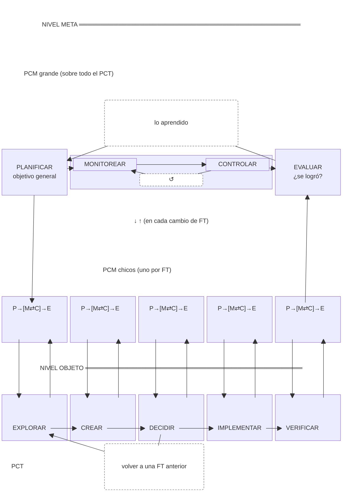

# Prueba Mermaid — PCM sobre PCT

▼ control (baja ajustes) · ▲ monitoreo (sube información)

- PCM = proceso cíclico metacognitivo
- PCT = proceso cíclico de trabajo
- FT = fase del proceso cíclico de trabajo
- P = planificar · M = monitorear · C = controlar · E = evaluar
