# Spec-Driven Development asistido por IA, nivel spec-as-source

## Proceso, tipos de especificación, tests, definición de "terminado" y resolución de desalineaciones, para proyectos nuevos y ya empezados

**Fecha:** 21 de octubre de 2026
**Audiencia:** equipo técnico pequeño que construye proyectos completos (backend + frontend) en un sector no regulado.
**Enfoque:** teoría y buenas prácticas, agnóstico de herramientas. Cuando aparecen herramientas (GitHub Spec Kit, AWS Kiro, Tessl, OpenSpec, Claude Code), lo hacen solo como evidencia de cómo se ha resuelto un problema, nunca como recomendación.

> **Cómo leer este informe.** Las afirmaciones llevan un enlace a su fuente. Cuando algo es síntesis o propuesta de este informe, y no de una fuente, se marca como **(propuesta)**. Cuando una fuente es un preprint de un solo autor, un fabricante o una fuente secundaria, se indica. Las cifras se dan con su contexto (año, modelo, tamaño de muestra), porque muchas son de 2023-2026 y envejecen rápido.
>
> **Método.** Ocho ángulos de investigación (proceso, especificaciones, generación, tests, "terminado", desalineación, proyectos ya empezados, precedentes y críticas), cada uno con una verificación adversarial de sus fuentes. Los hallazgos refutados se eliminaron. Los débiles se usan con cautela y se señalan como tales. La granularidad de specs y código (3.12 y 4.7) se investigó después, con seis ángulos más y el mismo método. Las specs derivadas (3.13) se investigaron después, con doce ángulos y el mismo método.

---

## Índice

0. Resumen ejecutivo: las 18 reglas
1. Marco: qué es SDD y qué implica elegir spec-as-source
2. El proceso: fases, gates, roles, bucles y ritmo
3. Creación de especificaciones: tipos, formatos, detalle, ambigüedad, *ready*, organización, granularidad de la spec (3.12), specs derivadas (3.13)
4. Implementación y generación: contexto, bucle del agente, no-determinismo, regeneración, granularidad del código y correspondencia spec↔código (4.7)
5. Tests: todas las metodologías con trade-offs, oráculo, autoría y anti-trampas
6. "Terminado": el trío como evidencia, DoD por tipo de spec, trazabilidad
7. Desalineación: taxonomía de casos, árbol de decisión, detección y reconciliación
8. Proyectos nuevos (greenfield) frente a proyectos ya empezados (brownfield)
9. Precedentes, críticas, límites, antipatrones y cuándo no aplicar
10. Checklists consolidadas por gate
11. Plan de adopción recomendado para el equipo
12. Fuentes
13. Anexos: plantillas, checks de CI y glosario de siglas

---

## 0. Resumen ejecutivo: las 18 reglas

SDD (Spec-Driven Development, desarrollo guiado por especificaciones) asistido por IA (inteligencia artificial) es una forma de trabajar en la que agentes basados en LLM (Large Language Model, modelo de lenguaje grande) generan el código a partir de especificaciones escritas y versionadas. El nivel que eligió el equipo, **spec-as-source** (la especificación como código fuente), es el más exigente: los humanos solo editan especificaciones, y el código y los tests se derivan de ellas.

Dos cosas hay que saber desde el principio:

1. **Spec-as-source es hoy el nivel menos probado.** Birgitta Böckeler (Thoughtworks) analizó Kiro, Spec Kit y Tessl y concluyó que todas las herramientas son spec-first, y que solo Tessl *explora* spec-as-source ([Böckeler, 2025](https://martinfowler.com/articles/exploring-gen-ai/sdd-3-tools.html)). El Technology Radar de Thoughtworks dejó SDD en "Assess" ([Radar, nov. 2025](https://www.thoughtworks.com/radar/techniques/spec-driven-development)). El único estudio empírico grande no encontró que los artefactos de especificación reduzcan defectos, aunque tampoco evaluó herramientas SDD ([Hill, ESEM 2026](https://drops.dagstuhl.de/entities/document/10.4230/LIPIcs.ESEM.2026.84)).
2. **Es viable como disciplina de gobernanza, no como compilación determinista.** Puede funcionar hoy si "la spec manda y se cambia primero" se convierte en una regla de flujo de cambios con verificación ejecutable. Lo que no es realista todavía es esperar que la misma spec produzca siempre el mismo código.

Las 18 reglas que resumen el informe:

1. **Nada se implementa sin una cláusula de spec con ID estable que lo pida.** Código o test sin cláusula = deriva.
2. **Todo cambio de comportamiento entra como delta de spec** (ADDED / MODIFIED / REMOVED) aprobado por un humano, *antes* de tocar tests o código.
3. **Primacía normativa, no infalibilidad.** La spec es lo único que manda, pero puede estar mal. Una discrepancia entre spec, código y tests es información ([Garner, JUXT](https://www.juxt.pro/blog/on-co-specs-and-tri-checks/)). Se resuelve enmendando la spec, nunca parcheando en silencio el código o los tests.
4. **El código es evidencia, no contrato.** "Accepting code does not automatically make it the intended contract" ([Spec Kit, Evolving specs](https://github.github.io/spec-kit/guides/evolving-specs.html)). El código puede ganar una discusión, pero solo después de quedar escrito en la spec.
5. **La invariante de spec-as-source es la equivalencia de comportamiento, no la identidad de código.** Una regeneración es válida si (a) pasa la misma suite de evidencia bloqueada **y** (b) la comparación diferencial con la versión anterior (mismas entradas a las dos versiones, sección 5.2.13) no muestra cambios observables fuera de los declarados en el delta. Cualquier diferencia no declarada se trata como deriva por regeneración (caso i, sección 7.2).
6. **El oráculo es normativo; el código del test es derivado.** Los ejemplos, propiedades y resultados esperados escritos en la cláusula forman parte de la spec: los escribe o aprueba un humano y cambiarlos exige delta. El código del test (y los *step definitions*) es un derivado protegido: se ve fallar antes de implementar y el agente que implementa no puede modificarlo.
7. **Quien implementa no se califica a sí mismo.** Revisa un verificador independiente (otro agente en contexto limpio, o un humano) y el agente entrega evidencia, no afirmaciones.
8. **Cada cláusula declara cómo se verifica.** "Terminado" significa que el 100 % de las cláusulas obligatorias (MUST, en el sentido de la RFC 2119 (*Request for Comments* 2119), que distingue MUST, obligatorio, de SHOULD, recomendado) tiene evidencia vigente y trazada.
9. **Se mide la cobertura de spec y el *mutation score*, no la cobertura de líneas.** La cobertura de código solo sirve para encontrar huecos ([Fowler, TestCoverage](https://martinfowler.com/bliki/TestCoverage.html)).
10. **Lo que debe cumplirse siempre va en checks deterministas** (CI (Continuous Integration, integración continua), hooks, linters), no en instrucciones en markdown.
11. **Se regenera en cascada, de forma selectiva y acotada a los archivos afectados.** El código generado se fija en git y se revisa como diff. Nunca se regenera todo sin un cambio de spec que lo motive. Un cambio en una interfaz compartida se clasifica con una herramienta antes de regenerar, y si es incompatible se reparte en varios deltas (4.7.8).
12. **El agente no adivina.** Ante una ambigüedad marca `[NEEDS CLARIFICATION]` y se detiene.
13. **Proporcionalidad: tres carriles** (trivial, estándar y completo). Un bug de una línea no se convierte en 16 criterios de aceptación.
14. **Contexto mínimo y podado.** Cada tarea carga solo las cláusulas que toca. La constitución del proyecto es corta.
15. **En proyectos ya empezados, nunca *big bang*.** Se especifica al tocar cada zona, se congela el comportamiento con *characterization tests* (tests de caracterización), se separa lo "observado" de lo "decidido" y se sube de nivel módulo a módulo.
16. **"Primero la spec" tiene una lista cerrada de cuatro excepciones, cada una acotada** (sección 7.1): (1) el **hotfix**, con test de reproducción, deuda de spec con plazo y regeneración de verificación; (2) el **refactor estructural**, con la suite en verde antes y después y sin cambio de comportamiento observable; (3) el **spike desechable**, fuera de los targets y sin llegar nunca a producción; (4) las **zonas brownfield sin spec normativa**, bajo "spec on touch": en ellas no se cambia ningún comportamiento sin crear antes su spec. Fuera de esta lista no hay excepciones.
17. **Dos granularidades, una regla.** La verdad vive en una spec consolidada por capacidad; la cláusula con ID es la unidad de identidad; el **archivo entero** es la unidad de regeneración. Una spec puede ser dueña de muchos archivos, pero **cada archivo tiene como mucho una spec dueña**. Clases y funciones se trazan a cláusulas, pero nunca se poseen ni se regeneran por separado, salvo la excepción brownfield temporal de 4.7.4 (región insertada por script, con el ID de la cláusula y hash verificado en CI). Las specs transversales (seguridad, logging, rendimiento) no son dueñas de nada: se relacionan con el código por **ámbito** (`applies_to`), que es N:M y no da derecho a modificar; las modifica siempre la spec dueña de cada archivo (3.12 y 4.7.11).
18. **Una spec derivada nunca es una segunda fuente.** La gramática, la semántica formal o el OpenAPI que salen de la prosa nacen DERIVADOS: obligan a la implementación, pero ante la prosa ceden, y toda decisión que tomen sin cláusula padre (precedencia, orden de evaluación, casos borde) se eleva a la spec fuente antes de aprobarse. Un aspecto solo pasa a tener un artefacto formal como dueño por delegación explícita, aprobada regla por regla y registrada en la tabla de autoridad, y nunca tiene dos dueños (3.13).

---

## 1. Marco: qué es SDD y qué implica elegir spec-as-source

### 1.1 Qué es SDD asistido por IA

En SDD, una especificación escrita, versionada y revisada por humanos guía a un agente LLM que planifica, genera código y lo verifica contra esa especificación. Las fuentes primarias coinciden en un pipeline por fases, con un artefacto por fase y una revisión humana entre fases. Las herramientas solo le cambian el nombre a cada paso:

| Fuente | Pipeline |
|---|---|
| GitHub Spec Kit | constitution → specify → (clarify) → plan → tasks → (analyze) → implement → converge ([README](https://github.com/github/spec-kit)) |
| AWS Kiro | requirements.md (criterios EARS) → design.md → tasks.md ([Kiro, feature specs](https://kiro.dev/docs/specs/feature-specs/)) |
| OpenSpec | explore → propose → apply → archive ([OpenSpec](https://github.com/Fission-AI/OpenSpec)) |
| Piskala (informe técnico, 2026) | Specify → Plan → Implement → Validate ([arXiv 2602.00180](https://arxiv.org/html/2602.00180v1)) |

EARS significa *Easy Approach to Requirements Syntax* (sintaxis sencilla para requisitos); se explica en la sección 3.

La base conceptual la formula Sean Grove (OpenAI) en "The New Code": el código es "a lossy projection from the specification" (una proyección con pérdida de la especificación), y descartar el prompt para quedarse con el código es como "shred the source, and then you very carefully version control the binary" (triturar el fuente y versionar con cuidado el binario) ([Grove, AI Engineer 2025](https://www.ai.engineer/talks/8rABwKRsec4-specifications-are-the-new-code)). El manifiesto de Spec Kit lo dice todavía más fuerte: "Specifications don't serve code—code serves specifications" ([spec-driven.md](https://github.com/github/spec-kit/blob/main/spec-driven.md)).

### 1.2 Los tres niveles: spec-first, spec-anchored y spec-as-source

La taxonomía de Böckeler ([2025](https://martinfowler.com/articles/exploring-gen-ai/sdd-3-tools.html)), que adopta también Piskala, es la referencia común:

| Nivel | Qué ocurre con la spec | ¿Quién toca el código? | Evidencia práctica |
|---|---|---|---|
| **Spec-first** | Se escribe antes de la tarea, la guía y luego puede descartarse | Humanos e IA | Es la base de todas las herramientas. Spec Kit crea una rama por spec: la spec vive lo que un *change request*, no lo que la feature |
| **Spec-anchored** | Se conserva después de la tarea y sirve para mantener y evolucionar la feature | Humanos e IA, guiados por la spec | Tessl aspira a este nivel. Piskala lo recomienda para sistemas longevos con varios mantenedores |
| **Spec-as-source** | Es el archivo fuente principal a lo largo del tiempo. "only the spec is edited by the human, the human never touches the code" | Solo la generación | Solo Tessl lo exploraba, con mapeo 1:1 spec-archivo, cabecera `// GENERATED FROM SPEC - DO NOT EDIT` y no-determinismo visible al regenerar. Su framework está en beta cerrada desde septiembre de 2025, sin disponibilidad general a mediados de 2026; en enero de 2026 Tessl se reposicionó como plataforma de *skills* sin aclarar el futuro del framework ([CodeMySpec, fuente secundaria](https://codemyspec.com/blog/tessl-review)) |

Guy Podjarny (Tessl) propone otra escala de tres pasos: *spec-assisted* (la spec es solo contexto), *spec-driven* (primero se cambia la spec y luego el código) y *spec-centric* ("code becomes disposable", el código pasa a ser desechable). Su propio panel reconoce que la industria todavía no ha llegado a spec-centric y que la "regeneración estable" es un problema abierto ([Tessl, Taming agents with specifications](https://tessl.io/blog/taming-agents-with-specifications-what-the-experts-say/)).

### 1.3 Qué implica elegir spec-as-source

Elegir este nivel tiene consecuencias de diseño que no son opcionales:

1. **Todo lo que importa del sistema tiene que estar en alguna spec durable.** Lo que solo existe en el código, en un chat o en la cabeza de alguien se pierde en la siguiente regeneración. Hace falta una taxonomía completa de tipos de spec (sección 3), no solo specs de feature.
2. **Todo bucle de retroalimentación se cierra en la spec.** "Debugging means fixing specifications and their implementation plans that generate incorrect code", y los incidentes de producción "update specifications for the next regeneration" ([spec-driven.md](https://github.com/github/spec-kit/blob/main/spec-driven.md)). Drew Breunig lo describe como un triángulo spec–tests–código en el que la implementación devuelve decisiones a la spec ([Breunig, 2026](https://www.dbreunig.com/2026/03/04/the-spec-driven-development-triangle.html)).
3. **Hace falta una verificación determinista**, porque la generación no es reproducible. Fowler habla de una "non-deterministic abstraction" y cita a Böckeler: no solo subimos de nivel de abstracción, "we're moving sideways into non-determinism" ([Fowler, 2025](https://martinfowler.com/articles/2025-nature-abstraction.html)).
4. **Hay que prohibir y detectar la edición manual del código generado.** Si existen módulos escritos a mano, se declaran como tales en la spec, con su interfaz y sus tests. Es la lección de MDA (*Model-Driven Architecture*, arquitectura dirigida por modelos) y, en general, de MDE (*Model-Driven Engineering*, ingeniería dirigida por modelos), que se tratan en la sección 9: el *round-trip engineering* (sincronizar modelo y código en ambos sentidos) nunca funcionó bien.
5. **La regeneración tiene que ser selectiva**, acotada a lo que cambió, con la suite de regresión protegiendo lo demás.
6. **El coste se desplaza a la revisión.** Böckeler: "I'd rather review code than all these markdown files" ([Böckeler, 2025](https://martinfowler.com/articles/exploring-gen-ai/sdd-3-tools.html)). Un equipo pequeño debe revisar deltas, no specs completas. (Esta cita es la referencia para las secciones 3.10 y 9.4.)

### 1.4 Postura de este informe

**(propuesta)** Separamos dos cosas:

- **Spec-as-source como gobernanza** (viable hoy): la spec es lo único normativo y lo único que se edita para cambiar comportamiento. Ningún comportamiento entra sin pasar antes por la spec. El código y los tests son derivados, y se verifican contra la spec en cada cambio.
- **Spec-as-source como regeneración** (se habilita por módulo): un módulo se regenera desde la spec solo cuando cumple criterios objetivos (sección 8.5). Los demás módulos se modifican con la ayuda del agente, *siempre después* del delta de spec. Eso respeta "primero la spec" aunque no se regenere el archivo entero.

Así se cumple la regla del equipo ("nada sin spec; todo cambio entra primero en la spec") sin depender de una capacidad que hoy no es fiable: la regeneración completa determinista.

> **Dónde este informe matiza la decisión del equipo.**
>
> - **Decisión del equipo:** spec-as-source, con el código (re)generado desde la spec.
> - **Recomendación del informe:** mantener sin cambios la parte de *gobernanza* (la spec es la única fuente normativa y todo cambio entra primero en ella), pero empezar con la mayoría de los módulos en "spec primero con edición guiada" (lo que Böckeler llama *spec-anchored*) y habilitar la *regeneración* módulo a módulo, cuando cumpla los criterios de 8.5.
> - **Motivo:** la generación no es determinista (4.5), las herramientas que exploran spec-as-source siguen en beta (1.2), el único estudio grande no encontró reducción de defectos (9.7) y la historia de MDE muestra que la generación de sistemas completos fracasa donde funciona la generación parcial con contratos estables (9.1).
> - **Expectativa orientativa (propuesta, a validar con las métricas del piloto):**
>   - *Regenerables pronto (primeros 1-3 meses):* código generado de forma determinista desde contratos (tipos, clientes, validadores), adaptadores, handlers HTTP, DTO y CRUD.
>   - *Regenerables más tarde (cuando haya PBT (*property-based testing*, tests basados en propiedades), *mutation score* aceptable y comparación diferencial estable):* lógica de dominio.
>   - *Curados de forma indefinida:* UI fina o de marca, algoritmos delicados y rutas críticas de rendimiento o seguridad. Siguen "primero la spec", pero no se regeneran.
> - **Señales que justifican ampliar la regeneración:** varias regeneraciones de control seguidas sin diferencias no declaradas en la comparación diferencial; *mutation score* del módulo por encima del umbral; ninguna regresión atribuida a regeneraciones en el último trimestre; deltas originados en implementación en descenso; y un cambio de versión del modelo LLM absorbido sin deriva (4.5).

### 1.5 Principios rectores

| # | Principio | Qué significa en la práctica |
|---|---|---|
| P1 | **Nada sin spec** | Todo comportamiento observable tiene una cláusula con ID. Un test o un código sin cláusula se trata como deriva |
| P2 | **Primero la spec** | Es una regla de *orden de flujo*: spec → tests → código. No es una regla de verdad absoluta |
| P3 | **Primacía normativa, no infalibilidad** | La spec manda, pero puede ser ambigua, inviable o incorrecta. Si lo es, se enmienda con un gate humano |
| P4 | **El código es evidencia** | Lo que el código "descubre" se propone como delta; no se acepta por el mero hecho de existir |
| P5 | **Equivalencia de comportamiento** | Se regenera contra una suite bloqueada y una comparación diferencial con la versión anterior, no contra un diff de código idéntico |
| P6 | **Lo ejecutable gana a la prosa** | "The executable test is the only spec that cannot lie" ([Frisinger](https://dev.to/tmfrisinger/spec-driven-development-is-the-prose-spec-drift-trap-reborn-4p99)). Cada cláusula obligatoria lleva un ejemplo o propiedad ejecutable |
| P7 | **Lo determinista gana a lo consultivo** | Las instrucciones en el archivo de instrucciones del agente son consultivas; lo que debe cumplirse siempre va en checks deterministas (hooks del agente, CI). Ejemplo: la documentación de Claude Code dice que sus instrucciones de CLAUDE.md "are advisory", mientras que los hooks "are deterministic and guarantee the action happens" ([Anthropic](https://code.claude.com/docs/en/best-practices)) |
| P8 | **Separación de roles** | Quien escribe la spec, quien escribe los tests, quien implementa y quien revisa no son el mismo contexto de IA |
| P9 | **Proporcionalidad** | La ceremonia se ajusta al riesgo y al tamaño del cambio |

### 1.6 Vocabulario mínimo

- **Cláusula:** la unidad mínima normativa de una spec (un requisito, una invariante, un criterio). Tiene un **ID** estable (por ejemplo `PAY-012`).
- **Spec consolidada:** describe el comportamiento vigente de una capacidad. Es la única fuente de regeneración.
- **Delta o spec de cambio:** describe solo lo que un cambio añade, modifica o retira. Al cerrar el cambio se fusiona en la consolidada.
- **Target:** archivo o patrón de archivos del que una spec es dueña: esa spec es la única que puede modificarlo, por parche guiado, reescritura o regeneración según su categoría (4.6) y su habilitación (8.5).
- **Unidades de granularidad:** el informe usa siempre el mismo esquema de **cuatro unidades y tres relaciones** (3.12 y 4.7). Unidades: *verdad* (la spec consolidada de una capacidad), *trabajo* (el delta de un cambio), *identidad* (la cláusula con ID) y *regeneración* (el archivo entero).
- **Propiedad, trazabilidad y ámbito:** son las tres relaciones. La *propiedad* une un documento de spec dueño (capacidad, plataforma, contratos, *shared kernel*) con sus targets (una spec, muchos archivos; cada archivo, como mucho una spec dueña). La *trazabilidad* une una cláusula con los archivos, clases, funciones y tests que la implementan o verifican, en cualquier combinación. El *ámbito* une una spec transversal con los archivos a los que se aplica (`applies_to`), también en cualquier combinación. Ni la trazabilidad ni el ámbito dan derecho a modificar ni a regenerar nada (4.7.1 y 4.7.6).
- **Unidad de regeneración:** lo mínimo que se regenera de una vez. En este informe es el archivo entero, nunca una región, clase o función suelta, salvo la excepción brownfield temporal de 4.7.4 (región insertada por script, con el ID de la cláusula y hash verificado en CI) (4.7.2).
- **Suite de evidencia:** los tests y checks trazados a cláusulas, que demuestran el cumplimiento.
- **Oráculo normativo frente a código de test:** los ejemplos, propiedades y resultados esperados escritos en una cláusula son **spec** (normativos). El código que los ejecuta (tests, *step definitions*, *fixtures*) es **derivado**: se genera o escribe desde la spec, está protegido y no decide qué es correcto. Cambiar un resultado esperado exige delta; corregir el código de un test para que refleje fielmente el ejemplo, no (caso f, sección 7.2).
- **Spec fuente:** la spec escrita por humanos (prosa más casos de conformidad), con la autoría de 2.3. Es el nivel 1 de la cadena spec fuente → spec derivada → artefacto generado (3.13).
- **Spec derivada:** artefacto formal o semiformal producido a partir de cláusulas de la spec fuente, normalmente propuesto por IA (gramática Lark, semántica Lean 4, contrato AST, OpenAPI derivado, statechart). Es el nivel 2. Por aspecto tiene un estatus: DERIVADA (al nacer: cede ante la fuente y obliga a la implementación), DELEGADA (spec fuente en notación formal, tras una delegación aprobada regla por regla) o CO-NORMATIVA (no se usa) (3.13.2).
- **Decisión excedente:** lo que una spec derivada decide y la spec fuente no decidía (precedencia, asociatividad, orden de evaluación, overflow, caso borde, prioridad de Lark, resolución de un conflicto LALR). Equivale al *derived requirement* de DO-178C. Su único destino válido es **elevarla**: escribirla en la spec fuente como cláusula con caso de conformidad, o eliminarla (3.13.2).
- **Caso de conformidad:** ejemplo **normativo** de la spec fuente, con ID (`CONF-`), programa, veredicto (acepta, rechaza o error), árbol o valor esperado y cláusula de origen. Forma parte del oráculo normativo y se ejecuta contra los tres niveles. Se distingue del **ejemplo ilustrativo**, que es informativo y no entra en el oráculo (3.13).
- **Procedencia de una generación:** spec y cláusulas de origen, cambio que la motivó, modelo LLM, versión del agente o herramienta y hash de las instrucciones y plantillas usadas (4.5).
- **Gate:** punto de control. Es **computacional** si es determinista y bloqueante (tests, tipos, linters) e **inferencial** si es semántico y no determinista (revisión por IA, LLM como juez) ([Böckeler, Harness engineering](https://martinfowler.com/articles/harness-engineering.html)).
- **Harness:** el conjunto de guías (*feedforward*: specs, constitución, ejemplos) y sensores (*feedback*: tests, linters, revisión) que rodea al agente.
- **Oráculo:** el mecanismo que decide si una salida es correcta.
- **Deriva (drift):** divergencia entre spec, código y tests.
- **Carril:** el nivel de ceremonia que se aplica a un cambio (trivial, estándar o completo).

---

## 2. El proceso: fases, gates, roles, bucles y ritmo

### 2.1 Fases, artefactos y gates

**(propuesta, sobre la convergencia de Spec Kit, Kiro, OpenSpec, Piskala, Anthropic y Beck)** El proceso tiene diez fases y nueve gates. En spec-as-source hay una diferencia importante con las herramientas: los tests de aceptación se derivan y se aprueban *antes* del plan técnico, porque sus resultados esperados forman parte de la spec (1.6). Es lo que pide la constitución de Spec Kit (Artículo III): tests escritos, aprobados por el usuario y vistos fallar antes de cualquier código ([spec-driven.md](https://github.com/github/spec-kit/blob/main/spec-driven.md)).

| Fase | Artefacto que produce | Autor responsable | Qué aporta la IA | Gate de salida |
|---|---|---|---|---|
| F0 Intención | Brief: objetivo, resultado esperado, criterio de éxito, fuera de alcance | Humano (producto o tech lead) | Nada, o preguntas | **G0**: ¿vale la pena? ¿qué carril? |
| F1 Especificación | Delta de spec con IDs (comportamiento, NFR, contratos, datos, UI) | Humano | Borradores en formato controlado, si el humano los pide | (sigue en F2) |
| F2 Clarificación | Spec sin marcas abiertas y sección de supuestos revisada | Humano | Entrevista, análisis de ambigüedades, sinónimos y contradicciones | **G1**: Definition of Ready |
| F3 Tests de aceptación | Ejemplos, propiedades y contract tests trazados a IDs, en rojo | Humano escribe o aprueba | Un agente *distinto* del implementador deriva los borradores | **G2**: tests aprobados y fallando |
| F4 Plan técnico | Diseño, contratos formales, ADR | Tech lead | Propone variantes y comprueba la constitución | **G3**: plan conforme a la constitución |
| F5 Tareas | Lista de tareas pequeñas trazadas a IDs, cada una con su check | IA, revisa un humano | Descompone y analiza la consistencia spec/plan/tareas | (sigue en F6) |
| F6 Implementación | Código generado o modificado en los targets | Agente | Bucle generar → ejecutar → corregir | **G4**: check de la tarea en verde |
| F7 Verificación | Suite completa, revisión independiente, evidencia adjunta | Revisor humano y agente revisor | Revisión adversarial en contexto limpio | **G5**: DoD de feature |
| F8 Integración | Merge con código + tests + delta fusionado en la spec consolidada | Humano | Regenera la matriz de trazabilidad | **G6**: merge |
| F9 Operación | Métricas, incidentes, feedback | Equipo | Resume y propone deltas | **G7**: release; **G8**: auditoría periódica |

NFR = *Non-Functional Requirement* (requisito no funcional). ADR = *Architecture Decision Record* (registro de decisión de arquitectura). DoD = *Definition of Done* (definición de terminado).

### Diagrama 1. Proceso completo con fases, gates y bucles de retroalimentación

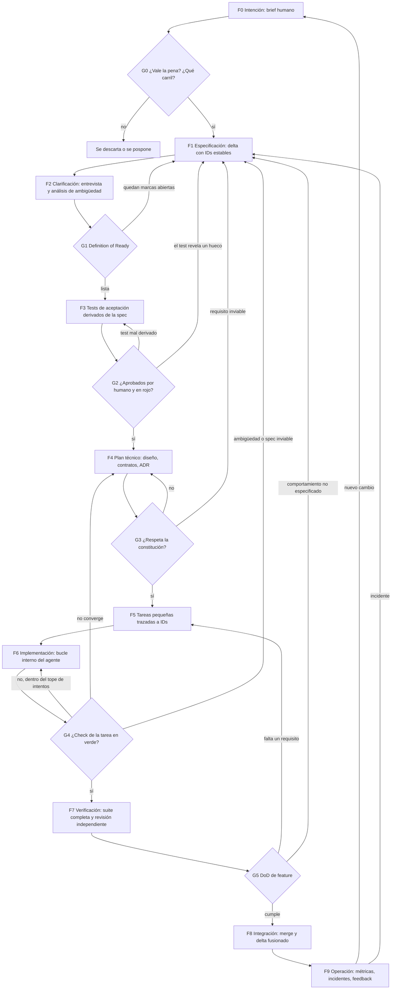

### 2.2 Dos bucles: externo humano e interno del agente

Marc Brooker (AWS) responde a la crítica de "waterfall" (cascada) con una distinción útil: SDD "isn't about pulling designs up-front, it's about pulling designs up" (no adelanta el diseño, lo sube de nivel), y "the specification is the thing being iterated on, rather than the implementation" ([Brooker, 2026](https://brooker.co.za/blog/2026/04/09/waterfall-vs-spec)). De ahí salen dos bucles:

- **Bucle externo (humano):** intención → spec → clarificación → aprobación del delta → tests de aceptación. Aquí se resuelven los trade-offs y los requisitos en conflicto. "Humans are still critical to this outer loop."
- **Bucle interno (agente):** plan → tareas → generación → ejecución de checks → corrección. Es rápido y autónomo mientras tenga un check ejecutable.

**Regla de oro:** ningún hallazgo del bucle interno que cambie comportamiento especificado se resuelve dentro de ese bucle. Se escala al externo como propuesta de delta. El agente puede corregir su propio código, pero no puede reinterpretar la spec ni tocar los tests de aceptación.

### 2.3 Roles: qué hace el humano y qué hace la IA

El equipo exige que **las specs las escriban humanos**. Las herramientas, en cambio, suelen hacer que la IA redacte la spec a partir de un brief: "the coding agent generates a detailed specification" ([GitHub Blog, Delimarsky](https://github.blog/ai-and-ml/generative-ai/spec-driven-development-with-ai-get-started-with-a-new-open-source-toolkit/)). El Radar de Thoughtworks pregunta para quién se escriben esos documentos generados ([Radar](https://www.thoughtworks.com/radar/techniques/spec-driven-development)), y si la IA redacta y el humano solo aprueba, se corre el riesgo de aprobar sin haber pensado.

**(propuesta) Regla de autoría:**

1. El humano es **autor y responsable** de toda cláusula normativa. Los criterios de aceptación, las invariantes, los NFR y los contratos públicos los redacta él, o al menos los reescribe con sus palabras.
2. La IA puede **entrevistar** ("have Claude interview you", [Anthropic](https://code.claude.com/docs/en/best-practices)), **proponer redacciones** en formatos controlados (EARS, Given/When/Then), **detectar** ambigüedades, sinónimos y contradicciones, y **comprobar la consistencia** entre artefactos.
3. Ningún texto generado por IA entra en la spec consolidada sin que un humano lo haya leído y aprobado *cláusula por cláusula*. La IA nunca marca como cumplidos los ítems de una checklist de *ready* ([Spec Kit, checklist](https://github.com/github/spec-kit/blob/main/templates/commands/checklist.md)).
4. **Specs derivadas (3.13).** Una gramática, una semántica formal o un contrato que la IA deriva de la prosa no añade cláusulas normativas: nace DERIVADA, cede ante la spec fuente y cada decisión excedente se eleva para que el humano la escriba como cláusula, con su caso de conformidad. La IA nunca edita la spec fuente para que encaje con la derivada. Un artefacto formal solo pasa a ser normativo en un aspecto (DELEGADA) mediante una cláusula de delegación escrita por el humano y una aprobación regla por regla, que puede hacerse por representación cuando el aprobador no lee la notación con soltura (3.13.2 y 3.13.4).

| Actividad | Humano | Agente IA |
|---|---|---|
| Decidir intención, prioridad y alcance | Decide | Pregunta |
| Redactar cláusulas normativas | Escribe y aprueba | Propone, si se le pide |
| Detectar ambigüedad y contradicciones | Resuelve | Detecta y marca |
| Escribir ejemplos de aceptación críticos | Escribe o aprueba | Un agente distinto deriva borradores |
| Plan técnico | Aprueba (tech lead) | Propone variantes |
| Tareas | Revisa | Descompone |
| Código | Revisa y debe poder explicarlo | Genera |
| Tests de bajo nivel | Revisa una muestra | Un agente distinto los genera desde la spec |
| Revisión contra la spec | Decide | Revisa en contexto limpio |
| Decisiones no especificadas del agente | Aprueba (se vuelve delta) o rechaza | Las registra en un log |
| Resolver una desalineación | Decide | Aporta evidencia (spike, contraejemplo) |

#### Roles con 2-4 personas

El proceso nombra muchos roles (autor de spec, aprobador, dueño de spec por capacidad, "Producto", tech lead, guardia, dueño del test, dueños de rutas protegidas, revisor humano). En un equipo de 2 a 4 personas varios caen en la misma persona. **(propuesta)** Qué se puede fusionar y qué no:

| Separación | ¿Se puede fusionar? | Motivo |
|---|---|---|
| Contextos de IA: agente de tests, agente implementador y agente revisor | **Nunca** | Es la separación que impide que la IA se valide a sí misma (5.5). No cuesta personas, solo sesiones distintas |
| Autor y aprobador del **oráculo** (ejemplos, propiedades, baselines de cláusulas MUST) | **No**, salvo con aprobación diferida (ver abajo) | Es la única separación humana crítica: un error en el oráculo se propaga a tests y código sin que nadie lo vea |
| Autor y aprobador de la prosa de la spec en el carril trivial | Sí | El riesgo está en el ejemplo y el test, no en la redacción |
| Dueño de spec, dueño del test y "Producto" de una capacidad | Sí | Una misma persona puede tener los tres, siempre que no sea también quien aprueba su propio oráculo |
| Tech lead y revisor humano del código | Sí | Basta con que no revise su propio PR (*Pull Request*) en el carril completo |
| Guardia y dueño de la spec en un hotfix | Sí | La ratificación posterior (7.4) la hace otra persona cuando sea posible |

Las separaciones propias de las specs derivadas (agentes derivador, verificador de fidelidad, retrotraductor e implementador; autor del corpus de conformidad frente a aprobador de la derivada; lectores de Lean para delegar) están en 3.13.4 (e).

**Si solo hay un humano disponible** (vacaciones, equipo de dos con uno ausente):

1. **Aprobación diferida con plazo.** El autor aprueba su propio delta y su oráculo para no bloquear el flujo, el PR lleva la etiqueta `pending-second-approval` y el segundo humano revisa de forma asíncrona en un plazo fijo (sugerencia: 2 días laborables). Si al revisar rechaza el oráculo, se abre un caso e o f (7.2).
2. **Límite de riesgo.** La aprobación diferida no vale para contratos públicos, migraciones de datos ni cláusulas de seguridad: esos esperan al segundo humano.
3. **Compensación con más evidencia automática:** revisor IA en contexto limpio obligatorio, *mutation score* del diff y comparación diferencial, aunque el carril sea estándar.
4. **Métrica:** el porcentaje de aprobaciones diferidas se revisa en la retro mensual (2.6). Si pasa de un umbral acordado (por ejemplo, el 20 % de los PR), el equipo no tiene capacidad para el carril elegido.

**Quién ejerce "Producto" sin *product owner*.** Se nombra por capacidad a la persona del equipo más cercana al cliente o al usuario (a menudo el tech lead o quien habla con el cliente). Decide alcance y prioridad (casos c, e y g) y deja la decisión escrita en el delta. Cuando la decisión afecta al negocio del cliente (precios, permisos, datos personales), la valida por escrito el cliente o su representante, y ese registro se enlaza desde el delta.

### 2.4 Tres carriles: proporcionalidad sin romper "nada sin spec"

La regla absoluta choca con dos consejos razonables. Anthropic: "If you could describe the diff in one sentence, skip the plan" ([best practices](https://code.claude.com/docs/en/best-practices)). Böckeler: un bug pequeño acabó convertido en "4 user stories with a total of 16 acceptance criteria", "like using a sledgehammer to crack a nut". La salida es mantener siempre la spec y graduar todo lo demás:

| Carril | Cuándo | Qué es obligatorio | Qué se omite |
|---|---|---|---|
| **Trivial** | El diff cabe en una frase. Sin cambio de contrato público ni de datos | Delta de 1-3 líneas en la cláusula afectada + test que lo demuestra + revisión del PR (Pull Request) | Plan, tareas, entrevista |
| **Estándar** | Feature acotada a uno o dos módulos, sin incertidumbre técnica | Delta completo, G1, tests en rojo, tareas, revisión independiente | Variantes de plan; ADR salvo trade-off |
| **Completo** | Varias capas (front + API + datos), incertidumbre, código desconocido, contrato público o riesgo alto | Todas las fases y gates, spike si hay dudas de viabilidad, ADR | Nada |

**(propuesta)** El carril se decide en G0 y se puede subir en cualquier momento (un trivial que resulta tocar un contrato pasa a estándar). Nunca se baja una vez iniciado el cambio.

### 2.5 Bucles entre fases: disparador → fase destino → acción

| Disparador | Fase destino | Acción |
|---|---|---|
| El agente o el plan encuentran una ambigüedad | F1/F2 Spec | El agente marca `[NEEDS CLARIFICATION]` y se detiene. El humano responde, se añade un ejemplo que resuelve la ambigüedad y se regeneran las tareas afectadas |
| La spec es inimplementable (límite técnico, coste, plataforma) | F1 Spec, pasando por F4 si es de diseño | Spike con plazo y evidencia → ADR → delta MODIFIED → regeneración en cascada |
| Falla un test y la spec es clara | F6 Implementación | El agente corrige el código sin tocar test ni spec. Tras N intentos (sugerencia: 3) se escala a F4 |
| Falla un test y el test parece mal | F3 Tests | Otro agente o un humano reescribe el test contra el texto de la cláusula. Si la cláusula admite dos lecturas, F2 |
| Tests y código coinciden pero contradicen la spec | F1 Spec | Decidir quién tiene razón. Si la spec es correcta, se regeneran tests y código. Si estaba mal, delta. Nunca se ajusta la spec en silencio |
| El agente toma una decisión no especificada | Gate de decisión antes del merge | Si se aprueba, se convierte en delta + test. Si se rechaza, se regenera sin ella ([Breunig](https://www.dbreunig.com/2026/03/04/the-spec-driven-development-triangle.html)) |
| Cambio de alcance pedido por negocio | F0/F1 | Delta nuevo y pipeline completo para lo afectado |
| Cambio solo técnico (librería, framework) | F4 Plan | Se regeneran diseño, tareas y código. La spec funcional no cambia y los tests de aceptación deben seguir en verde |
| Cambio de versión del modelo LLM, del agente o de las plantillas de instrucciones | F4 Plan | Cambio técnico: se regeneran los módulos regenerables con la versión nueva, se pasa la suite completa y la comparación diferencial con la versión anterior, y solo entonces se adopta (4.5) |
| Dos deltas abiertos tocan los mismos IDs o los mismos targets | F1 Spec (el segundo en llegar) | Se serializan, o un humano decide la fusión de las dos cláusulas. El delta se rebasa sobre la consolidada, se regenera y se vuelve a pasar la suite (3.8) |
| Una regeneración rompe tests de cláusulas no tocadas | F1/F4 | Se rechaza la regeneración y se precisa la spec o se fija la restricción en la constitución |
| Revisión adversarial: falta un requisito o hay algo fuera de alcance | F5/F6 | Se añade la tarea o se elimina lo no pedido |
| Mutante superviviente o contraejemplo de property-based testing | F3 o F1 | Se refuerza el test, o se especifica el comportamiento si el contraejemplo revela un hueco |
| Incidente de producción | F6 (hotfix) → F1 en plazo | Test de reproducción + fix, deuda de spec, enmienda y regeneración de verificación |
| Métrica o feedback de usuario | F0 | Nuevo brief o delta. Sin hotfix directo |
| Se toca una zona sin spec (proyecto ya empezado) | Adopción (sección 8) | Characterization tests → spec reconstruida → validación humana → delta |
| La constitución crece y el agente ignora reglas | Constitución | Poda. Lo obligatorio pasa a hooks o CI |

### Diagrama 2. El bucle de cambio "primero la spec"

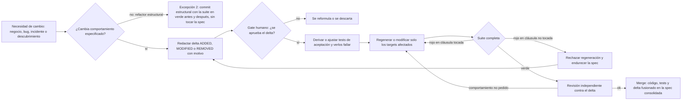

El refactor estructural (rama "no") sigue la regla de Kent Beck: "Never mix structural and behavioral changes in the same commit" ([Beck, Augmented Coding](https://newsletter.kentbeck.com/p/augmented-coding-beyond-the-vibes)). Un cambio estructural que mantiene la suite en verde no altera ninguna cláusula y no necesita delta: es la excepción 2 de la lista cerrada de la sección 7.1, y solo vale si la suite estaba en verde antes, sigue en verde después sin tocar ningún test y el commit se declara estructural. Si en un módulo regenerable el cambio estructural es "regenerar con otra estructura", se trata como cambio técnico de F4.

### 2.6 Ritmo para un equipo pequeño

**(propuesta)** Cadencia orientativa:

- **Deltas pequeños:** de 1 a 3 días de trabajo como máximo. Si no cabe, se parte en varios deltas que se puedan desplegar por separado.
- **Una tarea a la vez por agente** y una sesión nueva por tarea. Beck trabaja "one test at a time", y Anthropic recomienda reiniciar el contexto entre tareas no relacionadas (en Claude Code, con `/clear`).
- **Revisión del delta en PR el mismo día.** El revisor lee primero el delta y después el diff de código.
- **Auditoría de deriva semanal (G8):** un agente en contexto limpio compara spec, código y tests y lista los huecos. Un humano tría y solo convierte en tareas lo que afecta a corrección o a requisitos.
- **Poda mensual** de la constitución, el glosario y los archivos de instrucciones del agente, con la pregunta "¿quitar esta línea haría que el agente se equivocara?" (en el original de Anthropic: "Would removing this cause Claude to make mistakes?", [Anthropic](https://code.claude.com/docs/en/best-practices)).
- **Retro de proceso mensual** con métricas:
  - tasa de primera pasada en verde;
  - número de `[NEEDS CLARIFICATION]` por spec;
  - deltas originados en implementación (señal de specs inmaduras);
  - diffs de tests rechazados (señal de trampa del agente);
  - cobertura de spec y *mutation score*;
  - tiempo de revisión de spec frente al de revisión de código (señal de ceremonia excesiva).

---

## 3. Creación de especificaciones

### 3.1 No hay un "documento de spec": hay una familia de tipos

Ninguna fuente define un único documento de especificación. Lo que se encuentra en la práctica es una familia de artefactos, cada uno con su propio ciclo de vida. Böckeler separa las specs de cada feature del *memory bank* (contexto que vale para todo el proyecto). Kiro trabaja con requirements, design, tasks y *steering*. Spec Kit, con constitution, spec, plan, research, data-model, contracts y tasks. OpenSpec separa `specs/` (la verdad vigente por capacidad) de `changes/` (deltas). Tessl distingue *feature specs*, identidad del agente, *workflow specs* y *knowledge specs* ([Tessl, 10 things](https://tessl.io/blog/spec-driven-development-10-things-you-need-to-know-about-specs/)).

En spec-as-source la consecuencia es directa: **cada decisión que importa debe vivir en el tipo de spec que le corresponde**. Si una decisión de arquitectura solo está en el código, la regeneración la "optimizará" en contra. Si el formato de un número de cliente no está en el glosario ni en el modelo de datos, el agente supondrá uno distinto en cada generación. Böckeler y Laura Tacho ponen este ejemplo: "AI makes a different assumption about the format of the customer number" ([Thoughtworks Podcast](https://www.thoughtworks.com/insights/podcasts/technology-podcasts/what-is-spec-driven-development)).

### 3.2 Taxonomía de tipos de especificación

**(propuesta, síntesis de las fuentes citadas en cada fila)**

| Tipo | Qué decide | Formato recomendado | Evidencia que lo verifica | Ciclo de vida |
|---|---|---|---|---|
| **Constitución** | Principios no negociables del proyecto: stack, versiones, arquitectura, test-first, límites del agente | Markdown corto, 5-10 artículos con su porqué | Un verificador automático por artículo crítico (linter, regla de dependencias, hook) | Vive todo el proyecto. Las enmiendas se hacen con ADR |
| **Glosario (lenguaje ubicuo)** | Términos del dominio: entidades, estados, eventos, unidades, formatos | Tabla término → definición → sinónimos prohibidos → ejemplo | Revisión de sinónimos por IA. Nombres en código y contratos | Vive todo el proyecto |
| **Spec de capacidad (comportamiento)** | Qué hace el sistema, por capacidad o dominio | Historias priorizadas con escenarios Given/When/Then y requisitos EARS con ID | Tests de aceptación y E2E (*End-to-End*, de extremo a extremo) trazados | Consolidada y viva |
| **Reglas e invariantes** | Lo que debe ser cierto siempre ("el saldo nunca es negativo") y las reglas combinatorias | Tablas de decisión y propiedades "para todo..." | Property-based tests, aserciones de contrato en runtime | Consolidada y viva |
| **NFR (requisitos no funcionales)** | Rendimiento, disponibilidad, seguridad, accesibilidad, coste | Escenario de atributo de calidad con medida numérica, entorno y frecuencia | Benchmarks, *fitness functions* ([Radar](https://thoughtworks.com/radar/techniques/architectural-fitness-function)), escáneres + auditoría | Consolidada y viva |
| **Seguridad: autenticación y autorización** | Quién puede hacer qué, sobre qué recurso y en qué estado; cómo se autentica; qué se registra | Matriz rol × acción × condición como tabla de decisión (3.3.11), más cláusulas EARS para sesión, bloqueo y auditoría | Test parametrizado de la matriz completa (incluidas las celdas "denegado") en la frontera de la API, más tests de acceso horizontal (un usuario no ve recursos de otro) | Consolidada y viva |
| **Operación e infraestructura** | Entornos, configuración, secretos, despliegue, observabilidad (logs, métricas, alertas), copias y recuperación | Lista declarativa de entornos y variables con tipo y valor por defecto, infraestructura como código, catálogo de logs, métricas y alertas con umbral (3.3.10) | Validación de configuración en CI, *smoke tests* tras desplegar, test de que cada alerta salta con su condición, ensayo periódico de restauración | Consolidada, versionada con el código |
| **Contratos (API y eventos)** | Frontera entre backend y frontend, y con terceros | OpenAPI, JSON Schema o AsyncAPI como fuente, versionados con semver | Linter de contrato, diff semántico, fuzzing por schema, contract tests | Consolidada, versionada |
| **Modelo de datos** | Entidades, relaciones, restricciones, migraciones, retención | Esquema declarativo + invariantes + política de migración | Tests de migración, round-trip, restricciones de BD | Consolidada, versionada |
| **UI/UX** | Flujos, estados de pantalla, componentes, tokens, accesibilidad, textos | Flujos navegables, mockups o capturas de referencia, *design tokens*, contratos de componente, criterios de accesibilidad (WCAG) | E2E en navegador, regresión visual con baseline aprobada, checks de accesibilidad + revisión humana | Consolidada, con artefactos no textuales |
| **Arquitectura y diseño** | Módulos, dependencias permitidas, patrones, estrategia de errores | Diagramas C4 o similares + reglas de dependencia | Tests de arquitectura (reglas de imports), *fitness functions* | Consolidada |
| **ADR** | El porqué de una decisión y lo que se descartó | Formato de Nygard: contexto, decisión, estado, consecuencias | No se testea: se enlaza desde las cláusulas afectadas | Inmutable. Se marca como *superseded*, nunca se borra |
| **Integraciones externas** | Qué se espera de un proveedor y qué versión se usa | Spec de integración detrás de una capa anticorrupción | Contract tests contra el proveedor | Consolidada, revisada cuando el proveedor cambia |
| **Spec derivada** | La formalización de cláusulas de la spec fuente en un aspecto concreto (sintaxis concreta, semántica, forma del payload, transiciones). Toda decisión que la prosa no tomaba es una decisión excedente que se eleva a la fuente | Artefacto formal o semiformal con cabecera de categoría y estatus por aspecto, y traza `@fuente <ID>@<rev>` en cada elemento: gramática Lark, semántica Lean 4, contrato AST, OpenAPI derivado, statechart, tabla DMN extraída (3.13.3) | Puertas de fidelidad PF0–PF8 contra el corpus de conformidad (3.13.6), revisión por representación (3.13.4) y diferencial contra el nivel 3 | Nace DERIVADA. Se promueve a DELEGADA por aspecto y se registra en la tabla de autoridad. Una vez aprobada solo cambia por diff trazado a un cambio de la fuente; sus elementos quedan caducados cuando cambia la cláusula |
| **Spec de cambio (delta)** | Lo que un cambio añade, modifica o retira | ADDED / MODIFIED / REMOVED / RENAMED, con motivo | La de las cláusulas que toca | Se fusiona en la consolidada y se archiva |
| **Bugfix spec** | Comportamiento actual, esperado y el que no debe cambiar | Tres secciones ([Kiro](https://kiro.dev/docs/specs/)) | Test de reproducción + tests de lo preservado | Se fusiona como delta |
| **Tareas** | Orden de trabajo | Lista con checks | Check por tarea | **Efímera: no es fuente de verdad** |

WCAG = *Web Content Accessibility Guidelines* (pautas de accesibilidad para contenido web). JSON = *JavaScript Object Notation*. API = *Application Programming Interface*. BD = base de datos. C4 = modelo de diagramas de arquitectura en cuatro niveles (contexto, contenedores, componentes, código). DMN = *Decision Model and Notation*.

### 3.3 Cómo escribir cada tipo

#### 3.3.1 Constitución

Spec Kit propone una constitución con artículos como *Test-First* ("NON-NEGOTIABLE"), *Simplicity*, *Anti-Abstraction* e *Integration-First Testing* ("Prefer real databases over mocks"). Antes de implementar, el plan pasa por unas *phase gates* contra la constitución, y toda excepción se justifica en una sección *Complexity Tracking* ([spec-driven.md](https://github.com/github/spec-kit/blob/main/spec-driven.md)). Dos advertencias de las fuentes:

- **Mantenerla corta.** Un archivo de instrucciones inflado hace que el agente "ignore half of it" ([Anthropic](https://code.claude.com/docs/en/best-practices)). Thoughtworks observó *instruction bloat* y *context rot* (degradación del contexto) al ir añadiendo contexto sin control ([Radar, Spec Kit](https://www.thoughtworks.com/radar/languages-and-frameworks/github-spec-kit)).
- **Cada artículo crítico necesita un verificador automático.** El agente puede aplicar las reglas "way overboard" (en exceso) o ignorarlas ([Böckeler](https://martinfowler.com/articles/exploring-gen-ai/sdd-3-tools.html)). Una regla sin verificador es una aspiración.

Plantilla mínima de artículo:

```markdown
### C-04 Dependencias entre capas
**Regla:** el dominio no importa nada de infraestructura ni de UI.
**Por qué:** permite regenerar adaptadores sin tocar reglas de negocio.
**Verificador:** test de arquitectura `arch/no-domain-imports` en CI (bloqueante).
**Excepciones:** ninguna. Para cambiarla hace falta un ADR.
```

#### 3.3.2 Glosario

Martin Fowler resume la idea de Eric Evans así: "a common, rigorous language between developers and users". Y recuerda que "software doesn't cope well with ambiguity" ([Fowler, UbiquitousLanguage](https://martinfowler.com/bliki/UbiquitousLanguage.html)). En SDD con LLM, el glosario fija los nombres que usan EARS, los escenarios, el modelo de datos y el código generado. Hay que pedir a la IA que busque sinónimos ("cliente", "usuario" y "cuenta" para la misma cosa) y términos sin definir, porque es una revisión que hace bien.

```markdown
| Término | Definición | No usar | Ejemplo |
|---|---|---|---|
| Cliente | Persona o empresa con contrato activo | usuario, cuenta | CLI-000123 (prefijo CLI- + 6 dígitos) |
| Pedido | Solicitud confirmada de uno o más productos | orden, compra | Estados: borrador, confirmado, enviado, cancelado |
```

#### 3.3.3 Comportamiento: historias, escenarios y EARS

La plantilla de Spec Kit exige tres secciones ([spec-template.md](https://raw.githubusercontent.com/github/spec-kit/main/templates/spec-template.md)):

1. Escenarios de usuario priorizados (P1/P2/P3). Cada uno lleva "Why this priority", un *Independent Test* y escenarios Given/When/Then: "Each user story/journey must be INDEPENDENTLY TESTABLE".
2. Requisitos `FR-001`... en forma "System MUST".
3. Criterios de éxito `SC-001`... "technology-agnostic and measurable".

El formato Given/When/Then viene de Dan North: "Given some initial context, When an event occurs, Then ensure some outcomes", y "A story's behaviour is simply its acceptance criteria" ([North, Introducing BDD](https://dannorth.net/blog/introducing-bdd/)). BDD significa *Behaviour-Driven Development*, desarrollo guiado por comportamiento.

**EARS** (Mavin et al., Rolls-Royce, 2009) es una sintaxis controlada con cinco patrones ([Wikipedia](https://en.wikipedia.org/wiki/Easy_Approach_to_Requirements_Syntax)). Kiro la usa por defecto ([Kiro, requirements-first](https://kiro.dev/docs/specs/feature-specs/requirements-first/)):

| Patrón | Plantilla | Ejemplo |
|---|---|---|
| Ubicuo | THE SYSTEM SHALL ... | THE SYSTEM SHALL registrar cada cambio de estado de un Pedido con fecha y autor |
| Por evento | WHEN ... THE SYSTEM SHALL ... | WHEN un Cliente confirma un Pedido THE SYSTEM SHALL reservar el stock de cada línea |
| Por estado | WHILE ... THE SYSTEM SHALL ... | WHILE un Pedido está enviado THE SYSTEM SHALL impedir que se modifiquen sus líneas |
| Opcional | WHERE ... THE SYSTEM SHALL ... | WHERE el Cliente tiene facturación electrónica THE SYSTEM SHALL emitir la factura en formato estructurado |
| No deseado | IF ... THEN THE SYSTEM SHALL ... | IF el stock es insuficiente THEN THE SYSTEM SHALL rechazar la confirmación con el error `STOCK_INSUFFICIENT` y no reservar nada |

El patrón IF/THEN obliga a especificar los errores, que es justo lo que los LLM tienden a omitir. EARS da forma a la frase, pero no garantiza que la frase esté completa ni que los términos estén definidos. Para eso están el glosario y los ejemplos.

**Ejemplo de cláusula completa** (formato propuesto):

```markdown
### ORD-007 Confirmar pedido sin stock suficiente
**Tipo:** comportamiento · **Prioridad:** MUST · **Verificación:** test-aceptación + propiedad
IF el stock disponible de alguna línea es menor que su cantidad
THEN THE SYSTEM SHALL rechazar la confirmación con `409 STOCK_INSUFFICIENT`,
indicar las líneas afectadas y no reservar stock de ninguna línea.

Ejemplos:
| stock A | pide A | stock B | pide B | resultado | reservas |
|---|---|---|---|---|---|
| 5 | 5 | 2 | 1 | confirmado | A=5, B=1 |
| 5 | 6 | 2 | 1 | 409, líneas=[A] | ninguna |
| 0 | 1 | 0 | 1 | 409, líneas=[A,B] | ninguna |

Propiedad: para todo pedido rechazado, el stock total antes y después es idéntico.
Tests: [@test] tests/acceptance/orders/confirm_insufficient_stock.spec.ts
```

#### 3.3.4 Reglas de negocio: ejemplos y tablas de decisión

Gojko Adzic (*[Specification by Example](https://www.manning.com/books/specification-by-example)*) describe este proceso: ilustrar con ejemplos, refinar la especificación, "automating validation without changing specifications" y dejar que el sistema de documentación viva evolucione ([InfoQ](https://www.infoq.com/articles/specification-by-example-book/)). Los ejemplos clave son pocos y representativos, no exhaustivos. Anthropic recomienda lo mismo para los agentes: en lugar de "implement a function that validates email addresses", dar los casos concretos ([best practices](https://code.claude.com/docs/en/best-practices)). En reglas combinatorias (precios, permisos, transiciones de estado), una tabla de decisión en Markdown deja ver de un vistazo los huecos y las contradicciones.

#### 3.3.5 Invariantes y propiedades

Kiro reescribe los criterios de aceptación como propiedades que empiezan con "for any" y las convierte en tests basados en propiedades enlazados al requisito, "an executable specification" ([Kiro blog](https://kiro.dev/blog/property-based-testing/)). Lo importante para este equipo: un contraejemplo "could also be a bug in property definition, or in the original specification". Kiro pregunta entonces si se arregla el código, la spec o el test. Las invariantes de dominio conviene escribirlas como un tipo propio dentro de la spec, porque son las cláusulas que mejor sobreviven a cualquier regeneración.

#### 3.3.6 Requisitos no funcionales

El escenario de atributo de calidad de Bass, Clements y Kazman (SEI, *Software Engineering Institute* de la Universidad Carnegie Mellon) tiene seis partes: fuente, estímulo, artefacto, entorno, respuesta y medida de respuesta ([Bass et al.](https://people.ece.ubc.ca/matei/EECE417/BASS/ch04lev1sec5.html)). arc42 señala que esa plantilla resulta pesada en equipos ágiles y propone una alternativa de dos niveles: enunciado más criterios medibles con unidades, umbrales, carga y qué pasa si se supera el umbral ([arc42 quality](https://quality.arc42.org/articles/specify-quality-requirements)). Para un equipo pequeño y no regulado conviene la versión ligera:

```markdown
### NFR-003 Latencia del catálogo
Con 500 usuarios concurrentes en operación normal, GET /catalog responde con
p95 < 300 ms y tasa de error < 0,5 %, medido en staging con el perfil de carga `catalog-normal`.
Si se supera durante 2 ejecuciones nocturnas seguidas: alerta y delta de revisión.
**Verificación:** benchmark nocturno (fitness function). Bloquea la release, no el merge.
```

p95 = percentil 95 de la latencia. Está prohibido usar adjetivos sin métrica ("rápido", "seguro", "intuitivo"): un NFR sin medida no se puede verificar y deja incompleto el "terminado" del trío.

#### 3.3.7 Contratos y modelo de datos

En un proyecto backend + frontend, el contrato (por ejemplo OpenAPI) es la frontera entre las dos mitades. **(propuesta)** Debe ser una spec humana de primera clase:

- se escribe antes del código (*contract-first*);
- se valida con un linter;
- se versiona con semver (versionado semántico);
- desde él se generan **de forma determinista** los tipos y el cliente del frontend, los stubs del backend y los contract tests;
- **nunca se regenera desde el código** (*code-first*), porque entonces deja de ser spec.

**Estatus del contrato en términos de 3.13 (propuesta).** Un contrato escrito por un humano es spec fuente (nivel 1) en notación formal para el aspecto "forma del payload y códigos de error". Si lo redacta la IA a partir de historias y escenarios, es una **spec derivada**: nace DERIVADA, cada restricción que la prosa no fija (un `maxLength`, un `nullable`, un código de error) es una decisión excedente que se eleva, y solo adquiere el estatus de esta sección cuando un humano lo aprueba operación por operación y una cláusula de delegación lo registra en `spec/authority.md` (DELEGADA, 3.13.2). En los dos casos hay un solo dueño normativo del aspecto: la prosa de las capacidades no repite la forma del payload, la referencia (3.12.3).

En contratos y datos, el "cómo" (forma del payload, códigos de error, restricciones) sí forma parte de la spec. Spec Kit genera `data-model.md` y `contracts/` como artefactos explícitos y exige contract tests antes de implementar ([spec-driven.md](https://github.com/github/spec-kit/blob/main/spec-driven.md)). Del modelo de datos se especifican las entidades, relaciones, invariantes, la política de migración (expand → migrate → contract, ver sección 7) y la retención.

**(propuesta) Las migraciones no son código regenerable.** El modelo de datos de la spec describe el estado *deseado* del esquema; una migración describe el *paso* de un estado a otro y depende de la historia real de la base de datos. Por eso:

- se genera **una sola vez por delta**, a partir del diff entre el modelo anterior y el nuevo (con un generador determinista o con el agente), y la revisa un humano;
- se commitea y queda **inmutable desde que se aplica** en cualquier entorno compartido. Para corregirla se escribe una migración nueva;
- la regeneración de un módulo **nunca reescribe ni borra migraciones aplicadas**, y un check de CI lo vigila (Anexo F, `migrations-immutable`);
- los cambios incompatibles siguen expand → migrate → contract, en migraciones separadas que se despliegan por separado;
- la migración hacia adelante se prueba sobre una copia de datos reales (anonimizada) antes de la release (DoD de datos, 6.3).

#### 3.3.8 UI/UX

Es el tipo más difícil de especificar en texto, porque parte de la intención visual y de interacción es tácita. **(propuesta, sobre Anthropic y prácticas de *design systems*)** Se especifica con artefactos no textuales versionados:

- *design tokens* con nombre (colores, espaciados, tipografía);
- contratos de componente (props, estados, variantes, accesibilidad);
- mockups o capturas de referencia por pantalla y estado (vacío, cargando, error, éxito);
- flujos de navegación;
- criterios de accesibilidad (contraste, orden de foco, etiquetas);
- textos (UX writing), con su rúbrica.

Anthropic recomienda pasar la captura del diseño y pedir: "take a screenshot of the result and compare it to the original. list differences and fix them" ([best practices](https://code.claude.com/docs/en/best-practices)). La evidencia es visual y en navegador (sección 5).

#### 3.3.9 Arquitectura y ADR

El formato de Michael Nygard: título con número, contexto (las fuerzas en tensión), decisión ("We will..."), estado (*proposed*, *accepted*, *deprecated*, *superseded*) y consecuencias. "Numbers will not be reused", y un ADR revertido se conserva marcado como *superseded* ([Nygard, 2011](https://cognitect.com/blog/2011/11/15/documenting-architecture-decisions)). En spec-as-source los ADR tienen dos funciones. Le dan al agente el porqué de una restricción que, sin él, "optimizaría" en contra. Y dejan rastro cuando una cláusula cede ante una restricción técnica (caso "spec no implementable", sección 7). Sin el porqué, quien llega después solo puede "blindly accept or blindly reverse a decision".

#### 3.3.10 Operación e infraestructura

**(propuesta)** En un proyecto completo, lo que más se pierde al regenerar es lo que no está en ninguna spec de comportamiento: variables de entorno, secretos, puertos, *health checks*, logs y alertas. Si no se especifican, el agente los inventa o los omite en cada generación. Se especifican de forma declarativa:

- **Entornos** (local, staging, producción) y qué difiere entre ellos.
- **Configuración:** cada variable con nombre, tipo, valor por defecto, si es obligatoria y si es secreta. Los secretos nunca tienen valor en la spec, solo el nombre y el origen.
- **Despliegue:** infraestructura como código como fuente, y orden de despliegue cuando hay migraciones (3.3.7).
- **Observabilidad:** catálogo de eventos de log con su nivel y sus campos (sin datos personales), métricas con su nombre y unidad, y alertas con condición, umbral y destinatario.
- **Recuperación:** frecuencia de copias y objetivo de restauración.

```markdown
### OPS-004 Alerta por errores de servidor en la API
WHEN la tasa de respuestas 5xx (errores del servidor, códigos HTTP 500-599) de /api supera el 2 %
durante 5 minutos THE SYSTEM SHALL enviar una alerta al canal de guardia con el endpoint y la tasa.
**Verificación:** test de la regla de alerta con datos sintéticos (CI) + *smoke test* tras desplegar
que comprueba que la métrica existe y se publica.
```

La verificación es en parte de CI (la configuración se valida contra su esquema; la aplicación falla al arrancar si falta una variable obligatoria) y en parte posterior al despliegue (*smoke tests*, monitorización sintética, 5.2.15).

#### 3.3.11 Seguridad: autorización como tabla de decisión

La autorización es de lo que más tiende a omitir o inventar un LLM: un endpoint nuevo sin comprobación de permisos, o una comprobación por rol que olvida la propiedad del recurso. **(propuesta)** Se especifica como tabla de decisión rol × acción × condición, donde cada celda es un resultado esperado (oráculo normativo) y las celdas "denegado" importan tanto como las "permitido":

```markdown
### SEC-010 Permisos sobre pedidos
**Tipo:** seguridad · **Prioridad:** MUST · **Verificación:** test parametrizado de la matriz completa

| Rol \ Acción          | Ver pedido     | Crear | Cancelar línea           | Ver pedidos de otros |
|---|---|---|---|---|
| Cliente               | solo los suyos | sí    | solo los suyos, si `confirmado` | 403 |
| Atención al cliente   | sí             | no (403) | sí, con motivo obligatorio | sí |
| Administrador         | sí             | no (403) | sí                       | sí |
| Anónimo               | 401            | 401   | 401                      | 401 |

Regla por defecto: toda acción no listada → 403 (denegar por defecto).
Tests: [@test] tests/acceptance/security/orders_authz.spec.ts
```

El test recorre **todas** las celdas en la frontera de la API (no en la UI, que puede ocultar un botón sin impedir la llamada) e incluye el caso de acceso horizontal: un Cliente que pide el pedido de otro Cliente recibe 403 o 404, según decida la spec. Un endpoint nuevo que no aparezca en ninguna matriz hace fallar el gate (regla "denegar por defecto"). La autenticación (sesiones, expiración, bloqueo tras intentos fallidos) se escribe en EARS con números concretos.

### 3.4 Qué frente a cómo

La doctrina dice que la spec funcional describe el qué y el porqué, no el cómo. Cucumber da una prueba práctica: "Will this wording need to change if the implementation does?". Si la respuesta es sí, la línea contiene detalle de implementación ([Cucumber, Better Gherkin](https://cucumber.io/docs/bdd/better-gherkin/)). Böckeler reconoce que la frontera es difícil: "I don't think we have a good track record as a profession to do this well".

**(propuesta)** En spec-as-source el cómo no desaparece: **se traslada al tipo de spec que le corresponde**. El cómo que importa (forma de un contrato, estrategia de errores, dependencias permitidas, presupuesto de rendimiento) va a contratos, arquitectura, NFR o ADR. El que no importa queda libre para el generador, pero protegido por tests. La regla correcta no es "no especificar el cómo". Es esta otra: **cada decisión va en un solo tipo de spec, y lo que no está en ninguna es libertad del generador**.

### 3.5 Cuánto detalle necesita un LLM

| Riesgo de poco detalle | Riesgo de demasiado detalle |
|---|---|
| El agente improvisa y "rellena" huecos con suposiciones que cambian en cada generación (el campo `priority` pasó en silencio de "1,2,3" a "low, medium, high" en el experimento de [Böckeler](https://martinfowler.com/articles/pushing-ai-autonomy.html)) | *Curse of instructions*: añadir directivas reduce la adherencia a cada una ([Osmani](https://addyosmani.com/blog/good-spec/)) |
| Funcionalidad inventada ("Pro-rated revenue, I know what that is!") | Revisión imposible: 8 archivos y 1.300 líneas para mostrar una fecha ([Zaninotto](https://marmelab.com/blog/2025/11/12/spec-driven-development-waterfall-strikes-back.html)) |
| Regeneración poco repetible | La spec se convierte en pseudo-código: "a sufficiently detailed spec is code" ([Gonzalez](https://www.haskellforall.com/2026/03/a-sufficiently-detailed-spec-is-code.html)) |

El marco teórico más útil, que atribuye a Hillel Wayne una fuente secundaria ([softwareseni](https://www.softwareseni.com/a-sufficiently-detailed-spec-is-code-the-community-principle-behind-spec-driven-development)), dice que **una spec es un conjunto de implementaciones admisibles y el código es un miembro de ese conjunto**. De ahí sale la regla práctica:

1. Especificar con precisión lo que **no admite variación**: contratos, invariantes, errores, formatos, NFR.
2. Dejar sin especificar lo que **cualquier miembro del conjunto resuelve bien**: nombres internos, estructura de clases.
3. **Calibrar con la repetibilidad.** Si dos regeneraciones pasan los mismos tests pero difieren en un comportamiento que a alguien le importa, la spec está subespecificada en ese punto. Böckeler tuvo que hacer las specs de Tessl "more and more specific to increase the repeatability".
4. Usar "the minimum level of specification rigor that removes ambiguity for your context" ([Piskala](https://arxiv.org/html/2602.00180v1)).

Anthropic resume qué necesita una spec útil: "The most useful specs are self-contained: they name the files and interfaces involved, state what is out of scope, and end with an end-to-end verification step" ([best practices](https://code.claude.com/docs/en/best-practices)).

### 3.6 Ambigüedad y clarificación

La ambigüedad se trata como un **defecto explícito**:

1. **Marcadores en el texto.** `[NEEDS CLARIFICATION: ¿método de autenticación: email/contraseña, SSO, OAuth?]`, con la regla "Don't guess: If the prompt doesn't specify something, mark it" ([spec-template](https://raw.githubusercontent.com/github/spec-kit/main/templates/spec-template.md)). SSO = *Single Sign-On* (inicio de sesión único). OAuth = *Open Authorization*, estándar de autorización delegada.
2. **Sección *Assumptions* visible.** Los supuestos razonables se escriben y el humano los acepta o los convierte en requisitos.
3. **Entrevista de la IA antes de escribir specs grandes.** El agente pregunta al humano antes de redactar, centrándose en lo difícil, y la spec resultante se implementa después en un contexto nuevo. Anthropic lo hace con una herramienta de preguntas del agente (en Claude Code, AskUserQuestion) y la consigna "Don't ask obvious questions, dig into the hard parts"; después se escribe la spec y se implementa en una sesión nueva.
4. **Análisis cruzado.** El *clarify* de Spec Kit hace como máximo 5 preguntas ([clarify.md](https://github.com/github/spec-kit/blob/main/templates/commands/clarify.md)) y escribe en `## Clarifications`. El *analyze* es de solo lectura y busca duplicaciones, ambigüedades, huecos e inconsistencias entre spec, plan y tareas. Los conflictos con la constitución son CRITICAL ([analyze.md](https://github.com/github/spec-kit/blob/main/templates/commands/analyze.md)).
5. **Precedente.** Cada ambigüedad resuelta deja un **ejemplo ejecutable** en la cláusula, igual que en el Model Spec de OpenAI cada cláusula tiene un ID y prompts difíciles que funcionan como tests ([Grove](https://www.ai.engineer/talks/8rABwKRsec4-specifications-are-the-new-code)).

La investigación respalda que preguntar antes de generar ayuda, con matices. ClarifyGPT subió el Pass@1 (porcentaje de problemas resueltos al primer intento) de GPT-4 en MBPP-sanitized (*Mostly Basic Python Problems*, un benchmark de problemas de programación en Python, versión depurada) del 70,96 % al 80,80 % ([arXiv 2310.10996](https://arxiv.org/abs/2310.10996)). ClarifyCoder mejora la tasa de preguntas pero solo mantiene el rendimiento del código ([arXiv 2504.16331](https://arxiv.org/abs/2504.16331)). SpecFix muestra que las aclaraciones generadas por el LLM son a menudo irrelevantes o inconsistentes, y propone reparar la descripción usando tests ([arXiv 2505.07270](https://arxiv.org/pdf/2505.07270v1)). Conclusión: **las preguntas de la IA ayudan, pero el humano las filtra**, y la mejor forma de cerrar una ambigüedad es un ejemplo.

### 3.7 Definition of Ready (DoR) de una spec

Spec Kit trata las checklists como "unit tests for English": validan la calidad del requisito, no del código, y su dueño es el revisor ([checklist.md](https://github.com/github/spec-kit/blob/main/templates/commands/checklist.md)). **(propuesta)** La DoR de este equipo es el gate G1. Para no mantener dos listas, **la checklist completa está solo en la sección 10 (G1)**. En resumen, una spec está lista cuando no le quedan marcas abiertas, cada cláusula tiene ID, prioridad y método de verificación, cada MUST tiene un ejemplo con resultado esperado aprobado por un humano (incluidos errores y un caso límite), los NFR son medibles, los términos están en el glosario, contrato y modelo de datos están al día, el delta declara qué no debe cambiar y qué queda fuera de alcance, y la ha aprobado un humano distinto del autor (o con aprobación diferida, 2.3). En el carril trivial se aplica la mini-checklist T de la sección 10.

### 3.8 Organización y versionado en el repositorio

Hay dos modelos en las fuentes:

- **Por cambio** (Spec Kit): una rama y una carpeta numerada por feature. La spec tiene vida de *change request*. Böckeler observa que "it's left vague or totally open what the spec maintenance strategy over time is meant to be".
- **Por capacidad más deltas** (OpenSpec): `specs/` describe "how your system currently behaves", y cada cambio vive en `changes/<nombre>/` con propuesta, deltas, diseño y tareas. Al archivarlo, los deltas se fusionan: ADDED se añade, MODIFIED reemplaza el bloque entero y REMOVED lo elimina. El cambio pasa a `changes/archive/AAAA-MM-DD-nombre/` ([OpenSpec concepts](https://github.com/Fission-AI/OpenSpec/blob/main/docs/concepts.md)).

Para spec-as-source **el segundo modelo es el correcto**. Es el único que mantiene una sola fuente de verdad vigente, y la verdad no queda repartida por el historial. En términos de granularidad **(propuesta)**: `capabilities/` es la **unidad de verdad**, `changes/` la **unidad de trabajo** y la cláusula con ID, la **unidad de identidad** (3.12); la cuarta, la **unidad de regeneración** (el archivo de `/src` o `/web`), y la correspondencia entre specs y archivos se fijan en 4.7. Estructura propuesta:

```text
/spec
  constitution.md
  glossary.md
  INDEX.md               # generado por CI: una línea por cláusula (3.12.2)
  /capabilities
    /orders
      spec.md            # consolidada: ORD-001..ORD-0NN
      ui/                # mockups, flujos, baselines aprobadas
    /payments
      spec.md
  /contracts
    openapi.yaml         # fuente; versión semver
    events.asyncapi.yaml
  /data
    model.md             # entidades, invariantes, política de migración
  /architecture
    overview.md          # módulos, dependencias permitidas
  /crosscutting          # todas las transversales: applies_to, sin targets (4.7.6)
    nfr.md               # NFR-*: rendimiento, disponibilidad
    security.md          # SEC-*
    observability.md     # OBS-*
    i18n.md              # I18N-* (y a11y.md: A11Y-*)
  /platform
    spec.md              # dueña de middleware, composition root y configuración global (4.7.7)
  /shared-kernel
    spec.md              # tipos de dominio compartidos, con semver propio
  /adr
    0001-...md
  /changes
    /2026-10-21-cancelacion-parcial
      proposal.md        # intención, alcance, fuera de alcance
      delta.md           # ADDED / MODIFIED / REMOVED
      plan.md
      tasks.md
      decisions.log      # decisiones del agente pendientes de aprobar
    /archive
/tests
  /acceptance            # protegidos: solo humanos o agente de tests; dueños humanos obligatorios (p. ej. CODEOWNERS)
  /contract
  /property
  /e2e
  /characterization      # solo en brownfield
/src                     # backend; cabecera GENERATED FROM SPEC en archivos regenerables (estructura en 4.7.10)
/web                     # frontend; misma regla (estructura en 4.7.10)
/migrations              # generado una vez, inmutable
```

Si el proyecto define un lenguaje, la estructura se amplía con `spec/language/` (spec fuente, casos de conformidad y tabla de autoridad por aspecto) y `/derived` (specs derivadas): ver 3.13.8 (a).

Los NFR son un tipo de spec transversal, así que viven en `/crosscutting` junto a seguridad, observabilidad, i18n y accesibilidad: todos declaran `applies_to` y ninguno tiene `targets` **(propuesta)**.

Reglas de versionado **(propuesta)**:

- Los IDs no se reutilizan nunca. Una cláusula retirada queda como `REMOVED` en el archivo del cambio, con motivo y migración.
- Un **MODIFIED copia la cláusula completa con todos sus escenarios**. OpenSpec rechaza bloques MODIFIED que omiten escenarios existentes, para que no se pierdan por accidente.
- La spec, el código y los tests de un cambio van **en el mismo PR**. El delta se fusiona en la consolidada en ese mismo merge ([Tessl registry, regla comunitaria](https://tessl.io/registry/vibe-ai/spec-as-source/files/rules/spec-as-source.md): "Modifying a target file requires modifying its owning spec in the same commit or PR").
- Los contratos siguen semver: un cambio incompatible exige una versión mayor y un plan de *parallel change*.
- Las migraciones de datos aplicadas son inmutables (3.3.7).

**Deltas concurrentes (propuesta).** Con varias personas y varios agentes en paralelo, dos deltas pueden tocar a la vez la misma capacidad, la misma cláusula (dos MODIFIED sobre el mismo ID) o los mismos targets regenerables. Reglas:

1. **Detección temprana.** Un check de CI (Anexo F, `concurrent-deltas`) lista los deltas abiertos que tocan los mismos IDs o los mismos targets y avisa en los dos PR desde que se abren, no al hacer merge.
2. **Dos MODIFIED sobre el mismo ID se serializan** (entra primero uno y el otro se rebasa) **o se fusionan con una decisión humana** del dueño de la spec, que escribe la cláusula combinada. Nunca se resuelve el conflicto eligiendo líneas de cada lado de forma mecánica.
3. **Rebase sobre la consolidada antes del merge.** El delta que llega segundo se reescribe contra la spec consolidada vigente (un MODIFIED copia el bloque *actual*, no el que existía cuando se abrió el cambio).
4. **Tras rebasar, se regenera y se pasa la suite completa otra vez**, incluida la comparación diferencial. Un conflicto de merge en código generado no se resuelve a mano: se descarta y se regenera desde la spec ya rebasada.
5. **Los tests protegidos en conflicto** los resuelve su dueño contra el texto de la cláusula combinada (caso f).

### Diagrama 3. Ciclo de vida de una cláusula

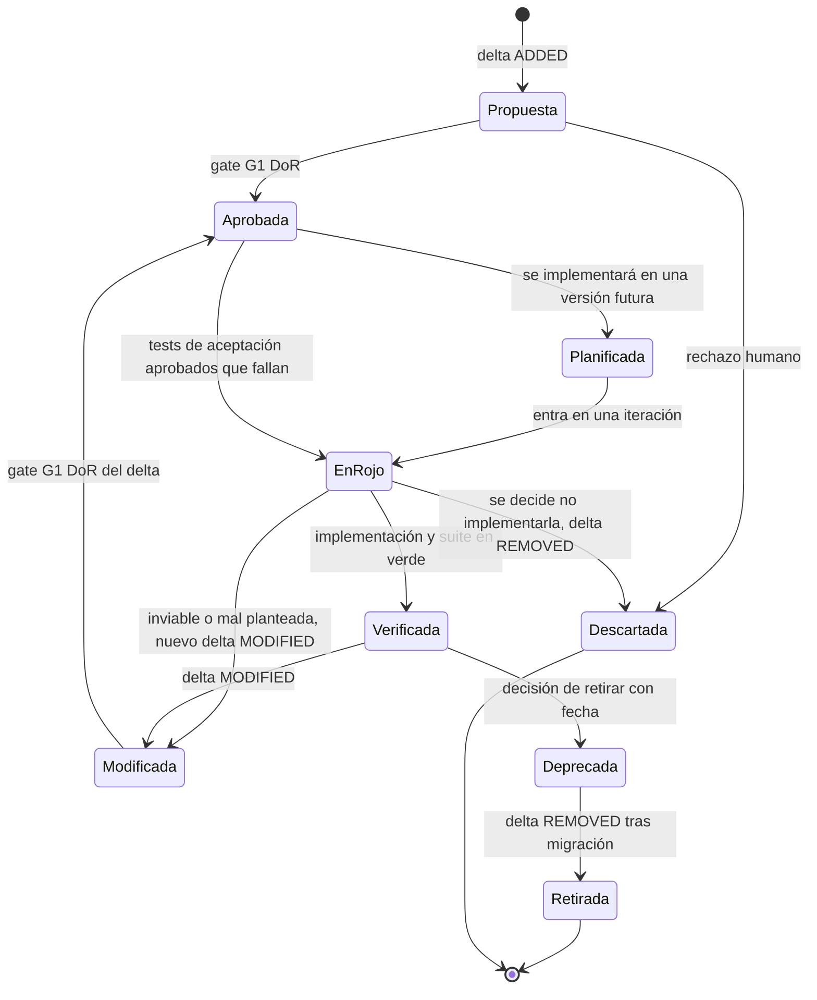

Una cláusula **Planificada** (estado `planned` del caso b, 7.2) está aprobada pero asignada a una versión futura: aparece en la matriz con su versión objetivo, genera un aviso y no un fallo, y se excluye de la cobertura de spec de las releases anteriores a esa versión (6.5, G7).

### 3.9 Spec de cambio frente a spec consolidada

| | Spec de cambio (delta) | Spec consolidada |
|---|---|---|
| Responde a | ¿Qué cambia, por qué y qué no debe cambiar? | ¿Cómo se comporta hoy el sistema? |
| Sirve para | Revisión y aprobación (unidad de trabajo, 3.12) | Fuente de la regeneración y onboarding (unidad de verdad, 3.12) |
| Contenido | Comportamiento actual, objetivo, invariantes que no cambian, exclusiones, ADDED/MODIFIED/REMOVED con motivo | Todas las cláusulas vigentes de una capacidad |
| Vida | Desde la propuesta hasta el archivo | Permanente |
| Quién lee | Revisor del PR | Agente que regenera, recién llegado, auditoría |

La sección **"comportamiento que no debe cambiar"** sale del bugfix spec de Kiro ("current / expected / unchanged behavior"). Es la protección contra regresiones más barata que existe, y conviene exigirla en todo delta del carril estándar o del completo.

Cómo se comporta cada nivel (sistema, contexto, capacidad, feature, cláusula y escenario) en el delta y en la consolidada se detalla en 3.12.5.

### 3.10 Revisión de specs

El cuello de botella es revisar (ver la cita de Böckeler en 1.3, punto 6). Thoughtworks: "lengthy spec files that are hard to review". Prácticas:

1. **Revisar el delta, no la spec entera.** El diff ADDED/MODIFIED/REMOVED es lo que se aprueba.
2. **Revisar la spec en PR como si fuera código:** diffs pequeños, un aprobador distinto del autor.
3. **Añadir una revisión de consistencia** con un agente en contexto limpio. Anthropic avisa: "A reviewer prompted to find gaps will usually report some, even when the work is sound... Chasing every finding leads to over-engineering". Hay que pedirle **solo los huecos que afectan a la corrección o a los requisitos**.
4. **Ordenar la revisión:** primero ejemplos e invariantes (lo ejecutable), luego la prosa.

### 3.11 Contexto y escalado: arquitectura de información

"Specs need an information architecture, not one large file" (paráfrasis de [Debois, Tessl](https://tessl.io/blog/spec-driven-development-10-things-you-need-to-know-about-specs/)). "Too large or too many specs will overload the context window". Reglas:

- **Siempre en contexto:** constitución y glosario, ambos cortos.
- **Por tarea:** solo las cláusulas que la tarea toca, el contrato relevante y un ejemplo de código de referencia. Böckeler encontró que los ejemplos y una aplicación de referencia funcionaban mejor que las reglas en prosa ([Böckeler, autonomy](https://martinfowler.com/articles/pushing-ai-autonomy.html)).
- **Bajo demanda:** el conocimiento ocasional va en skills o documentos referenciados, no en el archivo que se carga siempre.
- **Poda:** "¿quitar esta línea haría que el agente se equivocara?" (2.6). Si no, la línea se borra.
- **Límites en tres niveles** para el agente ([Osmani](https://addyosmani.com/blog/good-spec/)): *Always* (por ejemplo, ejecutar los tests antes del commit), *Ask first* (cambios de esquema, dependencias nuevas), *Never* (secretos, código vendorizado, tests de aceptación).
- **Índice de cláusulas** generado por CI (`spec/INDEX.md`), que el agente recibe siempre en lugar de las specs completas. Se detalla en 3.12.2.

### 3.12 Granularidad de la especificación

En spec-as-source hay **dos granularidades** distintas, y casi todas las confusiones vienen de mezclarlas:

1. **La granularidad de la spec:** de qué tamaño es un documento de spec, por dónde se corta y a qué nivel van los IDs. Es lo que trata esta subsección.
2. **La granularidad del código:** qué unidad de código se regenera (archivo, clase, función, módulo) y cómo se corresponden specs y archivos. Se trata en 4.7, porque depende de las categorías de código de 4.6.

La pregunta "¿una spec se asocia a un archivo, a una clase o a una función?" es ambigua porque junta cosas que conviene separar. **(propuesta)** El informe usa un solo esquema, de **cuatro unidades y tres relaciones**:

| | Qué es | Dónde se trata |
|---|---|---|
| **Unidad de verdad** | La spec consolidada de una capacidad | 3.12.1 |
| **Unidad de trabajo** | El delta de un cambio | 3.12.1 y 3.12.5 |
| **Unidad de identidad** | La cláusula con ID estable | 3.12.4 |
| **Unidad de regeneración** | El archivo entero | 4.7.2 |
| **Relación de propiedad** | Documento de spec dueño (capacidad, plataforma, contratos, *shared kernel*) → archivos (sus targets): una spec, muchos archivos; cada archivo, como mucho una spec dueña. Única relación que da derecho a modificar o regenerar | 4.7.1 y 4.7.5 |
| **Relación de trazabilidad** | Cláusula → archivos, símbolos (clases, funciones) y tests, en cualquier combinación. Solo informa | 4.7.1 y 4.7.9 |
| **Relación de ámbito** | Spec transversal (seguridad, logging, rendimiento, i18n, accesibilidad) → archivos a los que se aplica (`applies_to`), en cualquier combinación (N:M). Restringe y se verifica con una regla ejecutable, pero no posee nada | 4.7.6 |

**Por qué la propiedad 1:N no es ambigua aunque haya specs transversales (propuesta).** El 1:N solo rige para las specs *dueñas*. Una spec transversal abarca muchos ámbitos, pero no por propiedad sino por ámbito: no tiene `targets`, entra en el contexto de cada generación de su ámbito y su regla ejecutable falla en todo lo que no cumple. Cuando cambia, la modificación de cada archivo la hace su spec dueña (con un delta si cambia el comportamiento de esa capacidad), o la spec de plataforma si la regla está centralizada en un *middleware* o interceptor (4.7.6). Así, un archivo puede estar bajo el ámbito de varias transversales, pero sigue teniendo un único dueño.

La respuesta corta, que se justifica en 4.7.1: un *documento* de spec es dueño de archivos; una *cláusula* se traza a archivos, clases, funciones y tests; ni la clase ni la función se poseen ni se regeneran nunca por separado. Las tres primeras unidades son de la spec y se tratan aquí; la cuarta y las tres relaciones, en 4.7. La regla normativa que resume las dos granularidades está en 4.7.11.

#### 3.12.1 Unidades de spec: verdad, trabajo e identidad

Cada herramienta elige una unidad de spec distinta, y con ella un modelo de mantenimiento:

- **Spec Kit** especifica por feature o cambio: `/speckit.specify` "Scans existing specs to determine the next feature number", crea una rama y una carpeta `specs/[branch-name]/` (por ejemplo `specs/003-chat-system/`) con varios archivos ([spec-driven.md](https://github.com/github/spec-kit/blob/main/spec-driven.md)). Böckeler deduce que Spec Kit ve la spec como un artefacto que vive "for the lifetime of a change request" ([Böckeler](https://martinfowler.com/articles/exploring-gen-ai/sdd-3-tools.html)).
- **Kiro** también va por feature (`.kiro/specs/user-authentication/`, `shopping-cart/`...) y recomienda "creating multiple specs for different features" en lugar de "a single one for your entire codebase" ([Kiro, best practices](https://kiro.dev/docs/specs/best-practices/)).
- **OpenSpec** organiza la spec consolidada "by domain — logical groupings that make sense for your system" (por área funcional, por componente o por *bounded context*) y deja los cambios en deltas ([OpenSpec concepts](https://github.com/Fission-AI/OpenSpec/blob/main/docs/concepts.md)).
- **Tessl** baja hasta el archivo: "a quite low abstraction level, per code file", con "currently a 1:1 mapping between spec and code files" ([Böckeler](https://martinfowler.com/articles/exploring-gen-ai/sdd-3-tools.html)), en un framework que seguía en beta cerrada (1.2).

Böckeler concluye que "There doesn't seem to be a general definition" de lo que es una spec. Copiar la unidad de una herramienta es importar también su modelo de mantenimiento: transitorio en Spec Kit, consolidado en OpenSpec.

La práctica de la documentación viva ya había separado dos de esos ejes. Gojko Adzic organiza el trabajo en curso por historias y la documentación permanente por áreas funcionales, porque organizar por historias "makes perfect sense for work in progress, but not so much to explain things done in the past" ([Adzic, 2014](https://gojko.net/2014/03/25/throw-user-stories-away-after-they-are-delivered/)). **(propuesta)** Para spec-as-source se separan las tres unidades de spec del esquema anterior:

| Unidad | Qué es | Dónde vive | Vida |
|---|---|---|---|
| **De verdad** | La spec consolidada de una **capacidad** de negocio, dentro de un *bounded context* | `spec/capabilities/<cap>/spec.md` | Permanente |
| **De trabajo** | La feature o historia que se entrega en un cambio | Solo como delta en `spec/changes/<slug>/`; se archiva al hacer merge | Lo que dura el cambio |
| **De identidad** | La **cláusula**: un requisito EARS, una regla o una invariante, con sus escenarios | Dentro de una sola spec consolidada | Desde su ADDED hasta su REMOVED |

Trade-offs de cada posible unidad de spec **(propuesta, apoyada en las fuentes de cada fila)**:

| Unidad de spec | Ventaja | Inconveniente | Uso recomendado |
|---|---|---|---|
| **Sistema** (un solo documento) | Visión global, cero coordinación | No cabe en contexto ("too large or too many specs will overload the context window", [Debois](https://tessl.io/blog/spec-driven-development-10-things-you-need-to-know-about-specs/)), no se puede revisar, conflictos continuos entre deltas | Solo la constitución y prototipos de pocos días |
| **Bounded context** | Frontera de lenguaje fuerte: "total unification of the domain model for a large system will not be feasible or cost-effective" (Evans, vía [Fowler](https://martinfowler.com/bliki/BoundedContext.html)) | Demasiado grande para un documento; mezcla ritmos de cambio | Como carpeta, no como archivo |
| **Capacidad** (consolidada) | Estable, semántica, buena para regenerar y para incorporar a alguien al equipo | Necesita una correspondencia explícita con los archivos (4.7) y disciplina para repartir los deltas | **Unidad de verdad por defecto** |
| **Feature o cambio** (Spec Kit, Kiro) | Natural para planificar y revisar; encaja con ramas y PR | Caduca, se solapa con varias capacidades y reparte la verdad por el historial | Solo como delta, archivado al hacer merge |
| **Historia** (INVEST: *Independent, Negotiable, Valuable, Estimable, Small, Testable*) | Pequeña, estimable e independiente: "at most a few person-weeks" ([Wake](https://xp123.com/invest-in-good-stories-and-smart-tasks/)) | No es permanente y fragmenta las reglas de negocio | Unidad de planificación dentro de un delta |
| **Archivo** (Tessl) | Propiedad trivial y regeneración precisa | Acopla la spec a la estructura del código, filtra el "cómo" (3.4) y multiplica las specs | Solo para piezas muy estables; en general, el archivo es *target* de una spec de capacidad (4.7) |
| **Cláusula** | Coincide con la unidad del delta, de EARS y del `Rule` de Gherkin; se traza a tests | Exige registro de prefijos y control de colisiones de IDs | Unidad de identidad (3.12.4) |
| **Escenario** | Trazabilidad fina con los tests | Cambia a menudo; no es unidad de delta | Como mucho, sub-ID opcional (`ORD-014.S2`) |

#### 3.12.2 Tamaño: cuándo partir una spec

**Para el LLM, el tamaño importa de forma medible.** Chroma probó 18 modelos y encontró que "model performance consistently degrades with increasing input length", y que "Even a single distractor reduces performance" ([Chroma, *context rot*, jul. 2025](https://trychroma.com/research/context-rot)). Anthropic recomienda buscar "the smallest possible set of high-signal tokens" y cargar contexto *just in time* ([Anthropic, context engineering](https://www.anthropic.com/engineering/effective-context-engineering-for-ai-agents)). ManyIFEval (Harada et al., Findings de EMNLP 2025) mide que el rendimiento "consistently degrades as the number of instructions increases", aunque solo hasta 10 instrucciones simultáneas ([arXiv 2509.21051](https://arxiv.org/abs/2509.21051)); extrapolarlo a una spec de decenas de cláusulas es **(propuesta)**. Como referencia de un documento que se carga siempre, Claude Code pide "target under 200 lines per CLAUDE.md file" y avisa de que los *imports* "help you organize a long file but don't reduce its context cost" ([Anthropic, memory](https://code.claude.com/docs/en/memory)).

**Para el humano, el límite lo pone el delta.** La heurística clásica de revisión de código es no revisar más de 200-400 líneas de una vez: "beyond 400 LOC, the ability to find defects diminishes" ([SmartBear](https://smartbear.com/learn/code-review/best-practices-for-peer-code-review/); estudio del propio fabricante con un equipo de Cisco, 2006; LOC = *lines of code*, líneas de código). OpenSpec da señales cualitativas de que un cambio es demasiado grande: "Reviewing it would take an afternoon, so nobody will", "Two people couldn't work on it without colliding", "Half the tasks could ship on their own" ([OpenSpec, writing specs](https://github.com/Fission-AI/OpenSpec/blob/main/docs/writing-specs.md)). El Radar avisa de herramientas que "generate lengthy spec files that are hard to review" ([Radar](https://www.thoughtworks.com/radar/techniques/spec-driven-development)).

**(propuesta) Cómo se reconcilian.** La spec consolidada no la carga entera el agente ni la revisa entera el humano: el agente recibe el índice y solo las cláusulas que toca el delta (y las que estas referencian); el humano revisa el diff. Por eso hay dos límites distintos:

- **Spec consolidada de una capacidad:** que un humano la pueda leer de una sentada. Orientativo: unas 20-40 cláusulas o 300-600 líneas.
- **Delta:** que se revise en una sesión. Orientativo: unas 10 cláusulas ADDED o MODIFIED, o 200-400 líneas de diff. Por encima, se parte en cambios que se puedan entregar por separado, como historias INVEST (y como pide 2.6).

Ninguna fuente da umbrales numéricos para specs: estos son **(propuesta)** y se calibran con las métricas del piloto (tiempo de revisión y errores del agente frente a tamaño). Hay también un sesgo contrario que conviene respetar: "err on fewer, larger specs over many tiny ones (coordination overhead matters)" y "Never produce specs that can only ship together -- that's a single spec" ([triage-analyst, agente comunitario](https://sharedcontext.ai/agents/external/tzachbon/triage-analyst)).

**Señales para partir una capacidad (propuesta):**

1. Su propósito necesita una "y". OpenSpec aplica esta regla a requisitos y cambios ("One statement, one SHALL/MUST", [writing specs](https://github.com/Fission-AI/OpenSpec/blob/main/docs/writing-specs.md)); una heurística comunitaria la aplica también a capacidades: "Single purpose per capability (split if description needs 'AND')" ([gist de retrofit para OpenSpec](https://gist.github.com/mvdmakesthings/cd4a9432cc8665be7cb5060740158806)).
2. Un término significa cosas distintas en partes distintas de la spec. Es la señal de frontera de contexto de Fowler (su ejemplo es "meter" en una eléctrica, [BoundedContext](https://martinfowler.com/bliki/BoundedContext.html)).
3. Hay dos dueños humanos, o partes que cambian a ritmos muy distintos (reglas fiscales frente a pantallas).
4. Supera los umbrales anteriores.
5. Una tarea típica carga menos de un tercio de la spec.

**Señales para fusionar dos capacidades:** más del 70 % de los deltas tocan las dos, comparten casi todas las entidades, o una no tiene sentido sin la otra.

Ejemplo backend: una spec `orders` con 70 cláusulas que mezclan creación, cancelación, devoluciones y facturación se parte en `orders`, `returns` e `invoicing`; dos specs `cart` y `cart-totals` que siempre cambian juntas se fusionan. Ejemplo frontend: una spec "admin-ui" con 15 pantallas se parte por ruta de navegación o por paso del flujo, nunca por componente (botón, formulario).

**Índice de cláusulas (propuesta).** Antes de partir, se da arquitectura de información a la spec. Osmani propone "build an extended Table of Contents with summaries for the spec", que "acts as an index" ([Osmani](https://addyosmani.com/blog/good-spec/)). Aquí se materializa como `spec/INDEX.md`, generado por CI, con una línea por cláusula (ID, título, capacidad, estado, targets). El índice solo ahorra contexto si va acompañado de **carga real bajo demanda** de las cláusulas: partir la spec en archivos que se importan igualmente no reduce el coste (aviso de Claude Code citado arriba).

#### 3.12.3 Criterios de corte

**(propuesta) Primero por semántica, después por artefacto:**

1. **Contexto** (*bounded context*): carpeta de nivel superior solo si hay más de un lenguaje ubicuo. En un equipo pequeño suele haber de uno a tres. OpenSpec admite rutas anidadas del tipo `identity/user-auth` ([existing projects](https://github.com/Fission-AI/OpenSpec/blob/main/docs/existing-projects.md)).
2. **Capacidad de negocio** dentro del contexto: es la spec consolidada.
3. **Artefactos tipados dentro de la capacidad:** comportamiento (`spec.md`), contrato (fragmento OpenAPI o referencia a él), UI (`ui/`) y datos, cada uno con IDs propios cuando tiene reglas propias (`ORD-API-*`, `ORD-UI-*`).
4. **Transversales** (seguridad, NFR, observabilidad) en specs propias, que las capacidades referencian por ID. arc42 separa de la misma forma la vista de bloques de construcción de los *crosscutting concepts* ([INNOQ, arc42](https://www.innoq.com/en/blog/brief-introduction-to-arc42/)). Cómo se conectan con el código: 4.7.6.

Hay evidencia en contra de esta jerarquía y conviene conocerla. OpenSpec pone "By component" (`api/`, `frontend/`, `workers/`) al mismo nivel que "By bounded context"; Adzic acepta "Organize along UI navigation routes" como eje de la documentación viva; y Osmani propone archivos separados "Backend API Spec" y "Frontend UI Spec" porque "You don't need to always feed the frontend spec to the AI when it's working on the backend" ([Osmani](https://addyosmani.com/blog/good-spec/)). **(propuesta) Síntesis:** la **regla de negocio** se escribe una sola vez, en la capacidad; los artefactos por capa (contrato para el backend, `ui/` para el frontend) cuelgan de ella y la referencian. Cortar la regla por capa la duplica, y una regla duplicada en back y front acaba divergiendo (por ejemplo, un importe mínimo con valores distintos). Cortar por endpoint o por pantalla lleva a correspondencias N:M con el código, porque un endpoint o una pantalla suelen servir a varias capacidades.

Ejemplo backend: `POST /orders/{id}/cancel` pertenece a la capacidad `orders`; su esquema vive en `contracts/openapi.yaml` y se referencia desde `ORD-014`. Ejemplo frontend: `ORD-UI-003` ("el botón Cancelar solo es visible si el pedido está creado o pagado") vive en `capabilities/orders/ui/` y referencia `ORD-014`. Una pantalla compuesta como "Mi cuenta" (pedidos, pagos y perfil) tiene una **spec de composición** que solo referencia cláusulas de otras capacidades y solo es dueña del archivo de composición; las fuentes no tratan este caso, así que es **(propuesta)**.

**La spec de arquitectura se detiene en el componente.** El modelo C4 considera el nivel de código "very much an optional level of detail", "not recommended for anything but the most important or complex components", y mejor generado por herramientas ([C4, code diagram](https://c4model.com/diagrams/code)). **(propuesta)** `architecture/overview.md` describe contextos, contenedores, componentes y dependencias permitidas, sin nombrar clases internas. Si una cláusula de comportamiento necesita nombrar una función, está filtrando el "cómo" (3.4), salvo que esa función sea interfaz pública (firma de API, evento, tipo exportado), que se especifica en el contrato.

#### 3.12.4 Dónde van los IDs estables

**El ID estable va en la cláusula, y no codifica posición ni jerarquía.** Un ID jerárquico o posicional se rompe al reorganizar. Un *issue* enviado al grupo de trabajo de SysML (*Systems Modeling Language*) del OMG (*Object Management Group*) lo argumenta así: "a hierarchical ID will necessary change when the hierarchy is refactored", la reorganización está "almost guaranteed to happen" y "This breaks traceability"; propone un ID inmutable más un identificador jerárquico aparte, solo para ordenar ([SYSML17-142](https://issues.omg.org/issues/SYSML17-142); reporte individual de 2015 que la OMG cerró fuera de alcance: es un argumento, no una norma). La evidencia de las herramientas va en la misma dirección:

- Kiro numera los requisitos por posición y las tareas los citan así ("_Requirements: 1.1, 1.5, 3.1_", según una regla comunitaria que reproduce su formato, [promptz.dev](https://www.promptz.dev/rules/general/kiro-specs)). Al insertar o reordenar, las referencias apuntan a otra cosa. Es aceptable en una spec que muere con el cambio, no en una consolidada.
- Spec Kit reinicia `FR-001` en cada feature ([spec-template.md](https://raw.githubusercontent.com/github/spec-kit/main/templates/spec-template.md)), así que "FR-001" es ambiguo fuera de su carpeta, y sus carpetas numeradas chocan entre ramas paralelas: "their number will naturally conflict" ([Spec Kit, discusión #497](https://github.com/github/spec-kit/discussions/497)).
- OpenSpec identifica cada requisito por el texto de su cabecera (`### Requirement: <name>`), por eso necesita una operación `RENAMED` con `FROM:`/`TO:`, y la sincronización se detiene si no encuentra el nombre ([OpenSpec, skill de sincronización](https://github.com/Fission-AI/OpenSpec/blob/main/skills/openspec-sync-specs/SKILL.md)). Corregir una errata en el título sin `RENAMED` se convierte en REMOVED más ADDED, y la trazabilidad se pierde.
- Una regla comunitaria de spec-as-source del registro de Tessl exige justo lo que se propone aquí: "Every requirement must have a stable ID (format: REQ-<AREA>-<NNN>)", con al menos un `[@test]` por requisito ([vibe-ai/spec-as-source](https://tessl.io/registry/vibe-ai/spec-as-source/files/rules/spec-as-source.md)).

**(propuesta) Reglas de identidad:**

1. El ID es `<PREFIJO>-<NNN>` (p. ej. `ORD-014`): el prefijo de capacidad es solo un espacio de nombres; el número se asigna al crear y **nunca se reutiliza**. El orden de lectura lo da el documento, no el número. Los tipos con numeración propia dentro de una capacidad añaden el tipo al prefijo de la capacidad (`ORD-INV-001`, `ORD-API-002`, `CHK-UI-014`), para que dos capacidades no choquen con su `INV-001`. Solo las specs transversales y las de plataforma usan un prefijo global (`NFR-`, `SEC-`, `OBS-`, `PLT-`, `UI-KIT-`), registrado en el índice con numeración única.
2. La cabecera lleva ID y título (`### ORD-014 Reembolso proporcional al cancelar`). Los deltas se emparejan con la consolidada **solo por ID**, nunca por título ni por posición; el título se puede editar dentro de un MODIFIED.
3. Mover una cláusula a otra capacidad conserva su ID, o deja un alias explícito en el origen (`ORD-014 → RET-003`).
4. El registro de prefijos vive en el glosario o en `spec/INDEX.md`.
5. Los cambios se identifican por *slug* mientras están abiertos y por fecha más *slug* al archivarse (`changes/archive/2026-10-21-cancelacion-parcial/`), como en OpenSpec. Nunca por un número secuencial.
6. Si dos deltas paralelos reservan el mismo número (`ORD-021`), el check `concurrent-deltas` (Anexo F) lo detecta y el segundo renumera **antes del merge**, cuando el ID todavía no se ha publicado en la consolidada.
7. Los escenarios llevan como mucho un sub-ID derivado (`ORD-014.S2`) para tests y matriz, pero no son unidad de delta.
8. Cada MODIFIED incrementa la **revisión** de la cláusula (`ORD-007@r2` → `ORD-007@r3`). La revisión permite detectar anotaciones y tests obsoletos (4.7.9) y, en las specs derivadas, elementos caducados (3.13.7).
9. Los tests referencian la cláusula por *tag* o en el título. Gherkin permite *tags* "to group related features, independent of your file and directory structure" ([Gherkin reference](https://cucumber.io/docs/gherkin/reference/)), así que la trazabilidad sobrevive a mover archivos o partir capacidades.

#### 3.12.5 Cada nivel en delta y en consolidada

| Nivel | Consolidada | Delta | Notas |
|---|---|---|---|
| **Sistema y constitución** | Sí, única | No por cláusula: se enmienda con ADR y edición revisada | **(propuesta)**. Spec Kit enmienda su constitución con un comando propio que la versiona |
| **Bounded context** | Sí (mapa de contextos en `architecture/`) | Rara vez, por ADR | **(propuesta)** |
| **Capacidad** | Sí: `capabilities/<cap>/spec.md` | Sí: un bloque por capacidad afectada en cada cambio | Nace con un delta que trae `Purpose` y ADDED: `Purpose` "Seeds the Purpose of the main spec being created". En OpenSpec, retirarla exige el REMOVED de su última cláusula **y** declarar `retire_capabilities: true` en el cambio ([writing specs](https://github.com/Fission-AI/OpenSpec/blob/main/docs/writing-specs.md)). Partir o fusionar capacidades es un cambio que mueve cláusulas conservando sus IDs |
| **Feature o historia** | No | Solo delta (`proposal.md`, `delta.md`, `tasks.md`) | Al archivarse deja de ser fuente de verdad |
| **Cláusula** | Sí, dentro de una sola capacidad | Unidad de ADDED, MODIFIED, REMOVED y RENAMED | También es la unidad de conflicto: dos cambios sobre cláusulas distintas de la misma capacidad no chocan ("as long as they modify different requirements", [OpenSpec concepts](https://github.com/Fission-AI/OpenSpec/blob/main/docs/concepts.md)) |
| **Escenario** | Sí, dentro de su cláusula | Sin operación propia | Se añade, cambia o quita dentro de un MODIFIED que copia la cláusula entera: "A MODIFIED block carries the whole requirement - body plus every scenario that survives the change" ([skill de sincronización](https://github.com/Fission-AI/OpenSpec/blob/main/skills/openspec-sync-specs/SKILL.md)) |

Ejemplo backend: añadir un caso límite a `ORD-014` es un MODIFIED de `ORD-014` con todos sus escenarios más el nuevo. Ejemplo frontend: quitar un paso del asistente de checkout es un REMOVED de `CHK-UI-004` más un MODIFIED de `CHK-UI-005`.

#### 3.12.6 Checklist de granularidad de la spec

- [ ] Cada cláusula vigente vive en exactamente una spec consolidada de capacidad, y no en una carpeta de feature.
- [ ] El propósito de cada capacidad se describe sin "y".
- [ ] La spec consolidada se lee de una sentada (orientativo: 20-40 cláusulas, 300-600 líneas) y figura en `spec/INDEX.md`.
- [ ] El delta tiene unas 10 cláusulas ADDED o MODIFIED o menos; si no, se ha partido en cambios entregables por separado.
- [ ] Cada cláusula tiene un ID `<PREFIJO>-<NNN>` no posicional y no reutilizado, con su prefijo registrado y su revisión.
- [ ] Los deltas se emparejan con la consolidada por ID, no por título ni por número de sección.
- [ ] Cada MODIFIED copia la cláusula completa con todos sus escenarios vigentes.
- [ ] Los renombrados y los movimientos entre capacidades conservan el ID o dejan un alias.
- [ ] Ningún delta abierto reserva un ID nuevo que ya reservó otro (`concurrent-deltas`).
- [ ] Las reglas de negocio aparecen una sola vez, en la capacidad, y no duplicadas en specs de backend y frontend.
- [ ] Lo transversal está en su propia spec y se referencia por ID.
- [ ] La spec de arquitectura se detiene en componentes y dependencias permitidas, sin clases internas.
- [ ] Los tests llevan el ID de la cláusula en *tag* o título.

### 3.13 Specs derivadas: de la prosa a la gramática y la semántica formal

Hasta aquí el informe distingue dos clases de artefacto: la spec que escribe un humano y el código o los tests que salen de ella. Falta una tercera. Cuando el equipo diseña un lenguaje de programación, de la prosa con ejemplos salen una gramática EBNF (*Extended Backus-Naur Form*, notación de gramáticas) para Lark y una semántica en Lean 4. Las dos son formales, más precisas que la prosa, y sirven a su vez de fuente para el parser, el intérprete y las herramientas. No son código y tampoco son la spec que escribió el humano. Esta subsección les da nombre (**spec derivada**), fija qué manda cuando discrepan de su fuente y cómo una spec derivada puede llegar a ser normativa sin crear una segunda fuente de verdad. Aunque el caso central es el lenguaje, la regla vale también para un OpenAPI, un statechart o un schema derivados.

**Mapa de la subsección:**

- **3.13.1** El problema: qué es una spec derivada, la contradicción entre 3.3.7 y 1.6, y cómo la resuelven los estándares.
- **3.13.2** Postura: un dueño normativo por aspecto, tres estatus (DERIVADA, DELEGADA, CO-NORMATIVA) y la tabla de autoridad.
- **3.13.3** Taxonomía general de specs derivadas y sus categorías de artefacto (amplía 4.6).
- **3.13.4** Autoría, roles y aprobación por representación cuando el aprobador no lee Lean o EBNF con soltura.
- **3.13.5** Cuándo formalizar: escalones E0–E4 y cuándo no.
- **3.13.6** Verificación de fidelidad: puertas PF0–PF8.
- **3.13.7** Propagación de cambios, versionado por ediciones y desalineación entre niveles (casos k–s).
- **3.13.8** Caso completo: un lenguaje nuevo de la prosa a la implementación.
- **3.13.9** Riesgos, críticas y antipatrones.
- **3.13.10** Checklist de specs derivadas.

#### 3.13.1 El problema: specs formales que salen de la prosa

**Qué es una spec derivada.** Es un artefacto formal o semiformal producido a partir de cláusulas de la spec fuente (la escrita por humanos, con la autoría de 2.3), normalmente propuesto por la IA, que se usa para generar, comprobar o ejecutar algo. Cuatro ejemplos:

1. Una **gramática Lark** escrita a partir de los ejemplos de sintaxis y las reglas léxicas de la prosa.
2. Una **semántica en Lean 4** (tipos del AST, función de evaluación, reglas de tipado) escrita a partir del significado descrito en prosa.
3. Un **OpenAPI** que la IA redacta desde historias de usuario y escenarios, en vez de escribirlo un humano como pide 3.3.7.
4. Un **statechart** (por ejemplo XState) extraído de reglas de negocio en EARS o Given/When/Then.

La taxonomía completa, con formalidad, forma de generación y validación de cada tipo, está en 3.13.3.

**El caso del cliente.** El equipo diseña un lenguaje nuevo. Las specs humanas contienen ejemplos de sintaxis y el significado en prosa. De ellas tienen que salir una gramática para Lark, el parser de Python con algoritmos Earley y LALR (*Look-Ahead LR*, análisis ascendente con un símbolo de anticipación), y una semántica en Lean 4. De esas dos, a su vez, salen el parser, el intérprete o compilador, el LSP (*Language Server Protocol*, servidor de lenguaje para editores) y el formatter. Es una **cadena de tres niveles**: nivel 1, spec fuente; nivel 2, spec derivada; nivel 3, artefacto generado. El ejemplo desarrollado está en 3.13.8.

**La contradicción.** El informe tiene dos reglas que, aplicadas a la gramática, chocan:

- **Opción (a).** 3.3.7 trata un contrato formal (OpenAPI) como "spec humana de primera clase": se escribe antes del código, de él se genera código de forma determinista y "nunca se regenera desde el código". Si la gramática Lark es como el OpenAPI, es normativa. Pero entonces conviven dos fuentes normativas sobre lo mismo, la prosa y la gramática, y el informe no dice cuál gana.
- **Opción (b).** 1.6 dice que el oráculo (ejemplos, resultados esperados) es normativo y que el código de test es derivado: "no decide qué es correcto". Si la gramática es como el código de test, no manda. Pero entonces toda decisión que tome y que la prosa no tomaba tiene que volver a la prosa, y una gramática toma muchas.

**Por qué la gramática no puede ser derivada pura.** Escribir una gramática obliga a decidir cosas que la prosa casi nunca dice: precedencia, asociatividad, si `a < b < c` es válido, a qué `if` se asocia un `else`, qué palabras quedan reservadas, si el salto de línea significa algo. En Lark ni siquiera hay una declaración de precedencia: no existen `%left` ni `%right` al estilo yacc. La precedencia se codifica **estratificando reglas**, como en el ejemplo oficial [`examples/calc.py`](https://github.com/lark-parser/lark/blob/master/examples/calc.py) (`?sum: product | sum "+" product`, `?product: atom | product "*" atom`): la recursión por la izquierda hace asociativo por la izquierda al `+`, y anidar `product` dentro de `sum` hace que `*` ligue más fuerte. Las prioridades de regla y de terminal ([Lark, Grammar Reference](https://lark-parser.readthedocs.io/en/latest/grammar.html)) son otra vía por la que la gramática decide en silencio, y 3.13.6 muestra cómo hacerlas visibles. Lo mismo pasa en la semántica: una función `eval` en Lean 4 tiene que elegir un orden de evaluación de los argumentos, qué pasa con el overflow y qué error da cada caso borde. Además, una gramática libre de contexto casi nunca basta para decir qué programas son válidos: "Context-free grammars are not sufficiently powerful to express all the rules that define whether a stream of input elements form a valid ECMAScript Script or Module" ([ECMA-262, 5.2](https://tc39.es/ecma262/multipage/notational-conventions.html)). La gramática fija parte del lenguaje, no todo, y lo que fija no siempre lo había fijado la prosa.

**Cómo lo resuelven los estándares.** Ningún precedente serio deja dos fuentes normativas sobre lo mismo sin una regla de desempate o un mecanismo que las haga coincidir. Hay cuatro patrones:

| Patrón | Quién gana | Ejemplos con cita | Lección |
|---|---|---|---|
| **La prosa o el algoritmo gana; lo formal es informativo** | La prosa | RFC 9651, Appendix C: "If there is disagreement between the parsing algorithms and ABNF, the specified algorithms take precedence" ([RFC 9651](https://www.rfc-editor.org/rfc/rfc9651.html)). C23: "Annex A (informative) Language syntax summary" ([N3220](https://www.open-std.org/jtc1/sc22/wg14/www/docs/n3220.pdf)). C++: "the grammar described here accepts a superset of valid C++ constructs" ([\[gram\]](https://eel.is/c++draft/gram)). R6RS, Appendix A: "a non-normative, formal, operational semantics" que "does not cover the entire language" ([R6RS](https://www.r6rs.org/final/r6rs.pdf)) | La copia formal completa en un solo sitio, la más parecida a un `.lark`, suele ser justo la informativa. Si es informativa, puede aceptar de más; si fuera normativa, no |
| **Lo formal es la definición** | Lo formal | Standard ML: la *Definition* es una semántica formal normativa, y aun así acumuló ambigüedades y defectos de precedencia ([Rossberg, Defects](https://people.mpi-sws.org/~rossberg/sml-defects.html)). Cedar (AWS): "The models serve as Cedar's specification" ([arXiv 2407.01688](https://arxiv.org/abs/2407.01688)) | Funciona cuando un humano escribe lo formal. Aun así necesita un oráculo de intención, porque lo formal también se equivoca (Cedar documenta bugs del propio modelo Lean) |
| **Co-normativas con equivalencia declarada** | Nadie | WebAssembly: "All rules are given in two equivalent forms", "The prose and formal rules are equivalent" ([Wasm, Validation conventions](https://webassembly.github.io/spec/core/valid/conventions.html)). No hay regla de desempate | La equivalencia declarada no responde a "¿cuál gana?"; convierte cada discrepancia en un incidente sin árbitro. Wasm acabó saliendo de este régimen (ver abajo) |
| **Normatividad repartida por aspecto** | Cada aspecto tiene su dueño | XQuery 1.0: "This document contains the normative static semantics"; las reglas dinámicas formales "are provided for explanatory purposes and are not normative", y la dinámica normativa está en las specs del lenguaje ([XQuery Formal Semantics](https://www.w3.org/TR/xquery-semantics/)) | Es el patrón que encaja con spec-as-source: una sola fuente por aspecto, no una sola fuente en total |

Dos casos recientes completan el cuadro:

- **ECMAScript: prosa normativa con mecanización derivada en CI.** ECMA-262 es prosa algorítmica estructurada y es la única fuente normativa. ESMeta extrae de ella una semántica ejecutable que comprueba tipos en cada PR (workflows `esmeta-typecheck.yml` y `esmeta-yetcheck.yml` en [tc39/ecma262](https://github.com/tc39/ecma262/tree/main/.github/workflows)). La suite de conformidad tampoco manda: "Test262 is a non-normative test suite", y cualquier diferencia "must be resolved in favour of the ECMA-414 specification" ([Ecma TR/104](https://www.ecma-international.org/wp-content/uploads/ECMA_TR-104_2nd_edition_december_2016.pdf)). Es la opción (b) llevada a la práctica: la mecanización verifica la prosa y no la sustituye.
- **WebAssembly y SpecTec: fuente formal única.** Para escapar de las dos fuentes, Wasm invirtió la cadena. Una definición en el DSL SpecTec, escrita por humanos, genera el LaTeX, la prosa y un intérprete; el Community Group la adoptó en marzo de 2025 ([webassembly.org, 2025-03-27](https://webassembly.org/news/2025-03-27-spectec/)) y Wasm 3.0 es la primera versión producida con ella ([webassembly.org, 2025-09-17](https://webassembly.org/news/2025-09-17-wasm-3.0/)). La adopción es parcial: el formato de texto, el equivalente de la gramática Lark, sigue escrito a mano.

**Semánticas formales escritas a partir de una prosa ajena.** Son el precedente más directo de una spec derivada: alguien formaliza un lenguaje cuya definición normativa es prosa, y tiene que decidir qué hacer con lo que la prosa no fija.

- **CompCert (C en Coq).** La semántica de Clight se escribió a mano a partir del estándar ISO C, y **toma decisiones que el estándar no toma**: "makes precise a number of behaviors left unspecified or undefined in the ISO C standard, such as the sizes of data types, the results of signed arithmetic operations in case of overflow, and the evaluation order" ([Leroy, CACM 2009](https://xavierleroy.org/publi/compcert-CACM.pdf)). Son decisiones excedentes en el sentido de 3.13.2, y quedan en la base de confianza: Leroy lista "the formal semantics for the source (Clight) and target (PPC) languages" y "the CIL-based parser" entre lo que hay que confiar, y admite que lo más delicado es "how can we make sure that a formal semantics agrees with language standards". Su respuesta es la de 3.13.6: "manual reviews by experts, as well as testing conducted on executable forms of the semantics, could provide reasonable (but not formal) confidence". Los fallos que Csmith encontró en CompCert cayeron fuera de la parte verificada (3.13.9).
- **CakeML (ML en HOL4).** Es el caso contrario: el lenguaje se define por su semántica formal y no por la prosa de la que parte. CakeML sigue a Standard ML, pero "we have not proved that fact with respect to the Definition of Standard ML. Thus, any formal reasoning about CakeML programs must be carried out with respect to the CakeML semantics, rather than SML's" ([Kumar et al., POPL 2014](https://cakeml.org/popl14.pdf)). Su gramática "unambiguously encodes the various parsing precedences and resolves the 'dangling case' ambiguity", y el parser está probado *sound* y completo respecto de ella ([cakeml.org](https://cakeml.org/)). Es una fuente formal única escrita por humanos: en el vocabulario de 3.13.2, una DELEGADA total, no una derivada.
- **K (KCC, KJS).** El marco K produce semánticas **ejecutables** que se validan contra suites ajenas. La semántica de C de Ellison y Roșu "has been thoroughly tested against the GCC torture test suite and successfully passes 99.2% of 776 test programs" ([POPL 2012](https://fsl.cs.illinois.edu/publications/ellison-rosu-2012-popl.pdf); repositorio [kframework/c-semantics](https://github.com/kframework/c-semantics)). KJS hace lo mismo con Test262 (3.13.6). Ninguna de las dos es normativa: la norma sigue siendo la prosa ISO o ECMA, y la semántica K es la opción (b).
- **Rust (FLS y MiniRust).** El proyecto Rust adoptó la FLS (*Ferrocene Language Specification*), una spec en prosa con un ID por párrafo, "as part of our ongoing specification efforts", y aclara que eso "does not change the status of the Reference" ([Rust blog, 2025-03-26](https://blog.rust-lang.org/2025/03/26/adopting-the-fls/)). En paralelo, MiniRust es una semántica operacional escrita como intérprete ("the MiniRust spec is written as an _interpreter_, so the spec itself is code"), que su autor presenta como "the cornerstone of my vision for a normative specification of Rust semantics", aunque hoy no es oficial y se declara "extremely incomplete" ([minirust/minirust](https://github.com/minirust/minirust)). Es la misma tensión de 3.13.2 sin resolver todavía: una prosa adoptada y una semántica ejecutable que aspira a ser normativa.

Lección común **(propuesta)**: cuando el formal lo escribe un humano y se declara la definición (CakeML), hay una sola fuente. Cuando se escribe a partir de una prosa que sigue siendo la norma (CompCert, K), el formal es DERIVADO, toma decisiones excedentes y se valida por revisión experta y por suite, nunca por demostración.

**La recomendación del W3C.** La guía de calidad de specs del W3C recomienda (es una *Good Practice*, no una obligación) que "when the English prose and the formal language overlap, make it clear which one takes precedence in case of discrepancy", y añade que declararlo "doesn't relieve the Working Group from dealing with any discrepancies ... as errata" ([QA Framework, GP 11](https://www.w3.org/TR/qaframe-spec/)). Dos ideas que esta subsección adopta: la precedencia se escribe, y una discrepancia se trata como errata que hay que resolver, no como libertad de quien implementa.

**Formalizar encuentra errores en la fuente.** La evidencia es constante:

- **JISET** extrajo semántica ejecutable de ECMA-262 y encontró 9 errores en ES10, todos confirmados por TC39, más 3 en la propuesta BigInt ([Park et al., ASE 2020](https://plrg.korea.ac.kr/assets/data/publication/ase20-park-jiset.pdf)).
- **JSTAR** analizó 864 versiones de la spec y emitió 157 avisos de tipos, de los que 93 eran bugs reales y 14 eran nuevos; TC39 confirmó esos 14 nuevos ([Park et al., ASE 2021](https://plrg.korea.ac.kr/assets/data/publication/ase21-park-jstar.pdf)). La precisión del 59 % recuerda que cada aviso necesita triaje humano.
- **SpecTec** encontró errores históricos en la spec de Wasm y diez errores en cinco propuestas listas para incluirse ([PLDI 2024](https://pldi24.sigplan.org/details/pldi-2024-papers/64/Bringing-the-WebAssembly-Standard-up-to-Speed-with-SpecTec)).
- **Watt** mecanizó el borrador de Wasm en Isabelle y mostró que el sistema de tipos era *unsound*: "In some cases, these errors meant that the type system was originally unsound". Los arreglos se hicieron en la spec, no en la mecanización ([CPP 2018](https://www.cl.cam.ac.uk/~caw77/papers/mechanising-and-verifying-the-webassembly-specification.pdf)).
- **El *dangling else* de ES10.** La prosa decía que el `else` va con el `if` más cercano, pero la gramática no lo expresaba: "Because it is written in prose rather than in the ES10 grammar productions, it caused one failed test. We proposed a fix to revise the ambiguous grammar production, and TC39 confirmed it" ([JISET](https://plrg.korea.ac.kr/assets/data/publication/ase20-park-jiset.pdf), error ES10-2). La herramienta no decidió la regla: la decisión subió a la gramática normativa del documento humano, donde hoy está como `[lookahead ≠ else]`.

Conclusión: el valor principal de una spec derivada no es la garantía de corrección. Es que **detecta huecos y contradicciones en la spec fuente**, y lo que detecta se corrige arriba. La postura de 3.13.2 está construida sobre esa observación.

#### 3.13.2 Postura: un dueño normativo por aspecto y tres estatus

**(propuesta)** La contradicción entre (a) y (b) se resuelve con una regla y un ciclo de vida. La regla extiende la propiedad de 4.7 ("cada archivo tiene, como mucho, una spec dueña") de los archivos a la normatividad:

> **R-DER-1 · Regla de un dueño por aspecto.** Cada aspecto del lenguaje o del sistema tiene exactamente **una** fuente normativa, nunca dos. Aspectos del lenguaje: léxico, sintaxis concreta, precedencia y asociatividad, sintaxis abstracta (AST), semántica estática, semántica dinámica, orden de evaluación, errores y diagnósticos, recuperación de errores del parser. Aspectos del sistema: forma del payload, transiciones de un flujo, estructura física de datos, valores de diseño. Quién es dueño de cada aspecto se escribe en una **tabla de autoridad por aspecto**. Una discrepancia entre niveles **bloquea** y la decide un humano.

Sobre esa regla, cada spec derivada tiene, **por aspecto**, uno de tres estatus **(propuesta)**:

| Estatus | ¿Gana en conflicto con la fuente? | ¿Obliga a la implementación? | Cómo se cambia | Modelos reales | Cuándo usarlo |
|---|---|---|---|---|---|
| **DERIVADA** (nacimiento, siempre) | No: gana la prosa y la derivada se corrige. Frente a la fuente es informativa | Sí: es el oráculo de referencia del nivel 3, como el código de test de 1.6 | Se re-deriva desde la cláusula fuente cambiada, con aprobación humana del diff | ESMeta frente a ECMA-262; R6RS Appendix A; anexos de gramática de C23 y C++; ABNF de RFC 9651 | Por defecto, en todo aspecto que la prosa ya decide o que aún no está estable |
| **DELEGADA** (solo por promoción explícita) | Para ese aspecto ya no hay conflicto posible: el artefacto **es** la spec fuente, escrita en notación formal. La prosa deja de hablar de él o pasa a ser vista generada | Sí | Solo por edición humana revisada. Nunca se regenera desde el código ni por un LLM en bloque | OpenAPI de 3.3.7; semántica estática de XQuery; SpecTec en Wasm 3.0 (para la semántica); Cedar | Aspecto acotado, estable y que el equipo puede leer, cuando la notación formal lo expresa mejor que la prosa |
| **CO-NORMATIVA con equivalencia** | No se sabe: es el problema | Sí | Hay que cambiar las dos fuentes y mantenerlas iguales | Wasm 1.0 y 2.0 | **No se usa**, salvo que prosa y formal se generen desde una fuente única. En ese caso no es CO-NORMATIVA: es una DELEGADA más una vista generada |

**Precedencia escrita (propuesta).** El orden es: **spec fuente (prosa más casos de conformidad) > spec derivada aprobada > implementación**. La implementación nunca gana. Una discrepancia entre niveles siempre bloquea el pipeline y la decide un humano, con la taxonomía de 3.13.7. La IA nunca edita la spec fuente para que encaje con la derivada: eso sería legalizar en silencio una decisión que nadie aprobó. Esta precedencia se escribe dos veces, como pide GP 11: en la cláusula de la spec fuente que delega o que declara la derivada, y en la cabecera del archivo derivado.

Con esto, 3.3.7 y 1.6 dejan de contradecirse. El OpenAPI de 3.3.7 es el caso **DELEGADA**: un humano lo escribe o lo aprueba regla por regla, y desde ese momento es spec fuente en notación formal para el aspecto "forma del payload". El código de test de 1.6 es el caso **DERIVADA**: no decide qué es correcto, pero el código debe pasarlo. Una gramática Lark empieza como el segundo y puede terminar como el primero, aspecto por aspecto.

#### Diagrama 3.13-A. Jerarquía spec fuente → spec derivada → artefacto generado

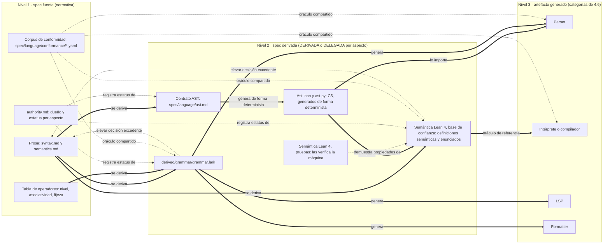

Las flechas gruesas son **derivación y generación**, siempre hacia abajo. Las punteadas hacia el nivel 1 son la única vía de vuelta: una decisión excedente nunca se acepta en el nivel 2, se **eleva**. El corpus de conformidad es el **oráculo compartido**: los mismos casos se ejecutan contra la gramática, la semántica Lean 4 y la implementación, y una discrepancia indica en qué nivel está el error. Las pruebas de Lean quedan fuera de la aprobación humana: solo se aprueba lo que dicen la base de confianza y sus enunciados.

**Decisión excedente y la regla de elevar (propuesta).** Una **decisión excedente** es lo que una spec derivada decide y la spec fuente no decidía: precedencia, asociatividad, orden de evaluación, overflow, un caso borde, una prioridad de Lark, la resolución de un conflicto LALR o de una ambigüedad de Earley. La aviación ya tiene nombre para esto: un *derived requirement* de DO-178C es, según su glosario, el que no traza directamente a un requisito de nivel superior o el que "especifica comportamiento más allá" del nivel superior (rama b); el texto normativo es de pago y no se consultó directamente. Una fuente secundaria lo resume así: "do not necessarily trace to a parent requirement, therefore require additional Safety review" ([AFuzion](https://afuzion.com/avionics-software-requirements-in-do-178c/), consultora). El equipo no está regulado y no adopta el proceso, pero sí su regla: **lo que no traza hacia arriba se eleva**. Elevar es el único destino válido de una decisión excedente: un humano la escribe en la spec fuente como cláusula nueva con su caso de conformidad, o la elimina.

Para que eso sea comprobable, cada elemento de la spec derivada (regla Lark, declaración Lean de la base de confianza, operación de OpenAPI, transición de un statechart) lleva un **estado por elemento** y una **traza de elemento** `@fuente <ID>@<rev>`, con la revisión de la cláusula de 3.12.4 como **huella de versión**:

| Estado | Significa | Equivale en 8.3 B2 | Qué bloquea |
|---|---|---|---|
| `trazada` | Traduce una cláusula aprobada; lleva `@fuente` | Confirmada | Nada |
| `excedente` | Decisión sin cláusula padre, pendiente de elevar | Inferida pendiente | La aprobación de la derivada y la release |
| `hueco` | La fuente es ambigua, incompleta o contradictoria en ese punto; es una pregunta abierta | Hueco | La aprobación de la derivada y la release |
| `no-normativa` | Anotación de la herramienta: alias y `?regla` de Lark, nombres de lemas, prioridades usadas solo por rendimiento | (no aplica) | Nada, pero no puede cambiar el lenguaje aceptado ni su significado |

Para aprobar una derivada o hacer una release, los aspectos afectados tienen **cero `excedente` y cero `hueco`**. En el `.lark` se ve así:

```lark
// @fuente SYN-010@r2  (tabla de operadores: + y - del mismo nivel, asociativos por la izquierda)
?sum: product
    | sum "+" product -> add   // @fuente SYN-010@r2
    | sum "-" product -> sub   // @fuente SYN-010@r2
// no-normativa: alias de árbol (-> add) y prefijo ?, solo dan forma al árbol de Lark
```

Si la IA hubiera puesto `^` asociativo por la derecha sin que ninguna cláusula lo diga, la regla quedaría en `excedente` con un caso de conformidad propuesto (`2^3^2` ≡ `2^(3^2)`) hasta que un humano lo apruebe como cláusula. Cuando una cláusula cambia de revisión, todo elemento que la cite con la revisión anterior queda **caducado**, y no se regenera el nivel 3 desde él (3.13.7).

**Criterios para pasar de DERIVADA a DELEGADA (propuesta).** Una delegación es una cláusula de la spec fuente que nombra un aspecto acotado y el artefacto que pasa a ser su dueño. Por ejemplo, en `spec/language/syntax.md`: "**SYN-000 (delegación).** La sintaxis concreta la define `derived/grammar/grammar.lark` v3; esta spec no la repite. Las anotaciones marcadas `no-normativa` no forman parte de la delegación." (La cláusula completa, con su aprobación, está en 3.13.8 h.) Antes de escribirla tienen que cumplirse siete criterios:

| # | Criterio | Qué exige | Fuente |
|---|---|---|---|
| 1 | Autoría y aprobación humana regla por regla | Un humano aprueba cada regla, por representación si no lee la notación con soltura (3.13.4). Nada escrito por la IA es normativo sin esa aprobación | Regla de autoría de 2.3 |
| 2 | Completitud del aspecto, o declaración de lo que no cubre | El artefacto cubre todo el comportamiento observable del aspecto, o dice qué queda fuera (recuperación de errores, restricciones no libres de contexto) | RFC 9651 hace ganar al algoritmo porque el ABNF "does not capture all requirements"; los diagramas de CSS Syntax 3 son "informative and incomplete" ([CSS Syntax 3](https://www.w3.org/TR/css-syntax-3/)) |
| 3 | Aspecto acotado y nombrado | Se delega "sintaxis concreta" o "semántica estática", nunca "el lenguaje" | XQuery reparte la normatividad por aspecto ([XQuery FS](https://www.w3.org/TR/xquery-semantics/)) |
| 4 | Verificable con herramientas | El artefacto pasa sus herramientas en CI (Lark construye el parser sin conflictos, Lean compila sin `sorry`) y tiene las puertas PF0–PF5 de 3.13.6 en verde sobre todo el corpus de conformidad (PF6 también si el escalón es E3) | IESG (2001): "The specification needs to be verifiable" ([IESG statements](https://datatracker.ietf.org/group/iesg/statements/); [texto](https://ftp.ripe.net/rfc/rfc-editor/UsingPseudoCode.txt)). Esa declaración no dice qué gana en un conflicto |
| 5 | Cláusula de precedencia escrita en los dos documentos | La cláusula de delegación en la spec fuente y su espejo en la cabecera del artefacto | W3C QA Framework, GP 11 ([qaframe-spec](https://www.w3.org/TR/qaframe-spec/)) |
| 6 | Oráculo independiente | Un corpus de conformidad escrito o aprobado por humanos que el artefacto pasa entero. Un formalismo normativo también se equivoca | Standard ML: Rossberg señala que las reglas de precedencia de la *Definition* "are not sufficient to disambiguate all possible phrases" y que "the common way to deal with this probably is to just use Yacc precedence declarations" ([Rossberg, Defects (2013)](https://www.mpi-sws.org/~rossberg/papers/Rossberg%20-%20Defects%20in%20the%20Revised%20Definition%20of%20Standard%20ML%20%5B2013-09-18%20Update%5D.pdf)); es una conjetura suya ("probably"), no un registro de lo que hicieron las implementaciones |
| 7 | Forma estable | La clase de parser elegida (LALR o Earley) no obliga a reestructurar la gramática de forma que cambie el lenguaje aceptado, y el aspecto no ha cambiado durante N ediciones (sugerencia: 2) | JLS SE 7 tenía una gramática expositiva y otra "basis for the reference implementation" ([cap. 18](https://docs.oracle.com/javase/specs/jls/se7/html/jls-18.html)); desde SE 8 hay una sola ([SE 21, cap. 19](https://docs.oracle.com/javase/specs/jls/se21/html/jls-19.html)). PEP 617: la gramática LL(1) acabó "not reflecting correctly what the actual grammar is" ([PEP 617](https://peps.python.org/pep-0617/)) |

Estos siete criterios son el **único umbral de delegación** del informe. La tabla de autoridad, el caso de 3.13.8 (h) y la checklist de 3.13.10 remiten a ellos y no los reformulan.

**La tabla de autoridad por aspecto (propuesta).** Vive en `spec/language/authority.md` (en `spec/authority.md` para los aspectos del sistema, como la forma del payload). Tiene una fila por aspecto con su dueño normativo, el estatus del artefacto formal, la versión, la fecha de delegación y el aprobador. Para el lenguaje del cliente, la recomendación por defecto es esta (las fechas y personas son marcadores):

| Aspecto | Dueño normativo (archivo) | Estatus del artefacto formal | Versión | Fecha de delegación | Aprobador |
|---|---|---|---|---|---|
| Léxico | `spec/language/syntax.md` (LEX-) | `grammar.lark`: DERIVADA | syntax.md r4 | — | — |
| Sintaxis concreta | `spec/language/syntax.md` (SYN-…) hasta la delegación; después `derived/grammar/grammar.lark` vía SYN-000 | `grammar.lark`: DERIVADA; DELEGADA cuando cumpla los siete criterios de arriba | v3 | `<fecha>` | `<persona 1>` + `<persona 2>` |
| Precedencia y asociatividad | `spec/language/syntax.md` (tabla SYN-010) | `grammar.lark`: DERIVADA | r2 | — | — |
| Sintaxis abstracta (AST) | `spec/language/ast.md` (AST-) | DELEGADA: nace DERIVADA de SYN- y SEM-, y se delega pronto porque de él se generan el `inductive` de Lean, el transformer de Lark y las clases Python | r1 | `<fecha>` | `<persona 1>` + `<persona 2>` |
| Semántica estática | `spec/language/semantics.md` (SEM-) | Lean: DERIVADA | r3 | — | — |
| Semántica dinámica | `spec/language/semantics.md` (SEM-) | Lean: DERIVADA | r3 | — | — |
| Orden de evaluación | `spec/language/semantics.md` (SEM-) | Lean: DERIVADA | r3 | — | — |
| Errores y diagnósticos | `spec/language/semantics.md` (SEM-): clases y códigos de error; el texto de los mensajes queda fuera de contrato | Lean: DERIVADA | r3 | — | — |
| Recuperación de errores del parser | Fuera de contrato (no normativa) | Implementación libre | — | — | — |

La tabla muestra por qué la delegación se hace **por aspecto**. `grammar.lark` es dueña de la sintaxis concreta pero no de la precedencia: su estratificación de reglas es DERIVADA de la tabla SYN-010, y si las dos discrepan gana la tabla. Así la tabla de operadores, el léxico y el orden de evaluación se escriben en la prosa **antes** de derivar el `.lark`, y la gramática solo codifica decisiones ya tomadas. La semántica Lean 4 nace DERIVADA, parcial y con su cobertura declarada; solo se delega por aspectos nombrados (por ejemplo la semántica estática) y solo si al menos dos personas del equipo pueden leer Lean. Si nadie lo lee, la aprobación del criterio 1 sería nominal.

#### Diagrama 3.13-B. Árbol de decisión: qué estatus tiene cada aspecto

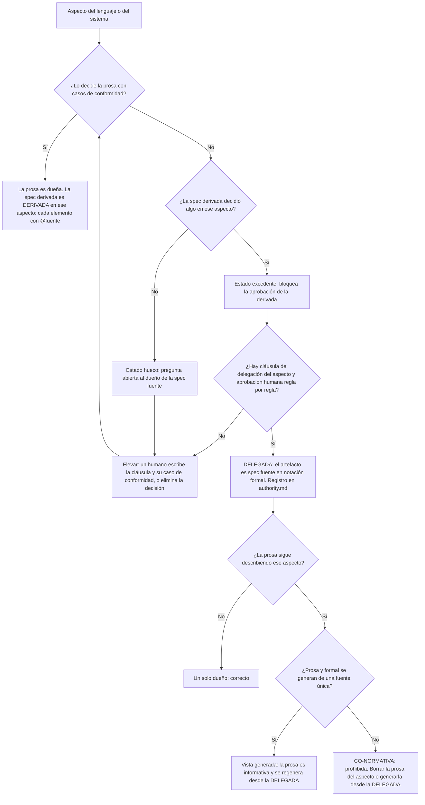

El árbol se recorre por aspecto, no por archivo. Un mismo `grammar.lark` puede salir por R1 para la precedencia y por D para la sintaxis concreta. Eso no le da dos dueños: el dueño del archivo sigue siendo `syntax.md`, que contiene tanto la tabla SYN-010 como la cláusula de delegación SYN-000, y el estatus de cada aspecto se lleva en la cabecera (3.13.3 e).

**Lo no especificado a propósito.** A veces la prosa deja un punto abierto adrede, y eso no es un hueco. ECMA-262 lo marca con categorías explícitas: "A conforming implementation of ECMAScript must not redefine any facilities that are not implementation-defined, implementation-approximated, or host-defined" ([ECMA-262](https://tc39.es/ecma262/)). R7RS deja libre el orden de evaluación de una llamada y su semántica formal lo modela sin fijarlo: "The order of evaluation within a call is unspecified. We mimic that here by applying arbitrary permutations permute and unpermute" ([R7RS, 7.2](https://small.r7rs.org/attachment/r7rs.pdf)). La propia R7RS admite que es una aproximación ("This is not quite right"), así que también el modelado de lo no especificado se revisa. **(propuesta)** En la spec fuente, cada punto libre a propósito se marca con una cláusula ("no especificado: la implementación elige"). En Lean 4 se modela como **parámetro** del modelo o como **relación no determinista**, nunca como una elección concreta. La IA **nunca** elige un valor para lo que la prosa dejó libre: si lo hace, es una decisión excedente.

```lean
-- @fuente SEM-031@r1  (ejemplo: una spec que deja libre el orden de evaluación de los argumentos)
structure Host where
  argOrder : List Expr → List Expr   -- lo elige la implementación; el modelo no lo fija
```

**Advertencia: copiar SpecTec invierte la cadena.** El patrón de Wasm resuelve las dos fuentes haciendo que la fuente sea formal y la prosa, generada. Para el cliente eso solo es coherente con spec-as-source si **un humano escribe el formal**: entonces el formal es la spec fuente (nivel 1), la prosa generada es un artefacto de nivel 3 y la derivación por IA desaparece de ese aspecto. Lo que no vale es que la IA derive un formal desde la prosa y luego se genere la prosa desde ese formal: la autoría de 2.3 se perdería sin que nadie lo decidiera. Si el equipo gana soltura con Lean y quiere ese cambio para un aspecto, lo hace con una delegación explícita y lo registra en `authority.md`. El modelo SpecTec queda así como un caso particular de DELEGADA más vista generada, no como un cuarto estatus.

#### 3.13.3 Taxonomía general de specs derivadas y categorías de artefacto

La gramática Lark y la semántica en Lean 4 del lenguaje nuevo son el caso central. Aun así, el mismo patrón aparece en todo el equipo backend + frontend: un artefacto formal o semiformal sale de cláusulas en prosa y sirve para generar, comprobar o ejecutar. Esta subsección clasifica esos artefactos, extiende a ellos las categorías de código de 4.6 y fija cómo se marcan y quién es su dueño. Los tres estatus (DERIVADA, DELEGADA y CO-NORMATIVA) los define 3.13.2. Aquí solo se aplican.

**(a) Ejes de clasificación (propuesta).** Toda spec derivada se describe con seis ejes:

| Eje | Valores | Para qué sirve |
|---|---|---|
| **Tipo** | Gramática, semántica, contrato de datos, máquina de estados, modelo abstracto, regla de análisis, tabla, fórmula temporal, etc. | Elegir su validador |
| **Formalidad** | Semiformal (tabla o esquema con texto libre), formal sintáctica (acepta o rechaza cadenas), formal ejecutable (se puede correr sobre casos), formal abstracta (se analiza, pero no implementa nada) | Saber si puede hacer de oráculo del nivel 3 |
| **Cómo se genera** | Determinista (herramienta clásica), LLM (propuesta de un agente) o humano | Saber si puede regenerarse sin revisión. Si lo escribe un humano, **es spec fuente y no derivada**: una tabla DMN o un OpenAPI de autoría humana es nivel 1 |
| **Estatus por defecto** | Siempre DERIVADA al nacer (3.13.2) | Saber quién gana un conflicto |
| **Aspecto delegable** | El aspecto concreto que podría promoverse a DELEGADA, o "ninguno" | Rellenar la tabla de autoridad por aspecto |
| **Validación mínima** | La puerta barata y específica del tipo | Montar las puertas de fidelidad PF0–PF8 (3.13.6) |

**(b) Tabla de tipos (propuesta).** Las validaciones citadas son de herramientas reales. La columna de estatus es síntesis del informe.

| Tipo | Formalidad | Generación típica | Estatus por defecto → posible | Aspecto delegable | Validación mínima |
|---|---|---|---|---|---|
| **Gramática Lark** (`derived/grammar/grammar.lark`) | Formal sintáctica | LLM desde cláusulas `LEX-`/`SYN-`, cláusula a cláusula | DERIVADA → DELEGADA | Sintaxis concreta. La precedencia solo si la tabla de operadores ya estaba en la prosa | Corpus de conformidad positivo y negativo con árbol esperado. Construir con `parser='lalr', strict=True`, o con Earley y `ambiguity='explicit'` exigiendo cero nodos `_ambig` ([Lark, Parsers](https://lark-parser.readthedocs.io/en/latest/parsers.html)) |
| **Semántica Lean 4** (`derived/semantics/Lang/…`) | Formal ejecutable (intérprete con *fuel*) y, opcionalmente, relacional | LLM desde cláusulas `SEM-` | DERIVADA, parcial y con cobertura declarada → DELEGADA solo por aspectos nombrados | Semántica estática u otro aspecto acotado | Cada caso de conformidad como `#guard` o `example … := by decide`. Propiedades no vacías. Diferencial contra la implementación (5.2.13) |
| **Contrato AST** (`spec/language/ast.md`) | Semiformal (tabla de nodos, campos y cardinalidad) | LLM desde `SYN-`, o humano | DERIVADA → DELEGADA pronto, porque es la frontera entre las derivadas hermanas | Sintaxis abstracta | Generación determinista de `Ast.lean` y `ast.py`. Ida y vuelta texto → árbol Lark → término Lean → evaluación sobre todo el corpus |
| **OpenAPI / JSON Schema derivado de historias** | Semiformal / formal de datos | LLM desde historias y EARS | DERIVADA → DELEGADA (es el caso de 3.3.7) | Forma del payload y códigos de error | Los `examples` salen de los ejemplos de la prosa. Contratos ejecutables con [Specmatic](https://github.com/specmatic/specmatic). Diff entre versiones con [oasdiff](https://github.com/oasdiff/oasdiff). Restricciones nuevas (`maxLength`, `nullable`) = decisión excedente |
| **Statechart XState** | Formal ejecutable | LLM desde escenarios Given/When/Then | DERIVADA → DELEGADA | Transiciones de un flujo de UI | Caminos generados con [`xstate/graph`](https://stately.ai/docs/xstate-graph) frente a escenarios. Guardas y acciones las revisa siempre un humano (ver la nota) |
| **TLA+ / Alloy** | Formal abstracta | Humano o LLM | DERIVADA, **nunca dueña del código** | Ninguno | *Model checking* y tests positivos y negativos generados por LLM a partir de los requisitos ([Cunha y Macedo, arXiv 2510.23350](https://arxiv.org/abs/2510.23350)). Generación de tests desde el modelo |
| **Schema de BD (Prisma)** | Formal | Determinista o LLM desde el modelo de dominio de 3.3.7 | DERIVADA → DELEGADA | Estructura física. Invariantes y retención siguen en prosa | [`prisma migrate diff --exit-code`](https://www.prisma.io/docs/cli/migrate/diff) en CI (sale con 2 si hay diferencias). Las migraciones siguen siendo "generado una vez, inmutable" (4.6) |
| **Tokens DTCG** | Formal de datos | Humano o LLM desde la guía de marca | DERIVADA → DELEGADA | Valores de los tokens | Check automático de contraste entre pares y regresión visual (5.2.8). El formato es el [Design Tokens Format Module 2025.10](https://www.w3.org/community/reports/design-tokens/CG-FINAL-format-20251028/), un *Final Community Group Report*, **no un estándar del W3C** |
| **Propiedad PBT** | Formal ejecutable | LLM desde una invariante en prosa | La invariante en prosa es normativa; su código es derivado (como en 1.6) | Ninguno | *Mutation testing* (5.2.6) y revisión humana de las estrategias de generación, que casi siempre esconden decisiones excedentes ([Hypothesis, stateful](https://hypothesis.readthedocs.io/en/latest/stateful.html)) |
| **Regla Semgrep / ESLint** | Formal ejecutable | LLM desde una spec transversal (4.7.6) | DERIVADA | Ninguno | Fixtures `ruleid:`/`ok:` ([Semgrep, testing rules](https://docs.semgrep.dev/writing-rules/testing-rules)) o `valid`/`invalid` ([ESLint, RuleTester](https://eslint.org/docs/head/extend/custom-rule-tutorial)) derivados de los ejemplos de la cláusula |
| **Tabla DMN** | Formal tabular | Humano (es spec fuente) o extraída por IA (es DERIVADA) | DERIVADA → DELEGADA si se extrajo | Reglas de decisión | Análisis de huecos y solapes según la *hit policy* ([Calvanese et al., BPM 2016](https://www.inf.unibz.it/montali/papers/calvanese-etal-BPM2016-dmn.pdf)). Cada borde abierto o cerrado que la prosa no fija es una decisión excedente |
| **Fórmula LTL** | Formal abstracta | LLM interactivo | DERIVADA | Ninguno | Traza de cada subfórmula al fragmento de prosa del que sale, editable por subtraducción ([nl2spec, arXiv 2303.04864](https://arxiv.org/abs/2303.04864)) |

DMN = *Decision Model and Notation*. DTCG = *Design Tokens Community Group*. TLA+ = *Temporal Logic of Actions*. LTL = *Linear Temporal Logic*, lógica temporal lineal. PBT = *Property-Based Testing*.

Dos notas sobre la evidencia:

- **Statecharts.** En un estudio de generación de máquinas de estado, Claude 3.5 Sonnet obtuvo un F1 de alrededor de 0,90 en estados y 0,75 en transiciones, mientras que GPT-4o obtuvo 0,23 en guardas y 0,00 en acciones ([arXiv 2604.00275](https://arxiv.org/abs/2604.00275)). Son **modelos distintos**, así que las cifras no se comparan entre sí. Lo que importa es el patrón: los LLM fallan justo donde la prosa suele ser vaga.
- **TLA+ en MongoDB.** El *trace-checking* (comparar trazas de la implementación con la spec TLA+) **fracasó**: la spec se había escrito después del código, era demasiado abstracta y las trazas nunca encajaron. Se abandonó. **Lo que funcionó fue generar tests desde el modelo** ([MongoDB, Conformance Checking](https://www.mongodb.com/company/blog/engineering/conformance-checking-at-mongodb-testing-our-code-matches-our-tla-specs)). Por eso un modelo abstracto nunca es dueño del código: su valor es encontrar huecos en la prosa y alimentar tests.

**(c) Categorías de artefacto para specs derivadas (propuesta).** Las cuatro categorías de 4.6 son de código. Las specs derivadas necesitan una extensión, porque la spec derivada aprobada **no es** "generado por LLM, regenerable":

| Categoría | Ejemplos | Cómo se produce | Regla de cambio |
|---|---|---|---|
| **C1 · Spec fuente** | `syntax.md`, `semantics.md`, los casos de conformidad `CONF-` aprobados y, en el aspecto delegado, todo artefacto DELEGADO (p. ej. `ast.md`) | Humano (regla de autoría de 2.3) | Solo por delta |
| **C2 · Spec derivada, base de confianza** | `grammar.lark`; en Lean, definiciones semánticas, notación y enunciados de teoremas. Los tipos del AST no: `Ast.lean` se genera desde `ast.md` y es C5 | La propone la IA y se **cura** tras la aprobación humana | Una vez aprobada, solo cambia por **diff trazado a un cambio de la fuente**. Nunca se regenera en bloque |
| **C3 · Pruebas Lean y lemas auxiliares** | `derived/semantics/Lang/Proofs/**` | La IA las genera y la máquina las verifica | Regenerables sin revisión humana, siempre que compilen sin `sorry`, sin axiomas nuevos (`#print axioms`) y sin tocar un enunciado de C2 |
| **C4 · Corpus de fidelidad** | Casos negativos, mutantes de la derivada y programas generados para la exploración | Un agente **distinto** del derivador, **solo a partir de la fuente** | Protegido como el código de test de 1.6. Los casos que un humano aprueba con veredicto pasan a ser casos de conformidad (C1) |
| **C5 · Artefactos generados deterministas** | Parser *standalone* de Lark, `Ast.lean` y `ast.py` generados desde `ast.md`, tabla caso → resultado | Herramienta determinista | Nunca se editan. Se regeneran siempre que cambia su entrada |
| **C6 · Implementación** | Intérprete o compilador, LSP, formatter | Según 4.6 | Las cuatro categorías de 4.6 |

Un artefacto C2 que se promueve a DELEGADA (3.13.2) pasa a regirse como C1 en el aspecto delegado: solo cambia por delta de spec revisado, aunque no cambie de ruta.

**Por qué C2 no se regenera en bloque.** Regenerar una gramática o una semántica ya aprobada puede invertir decisiones sin que nadie lo vea, por dos vías. La primera es la herramienta. Con LALR, Lark resuelve los conflictos *shift/reduce* como *shift* y solo lo deja en el log de depuración ("shift/reduce conflicts are automatically resolved as shifts", [lalr_analysis.py](https://github.com/lark-parser/lark/blob/master/lark/parsers/lalr_analysis.py)). Con Earley, el modo por defecto elige "the simplest derivation" sin avisar (detalle en 3.13.6, puerta PF2). Basta que una regeneración reordene dos reglas para que cambien la asociatividad o el *dangling else*. La segunda vía es el modelo: dos regeneraciones desde la misma spec no dan el mismo resultado (4.5). En el código, la suite de regresión detecta la diferencia. En la base de confianza, lo que cambia es el propio oráculo del nivel 3, y nada aguas abajo lo detectaría. Por eso C2 se edita por diff y con el diff semántico de 3.13.4 delante.

**(d) Cabecera legible por máquina (propuesta).** Cada archivo de C2 lleva una cabecera con su categoría, el estatus de cada aspecto, la spec fuente dueña, el estado agregado de sus elementos y la procedencia de 4.5 (modelo, agente y hash de instrucciones). Cada regla o declaración lleva además su traza de elemento `@fuente <ID>@<rev>` (la revisión de 3.12.4). La plantilla genérica está en el Anexo H. Los dos ejemplos usan los nombres del caso Lumen de 3.13.8: el de Lark muestra la gramática **después** de la delegación de 3.13.8 (h); el de Lean, la semántica aprobada de 3.13.8 (f).

```lark
// DERIVED SPEC — EDIT ONLY VIA TRACED DIFF (no regenerar en bloque)
// Category: C1 en el aspecto delegado (sintaxis concreta) · C2 en el resto (precedencia)
// Owner: spec/language/syntax.md (SYN-000, delegación; SYN-010, tabla de operadores) · Authority: spec/language/authority.md
// Status: sintaxis-concreta=DELEGADA (v3, <fecha>, aprobaron: <persona 1> + <persona 2>) · precedencia=DERIVADA (dueña: SYN-010)
// State: trazada=41 · excedente=0 · hueco=0 · no-normativa=6 · caducado=0
// Proposed-by: Model <id exacto> · Agent <herramienta>@<versión> · Instructions sha256:9c1f…
// Change: 2026-10-20-operador-pipe

// @fuente SYN-010@r2
?sum: product | sum "+" product -> add | sum "-" product -> sub

// @fuente SYN-010@r2
?product: atom | product "*" atom -> mul

// no-normativa: alias y ?regla solo dan forma al árbol (contrato AST, AST-004)
```

```lean
/- DERIVED SPEC — EDIT ONLY VIA TRACED DIFF
    Category: C2 (base de confianza)
    Owner: spec/language/semantics.md (SEM-010..SEM-041) · Authority: spec/language/authority.md
    Status: semantica-dinamica=DERIVADA · orden-evaluacion=DERIVADA · errores=DERIVADA
    Coverage: semántica dinámica completa de la edición 1; no cubre el texto de los diagnósticos
    State: excedente=0 · hueco=0 · caducado=0
    Proposed-by: Model <id exacto> · Agent <herramienta>@<versión> · Instructions sha256:4b7e…
-/

-- @fuente SEM-021@r1 · SEM-022@r1 · SEM-023@r1
def applyOp : BinOp → Int → Int → Except Err Int := sorry   -- ilustrativo: el cuerpo está en 3.13.8 (f)
```

Un archivo con `hueco` o `excedente` distinto de cero en algún aspecto no es aprobable (3.13.2), así que la cabecera de un archivo aprobado siempre muestra los dos a cero.

El `DO NOT EDIT` de 4.6 **no aplica a C2**: el archivo sí se edita, pero solo por diff trazado. Por eso lleva otra cabecera. Para C5 se usa la convención de Go para código generado, una línea que encaja con `^// Code generated .* DO NOT EDIT\.$` antes del primer texto que no es comentario ([go.dev/issue/41196](https://go.dev/issue/41196)), adaptada al comentario de cada lenguaje (`-- Code generated by astgen from spec/language/ast.md; DO NOT EDIT.` en `Ast.lean`). El check `generated-untouched` de 4.6 cubre C5. Un check nuevo, `derived-traced` (Anexo F), falla si un elemento de C2 no tiene `@fuente`, si el ID citado no existe o no está aprobado, o si el estado agregado de la cabecera no cuadra con el recuento real. Los elementos **caducados** (huella de versión distinta de la revisión vigente de la cláusula) los detecta `derived-stale` (3.13.7).

**(e) Propiedad (propuesta).** La regla de 4.7 se aplica sin cambios: cada archivo derivado tiene **una sola spec dueña**. El dueño del archivo es el **archivo de spec fuente que contiene sus cláusulas, incluida la cláusula de delegación** si la hay. `grammar.lark` es de `syntax.md`, antes y después de delegar la sintaxis concreta, porque SYN-000 (delegación) y SYN-010 (tabla de operadores) viven las dos en `syntax.md`; el estatus de cada aspecto se lleva en la cabecera del archivo, no en su propiedad. Los módulos de `derived/semantics/` son de `semantics.md`. `Ast.lean` y `ast.py` son de `ast.md`. Un archivo derivado solo se parte en dos si sus aspectos tienen las cláusulas en **archivos de spec distintos** (por ejemplo, un `.lark` que codificara a la vez reglas de `syntax.md` y de una spec de otro lenguaje embebido). El **contrato AST tiene un único dueño**: ni la gramática ni la semántica pueden añadir un nodo. Si una de las dos lo necesita, se abre un delta sobre `ast.md` y se regeneran sus representaciones C5.

#### 3.13.4 Autoría, roles y aprobación por representación

**(a) La regla 2.3 cuando el aprobador no lee Lean 4 (propuesta).** La regla de autoría exige que nada generado por IA entre sin aprobación humana cláusula por cláusula. Con una gramática de cientos de reglas y una semántica en Lean 4, esa aprobación solo es real si se puede hacer sin leer el texto formal con soltura. La referencia de Lean da la pieza clave: en una comprobación de pruebas, lo que hay que confiar es el enunciado del teorema y las definiciones que usa. Si hay dudas, "its statement and all referenced definitions must be investigated carefully, in particular with regard to custom notation and type classes" ([Lean Reference, Validating Proofs](https://lean-lang.org/doc/reference/latest/ValidatingProofs/)). Las pruebas las verifica el kernel.

De ahí sale la división C2/C3 de 3.13.3. La **base de confianza** (definiciones semánticas, notación, enunciados) la aprueba un humano. Los tipos del AST también son base de confianza, pero se aprueban **una sola vez**, en `ast.md` (C1); `Ast.lean` se genera de él (C5) y no se vuelve a aprobar. Las **pruebas** no las revisa nadie: basta con que compilen sin `sorry` y sin axiomas nuevos. **El alivio es parcial, y hay que decirlo:** en una semántica, las definiciones *son* el contenido normativo. `eval` y `step` no son un detalle técnico, son el significado del lenguaje. Lo que se ahorra es revisar pruebas. Las definiciones hay que revisarlas igual, por eso la revisión por representación del punto (c). Además, que compile no significa que sea fiel: las versiones Lean 4 de ProofNet, hechas por personas, tenían errores de formalización en el 31,8 % de las entradas ([arXiv 2406.07222](https://arxiv.org/abs/2406.07222); más evidencia en 3.13.6).

**(b) Roles: humano y cuatro agentes (propuesta).** Se amplía la tabla de 2.3 y la separación de 5.5 con cuatro agentes, cada uno en su contexto:

| Actividad | Humano | Agente |
|---|---|---|
| Escribir cláusulas `LEX-`/`SYN-`/`SEM-`/`AST-` y casos de conformidad | Escribe y aprueba | El derivador puede detectar huecos y proponer preguntas, nunca redactar la cláusula |
| Proponer la regla Lark o la definición Lean y el registro de decisiones excedentes (`derived/decisions.md`) | Revisa | **Derivador** |
| Generar corpus positivo, negativo y mutantes **solo desde la fuente, sin ver la derivada** | Aprueba los casos que pasan a conformidad | **Verificador de fidelidad** |
| Retrotraducir cada regla a prosa y hacer de juez previo | Compara la retrotraducción con la cláusula | **Retrotraductor/juez**, en otro contexto y, si se puede, de otra familia de modelo |
| Escribir pruebas Lean (C3) | No revisa (las verifica la máquina) | Derivador o un agente de pruebas |
| Implementar parser de producción, intérprete y tooling (nivel 3) | Revisa como código (4.4) | **Implementador**, que solo ve la spec fuente y la derivada aprobada |
| Elevar una decisión excedente o un hueco | Decide y escribe la cláusula | Aporta opciones con ejemplos que las distinguen |
| Promover un aspecto a DELEGADA | Firma el dueño de la spec del lenguaje y aprueba una segunda persona | Nada |
| Resolver una discrepancia entre niveles | Decide (3.13.7) | Aporta evidencia |

**Ningún agente edita archivos de otro rol.** El derivador no toca el corpus de fidelidad, el verificador no ve la derivada, el implementador no toca C2. Lo vigila un check de rutas protegidas (como en 5.5).

La evidencia apoya la separación. AgentCoder separa al diseñador de tests del programador porque los tests escritos justo después del código en la misma conversación "can be biased and affected by the code, losing objectivity" ([arXiv 2312.13010](https://arxiv.org/html/2312.13010v2)). Los evaluadores LLM reconocen y favorecen sus propias generaciones ([Panickssery, Bowman y Feng, arXiv 2404.13076](https://arxiv.org/html/2404.13076v1)). La IV&V de la NASA define la independencia como técnica, de gestión y financiera ([NASA IV&V](https://www.nasa.gov/ivv-overview)). En un equipo pequeño, la independencia técnica se consigue con contextos y modelos distintos; la de gestión, con la regla de que el corpus de fidelidad tiene como dueña a la spec fuente y no a la derivada.

**Advertencia.** Cuatro agentes del mismo modelo **no** son cuatro verificadores independientes. Comparten sesgos: ante la misma prosa ambigua, tienden a resolverla igual en la gramática, en el corpus y en la retrotraducción, y el diferencial pasa en verde. Knight y Leveson ya mostraron en 1986 que versiones de un programa escritas por equipos independientes fallaban de forma correlacionada (*An experimental evaluation of the assumption of independence in multiversion programming*, [IEEE TSE, 1986](https://doi.org/10.1109/TSE.1986.6312924); DOI verificado, resuelve en IEEE Xplore, documento 6312924; texto no consultado). Con agentes del mismo modelo la correlación es previsiblemente mayor. Mitigación: otra familia de modelo para el retrotraductor y el verificador, y los casos de conformidad escritos por humanos como oráculo que no depende de ningún agente.

**(c) Revisión por representación (propuesta).** El aprobador no lee EBNF ni Lean línea a línea. Revisa cuatro artefactos C5, generados de forma determinista:

1. **Tabla caso → resultado**, en Lark y en Lean. Una fila por caso de conformidad: programa, veredicto esperado, veredicto obtenido, valor o error esperado y obtenido, cláusula. Se lee sin saber Lean.
2. **Árboles con paréntesis explícitos.** `a - b - c` se muestra como `((a - b) - c)` y `if a then if b then x else y` con el `else` atado visiblemente a su `if`. Así se aprueban precedencia, asociatividad y *dangling else* sin mirar la gramática.
3. **Retrotraducción al lado de la cláusula.** El retrotraductor explica en prosa cada regla o definición, y se muestra en dos columnas junto a la cláusula fuente. Es un instrumento de revisión: nunca entra en la spec.
4. **Diff semántico.** En cada cambio de C2, la lista de casos del corpus y de programas generados cuyo árbol, veredicto o valor cambió. Todo cambio que no corresponda a una cláusula modificada en el delta se rechaza.

Esto se complementa con una **auditoría periódica por muestreo** de la base de confianza Lean, hecha por un experto, interno o externo (sugerencia: trimestral y antes de cada delegación en Lean). Busca lo que la representación no muestra: notación engañosa, clases de tipos que cambian el significado, casos que la semántica no cubre y el corpus tampoco.

**(d) El juez LLM sobreestima.** Herald reportaba un 97 % de formalizaciones correctas evaluadas por un juez LLM. La revisión manual de un experto en Lean dio un 67 % ([Yousefzadeh y Cao, arXiv 2507.04719](https://arxiv.org/abs/2507.04719)). **(propuesta)** El juez LLM sirve solo como **filtro previo**: descarta lo obviamente infiel antes de que llegue al humano. Nunca aprueba ni cuenta como evidencia de fidelidad.

**(e) Fusión de roles con 2-4 personas (propuesta).** Estas filas completan, para las specs derivadas, la tabla "Roles con 2-4 personas" de 2.3:

| Separación | ¿Se puede fusionar? | Motivo |
|---|---|---|
| Agentes derivador, verificador de fidelidad, retrotraductor e implementador | **Nunca** | Solo cuesta sesiones distintas. Es lo que impide que la derivada se valide a sí misma |
| Autor del corpus de conformidad y aprobador de la spec derivada | **No** | Si la misma persona escribe el oráculo y aprueba lo que el oráculo comprueba, un error suyo pasa por los dos filtros |
| Dueño de la spec del lenguaje y aprobador de una delegación | **No** | La delegación cambia quién manda sobre un aspecto. La firma el dueño y la aprueba otra persona |
| Lectores de Lean para DELEGAR algo en Lean | **Mínimo 2 personas** (*bus factor* ≥ 2) | Con un solo lector, la aprobación cláusula por cláusula es nominal y la semántica no pasa de DERIVADA |
| Aprobación diferida (`pending-second-approval`, 2.3) | **No vale para delegaciones** | Igual que los contratos públicos: una delegación espera al segundo humano. Sí vale para derivadas que siguen en DERIVADA |
| Autor de una cláusula y revisor de su retrotraducción | Sí | Es quien mejor sabe qué quería decir |

**(f) Dueños (propuesta).** El dueño de la gramática DELEGADA, de la semántica y de la tabla de autoridad por aspecto (`spec/language/authority.md`) es **el dueño de la spec del lenguaje**, la persona nombrada como dueña de `syntax.md` y `semantics.md`. No hay un dueño distinto para el artefacto formal: si lo hubiera, habría dos personas con autoridad sobre el mismo aspecto, que es justo lo que la regla de un dueño por aspecto (R-DER-1, 3.13.2) prohíbe.

#### Diagrama 3.13-C. Flujo de derivación y aprobación con agentes separados

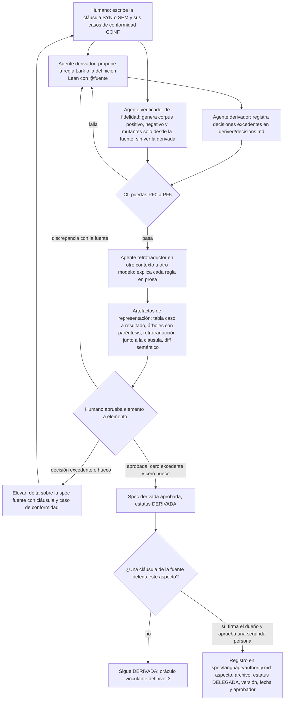

Las puertas PF0–PF5 son las de 3.13.6. PF6 (propiedades Lean) entra en la aprobación solo en el escalón E3. PF7 y PF8 (diferenciales) se ejecutan después de regenerar el nivel 3, cuando existe la implementación. El lazo "Elevar" es el único destino válido de una decisión excedente: la IA nunca edita la spec fuente para que encaje con la derivada.

#### 3.13.5 Cuándo formalizar: escalones E0–E4 y cuándo no

Formalizar tiene un coste que crece mucho de un escalón al siguiente, y casi todo el valor está en los primeros. **(propuesta)** Se sube de escalón solo cuando el anterior está estable y hay una razón concreta para subir. Los escalones son de esfuerzo, no de estatus: una semántica en E3 puede seguir siendo DERIVADA.

**(a) Escalones (propuesta):**

| Escalón | Qué añade | Qué detecta | Coste | Prerrequisito para subir |
|---|---|---|---|---|
| **E0** | Prosa más corpus de conformidad (casos `CONF-` positivos y negativos con veredicto y resultado) | Huecos y contradicciones al escribir los casos. Ejemplos ilustrativos que nadie sabía evaluar | Bajo | Cada cláusula `SYN-` y `SEM-` tiene al menos un caso positivo y, si restringe algo, uno negativo |
| **E1** | Gramática Lark con desambiguación explícita | Decisiones excedentes sintácticas: ambigüedad, conflictos, palabras reservadas, espacios | Bajo-medio | E0 más tabla de operadores (nivel, asociatividad, fijeza), léxico y orden de evaluación escritos en la prosa |
| **E2** | Semántica Lean 4 ejecutable con *fuel*, sin teoremas | Huecos semánticos (casos sin regla), usos incoherentes de un concepto que aparecen como errores de tipos, oráculo para el diferencial con la implementación | Medio | Contrato AST aprobado, sintaxis estable (sin cambios en `SYN-` durante varias semanas) y al menos una persona que lea Lean |
| **E3** | Teoremas metateóricos del núcleo (determinismo, progreso, preservación) | Errores de *soundness*: programas bien tipados que se atascan | Alto, y con mantenimiento recurrente | Una afirmación global que se vaya a hacer de verdad, núcleo estable y al menos dos lectores de Lean |
| **E4** | Implementación extraída de Lean o verificada contra la semántica | Errores del nivel 3 frente al nivel 2, por construcción | Muy alto | Un requisito externo de garantía. Raro en un equipo no regulado |

**(b) Evidencia de coste:**

- **Cedar (AWS):** 1.673 líneas de modelo Lean frente a 15.693 de Rust de producción. La prueba de *soundness* del validador (4.686 líneas) "took 18 person-days" ([AWS Open Source Blog](https://aws.amazon.com/blogs/opensource/lean-into-verified-software-development/); [How We Built Cedar, arXiv 2407.01688](https://arxiv.org/abs/2407.01688)). Un modelo ejecutable pequeño es asequible. Las pruebas cuestan semanas por componente.
- **seL4:** unos 25 persona-año en total. Son 7.500 líneas de C verificadas frente a unas 200.000 de prueba en Isabelle, una ratio de unas 23-27 líneas de prueba por línea de C ([seL4 numbers](https://trustworthy.systems/projects/OLD/l4.verified/numbers)). Heiser estima un coste de "less than $400 per line of code" ([Heiser, 2016](https://microkerneldude.org/2016/06/16/verified-software-can-and-will-be-cheaper-than-buggy-stuff/)). Es la referencia del extremo E4.
- **Lo ligero es barato y rinde:** Klein et al. modelaron en Redex nueve artículos de ICFP 2009, revisados por pares, y encontraron errores en los nueve. Construir el modelo costó más o menos lo que maquetarlo en LaTeX ([Run Your Research, POPL 2012](https://users.cs.northwestern.edu/~robby/lightweight-metatheory)). Es el argumento a favor de E2.
- **Pero lo ligero no lo encuentra todo:** en la mecanización de Wasm, los errores "semánticos" (programas bien tipados que se atascan) aparecieron "during the soundness proof" y eran "difficult to find by hand/light-weight specification" ([Watt, slides](https://www.cl.cam.ac.uk/~caw77/slides/srepls.pdf); [Watt, CPP 2018](https://www.cl.cam.ac.uk/~caw77/papers/mechanising-and-verifying-the-webassembly-specification.pdf)). Es el argumento a favor de E3 cuando hay una afirmación de *soundness*.
- **El mantenimiento llega por dos lados:** las pruebas se rompen tras "seemingly unrelated changes" ([QED at Large, arXiv 2003.06458](https://arxiv.org/abs/2003.06458)), y Lean y Mathlib introducen cambios incompatibles con frecuencia, mitigados con deprecaciones ([Growing Mathlib, arXiv 2508.21593](https://arxiv.org/abs/2508.21593)). Un equipo pequeño paga el *churn* de su lenguaje y el de Lean. **(propuesta)** Se fija `lean-toolchain` y solo se actualiza por decisión explícita, como el modelo LLM en 4.5.

**(c) Cuándo no formalizar con pruebas (propuesta).** Quedarse en E0–E1, o como mucho en E2, si se da alguno de estos casos:

- [ ] DSL pequeño o con semántica heredada obvia (aritmética estándar, evaluación estricta de izquierda a derecha).
- [ ] Fase exploratoria: la sintaxis cambia cada semana y las pruebas se romperían en cada delta.
- [ ] No se va a afirmar ninguna propiedad global (*soundness*, terminación, determinismo).
- [ ] Nadie del equipo lee Lean, o solo una persona: en ese caso la semántica no pasa de DERIVADA y E3 no compensa.

**Cuándo sí** (subir a E2 y considerar E3 en el núcleo):

- [ ] Hay un sistema de tipos y se quiere afirmar *soundness*.
- [ ] Hay o habrá varias implementaciones (intérprete y compilador, o parser de producción distinto de Lark) que deben coincidir.
- [ ] La semántica es sutil: *closures*, efectos, orden de evaluación, *overflow*, errores en tiempo de ejecución.

**(d) Fuera del lenguaje.** En el resto del sistema backend + frontend, un modelo TLA+ o Alloy solo se justifica en concurrencia crítica: reservas, colas, sagas, idempotencia de pagos (5.2.11). Es DERIVADA y nunca dueño del código, y se aprovecha como generador de tests y detector de huecos en la prosa, no como algo con lo que conformar la implementación por trazas (la lección de MongoDB en 3.13.3).

#### 3.13.6 Verificación de fidelidad: puertas PF0–PF8

**La fidelidad no se demuestra: se valida.** Una spec derivada (gramática Lark, semántica Lean 4) se compara con una spec fuente (humana) escrita en prosa. Entre las dos no hay ninguna relación formal que se pueda probar. Boehm separa *verificación* ("building the product right", conformidad con una spec) de *validación* ("building the right product", conformidad con la necesidad) ([IEEE 1012, cita de Boehm 1984](https://en.wikipedia.org/wiki/IEEE_1012)). Comprobar el nivel 2 contra el nivel 1 cae en medio: es **verificación informal contra una fuente no formal, cuyo juez último es el humano**. Por eso la **verificación de fidelidad** (nivel 2 frente a nivel 1) es siempre empírica, por muestreo y con un oráculo aprobado por humanos. No hay que confundirla con la **verificación de conformidad** (nivel 3 frente al nivel 2 y al corpus), que sí puede apoyarse en una spec ejecutable.

**"Compila" no implica "es fiel".** La evidencia viene casi toda de la autoformalización matemática, pero es abundante:

- Poiroux et al. encontraron errores de formalización en **118 entradas (31,8 %)** de los ports a Lean 4 de ProofNet, y esos ports **los habían escrito humanos** ([Reliable Evaluation and Benchmarks for Statement Autoformalization, arXiv 2406.07222](https://arxiv.org/abs/2406.07222)).
- miniF2F-Lean Revisited halló discrepancias entre el enunciado formal y el informal en "more than half of the problems". La literatura daba un 97 % de autoformalización correcta, y el pipeline completo real se quedaba en torno al 36 % ([arXiv 2511.03108](https://arxiv.org/abs/2511.03108)).
- En VERINA (specs de programas en Lean 4), el mejor modelo produce entre un 51 % y un 52 % de specs *sound* y *complete*. En la terminología de VERINA, *soundness* significa que la spec no acepta lo inválido y *completeness* que no rechaza lo válido ([arXiv 2505.23135](https://arxiv.org/abs/2505.23135)).
- *Beyond Compilation* (preprint) mide **29,5 puntos** de diferencia entre "compila" (87,2 %) y "es fiel" (57,7 %) en 227 enunciados de nivel universitario. Lo hace con un agente basado en un modelo de frontera ([arXiv 2606.31002](https://arxiv.org/abs/2606.31002)).
- En el caso de una gramática, el límite es teórico. La equivalencia de dos gramáticas libres de contexto (CFG, *Context-Free Grammar*) y la ambigüedad de una CFG son **indecidibles**. Madhavan, Mayer, Gulwani y Kuncak abordan la equivalencia por enumeración y muestreo: refutan el 74 % de los casos y prueban el 21 % ([Automating Grammar Comparison, OOPSLA 2015](https://2015.splashcon.org/details/oopsla2015/26/Automating-Grammar-Comparison)). Basten lo resume en su tesis (*Ambiguity Detection for Programming Language Grammars*, UvA, 2011; [sin enlace verificado]): como la ambigüedad es indecidible, no puede existir un método de detección perfecto. **Toda puerta sintáctica es, por tanto, un muestreo.** Un resultado verde dice "no encontré contraejemplo en este corpus", nunca "no lo hay".

**(propuesta) Puertas de fidelidad PF0–PF8.** Son nueve comprobaciones computacionales que la spec derivada debe pasar. **Se encajan en los gates G0–G8 de 2.1 y no los sustituyen.** Se llaman PF (*puerta de fidelidad*) en todo el informe para no confundirlas con las fases F0–F9 de 2.1. El orden es fijo, y evita una circularidad:

- **Para aprobar la derivada** (aprobación por representación, 3.13.4): PF0–PF5 en verde, y también PF6 si el escalón es E3. Ninguna de ellas necesita el nivel 3.
- **Después de regenerar el nivel 3**: PF7 y PF8, que comparan la derivada aprobada con la implementación. Se exigen a partir del escalón E2 (3.13.5), cuando existe nivel 3. Un fallo de PF7 o PF8 no desaprueba la derivada por sí solo: abre el triaje de 3.13.7 (e).
- **PF6** solo existe a partir de E3, porque E2 no tiene teoremas.

| Puerta | Qué comprueba | Herramienta concreta | Qué detecta | Qué NO detecta | Gate donde corre | Coste |
|---|---|---|---|---|---|---|
| **PF0** Trazabilidad | Cada regla Lark y cada declaración Lean de la base de confianza lleva `@fuente <ID>@<rev>`, y el ID existe y está aprobado. Cada cláusula SYN-/SEM- tiene al menos un elemento y al menos un caso de conformidad | Script tipo `leanblueprint checkdecls` ([Lean Blueprint](https://github.com/PatrickMassot/leanblueprint)) + lint del `.lark` | Elementos huérfanos (candidatos a `excedente`), cláusulas sin formalizar o sin oráculo, referencias rotas | La fidelidad: solo comprueba que **el nombre existe**, no que diga lo mismo | G1 y G6 | Muy bajo |
| **PF1** Casos positivos y negativos | Los casos CONF positivos parsean con el **árbol esperado** y evalúan al valor esperado. Los negativos fallan con la **clase de error** esperada | pytest sobre `spec/language/conformance/*.yaml` + `#guard`/`#guard_msgs` en Lean | Subgeneración, sobregeneración en los casos escritos, asociatividad equivocada (si el caso trae árbol) | Lo que ningún caso toca. Una gramática `start: /.*/s` aceptaría todos los positivos | G2 (corpus aprobado y en rojo), G4 | Bajo |
| **PF2** Decisiones ocultas | Que la herramienta no tome decisiones en silencio | Lark `parser='lalr', strict=True`; Earley con `ambiguity='explicit'` y `lexer='dynamic_complete'` | Conflictos *shift/reduce* y *reduce/reduce*, colisiones de regex, nodos `_ambig` en el corpus | Ambigüedad en entradas que no se probaron. `strict` no se aplica a Earley. Palabras clave no reservadas: el lexer contextual las deja pasar como `NAME` sin conflicto (ver abajo) | G4 | Bajo |
| **PF3** Cobertura | Que el corpus ejercite cada alternativa (k=1) y cada par padre→hijo (k=2), y cada rama de `eval` | Cobertura de expansiones del [Fuzzing Book](https://www.fuzzingbook.org/html/GrammarCoverageFuzzer.html); *k-paths* (Havrikov, Kampmann y Zeller, [TOSEM 2022](https://publications.cispa.de/articles/journal_contribution/From_Input_Coverage_to_Code_Coverage_Systematically_Covering_Input_Structure_with_k-Paths/24612432)) | Alternativas sin caso: cada una queda en estado `hueco` | Que el caso que cubre la alternativa sea correcto | G5 | Bajo |
| **PF4** Mutación de la derivada | Que el corpus *mate* mutantes de la derivada | Operadores propios: intercambiar niveles de precedencia, left↔right, borrar una alternativa, `?`↔`*`, alterar una regex; en Lean, invertir el orden de evaluación o cambiar un error por un valor | Decisiones de la derivada que ningún caso fija. **Cada mutante superviviente se convierte en una petición de caso** al autor de la fuente | Errores en los que el corpus y la derivada coinciden pero los dos se equivocan | G5 (carril completo) y G8 | Medio |
| **PF5** Exploración generativa revisada | Que lo que la gramática acepta y nadie pidió sea aceptable | `hypothesis.extra.lark.from_lark` → reparsear con el parser real → revisión humana de una muestra | Sobregeneración. **Cada "no" es un caso negativo nuevo**; cada "sí" sorprendente es una posible decisión excedente | Lo que el generador no produce | G5, una vez por versión de la gramática | Medio (tiempo humano) |
| **PF6** Propiedades Lean no vacuas | Teoremas sobre la semántica (determinismo, preservación, terminación de un fragmento) con enunciado aprobado | Plausible antes de probar; `#print axioms`; testigo de no vacuidad | Contradicciones internas de la fuente, semánticas demasiado permisivas, teoremas vacuos | Que la semántica sea la que la prosa quería | G5 (escalón E3) | Alto |
| **PF7** Diferencial Lean ↔ implementación | La semántica Lean ejecutable y el intérprete o compilador del nivel 3 dan lo mismo sobre programas generados | Generador desde la gramática + `#eval` compilado; DRT (*Differential Random Testing*) al estilo Cedar | Bugs del nivel 3, del modelo o del diseño (3.13.7 e) | Errores de modo común: la derivada y el nivel 3 malinterpretan igual la fuente | G5 en cada regeneración del nivel 3; G7 | Medio |
| **PF8** Diferencial Lark ↔ parser de producción | Mismo veredicto y mismo AST normalizado | Corpus + programas generados contra los dos parsers | Divergencias del parser de producción (PEG, *Parsing Expression Grammar*, o escrito a mano) | Nada si los dos son el mismo parser: **solo se exige si difieren** | G5 y G7 | Bajo-medio |

**Detalle de las puertas con trampa.**

- **PF2 y el comportamiento por defecto de Lark.** Lark resuelve los conflictos *shift/reduce* de LALR como *shift*: "By default Lark automatically resolves Shift/Reduce conflicts as Shift. It produces notifications as debug messages" ([How to use Lark](https://lark-parser.readthedocs.io/en/latest/how_to_use.html); [lalr_analysis.py](https://github.com/lark-parser/lark/blob/master/lark/parsers/lalr_analysis.py)). Es exactamente el *dangling else* resuelto sin que nadie lo decida. `strict=True` lo convierte en excepción: "Throw an exception on any potential ambiguity, including shift/reduce conflicts, and regex collisions" ([API Reference](https://lark-parser.readthedocs.io/en/latest/classes.html)). Pero **solo se aplica a LALR** y necesita el paquete `interegular` para las colisiones de regex. Con Earley, el valor por defecto `ambiguity='auto'` equivale a `resolve`, que "will automatically choose the simplest derivation". `ambiguity='explicit'` devuelve nodos `_ambig` (un SPPF, *Shared Packed Parse Forest*, desplegado), **pero solo para las entradas que se prueban**. Además, "inside terminals, Lark cannot detect or resolve ambiguity, even when using Earley", salvo con `lexer='dynamic_complete'` ([Grammar Reference](https://lark-parser.readthedocs.io/en/latest/grammar.html); [Parsers](https://lark-parser.readthedocs.io/en/latest/parsers.html)). La configuración mínima es esta:

```python
# PF2 · derived/grammar: dos pasadas sobre el mismo .lark (requiere pip install "lark[interegular]")
from lark import Lark
G = "derived/grammar/grammar.lark"
lalr  = Lark.open(G, parser="lalr", strict=True)            # falla si hay conflicto o colisión de regex
early = Lark.open(G, parser="earley", ambiguity="explicit",
                  lexer="dynamic_complete")                  # oráculo de ambigüedad, también dentro de terminales
def ambiguo(src): return any(t.data == "_ambig" for t in early.parse(src).iter_subtrees())
```

  Cada conflicto o `_ambig` es una pregunta a la spec fuente (caso **m**, 3.13.7), nunca una prioridad `.N` añadida al `.lark` sin `@fuente`.

  **Hay una tercera decisión silenciosa: el lexer.** Con `parser='lalr'`, el lexer por defecto es el **contextual**, que en cada estado solo prueba los terminales que el parser acepta ahí. Por eso un literal como `"let"` **no queda reservado** frente a `NAME`: donde se espera un nombre, `let` se lee como nombre. Comprobado con Lark 1.3.1 sobre la gramática de 3.13.8 (e) escrita con `%import common.CNAME -> NAME`: LALR con el lexer contextual acepta `let let = 1 in 2`, `let in = 1 in in` e `if then then 1 else 2`, y `strict=True` no avisa porque no hay conflicto. Earley con `lexer='dynamic_complete'` también acepta `let let = 1 in 2`, y además lee `letx=1 in x` como `let x = 1 in x`, porque el lexer dinámico no exige separación entre palabra clave e identificador. La reserva se codifica en la gramática: `NAME` excluye las palabras reservadas y cada palabra clave es un terminal con `\b` (3.13.8 e). Con eso, LALR contextual, LALR `basic`, Earley `dynamic` y Earley `dynamic_complete` dan el mismo veredicto en todos los casos probados. Cada palabra reservada lleva su caso negativo en el corpus.
- **PF4 tiene base teórica.** Ball y Kupferman muestran que la mutación da dos análisis duales. Si se muta la spec y sigue cumpliéndose, se cumple en vacío. Si se muta el sistema y la spec lo sigue aceptando, la spec no cubre esa parte ([Vacuity in Testing, TAP 2008](https://www.cs.huji.ac.il/%7Eornak/publications/tap08.pdf)). Aquí el corpus hace de spec y la derivada de sistema, así que un mutante que sobrevive mide la **cobertura del corpus**. Black, Okun y Yesha definieron operadores de mutación para especificaciones ([ASE 2000](https://doi.org/10.1109/ASE.2000.873652)).
- **PF5 no es fiable sin reparseo.** `from_lark` "does not support grammars that need custom lexing" y "Any lexers will be ignored". Además inserta los terminales `%ignore` con probabilidad 1/4 tras cada símbolo, así que genera tokens pegados (`if`+`x` → `ifx`) que el lexer real lee de otra forma ([hypothesis.extra.lark](https://hypothesis.readthedocs.io/en/latest/_modules/hypothesis/extra/lark.html)). Hay que reparsear cada muestra con el parser real y revisar a mano una muestra pequeña de lo raro.
- **PF6 tiene cuatro reglas.** (1) Antes de probar, Plausible busca contraejemplos ([Plausible](https://reservoir.lean-lang.org/@leanprover-community/plausible)). Necesita una versión **ejecutable** de la semántica, porque una relación inductiva `Step` no se puede testear directamente. (2) Cada teorema va con un **testigo no vacío**: un programa del corpus que cumple las hipótesis (existe uno que evalúa y existe uno que se rechaza). Así se detecta la semántica que "prueba" algo porque no tiene reglas para un constructor. (3) `#print axioms` en CI con **lista blanca**: falla todo axioma distinto de `propext`, `Classical.choice` y `Quot.sound`, que la referencia de Lean llama "standard axioms of Lean's logic, and benign". Una lista negra no basta, porque lo que imprime el cómputo nativo depende de la versión: hasta Lean 4.28 aparecía `Lean.trustCompiler`; "Since Lean 4.29.0", `+native` y `bv_decide` "introduce one dedicated axiom for each computation that is asserted by native computation", y la maquinaria de `Lean.trustCompiler` "was removed from Lean in version 4.35.0" ([Validating Proofs](https://lean-lang.org/doc/reference/latest/ValidatingProofs/)). Comprobado en Lean 4.35.0: un teorema probado con `native_decide` imprime `[tnd._native.native_decide.ax_1_1]`, que un check que buscara `Lean.ofReduceBool` no detectaría. La lista blanca cubre `sorryAx`, `Lean.ofReduceBool`, `Lean.trustCompiler` y cualquier axioma con `_native` en el nombre, todos los cuales meten el compilador o un hueco en la base de confianza. (4) **`partial def` está prohibido en la base de confianza**: "Functions marked partial are treated as opaque constants by the kernel and are neither unfolded nor reduced" ([Lean Reference: Recursive Definitions](https://lean-lang.org/doc/reference/latest/Definitions/Recursive-Definitions/)). Se usa recursión estructural sobre *fuel* o `partial_fixpoint`. Lo que hay que revisar son el enunciado y las definiciones referenciadas. Las pruebas las verifica el kernel ([Validating Proofs](https://lean-lang.org/doc/reference/latest/ValidatingProofs/)).

```lean
-- PF1/PF6 · derived/semantics/Lang/Conformance.lean (fragmento)
-- @fuente SEM-010@r1   (CONF-015: el árbol de "1 - 2 - 3", asociativo por la izquierda según SYN-010, vale -4)
#guard Lang.eval 100 [] (.bin .sub (.bin .sub (.lit 1) (.lit 2)) (.lit 3)) == .ok (-4)
-- El #print axioms de cada teorema va en Audit.lean, que importa las pruebas (3.13.8 f)
```

- **PF7 sigue a Cedar.** AWS usa los modelos Lean como spec ejecutable y genera "millions of inputs" con `cargo-fuzz`: "If they disagree, then we have found a bug". Encontraron 21 bugs con DRT y PBT, y 4 más del validador con pruebas ([How We Built Cedar, arXiv 2407.01688](https://arxiv.org/abs/2407.01688)). WasmRef-Isabelle, un intérprete verificado contra la mecanización de Wasm, es el **oráculo de fuzzing diferencial de Wasmtime** ([PLDI 2023](https://pldi23.sigplan.org/details/pldi-2023-pldi/5/WasmRef-Isabelle-A-Verified-Monadic-Interpreter-and-Industrial-Fuzzing-Oracle-for-We)). En el caso del cliente, el resultado `outOfFuel` de la semántica Lean es **sin veredicto**. No cuenta como discrepancia ni como acierto, y se distingue de los errores del lenguaje.

**Derivadas hermanas.** La gramática Lark y la semántica Lean pueden ser fieles a la fuente cada una y aun así no encajar entre sí. Se cubren con dos comprobaciones más, que corren junto a PF1 y forman parte del check `conformance-3-levels`:

1. **Ida y vuelta Lark → JSON AST → Lean.** El *transformer* de Lark serializa el AST del contrato AST (`spec/language/ast.md`), Lean lo deserializa con `Lean.FromJson` al `inductive` generado (el generador emite las instancias `FromJson` y `ToJson` en `Ast.lean`, 3.13.8 f) y lo evalúa. Un caso que no deserializa es el caso **p** de 3.13.7.
2. **`parse(print(ast)) == ast`** con Hypothesis sobre ASTs generados, usando un *pretty-printer* propio que pone paréntesis según la tabla de operadores de la fuente. Si falla, la gramática y la tabla no coinciden. No conviene usar el Reconstructor de Lark para esto: es "an experimental tool", no regenera regex ("cannot generate values from regexps") y exige `maybe_placeholders=False`, que no es el valor por defecto ([reconstruct.py](https://github.com/lark-parser/lark/blob/master/lark/reconstruct.py); [tree_matcher.py](https://github.com/lark-parser/lark/blob/master/lark/tree_matcher.py)).

**Técnicas inferenciales complementarias, no bloqueantes.** Sirven para encontrar qué preguntar, no para aprobar. Su veredicto lo tría un humano.

- **Retrotraducción ciega**: un agente que solo ve la regla Lean la re-explica en prosa y un humano la compara con la cláusula. Un pipeline de auditoría la usa con un juez que comprueba las dos direcciones de implicación ([arXiv 2606.14000](https://arxiv.org/abs/2606.14000)). La señal es útil pero sobreestima: con Herald, un juez LLM daba un 97 % y la revisión experta, un 67 % (3.13.4).
- **Doble formalización independiente**: dos derivaciones de la misma cláusula, con otro modelo u otro prompt, que se comparan. Li et al. agrupan candidatos por equivalencia lógica ([NeurIPS 2024](https://neurips.cc/virtual/2024/poster/96359)). BEq define la equivalencia bidireccional ([ICLR 2025](https://proceedings.iclr.cc/paper_files/paper/2025/hash/d630537fc4402cfa3ebbc7450a0cac91-Abstract-Conference.html)). El trabajo de *roundtrip* sube la equivalencia de 45-67 % a 79-86 % según dominio y modelo (tabla 1 del paper) y advierte que es "necessary but not sufficient" ([arXiv 2604.25031](https://arxiv.org/abs/2604.25031)): no detecta dos lecturas que se equivocan igual. Para gramáticas solo cabe el diferencial (PF8 entre candidatas).
- **Triángulo de Clover**: consistencia cruzada entre la prosa, la anotación formal y el código. Aceptó hasta el 87 % de los casos correctos sin falsos positivos ([arXiv 2310.17807](https://arxiv.org/abs/2310.17807)). Aplicado aquí: nivel 1 ↔ nivel 2 (retrotraducción y corpus), nivel 2 ↔ nivel 3 (PF7) y nivel 1 ↔ nivel 3 (corpus end-to-end). Si falla un solo par, eso localiza el nivel culpable.
- **nl2postcond**: mide la corrección y el **poder discriminante** de la spec generada, con tests ocultos al generador ("the set of tests T is hidden from the LLM") ([arXiv 2310.01831](https://arxiv.org/abs/2310.01831)). Aquí se traduce en que el agente derivador no ve el corpus de fidelidad (3.13.4).

**Precedentes de validación por suite.** Ninguna semántica industrial se declaró fiel por revisión. Se declararon fieles porque reproducen un corpus que alguien escribió sin mirarlas.

- El intérprete que SpecTec genera pasa el **100 % de la suite oficial aplicable** de Wasm 2.0 (49.833 aserciones). **Excluye el parsing y la validación**, para los que no tiene backend ([PLDI 2024, DOI 10.1145/3656440](https://dl.acm.org/doi/10.1145/3656440)). La fidelidad de la sintaxis necesita un corpus propio.
- JISET pasó **18.064 tests** aplicables de Test262. Se obtuvieron filtrando 35.990, y solo pasaron todos **tras corregir 9 errores de la spec** confirmados por TC39 ([ASE 2020](https://plrg.korea.ac.kr/assets/data/publication/ase20-park-jiset.pdf)).
- KJS pasa los 2.782 tests del núcleo de ES5.1 ([kframework/javascript-semantics](https://github.com/kframework/javascript-semantics)).
- ESMeta corre en el CI de ECMA-262 desde noviembre de 2022: [`esmeta-typecheck.yml`](https://raw.githubusercontent.com/tc39/ecma262/main/.github/workflows/esmeta-typecheck.yml) con una lista explícita de excepciones, [`esmeta-ignore.json`](https://raw.githubusercontent.com/tc39/ecma262/main/esmeta-ignore.json) (16 algoritmos), y [`esmeta-yetcheck.yml`](https://raw.githubusercontent.com/tc39/ecma262/main/.github/workflows/esmeta-yetcheck.yml), que avisa de frases nuevas que la herramienta aún no sabe mecanizar.
- JSTAR, el analizador de tipos de la spec, tuvo una **precisión del 59,2 %**: 157 avisos, de los que 93 eran bugs reales ([ASE 2021](https://plrg.korea.ac.kr/assets/data/publication/ase21-park-jstar.pdf)).

**(propuesta)** Por eso las puertas inferenciales y PF5 necesitan una **lista versionada de divergencias aceptadas**, en una sección "Divergencias aceptadas" de `derived/decisions.md`. Cada entrada tiene el elemento, el motivo, el aprobador y la **fecha de revisión**, y caduca: una entrada vencida hace fallar G7. La lista nunca normaliza el silencio. Lo que no está en ella bloquea, y lo que está tiene dueño y fecha.

#### 3.13.7 Propagación de cambios, versionado y desalineación entre niveles

**(a) Mecanismo: la traza con huella.** Cada elemento de la spec derivada lleva su traza de elemento `@fuente <ID>@<rev>`. En Lark se escribe con la sintaxis de comentario del formato (`// @fuente SYN-010@r2`) y en Lean 4 como comentario sobre cada declaración de la base de confianza. El `@<rev>` es la revisión de la cláusula de 3.12.4 (o el hash de su texto), es decir, su **huella de versión**. **(propuesta)** Un check de CI, `derived-stale`, compara la huella de cada elemento con la revisión vigente de su cláusula. Todo elemento cuya cláusula cambió queda **caducado**, y un archivo con elementos caducados **bloquea regenerar el nivel 3** desde él. Es la versión entre niveles de la detección de anotaciones obsoletas de 4.7.9. La regeneración es **selectiva**: solo se rederivan o revisan los elementos trazados a las cláusulas cambiadas, y el diff de la derivada se revisa por representación (3.13.4). Nunca se regenera la gramática o la semántica entera.

Las **instrucciones de derivación** que recibe el LLM (convenciones de nombres, cómo modelar entornos, errores y orden de evaluación, qué anotaciones de Lark se permiten) se versionan como artefacto propio, y su hash entra en la procedencia del check `provenance` (Anexo F). Son el análogo de las *compile rules* de JISET: reglas genéricas y estables separadas de la salida generada y de los parches curados. JISET las mantuvo "forward compatible" y compiló el 94,31 % de los pasos de cada actualización entre versiones ([ASE 2020](https://plrg.korea.ac.kr/assets/data/publication/ase20-park-jiset.pdf)). Si cambian las instrucciones sin que cambie la fuente y aun así cambia la derivada, es deriva por regeneración: el caso **i** de 7.2, llevado al nivel 2.

Hay precedentes del mecanismo. La FLS (*Ferrocene Language Specification*) da a cada párrafo un ID estable (`` :dp:`fls_pwut2jbmk66k` ``) y mantiene un [changelog](https://github.com/rust-lang/fls/blob/main/src/changelog.rst) que liga cada cambio del lenguaje a los párrafos tocados, aunque allí la dirección es implementación→spec. Test262 exige en cada test el campo `esid`, que "identifies the hash ID from the portion of the ECMAScript draft" ([CONTRIBUTING.md](https://github.com/tc39/test262/blob/main/CONTRIBUTING.md)). Las herramientas de gestión de requisitos como DOORS marcan como *suspect link* el enlace aguas abajo cuando cambia el requisito de arriba. Esto último es conocimiento previo, no verificado en esta investigación.

**(b) Orden de propagación, nunca al revés.** **(propuesta)**

1. Delta de la spec fuente (cláusula con nueva revisión).
2. Casos de conformidad: se añaden o modifican los CONF afectados, que son la parte normativa del oráculo de 1.6.
3. Spec derivada: solo los elementos caducados.
4. Puertas PF0–PF5, más PF6 si el escalón es E3 (3.13.6), y aprobación de la derivada con la nueva huella.
5. Nivel 3: parser e intérprete o compilador, regenerados desde la derivada aprobada.
6. Diferencial sobre el nivel 3 regenerado (PF7, PF8, `conformance-3-levels` y 5.2.13).
7. Tooling: *formatter*, LSP y gramáticas de editor.

**Una edición directa de la derivada sin delta de la fuente se rechaza**, salvo que sea un refactor que no cambia el corpus: el diff semántico sobre el corpus y los programas generados sale vacío. En Lean, las pruebas quedan fuera de esta regla porque no son base de confianza: la IA puede regenerarlas siempre que el enunciado no cambie. **Una reparación de pruebas que debilita un enunciado es un cambio de spec disfrazado de mantenimiento** y se trata como el caso **q**.

**(c) Versionado: ediciones.**

- **Ediciones opt-in por módulo.** En Rust, cada *crate* elige su edición en `Cargo.toml`, y "Crates in one edition must seamlessly interoperate with those compiled with other editions", por lo que los cambios son "skin deep" ([Rust Edition Guide](https://doc.rust-lang.org/edition-guide/editions/index.html)). Go 1.22 cambió la **semántica** de las variables de bucle solo para módulos que declaran `go 1.22` en `go.mod`, con control por archivo mediante `//go:build`: "Old code will continue to mean exactly what it means today" ([Go blog: loopvar](https://go.dev/blog/loopvar-preview)).
- **(propuesta)** Cada cláusula lleva "desde edición N" y, si aplica, "hasta edición M". La gramática Lark se genera por edición (un `.lark` por edición, o terminales condicionados) y la semántica Lean recibe `(ed : Edition)`. Si los cambios de edición son *skin deep*, se intenta demostrar en Lean que todas las ediciones bajan al mismo núcleo. Si no lo son, como en Go, se documenta.
- **Deprecación tipo PEP 387.** La conducta "must not change in an incompatible fashion between any two consecutive releases" sin pasar por deprecación. El aviso se mantiene al menos dos versiones menores e incluye "the release the incompatibility is expected to become the default" ([PEP 387](https://peps.python.org/pep-0387/)). **(propuesta)** En el lenguaje del cliente, la deprecación es un estado de la cláusula que se propaga a todas las derivadas. La gramática sigue aceptando la construcción. Lean añade un juicio de aviso trazado a la cláusula. El LSP lo muestra como diagnóstico y el migrador ofrece la reescritura. Una deprecación que solo existe en el compilador es el caso **s**.
- **Puerta de publicación tipo Stage 4.** En TC39, el texto completo se exige en Stage 2.7, los tests de Test262 se escriben **durante** Stage 2.7, y Stage 4 pide "Two compatible implementations which pass the Test262 acceptance tests" ([TC39 Process](https://tc39.es/process-document/)). **(propuesta)** Una cláusula pasa a publicada en una edición cuando cumple cuatro condiciones:
  1. texto aprobado;
  2. casos de conformidad aprobados (escritos antes que la derivada, como en 2.7);
  3. derivada con cero `excedente` y cero `hueco` en los aspectos afectados;
  4. implementación que coincide con la semántica Lean ejecutable en el corpus y en PF7.

  La semántica Lean y el nivel 3 hacen de "dos implementaciones compatibles".

**(d) Desalineación entre niveles: casos k–s de 7.2.** **(propuesta)** Mismas columnas que 7.2. "Gana la fuente" se lee según la tabla de autoridad por aspecto (3.13.2). Si el aspecto está DELEGADO, la fuente de ese aspecto **es** el artefacto formal, y la prosa que lo contradiga es informativa y se corrige.

| # | Caso | Quién gana | Cómo se resuelve | Quién decide | Registro |
|---|---|---|---|---|---|
| **k** | **La derivada contradice a la fuente**: la fuente decide X de forma inequívoca y la derivada hace Y | La spec fuente | Se corrige la derivada, **nunca** la fuente para que encaje. Si no había caso de conformidad que lo fijara, se añade. Si el nivel 3 ya sigue a Y, se pasa al caso **o** | Dueño de la spec fuente | Corrección de la derivada + CONF nuevo |
| **l** | **Decisión excedente**: la derivada decide lo que la fuente calla (precedencia, asociatividad, orden de evaluación, overflow, prioridad de Lark, resolución de un conflicto LALR) | Nadie hasta que decide un humano | Estado `excedente` en `derived/decisions.md`. Bloquea la aprobación. **Se eleva**: delta de la fuente con cláusula y CONF, o se elimina. Las anotaciones de herramienta (alias, `?rule`, prioridades solo de rendimiento) se marcan `no-normativa` y no cuentan | Dueño de la spec fuente | Delta ADDED o MODIFIED + CONF; entrada cerrada en `decisions.md` |
| **m** | **La formalización revela una fuente ambigua o contradictoria**: un `_ambig`, un conflicto LALR, un teorema que no se demuestra porque dos cláusulas chocan | Nadie: es el caso **d** de 7.2 en el nivel 1 | Estado `hueco`. La IA propone las opciones con un caso que distinga cada una. El humano decide y escribe la cláusula. Hasta entonces, el aspecto no se regenera en el nivel 3 | Dueño de la spec fuente | Delta MODIFIED + CONF |
| **n** | **Compila o se demuestra, pero es infiel**: falla un caso de conformidad, el teorema es vacuo o hay un mutante superviviente sobre una cláusula con caso | La spec fuente | Se corrige la derivada. **Nunca se cambia el caso sin delta**, porque el oráculo es normativo (1.6). Si el teorema era vacuo, se añade su testigo | Revisor de la derivada (3.13.4) | Incidente de fidelidad + corrección |
| **o** | **La implementación es conforme a la derivada pero no a la fuente** | La spec fuente | Primero se corrige la derivada (**k** o **n**) y después el nivel 3. Nunca al revés. PF7 no lo ve, porque los dos coinciden: lo detecta `conformance-3-levels` | Dueño de la spec fuente | Corrección de nivel 2 y nivel 3 en el mismo cambio |
| **p** | **Las derivadas hermanas discrepan**: Lark produce un AST que Lean no modela, o con otra asociatividad | La que coincide con el corpus. Si las dos lo pasan, el contrato AST | Se regeneran el *transformer* y el `inductive` desde `spec/language/ast.md`. Si el contrato calla, se trata como caso **l** | Dueño del contrato AST | Delta del contrato AST o corrección |
| **q** | **Edición directa de la derivada** sin delta de la fuente (o un enunciado Lean debilitado al reparar pruebas) | La spec fuente | Se rechaza, salvo refactor con diff semántico vacío. Se restaura | Revisor | Incidente de proceso (como **f'**) |
| **r** | **Derivada caducada**: la huella no coincide con la revisión vigente de la cláusula | La spec fuente | `derived-stale` bloquea la regeneración del nivel 3. Se re-revisan solo los elementos trazados y se re-aprueba con la huella nueva | Dueño de la derivada | Re-aprobación con huella nueva |
| **s** | **El tooling diverge del parser** (*formatter*, LSP, tree-sitter), **o hay desalineación de edición** (una regla de la edición N+1 se aplica a un módulo de la N) | La derivada aprobada para la sintaxis; la edición declarada del módulo | El tooling se deriva de la misma gramática o se somete al diferencial PF8 contra ella. *Formatter*: `parse(format(x)) ≅ parse(x)` e idempotencia. Edición: tests por edición en el corpus | Tech lead | Bug de nivel 3 |

**Caso aparte: la realidad de la implementación.** El nivel 3 ya se usa, hay programas que dependen de un comportamiento que la fuente no dice o contradice, y romperlos tiene coste. ECMA-262 lo resolvió con su Anexo B. Ese anexo codifica semántica heredada de los navegadores marcada de forma visible: "All of the language features and behaviours specified in this annex have one or more undesirable characteristics and in the absence of legacy usage would be removed from this specification" ([ECMA-262, Anexo B](https://tc39.es/ecma262/#sec-additional-ecmascript-features-for-web-browsers)). Los anexos E y F registran los cambios con impacto de compatibilidad. **(propuesta)** La regla "la implementación nunca gana" se mantiene, pero el caso abre una **decisión humana con tres salidas**:

1. **bug**: se corrige el nivel 3, con aviso si alguien depende de él;
2. **cláusula *legacy***: se añade a la fuente, marcada y con "hasta edición M";
3. **deprecación** en la próxima edición, con migrador.

Hasta que se decide, el caso queda registrado como desalineación conocida, con dueño y fecha. Enlaza con el caso **g** de 7.2: promover o deprecar con *parallel change*. La lección de JEST va en la misma línea. Su testing diferencial N+1 entre motores y la spec mecanizada encontró 27 bugs de la spec, y varios se resolvieron **cambiando la spec** ([arXiv 2102.07498](https://arxiv.org/abs/2102.07498)). Que la mayoría coincida solo señala dónde mirar, no decide.

**(e) Discrepancia Lean ↔ implementación: tres culpables posibles.** Cedar documenta los tres ([arXiv 2407.01688](https://arxiv.org/abs/2407.01688)):

- **el código**: Rust aceptaba octales en direcciones IPv4;
- **el modelo**: el modelo Lean rechazaba `"::"` en IPv6;
- **el diseño**: una funcionalidad de tamaño de *strings* se eliminó "after agreeing that it confuses users more than it benefits them".

**(propuesta)** El triaje de una discrepancia de PF7 sigue ese reparto:

- si el código está mal, se corrige el nivel 3 (como en el caso **b** de 7.2);
- si el modelo está mal, es el caso **n**;
- si la discrepancia revela algo que la fuente no fijaba, es el caso **l** o **m**, se **eleva** y no gana nadie hasta que decide el humano.

La spec derivada nunca se parchea en silencio para que coincida con el código: eso sería editarla sin delta (**q**).

#### Diagrama 3.13-D. Propagación de un cambio por la cadena de tres niveles

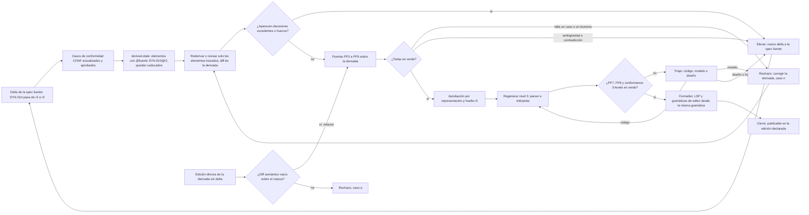

#### Diagrama 3.13-E. Árbol de decisión ante una desalineación entre niveles

Extiende el Diagrama 9 para divergencias en las que interviene una spec derivada. Incluye las dos salidas que no son casos k–s: la deriva por regeneración de la propia derivada (caso **i** de 7.2 llevado al nivel 2, 3.13.7 a) y el bug de implementación con la derivada fiel (caso **b** de 7.2), que es el resultado más frecuente de PF7.

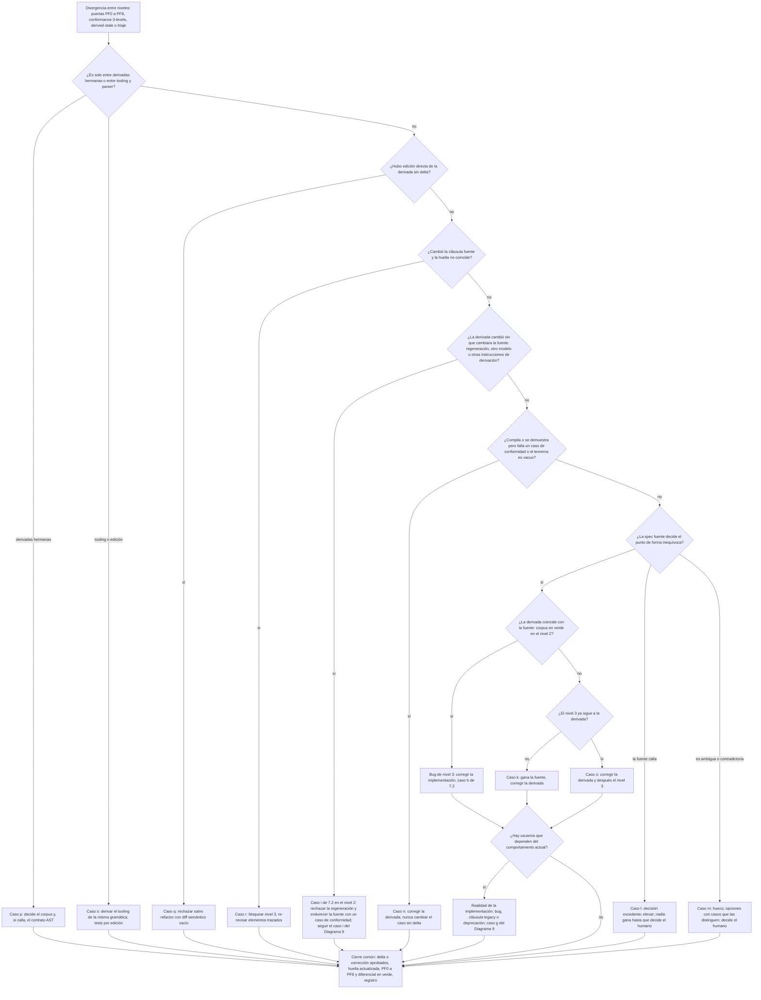

#### 3.13.8 Caso completo: un lenguaje nuevo de la prosa a la implementación

**Todo este caso es (propuesta).** El código es ilustrativo, pero se comprobó lo que se podía comprobar sin el repositorio completo. La gramática Lark de (e) se construyó con Lark 1.3.1 (con `interegular` para `strict=True`) en LALR contextual y `basic` y en Earley `dynamic` y `dynamic_complete`, y se parsearon los programas de los casos de conformidad y de los episodios. Los módulos Lean `Ast`, `Semantics`, `Conformance` y `Theorems` de (f) compilan con Lean 4.35.0, pasan todos los `#guard` y la ida y vuelta JSON del AST. No se escribieron ni se comprobaron las pruebas de `Proofs/`, y no se ejecutaron `parser.py`, los tests de pytest ni el diferencial. Aplica sin redefinirlos la postura de 3.13.2 (regla R-DER-1 de un dueño por aspecto y los estatus DERIVADA, DELEGADA y CO-NORMATIVA), los roles y la revisión por representación de 3.13.4, las puertas PF0–PF8 de 3.13.6 y los casos k–s de 3.13.7. El lenguaje se llama **Lumen**: enteros, `+ - * / ^`, comparaciones `< <= ==`, `let x = e in e`, `if c then e else e` y variables. La spec fuente (humana) está en prosa con casos de conformidad. Se derivan una gramática para Lark y una semántica en Lean 4, y la implementación es un intérprete en Python.

**(a) Estructura del repositorio.** Amplía la de 3.8. Cada línea lleva la categoría de artefacto de 3.13.3: **C1** spec fuente · **C2** spec derivada, base de confianza · **C3** pruebas Lean, regenerables · **C4** corpus de fidelidad del agente verificador · **C5** generado determinista · **C6** implementación, con las cuatro categorías de 4.6.

```text
/spec
  /language
    syntax.md              # C1 · LEX-001.., SYN-001..: léxico, tabla de operadores, construcciones
    semantics.md           # C1 · SEM-001..: evaluación, orden, errores, sombreado
    ast.md                 # C1 · AST-001..: contrato AST DELEGADO (nació DERIVADA de SYN- y SEM-); único dueño de la sintaxis abstracta
    authority.md           # C1 · tabla de autoridad por aspecto
    /conformance
      operators.yaml       # C1 · casos CONF- normativos: oráculo compartido de 1.6
      evaluation.yaml      # C1 · ídem
/derived
  decisions.md             # registro de decisiones excedentes y huecos (no normativo; lo cierra un humano)
  /grammar
    grammar.lark           # C2 · spec derivada; nace DERIVADA, delegable para sintaxis concreta (h)
  /semantics
    lean-toolchain         # fijado (p. ej. leanprover/lean4:v4.35.0, con la que se comprobó este caso); cambia solo por decisión explícita
    lakefile.toml          # configuración del proyecto Lean; revisión humana
    /Lang
      Ast.lean             # C5 · generado determinista desde ast.md
      Semantics.lean       # C2 · base de confianza: Err, Env, applyOp, eval
      Theorems.lean        # C2 · enunciados aprobados por un humano
      Conformance.lean     # C5 · generado desde conformance/*.yaml
      Main.lean            # C6 · CLI fino: AST en JSON → eval, para el diferencial PF7
      Audit.lean           # C5 · #print axioms de cada teorema, lo lee la CI
      /Proofs              # C3 · pruebas regenerables por IA; sin sorry ni axiomas nuevos
  /fidelity                # C4 · mutantes, programas generados y su revisión humana (PF4, PF5)
/src/lang
  parser.py                # C6 · carga grammar.lark con Lark(parser='lalr', strict=True)
  transformer.py           # C6 · árbol Lark → AST; no impone restricciones sintácticas propias
  ast.py                   # C5 · generado determinista desde ast.md
  interpreter.py           # C6 · implementación (nivel 3)
  formatter.py             # C6 · comprobado con ida y vuelta e idempotencia
  /lsp                     # C6 · usa la misma gramática que parser.py
/tests/conformance         # código de test derivado y protegido (1.6)
  runner.py                # ejecuta cada CONF contra Lark, Lean e intérprete (los tres niveles)
  test_syntax.py           # PF1 y PF2
  test_differential.py     # PF7
```

**(b) Cláusulas de ejemplo.** Formato de cláusula de 3.3.3. Los **casos de conformidad** son normativos y alimentan el corpus de conformidad. Los **ejemplos ilustrativos** son informativos y ningún test los usa como oráculo.

```markdown
### SYN-010 Tabla de operadores
**Tipo:** sintaxis · **Rev:** r2 · **Desde edición:** 1 · **Verificación:** PF1, PF2, PF4
THE PARSER SHALL agrupar las expresiones según esta tabla (nivel 0 = liga menos):

| Nivel | Operadores | Asociatividad | Fijeza |
|---|---|---|---|
| 0 | `let … in …`, `if … then … else …` | se extienden hasta el final | prefija; como operando de otro operador exigen paréntesis |
| 1 | `<` `<=` `==` | **no asociativa**: `a < b < c` se rechaza | infija |
| 2 | `+` `-` | izquierda | infija |
| 3 | `*` `/` | izquierda | infija |
| 4 | `-` (unario) | — | prefija; `-2 ^ 2` es `-(2 ^ 2)` |
| 5 | `^` | **derecha** | infija; el operando derecho no empieza por `-` sin paréntesis |

IF una expresión encadena dos operadores de nivel 1 sin paréntesis
THEN THE PARSER SHALL rechazarla con un error de sintaxis.

Casos de conformidad (normativos): CONF-011 · CONF-012 · CONF-013 · CONF-014
> *Ejemplo ilustrativo (informativo):* `1 + 2 * 3` se lee `1 + (2 * 3)`.

### SEM-020 Orden de evaluación
**Tipo:** semántica dinámica · **Rev:** r2 · **Desde edición:** 1
WHEN se evalúa un operador binario, THE EVALUATOR SHALL evaluar por completo el operando
izquierdo antes que el derecho y SHALL devolver el primer error que se produzca.
Caso de conformidad (normativo): CONF-021 — `x + 1 / 0` sin `x` definida → `Unbound "x"`, no `DivByZero`.
> *Ejemplo ilustrativo (informativo):* `(1 + 2) * (3 + 4)` evalúa primero `1 + 2`.

### SEM-021 División entera
**Tipo:** semántica dinámica · **Rev:** r1 · **Desde edición:** 1
IF el divisor de `/` vale 0 THEN THE EVALUATOR SHALL terminar con el error `DivByZero`.
En otro caso, THE EVALUATOR SHALL truncar el cociente hacia cero.
Casos de conformidad (normativos): CONF-031 — `10 / (3 - 3)` → `DivByZero` · CONF-032 — `-7 / 2` → `-3`.
> *Ejemplo ilustrativo (informativo):* `7 / 2` vale `3`.

### SEM-030 Sombreado de let
**Tipo:** semántica dinámica · **Rev:** r1 · **Desde edición:** 1
WHEN el cuerpo de `let x = e1 in e2` usa `x`, THE EVALUATOR SHALL usar el enlace más interno.
`e1` se evalúa en el entorno exterior.
Caso de conformidad (normativo): CONF-041 — `let x = 1 in let x = x + 1 in x` → `2`.
> *Ejemplo ilustrativo (informativo):* `let x = 1 in (let x = 2 in x) + x` vale `3`.
```

La regla de truncamiento de SEM-021 importa porque los dos lenguajes de la cadena no coinciden por defecto. En Python, `//` redondea hacia abajo. En Lean 4, el `/` de `Int` no trunca. Si la prosa no lo dijera, cada nivel decidiría algo distinto. Por eso la semántica usa `Int.tdiv` y el intérprete implementa la truncación de forma explícita.

**(c) Casos de conformidad en YAML.**

```yaml
# spec/language/conformance/operators.yaml · C1, normativo, versionado con la spec fuente
cases:
  - id: CONF-011                    # positivo
    clause: SYN-010@r2
    edition: 1
    program: "2 ^ 3 ^ 2"
    verdict: acepta
    tree: "(pow (lit 2) (pow (lit 3) (lit 2)))"   # S-expresión sobre los nombres de ast.md, no sobre alias de Lark
    value: 512
  - id: CONF-012                    # negativo
    clause: SYN-010@r2
    edition: 1
    program: "a < b < c"
    verdict: rechaza
    error: sintaxis
  - id: CONF-003                    # negativo: una palabra reservada no puede ser nombre (en el repositorio, lexical.yaml)
    clause: LEX-003@r1
    edition: 1
    program: "let let = 1 in 2"
    verdict: rechaza
    error: sintaxis
  - id: CONF-004                    # positivo: un nombre que empieza por una palabra reservada sí es nombre
    clause: LEX-003@r1
    edition: 1
    program: "let letx = 1 in letx + 1"
    verdict: acepta
    tree: "(letE letx (lit 1) (add (var letx) (lit 1)))"
    value: 2
  - id: CONF-031                    # error de ejecución
    clause: SEM-021@r1
    edition: 1
    program: "10 / (3 - 3)"
    verdict: error
    tree: "(div (lit 10) (sub (lit 3) (lit 3)))"
    error: DivByZero
```

**(d) Tabla de autoridad por aspecto.** Estado antes de la delegación de (h):

```markdown
<!-- spec/language/authority.md · C1 -->
| Aspecto | Dueño normativo | Estatus de la derivada que lo codifica | Versión | Delegación | Aprobador |
|---|---|---|---|---|---|
| Léxico | spec/language/syntax.md (LEX-) | grammar.lark: DERIVADA | LEX@r3 | — | — |
| Sintaxis concreta | spec/language/syntax.md (SYN-001..009, 020..029) | grammar.lark: DERIVADA | SYN@r4 | — | — |
| Precedencia y asociatividad | spec/language/syntax.md (SYN-010) | grammar.lark: DERIVADA | SYN-010@r2 | — | — |
| Sintaxis abstracta (AST) | spec/language/ast.md (AST-) | ast.md: DELEGADA; Ast.lean y ast.py se generan de él (C5) | AST@r2 | `<fecha>` | `<autora>` + `<segundo aprobador>` |
| Semántica estática | no aplica en la edición 1 (sin tipos) | — | — | — | — |
| Semántica dinámica | spec/language/semantics.md (SEM-) | Semantics.lean: DERIVADA | SEM@r5 | — | — |
| Orden de evaluación | spec/language/semantics.md (SEM-020) | Semantics.lean: DERIVADA | SEM-020@r2 | — | — |
| Errores y diagnósticos | semantics.md (clase de error); el texto de los mensajes no es normativo | Semantics.lean: DERIVADA | SEM@r5 | — | — |
| Recuperación de errores del parser | no normativo (implementación) | — | — | — | — |
```

**(e) Regla Lark.** Cabecera de 3.13.3. Lo normativo son las reglas y los terminales. Los alias (`-> nombre`), los prefijos `?` y `_`, los nombres de reglas y las opciones del parser son **no normativos**: dan forma al árbol, y el árbol se compara siempre a través del contrato AST.

```lark
// DERIVED SPEC — EDIT ONLY VIA TRACED DIFF (no regenerar en bloque)
// Category: C2 (spec derivada, base de confianza)
// Owner: spec/language/syntax.md (LEX-001..006, SYN-001..022) · Authority: spec/language/authority.md
// Status: sintaxis-concreta=DERIVADA · precedencia=DERIVADA (dueña: SYN-010)
// State: excedente=0 · hueco=0 · caducado=0 · Approved: 2026-10-14
// Proposed-by: Model <id exacto> · Agent <herramienta>@<versión> · Instructions sha256:…
// no-normativa: alias (-> x), prefijos ? y _, nombres de reglas, configuración del parser

start: expr                                        // @fuente SYN-001@r1

?expr: _LET NAME "=" expr _IN expr     -> let_     // @fuente SYN-020@r1 · SYN-010@r2 (nivel 0)
     | _IF expr _THEN expr _ELSE expr  -> if_      // @fuente SYN-021@r1 · SYN-010@r2 (nivel 0)
     | comparison

?comparison: sum COMP_OP sum           -> cmp      // @fuente SYN-010@r2 (nivel 1, no asociativa)
           | sum

?sum: sum "+" product                  -> add      // @fuente SYN-010@r2 (nivel 2, izquierda)
    | sum "-" product                  -> sub
    | product

?product: product "*" unary            -> mul      // @fuente SYN-010@r2 (nivel 3, izquierda)
        | product "/" unary            -> div
        | unary

?unary: "-" unary                      -> neg      // @fuente SYN-010@r2 (nivel 4, prefija)
      | power

?power: atom "^" power                 -> pow      // @fuente SYN-010@r2 (nivel 5, derecha)
      | atom

?atom: INT                             -> lit      // @fuente LEX-002@r1
     | NAME                            -> var      // @fuente LEX-001@r2 (reservadas: LEX-003)
     | "(" expr ")"                                // @fuente SYN-002@r1

// Palabras reservadas (LEX-003): terminales con \b, y NAME las excluye
_LET: /let\b/                                      // @fuente LEX-003@r1
_IN: /in\b/                                        // @fuente LEX-003@r1
_IF: /if\b/                                        // @fuente LEX-003@r1
_THEN: /then\b/                                    // @fuente LEX-003@r1
_ELSE: /else\b/                                    // @fuente LEX-003@r1
NAME: /(?!(?:let|in|if|then|else)\b)[A-Za-z_][A-Za-z0-9_]*/   // @fuente LEX-001@r2 · LEX-003@r1

COMP_OP: "<=" | "<" | "=="                         // @fuente LEX-004@r1
COMMENT: /#[^\n]*/                                 // @fuente LEX-005@r1
%import common.INT
%import common.WS
%ignore WS                                         // @fuente LEX-006@r1
%ignore COMMENT                                    // @fuente LEX-005@r1
```

Que `comparison` no sea asociativa sale de la forma de la regla: después de `sum COMP_OP sum` no existe ninguna producción que acepte otro `COMP_OP`, así que CONF-012 falla en el parser. Las palabras de LEX-003 (`let`, `in`, `if`, `then`, `else`) **no** quedan reservadas solo por escribirlas como literales: con el lexer contextual de LALR, Lark no reserva por sí solo los literales frente a `NAME` (3.13.6, PF2). La reserva se codifica en dos sitios: el terminal `NAME` las excluye con una búsqueda anticipada negativa, y cada palabra clave es un terminal con `\b`, para que Earley no lea `letx` como `let` seguido de `x`. Los terminales con `_` delante no aparecen en el árbol. CONF-003 fija la reserva y CONF-004 que `letx` sigue siendo un nombre válido. Comprobado con Lark 1.3.1: la gramática construye con `strict=True` y los cuatro lexers probados dan el mismo veredicto.

Configuración (no normativa, pero versionada con la gramática) y test de PF1 y PF2:

```python
# src/lang/parser.py · C6
from lark import Lark
GRAMMAR = "derived/grammar/grammar.lark"
PARSER = Lark.open(GRAMMAR, parser="lalr", strict=True,      # strict: shift/reduce y colisiones = error
                   maybe_placeholders=False, propagate_positions=True)
EARLEY = Lark.open(GRAMMAR, parser="earley", ambiguity="explicit",
                   lexer="dynamic_complete")                 # solo para PF2: expone las ambigüedades
```

```python
# tests/conformance/test_syntax.py · test derivado y protegido (1.6)
import pathlib, yaml, pytest
from lark import UnexpectedInput
from lang.parser import PARSER, EARLEY
from lang.transformer import to_ast
from lang.ast import to_sexpr

CASES = [c for f in sorted(pathlib.Path("spec/language/conformance").glob("*.yaml"))
         for c in yaml.safe_load(f.read_text())["cases"]]

@pytest.mark.parametrize("case", CASES, ids=lambda c: c["id"])
def test_pf1_arbol_o_rechazo(case):
    if case["verdict"] == "rechaza":
        with pytest.raises(UnexpectedInput):
            PARSER.parse(case["program"])
    else:
        assert to_sexpr(to_ast(PARSER.parse(case["program"]))) == case["tree"]

@pytest.mark.parametrize("case", [c for c in CASES if c["verdict"] != "rechaza"], ids=lambda c: c["id"])
def test_pf2_sin_ambiguedad(case):
    assert not list(EARLEY.parse(case["program"]).find_data("_ambig"))
```

**(f) Semántica en Lean 4.** `Ast.lean` (C5) se genera desde `ast.md`, igual que `ast.py`, así que las dos derivadas hermanas comparten la misma sintaxis abstracta:

```lean
-- Code generated by astgen@1.2 from spec/language/ast.md (AST-001..AST-004)@r2; DO NOT EDIT.
import Lean.Data.Json
namespace Lang

inductive BinOp
  | add | sub | mul | div | pow | lt | le | eq
  deriving Repr, DecidableEq, Lean.FromJson, Lean.ToJson

inductive Expr
  | lit  (n : Int)                      -- AST-001
  | var  (x : String)                   -- AST-001
  | neg  (a : Expr)                     -- AST-002
  | bin  (op : BinOp) (a b : Expr)      -- AST-002
  | letE (x : String) (v body : Expr)   -- AST-003
  | ite  (c t f : Expr)                 -- AST-004
  deriving Repr, DecidableEq, Lean.FromJson, Lean.ToJson

end Lang
```

Las instancias `FromJson` y `ToJson` derivadas fijan el formato de la ida y vuelta de 3.13.6: con Lean 4.35.0, `1 - x` se serializa como `{"bin": {"op": "sub", "b": {"var": {"x": "x"}}, "a": {"lit": {"n": 1}}}}` (el orden de las claves no importa). El *transformer* de Python emite ese mismo formato, y el generador `astgen` produce los dos lados desde `ast.md`.

`Semantics.lean` (C2, base de confianza). Usa recursión estructural sobre `fuel` y no `partial def`, que sería opaca para las pruebas. `outOfFuel` está separado de los errores del lenguaje:

```lean
/- DERIVED SPEC — EDIT ONLY VIA TRACED DIFF
    Category: C2 (base de confianza) · Owner: spec/language/semantics.md (SEM-010..SEM-041)
    Status: semantica-dinamica=DERIVADA · orden-evaluacion=DERIVADA · errores=DERIVADA
    Coverage: semántica dinámica completa de la edición 1; no cubre el texto de los diagnósticos
    State: excedente=0 · hueco=0 · caducado=0
    Proposed-by: Model <id exacto> · Agent <herramienta>@<versión> · Instructions sha256:…
-/
import Lang.Ast
namespace Lang

inductive Err
  | divByZero              -- @fuente SEM-021@r1
  | unbound (x : String)   -- @fuente SEM-012@r1
  | outOfFuel              -- no es un error del lenguaje: "sin veredicto" (3.13.6, PF7)
  deriving Repr, DecidableEq

deriving instance DecidableEq for Except   -- no normativo: lo necesitan #guard y decide

abbrev Env := List (String × Int)

/-- @fuente SEM-012@r1 · SEM-030@r1: el enlace más reciente está al principio de la lista. -/
def Env.lookup (env : Env) (x : String) : Except Err Int :=
  match env.find? (·.1 == x) with
  | some (_, v) => .ok v
  | none        => .error (.unbound x)

/-- @fuente SEM-021@r1 · SEM-022@r1 · SEM-023@r1 -/
def applyOp : BinOp → Int → Int → Except Err Int
  | .add, a, b => .ok (a + b)
  | .sub, a, b => .ok (a - b)
  | .mul, a, b => .ok (a * b)
  | .div, a, b => if b = 0 then .error .divByZero else .ok (a.tdiv b)   -- trunca hacia cero
  | .pow, a, b =>
      if b ≥ 0 then .ok (a ^ b.toNat)
      else if a = 0 then .error .divByZero
      else .ok (Int.tdiv 1 (a ^ b.natAbs))                                -- SEM-022: exponente negativo
  | .lt, a, b => .ok (if a < b then 1 else 0)                            -- SEM-023: 1 = cierto, 0 = falso
  | .le, a, b => .ok (if a ≤ b then 1 else 0)
  | .eq, a, b => .ok (if a = b then 1 else 0)

/-- Evaluación de expresiones.
@fuente SEM-010@r1 · SEM-020@r2 · SEM-030@r1 · SEM-040@r2 · SEM-041@r1
Orden explícito (SEM-020): el operando izquierdo se evalúa entero antes que el derecho.
Solo se evalúa la rama tomada de un `if` (SEM-040, SEM-041). -/
def eval : (fuel : Nat) → Env → Expr → Except Err Int
  | 0,        _,   _ => .error .outOfFuel
  | fuel + 1, env, e =>
    match e with
    | .lit n => .ok n
    | .var x => env.lookup x
    | .neg a => do
        let v ← eval fuel env a
        pure (-v)
    | .bin op a b => do
        let va ← eval fuel env a          -- primero el izquierdo
        let vb ← eval fuel env b          -- después el derecho
        applyOp op va vb
    | .letE x v body => do
        let vv ← eval fuel env v          -- e1 en el entorno exterior
        eval fuel ((x, vv) :: env) body   -- el enlace interno sombrea
    | .ite c t f => do
        let vc ← eval fuel env c
        if vc ≠ 0 then eval fuel env t else eval fuel env f

end Lang
```

`Conformance.lean` (C5) se genera desde el corpus. Como el parser vive fuera de Lean, cada caso usa el AST literal que corresponde a su campo `tree`:

```lean
-- Code generated by cnfgen from spec/language/conformance/*.yaml (edición 1); DO NOT EDIT.
import Lang.Semantics
open Lang

def evalTop (e : Expr) : Except Err Int := eval 10000 [] e

-- CONF-011 (SYN-010@r2): 2 ^ 3 ^ 2
#guard evalTop (.bin .pow (.lit 2) (.bin .pow (.lit 3) (.lit 2))) == .ok 512
-- CONF-021 (SEM-020@r2): x + 1 / 0 → el operando izquierdo falla primero
#guard evalTop (.bin .add (.var "x") (.bin .div (.lit 1) (.lit 0))) == .error (.unbound "x")
-- CONF-031 (SEM-021@r1): 10 / (3 - 3)
#guard evalTop (.bin .div (.lit 10) (.bin .sub (.lit 3) (.lit 3))) == .error .divByZero
-- CONF-041 (SEM-030@r1): let x = 1 in let x = x + 1 in x
#guard evalTop (.letE "x" (.lit 1) (.letE "x" (.bin .add (.var "x") (.lit 1)) (.var "x"))) == .ok 2
```

`Theorems.lean` (C2) solo contiene enunciados escritos a partir de la prosa. Un humano los aprueba por representación (3.13.4). Cada uno lleva un testigo de no vacuidad:

```lean
import Lang.Semantics
namespace Lang

/-- @fuente SEM-050@r1: "dar más combustible no cambia un resultado ya obtenido". -/
def FuelMono : Prop :=
  ∀ (n : Nat) (env : Env) (e : Expr) (v : Int),
    eval n env e = .ok v → eval (n + 1) env e = .ok v

/-- @fuente SEM-030@r1: en dos `let` anidados con el mismo nombre gana el interno. -/
def ShadowInner : Prop :=
  ∀ (n : Nat) (env : Env) (x : String) (v₁ v₂ : Int),
    eval (n + 3) env (.letE x (.lit v₁) (.letE x (.lit v₂) (.var x))) = .ok v₂

-- Testigos de no vacuidad: la premisa de FuelMono se cumple y también puede fallar.
example : ∃ n env e v, eval n env e = .ok v := ⟨1, [], .lit 7, 7, rfl⟩
example : eval 5 [] (.var "y") = .error (.unbound "y") := by decide

end Lang
```

`Proofs/FuelMono.lean` (C3) contiene `theorem Lang.fuelMono : Lang.FuelMono`. La prueba, de unas cuarenta líneas, hace inducción sobre `n` con casos sobre `e`. La escribe y la regenera la IA, y nadie la revisa línea a línea. La CI solo exige tres cosas: que compile, que no tenga `sorry` y que el enunciado no haya cambiado respecto del hash aprobado de `Theorems.lean`. Además, `Audit.lean` imprime los axiomas de cada teorema:

```lean
-- Lang/Audit.lean · lista blanca: la CI falla con cualquier axioma distinto de
-- propext, Classical.choice y Quot.sound (sorryAx, Lean.ofReduceBool, Lean.trustCompiler,
-- o desde Lean 4.29 cualquier axioma con "_native" en el nombre)
import Lang.Proofs.FuelMono
import Lang.Proofs.ShadowInner
#print axioms Lang.fuelMono
#print axioms Lang.shadowInner
```

Para PF7, `Main.lean` compila la semántica a un ejecutable de referencia. El test diferencial genera programas desde la gramática con `hypothesis.extra.lark.from_lark`. Como esa función ignora el lexer, cada programa se vuelve a parsear con el parser real y se descarta si no parsea:

```python
# tests/conformance/test_differential.py · PF7
@given(programs_from_grammar())                      # from_lark + reparseo con PARSER
def test_pf7_lean_vs_python(src):
    ast = to_ast(PARSER.parse(src))
    ref = run_lean_reference(ast, fuel=10_000)       # derived/semantics: lake exe lang-ref
    if ref.error == "outOfFuel":
        return                                       # sin veredicto, no es discrepancia
    assert interpret(ast) == ref
```

**(g) Flujo narrado: dos episodios.**

**Episodio 1: decisión excedente sobre `^`.**

1. En `SYN-010@r1` la tabla decía "`^` potencia, nivel 5", pero no tenía columna de asociatividad. Tampoco había ningún caso con dos `^` encadenados.
2. El agente derivador propone `?power: power "^" atom | atom`, es decir, asociatividad por la izquierda (`2 ^ 3 ^ 2` = 64). Si la gramática hubiera sido ambigua (`power "^" power`) con Earley en `ambiguity='resolve'`, Lark habría elegido en silencio.
3. PF1 pasa, porque ningún caso la contradice. PF2 pasa, porque la regla no es ambigua. Pero PF4 falla: el agente verificador muta la asociatividad (mutante M-17, `atom "^" power`) y el mutante **sobrevive** a todo el corpus. PF0 pasa, porque la regla lleva `@fuente SYN-010@r1` y PF0 solo comprueba que la cláusula citada existe y está aprobada, no que diga lo mismo. El fallo de fondo es del derivador: debió marcar la regla `excedente`, porque SYN-010@r1 no decía la asociatividad, y no lo hizo. PF4 lo destapa.
4. El verificador abre la entrada en `derived/decisions.md`:

```markdown
### DEC-001 Asociatividad de `^`
- Elemento: grammar.lark `?power` · Estado: excedente
- Qué decide: `^` asociativo por la izquierda (`2 ^ 3 ^ 2` = 64)
- Detectado por: PF4 (M-17 sobrevive); el derivador no la había marcado excedente
- Opciones con un programa que las distingue: izquierda → 64 · derecha → 512
- Bloquea: aprobación de grammar.lark; regeneración de /src/lang
```

5. **Elevar.** La autora de `syntax.md` elige la asociatividad por la derecha. Escribe el delta MODIFIED de `SYN-010` (r1 → r2) con la columna de asociatividad completa y añade CONF-011. Otra persona lo aprueba (2.3).
6. Al publicarse `SYN-010@r2`, todas las trazas `@fuente SYN-010@r1` quedan **caducadas**. La CI no deja regenerar el nivel 3 desde ellas.
7. El derivador vuelve a derivar `?power: atom "^" power | atom` y actualiza las trazas. DEC-001 pasa a `trazada → SYN-010@r2`.
8. PF0–PF5 en verde. PF4 ya mata a M-17, porque CONF-011 lo distingue. El aprobador revisa la tabla caso → resultado y el diff semántico, que solo muestra `2 ^ 3 ^ 2`: 64 → 512 (3.13.4).
9. Se regenera `parser.py` y se vuelve a ejecutar el corpus contra el intérprete. El diferencial PF7 entre Lean y Python sale sin discrepancias.

**Episodio 2: hueco semántico encontrado por PF7.** El diferencial encuentra un programa en el que los niveles no coinciden. Para `if 1 < 0 then 0 / 0 else 7`, Lean devuelve `7`, pero el intérprete Python devuelve `DivByZero`, porque su pase de plegado de constantes evalúa `0 / 0` antes de ejecutar. `SEM-040@r1` decía cómo elegir la rama, pero no decía si un error de una rama no tomada puede aparecer. La prosa callaba, así que no gana ni Lean ni Python. Se abre **DEC-007** en `decisions.md` y se clasifica con el Diagrama 3.13-E como caso **l** o **m** de 3.13.7: Lean había tomado una decisión excedente (no evaluar la rama no tomada) sobre un punto que la prosa no fijaba. No es el caso **n**, que exige una fuente que decide. El humano decide que los errores de ejecución solo aparecen al evaluar. Lo escribe como `SEM-040@r2` más la cláusula nueva `SEM-041`, con su caso CONF-045. Lean ya cumplía esa cláusula, así que solo cambian sus trazas. El intérprete se corrige: el plegado de constantes ya no puede lanzar errores. La IA nunca edita la prosa para que encaje con lo que hacía Lean. **Lección:** la derivada Lean se había aprobado con `excedente=0` aunque tomaba esa decisión, y ni PF4 ni la revisión por representación la vieron. Se añade a PF4 el mutante "evaluación estricta de las dos ramas del `if`", que ahora CONF-045 mata.

**(h) Promoción de la gramática a DELEGADA.** Cuando se cumplen los siete criterios de delegación de 3.13.2 (entre ellos, PF0–PF5 en verde sobre todo el corpus y la sintaxis dos ediciones sin cambios), la gramática se promueve de DERIVADA a DELEGADA para el aspecto *sintaxis concreta*. La tabla de operadores sigue siendo de la prosa: precedencia y asociatividad es otro aspecto, con su propio dueño (R-DER-1). La cláusula de delegación:

```markdown
### SYN-000 Delegación de la sintaxis concreta
**Tipo:** autoridad · **Rev:** r1 · **Desde edición:** 2
La sintaxis concreta de Lumen la define `derived/grammar/grammar.lark` v3 (sha256:9c1f…);
esta spec no la repite. Siguen siendo normativos aquí: el léxico (LEX-), la tabla de operadores
(SYN-010) y el corpus de conformidad. Las anotaciones de herramienta (alias, `?`, `_`, nombres de
reglas, opciones del parser) no son normativas.
```

**Quién aprueba:** la autora de `syntax.md` y una segunda persona capaz de leer EBNF. Aprueban regla por regla con la revisión por representación de 3.13.4: árboles con paréntesis explícitos de todo el corpus, retrotraducción hecha por otro agente y diff semántico. La fila de `authority.md` cambia a `Sintaxis concreta | derived/grammar/grammar.lark v3, vía SYN-000 de syntax.md | DELEGADA | v3 | 2026-11-30 | <autora> + <segundo aprobador>`. La propiedad del archivo (4.7) no cambia: `grammar.lark` sigue siendo de `syntax.md`, que contiene SYN-000 y SYN-010 (3.13.3 e).

**Qué cambia después:**

1. Las cláusulas de prosa SYN-001..009 y SYN-020..029 pasan a ser informativas, o se sustituyen por una vista generada desde el `.lark`.
2. `grammar.lark` solo cambia mediante un delta revisado por humanos. Ningún LLM lo regenera en bloque, y nunca se reescribe a partir de `parser.py`.
3. Su traza pasa a ser `// @fuente SYN-000@r1` más un identificador propio por regla.
4. Las puertas PF0–PF8 siguen funcionando igual. Lo que cambia es la dirección del arreglo: ante una discrepancia con el corpus, ahora se corrige el `.lark` como se corrige cualquier spec fuente, mediante un delta.

#### Diagrama 3.13-F. Flujo del caso: de una cláusula a la implementación

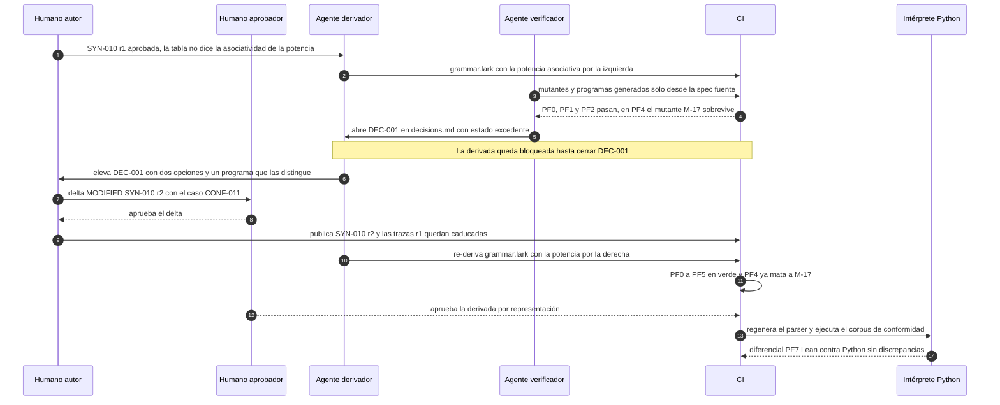

#### 3.13.9 Riesgos, críticas y antipatrones

**(a) Riesgos.**

| Riesgo | Evidencia | Mitigación |
|---|---|---|
| **Probar el teorema equivocado** | Fonseca et al. encontraron 16 bugs en sistemas distribuidos verificados (IronFleet, Verdi, Chapar). Todos estaban en la "interface between verified and other components, namely in the specification, shim layer, and auxiliary tools", y ninguno en los protocolos probados ([EuroSys 2017](https://www.cs.purdue.edu/homes/pfonseca//papers/eurosys2017-dsbugs.pdf)). Csmith no encontró errores de código incorrecto en las partes verificadas de CompCert, pero sí un hueco en su propia semántica PPC: "failed to specify a constraint on the width of this immediate value" ([PLDI 2011](https://www-old.cs.utah.edu/~regehr/papers/pldi11-preprint.pdf)) | Los enunciados forman parte de la base de confianza y los aprueba un humano. El corpus de conformidad, que es independiente de Lean, se ejecuta contra la semántica (PF1, PF6) |
| **Spec precisa pero errónea** | Zave modeló Chord en Alloy y vio que "of the seven properties claimed invariant of the original version, not one is actually an invariant" ([notas de Princeton](https://www.cs.princeton.edu/courses/archive/fall18/cos561/docs/ChordClass.pdf); [arXiv 1502.06461](https://arxiv.org/abs/1502.06461)). Lo encontró con modelado ligero, sin pruebas | Ejecutar antes de demostrar (escalones E1–E2 antes de E3, 3.13.5). PF5: exploración generativa con revisión humana |
| **Ilusión de rigor y vacuidad** | En *vericoding*, incluso cuando la verificación tuvo éxito, ~9 % de las specs eran demasiado débiles y ~15 % eran malas traducciones ([arXiv 2509.22908](https://arxiv.org/abs/2509.22908)) [preprint] | PF6: testigos de no vacuidad, `#print axioms` y prohibir `partial def` en la base de confianza. "Compila" nunca cuenta como evidencia de fidelidad |
| **Fallo de modo común** | La misma IA con el mismo prompt resuelve igual una ambigüedad en Lean y en Python, y el diferencial pasa. Knight y Leveson ya mostraron que versiones escritas de forma independiente fallan de forma correlacionada (3.13.4) | Agentes y sesiones separados, y si es posible familias de modelos distintas (3.13.4). Comparar las listas de ambigüedades que detecta cada derivador. El corpus lo escriben humanos |
| **Mecanizaciones que se quedan atrás** | WasmCert "has not been kept up to date with upcoming new Wasm features" ([SpecTec, PLDI 2024](https://dl.acm.org/doi/10.1145/3656440)). KJS se quedó en ES5.1 ([repo](https://github.com/kframework/javascript-semantics)). JSCert, en ES5 ([POPL 2014](https://www.doc.ic.ac.uk/~pg/publications/Bodin2014Trusted.html)) | Huella de versión en cada `@fuente`. Un elemento caducado bloquea (3.13.7). Regla de release al estilo Cedar (abajo) |
| **Churn de pruebas** | Las pruebas se rompen por "seemingly unrelated changes" ([QED at Large](https://arxiv.org/abs/2003.06458)). Lean y Mathlib introducen cambios incompatibles con frecuencia ([Growing Mathlib](https://arxiv.org/abs/2508.21593); [notas de versión de Lean](https://lean-lang.org/doc/reference/stable/releases/v4.22.0/)) | `lean-toolchain` fijado. Pruebas en C3, regenerables. Teoremas solo en el núcleo estable (E3) |
| **Bus factor de Lean** | AWS reconoce que "Proof assistants like Lean have a steep learning curve" ([AWS Open Source Blog](https://aws.amazon.com/blogs/opensource/lean-into-verified-software-development/)) | Al menos dos personas capaces de leer Lean como condición para delegar cualquier aspecto. Si no las hay, la semántica se queda en DERIVADA. Revisión por representación |
| **Fronteras no verificadas** | El pegamento Lark → transformer → AST → JSON → Lean no lo verifica nadie. CompCert confía en "the translation of the grammar from Menhir form to Coq form" ([Gallium](https://gallium.inria.fr/blog/verifying-a-parser-for-a-c-compiler)) | Contrato AST con un único dueño y generación determinista de `Ast.lean` y `ast.py`. Ida y vuelta Lark → AST → Lean en todo el corpus. Declarar la base de confianza en `authority.md` |

**(b) Antipatrones.**

| # | Antipatrón | Síntoma | Qué hacer |
|---|---|---|---|
| A1 | Dos fuentes normativas sin precedencia | La spec declara prosa y formal "equivalentes" y cada discrepancia se arregla en el lado que resulta cómodo. Es el caso de Wasm: "The prose and formal rules are equivalent" ([valid/conventions](https://webassembly.github.io/spec/core/valid/conventions.html)) | R-DER-1 y la tabla de autoridad. CO-NORMATIVA no se usa (3.13.2) |
| A2 | Desambiguación implícita | Earley con `ambiguity='resolve'`, que es el valor por defecto, elige "the simplest derivation". LALR resuelve los conflictos shift/reduce "automatically ... as shifts" ([Lark](https://lark-parser.readthedocs.io/en/latest/classes.html); [lalr_analysis.py](https://github.com/lark-parser/lark/blob/master/lark/parsers/lalr_analysis.py)) | `strict=True` en LALR y `ambiguity='explicit'` en PF2. Cada prioridad lleva su `@fuente` |
| A3 | "Compila, luego es correcto" | Lean typechecka y Lark construye la tabla, y eso se toma como aprobación | La fidelidad se mide con PF1, PF4 y PF6. Compilar es una condición necesaria, no suficiente |
| A4 | La misma IA escribe definición, teorema y prueba | Teoremas circulares o vacuos | Enunciados en C2 con aprobación humana. Pruebas en C3. Corpus en manos de otro agente |
| A5 | La spec filtra la implementación | `Semantics.lean` copia la estructura de `interpreter.py` y el diferencial no detecta nada. CLEVER excluye las specs que "leak implementation logic" ([ICML 2025](https://icml.cc/virtual/2025/52383)) | Derivar siempre desde la spec fuente, nunca desde `/src` |
| A6 | Decisiones excedentes que no vuelven a la prosa | Entradas `excedente` que se quedan abiertas o se cierran como "aceptadas" | Elevar es el único destino válido. Ninguna release sale con entradas `excedente` o `hueco` abiertas |
| A7 | Formalizar demasiado pronto | Teoremas sobre una sintaxis que cambia cada semana; las pruebas se rompen sin parar | Escalones E0–E4 de 3.13.5 |
| A8 | Base de confianza no declarada | Nadie sabe qué hay que confiar: el pegamento, la toolchain o `native_decide` | Declararla en `authority.md` y auditarla con `#print axioms` |
| A9 | Bus factor de 1 | Una sola persona lee Lean y la aprobación de 2.3 es solo nominal | No delegar. Formar a una segunda persona o encargar una auditoría externa periódica |
| A10 | Reparar pruebas debilitando enunciados | Una prueba rota "se arregla" cambiando el teorema | La CI compara `Theorems.lean` con el hash aprobado. Un enunciado que cambia es un delta |
| A11 | Juez LLM como única barrera | La fidelidad la decide otro modelo. En autoformalización, un juez LLM daba 97 % y la revisión experta, 67 % (3.13.4) | El juez LLM hace de filtro previo. Deciden los casos ejecutables y el humano (es el antipatrón 18 de 9.5 aplicado al nivel 2) |
| A12 | Regenerar en bloque la derivada aprobada | Se pide "rehaz la gramática" y cambian en silencio decisiones ya aprobadas | Solo cambios por diff, trazados a un cambio de la spec fuente, con diff semántico revisado |

**(c) Críticas.** Los casos industriales más maduros empujan hacia la fuente formal. En Cedar, "The models serve as Cedar's specification" ([arXiv 2407.01688](https://arxiv.org/abs/2407.01688)), es decir, el modelo Lean *es* la spec, al revés que en el caso del cliente. Su regla de publicación es la que conviene copiar: "No new Cedar version is released unless its model, proofs, and differential tests are current" ([Lean FRO](https://lean-lang.org/use-cases/cedar/)). Wasm resolvió sus dos fuentes haciendo que SpecTec generara la prosa ([anuncio](https://webassembly.org/news/2025-03-27-spectec/)). Si el equipo llega a escribir Lean con soltura, la presión para invertir la cadena será real. Tendría que ser una decisión explícita en `authority.md`, nunca una deriva. La segunda crítica es que elevar todas las decisiones excedentes **engorda la prosa** hasta convertirla en una spec formal escrita en castellano. **(propuesta)** El criterio de corte es la observabilidad. Lo que cambia el árbol, el veredicto o el valor de algún programa va a la spec fuente con su caso de conformidad. Lo técnico y no observable (nombres de reglas, prioridades internas del lexer que no cambian ningún veredicto, la elección LALR o Earley) va a un ADR y queda marcado `no-normativa`.

#### 3.13.10 Checklist de specs derivadas

**(propuesta)** Se usa al aprobar una spec derivada, al delegar un aspecto y antes de cada release del lenguaje. ⚙ = comprobable en CI.

**Estatus y autoridad**
- [ ] `authority.md` tiene un único dueño normativo por aspecto y ningún aspecto aparece como CO-NORMATIVA.
- [ ] Cada spec derivada declara en su cabecera el estatus por aspecto, la fuente con su versión y lo que no cubre. ⚙
- [ ] Toda delegación cumple los siete criterios de 3.13.2 y tiene su cláusula en la spec fuente, fecha, dos aprobadores y la huella del artefacto delegado.
- [ ] Las anotaciones de herramienta (alias, `?`, `_`, prioridades de rendimiento, nombres de lemas) están marcadas como no normativas.

**Trazabilidad**
- [ ] Cada regla Lark y cada declaración Lean de la base de confianza tiene `@fuente <ID>@<rev>`. ⚙
- [ ] Ningún elemento está caducado y no se regenera el nivel 3 desde una traza caducada. ⚙
- [ ] `decisions.md` no tiene entradas `excedente` ni `hueco` en los aspectos afectados. ⚙
- [ ] `Ast.lean` y `ast.py` se generan desde `ast.md`, y la ida y vuelta Lark → AST → Lean pasa en todo el corpus. ⚙

**Fidelidad (PF0–PF8)**
- [ ] PF1: todo caso que acepta da su árbol esperado y todo caso que rechaza falla en el parser. ⚙
- [ ] PF2: `strict=True` en LALR y cero nodos `_ambig` con Earley en `ambiguity='explicit'`. ⚙
- [ ] Las palabras reservadas están excluidas de `NAME` en la gramática, no confiadas al lexer, y cada una tiene un caso negativo en el corpus. ⚙
- [ ] PF3 y PF4: toda regla y toda rama de `eval` están cubiertas por un caso, y ningún mutante sobrevive sin una petición de caso abierta. ⚙
- [ ] PF5: un humano revisó una muestra de programas generados en esta versión, y cada "no debería ser válido" pasó a ser un caso negativo.
- [ ] PF0–PF5 (y PF6 en E3) estaban en verde **antes** de aprobar la derivada; PF7 y PF8 corren **después** de regenerar el nivel 3. ⚙
- [ ] PF7: el diferencial Lean contra la implementación está en verde, y `outOfFuel` se cuenta como "sin veredicto". ⚙ (PF8 solo si el parser de producción no es Lark.)

**Lean 4**
- [ ] Ningún `sorry`, y `#print axioms` solo muestra `propext`, `Classical.choice` y `Quot.sound` (lista blanca: falla `sorryAx`, `Lean.ofReduceBool`, `Lean.trustCompiler` y todo axioma con `_native`). Sin `native_decide` en los teoremas normativos. ⚙
- [ ] La base de confianza no usa `partial def` y la evaluación recurre sobre `fuel`.
- [ ] Cada teorema tiene un testigo de no vacuidad, y su enunciado coincide con el hash aprobado. ⚙
- [ ] `lean-toolchain` está fijado y solo se actualiza por decisión explícita.

**Propagación y edición**
- [ ] Cada cláusula declara "desde edición N" y cada caso de conformidad, su edición. ⚙
- [ ] Los cambios en la derivada llegan como diff trazado a un delta de la spec fuente, con su diff semántico revisado.
- [ ] Ninguna release sale si la semántica, sus pruebas y el diferencial no están al día con la spec fuente (regla de Cedar). ⚙

**Roles**
- [ ] El derivador, el verificador y el retrotraductor son agentes distintos, y el derivador no puede editar el corpus ni `/derived/fidelity`.
- [ ] La IA no editó la spec fuente para que encajara con la derivada.
- [ ] Al menos dos personas pueden leer cada notación delegada.

---

## 4. Implementación y generación

### 4.1 De la spec al código: spec → plan → tareas → código

Las herramientas siguen la misma cadena. **Specify** recoge el qué y el porqué, sin stack. **Plan** fija stack, arquitectura y restricciones, a veces con variantes. **Tasks** divide el trabajo en tareas "implementable and testable in isolation". **Implement** avanza tarea a tarea, con cambios acotados en vez de "thousand-line code dumps" ([GitHub Blog](https://github.blog/ai-and-ml/generative-ai/spec-driven-development-with-ai-get-started-with-a-new-open-source-toolkit/)). Kiro ordena las tareas en un grafo de dependencias y las ejecuta por "oleadas": "Waves execute sequentially; tasks within a wave execute concurrently" ([Kiro, specs](https://kiro.dev/docs/specs/)).

En spec-as-source hay que añadir tres cosas a esa cadena:

1. **Cada tarea declara sus targets** (los archivos que puede tocar) y **su check ejecutable** antes de empezar.
2. **El plan referencia lo que ya existe** (módulos, patrones, interfaces). Böckeler vio a un agente ignorar notas sobre clases existentes y duplicarlas.
3. **Las decisiones que tome el agente durante la implementación se registran** en `decisions.log`. Un humano las aprueba antes del merge: las aprobadas pasan a ser un delta y las rechazadas obligan a regenerar. Es el mecanismo del prototipo Plumb de Breunig, donde un hook impide el commit hasta que se revisa cada decisión ([Breunig](https://www.dbreunig.com/2026/03/04/the-spec-driven-development-triangle.html)).

### 4.2 Contexto del agente

- **Sesión limpia para implementar.** Primero se escribe la spec y después se abre una sesión nueva "to execute it" ([Anthropic](https://code.claude.com/docs/en/best-practices)). Tras dos correcciones fallidas, se reinicia el contexto (en Claude Code, `/clear`) y se vuelve a empezar con un prompt mejor.
- **Solo la porción de spec relevante.** "Context length is not a substitute for context quality" ([Osmani](https://addyosmani.com/blog/good-spec/)).
- **Ejemplos mejor que reglas.** En el experimento de Böckeler, sin ejemplos el modelo usó `javax.persistence` en lugar de `jakarta.persistence`. Con una aplicación de referencia vía MCP (*Model Context Protocol*, protocolo de contexto de modelos), la adherencia mejoró ([Böckeler](https://martinfowler.com/articles/pushing-ai-autonomy.html)).
- **Esqueletos deterministas.** Para lo que no requiere IA (scaffolding, CRUD con el CLI del framework, codemods), conviene usar generadores deterministas. Böckeler recomienda "maximise abstraction" con las herramientas del framework. CRUD = *Create, Read, Update, Delete*. CLI = *Command-Line Interface*.

### 4.3 El bucle del agente: generar → ejecutar → corregir

"Claude stops when the work looks done. Without a check it can run, 'looks done' is the only signal available, and you become the verification loop" ([Anthropic](https://code.claude.com/docs/en/best-practices)). Simon Willison define el agente como "something that runs tools in a loop to achieve a goal" y considera que la habilidad clave es "designing the agentic loop" ([Willison](https://simonwillison.net/2025/Sep/30/designing-agentic-loops)).

Reglas del bucle interno **(propuesta, a partir de Anthropic, Beck y del harness de larga duración de Anthropic)**:

1. **Un check ejecutable por tarea**, derivado de la spec y en rojo antes de empezar.
2. **Evidencia, no afirmaciones:** "Have Claude show evidence rather than asserting success". El agente adjunta la salida de los tests, el comando que ejecutó y capturas.
3. **Tope de iteraciones.** Tras N intentos sin converger, se reinicia la sesión o se escala a F4.
4. **Estado externo que el agente no pueda reescribir.** El harness de Anthropic guarda las funcionalidades en un JSON y solo deja al agente cambiar el campo `passes`: "It is unacceptable to remove or edit tests" ([Anthropic, long-running agents](https://www.anthropic.com/engineering/effective-harnesses-for-long-running-agents)).
5. **Una funcionalidad a la vez.** Así se evitan dos fallos documentados: declarar victoria antes de tiempo y el *one-shotting* que deja funcionalidades a medias.
6. **Gate determinista de cierre**, por ejemplo un hook que bloquea el fin del turno hasta que el check pasa.
7. **Señales para interrumpir** ([Beck](https://newsletter.kentbeck.com/p/augmented-coding-beyond-the-vibes)): bucles, "functionality I hadn't asked for (even if it was a reasonable next step)" y cualquier indicio de que el agente hace trampa, "for example by disabling or deleting tests".

### 4.4 Revisión humana y verificador independiente

La revisión humana sigue siendo necesaria. Böckeler concluye que "AI is not ready to create and maintain a maintainable business software codebase without human oversight" ([Böckeler, autonomy](https://martinfowler.com/articles/pushing-ai-autonomy.html)). Osmani: "won't commit code I couldn't explain to someone else". Se revisa en dos capas:

1. **Verificador independiente** (otro agente en contexto limpio): compara el diff con la spec y el plan. Comprueba "every requirement is implemented, the listed edge cases have tests, and nothing outside the task's scope changed" ([Anthropic](https://code.claude.com/docs/en/best-practices)). Solo informa de huecos que afectan a la corrección o a los requisitos.
2. **Revisor humano:** lee primero el delta y después el diff de código, revisa todo cambio en tests, comprueba que los archivos tocados son los targets previstos y que puede explicar el código.

### 4.5 No-determinismo y regeneración

**Evidencia.** Ouyang, Zhang, Harman y Wang estudiaron 829 problemas con ChatGPT en 2023. La proporción de tareas en las que ninguna salida de test coincidió entre peticiones fue del 75,76 % (CodeContests), 51,00 % (APPS) y 47,56 % (HumanEval). Con temperatura 0 bajó al 43,64 %, 27,40 % y 18,29 %: temperatura 0 "does not guarantee determinism" ([arXiv 2308.02828](https://arxiv.org/html/2308.02828v2)). Son datos de modelos de 2023 y no deben extrapolarse tal cual, pero la conclusión cualitativa se mantiene: Böckeler vio el no-determinismo "in action" al regenerar varias veces desde la misma spec en Tessl. El panel de Tessl reconoce que la "stable regeneration" es un problema abierto, y Don Syme (GitHub) lo plantea como "a straight-up trade-off between determinism and adaptability" ([Tessl panel](https://tessl.io/blog/taming-agents-with-specifications-what-the-experts-say/)).

**Consecuencias de diseño (propuesta):**

1. **La regeneración no es idempotente.** Cada regeneración es un cambio que hay que verificar contra la suite completa, no solo contra los tests del delta.
2. **El código generado se commitea y se revisa como diff.** No es un artefacto efímero de build. Breunig lo justifica: sin una implementación fijada, "Replicating bugs is nearly impossible" ([Breunig, whenwords](https://dbreunig.com/2026/01/08/a-software-library-with-no-code.html)).
3. **Se regenera en cascada desde el nivel más alto afectado.** Kiro lo formula así: "If you ask to change a task, only tasks are regenerated. If you adjust the design, design and tasks are rebuilt. If you change scope, the full pipeline reruns from requirements" ([Kiro blog](https://kiro.dev/blog/faster-smarter-specs/)). Cuando lo que cambia es una interfaz que usan varias capacidades, el procedimiento concreto está en 4.7.8.
4. **Se regenera solo el alcance afectado:** los targets de las cláusulas que cambiaron, archivo a archivo (la unidad de regeneración, 4.7.2).
5. **Hay que rechazar toda regeneración que cambie tests verdes de cláusulas no tocadas.** Se precisa la spec y se vuelve a regenerar.
6. **Toda regeneración pasa una comparación diferencial** (*differential* o *back-to-back testing*, 5.2.13): se ejecutan las mismas entradas (los casos de la suite más entradas generadas por PBT o fuzzing, y, si existe, un corpus de peticiones reales anonimizadas) contra la versión anterior y la regenerada, y se comparan las salidas observables (respuestas, códigos de error, efectos en BD, eventos). En los módulos regenerables se hacen además dos regeneraciones independientes y se comparan entre sí. Toda diferencia no declarada en el delta rechaza la regeneración: o la spec está subespecificada en ese punto (caso i) o el comportamiento se declara explícitamente "fuera de contrato".
7. **El modelo también es una entrada de la generación.** Con la misma spec, otro modelo, otra versión del agente u otras plantillas de instrucciones producen otro código. Chen, Zaharia y Zou midieron que el mismo servicio (GPT-3.5 y GPT-4) cambió de comportamiento entre marzo y junio de 2023: "Both GPT-4 and GPT-3.5 had more formatting mistakes in code generation in June than in March" ([arXiv 2307.09009](https://arxiv.org/abs/2307.09009)). En spec-as-source probablemente es la fuente principal de regeneraciones divergentes. **(propuesta)** Por eso:
   - se **fija el modelo** (identificador de versión exacto, no un alias "latest") por proyecto o por módulo, en un archivo versionado;
   - cada archivo generado y la matriz de trazabilidad registran la **procedencia**: modelo, versión del agente o herramienta y hash de las instrucciones y plantillas (4.6, 6.4);
   - **actualizar el modelo es un cambio técnico de F4** (2.5): se regeneran los módulos regenerables con la versión nueva en una rama, se pasa la suite completa y la comparación diferencial, y solo se adopta si no hay diferencias no declaradas. Si las hay, se trata como caso i antes de adoptar.

| Nivel del cambio | Qué se regenera | Qué protege |
|---|---|---|
| Tarea (orden, descomposición) | Tareas | Plan, código existente |
| Diseño técnico (librería, estructura) | Diseño, tareas y código de los targets afectados | Tests de aceptación sin cambios, que deben seguir en verde |
| Cláusula de comportamiento | Tests de esa cláusula y código de sus targets | Suite de regresión del resto |
| Contrato público o interfaz compartida | Contrato, tipos y clientes generados de forma determinista, proveedor y, según la clasificación semver, consumidores (4.7.8) | Versión anterior del contrato durante el *parallel change* |
| Alcance | Pipeline completo de lo afectado | Todo lo no afectado |

### 4.6 Qué se genera y qué no

Regenerar desde la spec no es todo o nada. **(propuesta, sobre MDE, Tessl y Böckeler)** Hay cuatro categorías de código, y cada archivo pertenece a una sola:

| Categoría | Ejemplos | Cómo se produce | Regla |
|---|---|---|---|
| **Generado determinista** | Tipos y clientes desde OpenAPI, validadores desde JSON Schema | Generador de código clásico | Nunca se edita a mano. Se regenera siempre que cambia el contrato |
| **Generado una vez, inmutable** | Migraciones de base de datos | Generador o agente, a partir del diff entre el modelo anterior y el nuevo, **una sola vez por delta** | Se revisa, se commitea y no se toca desde que se aplica. Ninguna regeneración la reescribe; para corregirla se añade una migración nueva (3.3.7). CI lo vigila |
| **Generado por LLM, regenerable** | Adaptadores, handlers, DTO, validaciones derivadas, CRUD, componentes UI estándar | Agente desde la spec | Cabecera `GENERATED FROM SPEC — DO NOT EDIT` con la ruta de la spec de origen. La CI detecta ediciones manuales |
| **Curado (escrito o pulido a mano), declarado** | Algoritmos delicados, rutas críticas de rendimiento o seguridad, UI fina | Humano asistido por agente, *después* del delta | Declarado en la spec como "curado", con interfaz especificada, spec más detallada y tests propios. Sigue la regla "primero la spec" aunque no se regenere |

DTO = *Data Transfer Object* (objeto de transferencia de datos).

**Convención de nombres (propuesta).** La categoría se lee en la ruta, para que los *globs* de `targets`, `ownership-overlap` y `generated-untouched` clasifiquen bien cada archivo:

| Categoría | Marca en la ruta | Ejemplos |
|---|---|---|
| Generado determinista | Carpeta `gen/` o `generated/`, o sufijo `.gen.*` (o `.generated.*`, si lo impone el generador) | `src/modules/orders/gen/**`, `routeTree.gen.ts`, `tokens.gen.css`, `web/src/shared/api/generated/**` |
| Generado una vez, inmutable | Carpeta `migrations/` | `migrations/2026-10-21-add-cancel-reason.sql` |
| Generado por LLM, regenerable | Sin sufijo, con cabecera `GENERATED FROM SPEC` | `cancel-order.handler.ts`, `OrderForm.tsx` |
| Curado | Sufijo `.curated.*` (o `_curated.py`) | `stock.curated.ts`, `cancel-order.handler.curated.ts` |

`gen/`, `generated/`, `.gen.*` y `.generated.*` se reservan para lo determinista: nunca se usan para código generado por un LLM.

Es la lección del patrón *Generation Gap* (Vlissides; [Fowler, Generation Gap](https://martinfowler.com/dslCatalog/generationGap.html)) y de las *protected regions* de los generadores MDA: lo que se edita a mano debe estar **separado físicamente** de lo que se regenera. Si no, la próxima regeneración lo borra. Por qué esa separación se hace entre archivos y no dentro de un archivo, qué unidad se regenera y cómo se reparten los archivos entre specs: 4.7.

Ejemplo de cabecera, a partir de la regla comunitaria del registro de Tessl ([vibe-ai/spec-as-source](https://tessl.io/registry/vibe-ai/spec-as-source/files/rules/generated-file-header.md)), ampliada **(propuesta)** con la procedencia de la generación (4.5, punto 7):

```ts
// GENERATED FROM SPEC — DO NOT EDIT DIRECTLY
// Source: spec/capabilities/orders/spec.md (ORD-001..ORD-014)
// Generated: 2026-10-21 · Change: 2026-10-21-cancelacion-parcial
// Model: <id exacto del modelo> · Agent: <herramienta>@<versión> · Instructions: sha256:3e9a…
```

**Specs derivadas: ver 3.13.3.** Las cuatro categorías de esta sección son de código. Las specs derivadas (gramática Lark, semántica Lean 4, contrato AST, OpenAPI derivado) usan la extensión C1–C6 de 3.13.3. La spec derivada aprobada (C2) **no** es "generado por LLM, regenerable": la propone la IA, se cura tras la aprobación humana y solo cambia por diff trazado a un cambio de la fuente, con una cabecera propia que no es `DO NOT EDIT`. Sus pruebas Lean (C3) sí son regenerables, y los artefactos generados desde ella de forma determinista (C5) siguen las reglas de "generado determinista" de esta sección. La implementación que sale de ella (C6: parser, intérprete o compilador, LSP, *formatter*) cae en una de las cuatro categorías de arriba.

### 4.7 Granularidad del código y correspondencia spec↔código

La sección 3.12 fijó las tres unidades de la spec: la capacidad como unidad de verdad, el delta como unidad de trabajo y la cláusula como unidad de identidad. Esta subsección fija la otra mitad del esquema de cuatro unidades y tres relaciones: **la unidad de regeneración (el archivo), las relaciones de propiedad, trazabilidad y ámbito, y qué pasa con lo que no encaja en una sola spec** (lo transversal, los archivos compartidos y las interfaces que usan varias capacidades).

**Mapa de la subsección:**

- **Respuesta corta** a "¿archivo, clase o función?": 4.7.1.
- **Qué se regenera y cómo:** unidad (4.7.2), editar frente a regenerar (4.7.3), partes de un archivo (4.7.4).
- **Correspondencias spec↔código:** cardinalidades (4.7.5), transversales (4.7.6), archivos compartidos (4.7.7), cascada (4.7.8), trazabilidad (4.7.9).
- **Arquitectura** que lo hace posible: 4.7.10.
- **Regla del equipo**, que cierra el argumento: 4.7.11; **evidencia práctica** que la respalda: 4.7.12; **checklist**: 4.7.13.

#### 4.7.1 Propiedad y trazabilidad: la respuesta a "¿archivo, clase o función?"

Hay que separar tres relaciones que suelen tratarse como una sola:

- **Propiedad:** qué documento de spec es dueño de qué archivo: la única spec que puede modificarlo, por parche guiado, reescritura o regeneración según su categoría (4.6) y su habilitación (8.5). Se define a nivel de **documento de spec frente a archivo** (o patrón de archivos). Es 1:N y cada archivo tiene, como mucho, una spec dueña.
- **Trazabilidad:** qué cláusula se implementa o se verifica dónde. Se define a nivel de **cláusula frente a archivos, símbolos (clases, funciones) y tests**. Es N:M de forma legítima y solo informa: no da derecho a modificar ni a regenerar nada.
- **Ámbito:** a qué archivos se aplica una spec transversal. Se define a nivel de **spec transversal frente a patrones de archivos** (`applies_to`). Es N:M (una transversal abarca muchas capacidades y un archivo cae bajo varias transversales) y restringe sin poseer: la transversal se verifica con una regla ejecutable y, cuando cambia, cada archivo lo modifica su spec dueña (4.7.6).

La evidencia de las herramientas pone la propiedad en el documento, no en la cláusula. En una regla comunitaria del registro de Tessl, el campo `targets` "declares ownership: that spec is the authoritative source for those files", y "Every spec must declare its `targets`" ([vibe-ai/spec-as-source](https://tessl.io/registry/vibe-ai/spec-as-source/files/rules/spec-as-source.md), comunitaria). El formato de Tessl Labs acepta en `targets` "relative file paths or glob patterns" y coloca los enlaces a tests "intermingled with the requirements they verify" ([Tessl Labs, spec-format](https://tessl.io/registry/tessl-labs/spec-driven-development/files/docs/spec-format.md)). Ninguna de esas páginas dice literalmente "una sola spec dueña por archivo": es una inferencia de "authoritative source", y en este informe es **(propuesta)**.

**Respuesta a la ambigüedad (propuesta):** una spec se asocia a **archivos** (propiedad); una cláusula se asocia a **archivos, clases, funciones y tests** (trazabilidad). La clase y la función nunca se poseen ni se regeneran por separado. La única excepción aparente es la interfaz pública (firma de API, evento, tipo exportado), que no se "posee" desde una spec de comportamiento: se especifica en un contrato (3.3.7).

Ejemplo backend: `spec/capabilities/orders/spec.md` es dueña de `src/modules/orders/**`. `ORD-007` se implementa en `features/confirm-order/handler.ts` y en `domain/stock-policy.ts`, y `ORD-003` también toca `handler.ts`: son dos cláusulas en un archivo, sin conflicto, porque pertenecen a la misma spec dueña. Ejemplo frontend: la spec `checkout` es dueña de `web/src/features/checkout/**`; `CHK-004` (error de stock) y `CHK-009` (resumen) conviven en `CheckoutPage.tsx`.

#### Diagrama 4. Correspondencia spec → cláusulas → targets

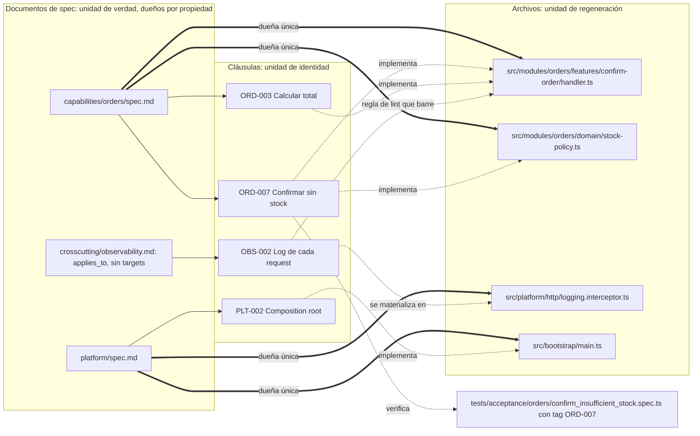

Las flechas gruesas son **propiedad** (una spec, varios archivos; cada archivo, una sola spec). Las punteadas son **trazabilidad** (cualquier combinación). La spec transversal no posee archivos de las capacidades: se materializa en un archivo de plataforma y se verifica con reglas que barren los demás (4.7.6).

#### 4.7.2 Qué unidad de código se regenera

| Unidad | Radio de impacto y diff | Fiabilidad y contexto de la IA | Estabilidad entre regeneraciones **(propuesta)** | Riesgo principal | Cuándo **(propuesta)** |
|---|---|---|---|---|---|
| **Función** | Mínimos | Necesita mucho contexto externo (campos, *helpers*, imports) por cada línea generada | Alta en apariencia, pero frágil: depende de un contexto externo que el generador no controla | Es regenerar *dentro* de un archivo (4.7.4); Git no conoce funciones | Nunca con un LLM. Solo inserción determinista o edición acotada por AST (*Abstract Syntax Tree*, árbol de sintaxis abstracta) |
| **Clase** | Pequeños | Los LLM rinden mucho peor: GPT-4 pasó del 85,4 % en funciones aisladas (HumanEval) al 37,0 % generando clases completas, y el código que llama a otros métodos de la clase es el más difícil ([ClassEval, 2023](https://arxiv.org/html/2308.01861v2)) | Media: los métodos se reordenan y los *helpers* privados cambian | Con varias clases por archivo, vuelve a ser regeneración parcial | Solo cuando clase = archivo; entonces la unidad es el archivo |
| **Archivo** | Acotados si el archivo es cohesivo y pequeño | Unidad nativa de Git, de la revisión, de los generadores clásicos (OpenAPI Generator protege y genera por archivo, [customization](https://openapi-generator.tech/docs/customization/)) y de la cabecera `GENERATED FROM SPEC` (4.6) | Media, acotable con formateador determinista, `symbol-guard` y comparación diferencial (4.7.3) | Un archivo grande da un diff que no se puede revisar | **Unidad de regeneración por defecto** |
| **Módulo** | Grandes | En repos complejos funciona mejor ir por partes que generarlo todo de una vez (RealBench, abajo) | Baja: cada regeneración reorganiza archivos y nombres internos | Diff grande y revisión cara | Unidad de *orquestación* (orden y verificación conjunta), no de diff |

Dos matices de esa evidencia. ClassEval usa modelos de 2023 y su ventaja de generar la clase entera de una vez solo se dio en los modelos más fuertes; los demás rendían mejor método a método. RealBench (2026) concluye que generar todo el repositorio de una vez "is the best generation strategy on smaller repositories" y que en repositorios complejos "the module-by-module strategy works better", aunque en el cuerpo del artículo esa estrategia es incremental archivo a archivo, añadir código recuperado (RAG, *retrieval-augmented generation*) bajó la tasa de ejecución correcta del 51,57 % al 37,91 %, y la mejor tasa media de tests superados fue del 19,39 % ([arXiv 2604.22659](https://arxiv.org/abs/2604.22659)). Leerlo como "el módulo es la unidad de orquestación y el archivo la de diff" es **(propuesta)**.

**El tamaño máximo lo fija la revisión humana del diff.** Google: "100 lines is usually a reasonable size for a CL, and 1000 lines is usually too large", y el número de archivos también cuenta: "A 200-line change in one file might be okay, but spread across 50 files it would usually be too large" ([Google, Small CLs](https://google.github.io/eng-practices/review/developer/small-cls.html); CL = *changelist*, el equivalente de un PR). **(propuesta)** La regla operativa no es el tamaño del archivo sino el **tamaño del diff normalizado** de cada regeneración: si pasa de unas 400 líneas sin que el delta lo justifique, o el archivo es demasiado grande y se parte, o la regeneración divergió y se rechaza (4.5). Como orientación, los archivos regenerables se mantienen por debajo de unas 300-400 líneas, que es además el rango en el que Cursor evaluó la reescritura de archivos (4.7.3).

**(propuesta) Siete criterios para elegir la unidad:**

1. **Dueño único:** la unidad solo contiene cláusulas de una spec. Si mezcla dos, se parte o se convierte en registro determinista (4.7.7).
2. **Interfaz estable en el borde:** lo que exporta (firma, *props*, endpoint) lo fija la spec o el contrato, así que regenerar el interior no provoca cascada (4.7.8).
3. **Co-cambio:** los archivos que cambian siempre juntos son candidatos a una sola unidad. Si dos specs distintas obligan siempre a tocar el mismo archivo, la frontera está mal cortada. CodeScene define el acoplamiento por cambio ("two (or more) modules change together over time") y advierte que "in itself is neither good nor bad": hay que contrastarlo con la arquitectura ([CodeScene](https://docs.enterprise.codescene.io/versions/6.0.0/guides/technical/change-coupling.html)).
4. **Tamaño del diff** en el rango revisable.
5. **Categoría (4.6):** una unidad nunca mezcla código regenerable y curado.
6. **Tests en el borde:** solo es regenerable la unidad cuyos tests ejercen su interfaz, no su detalle interno; si no, cada regeneración rompe los tests (5.6).
7. **Mecanismo del lenguaje:** si hay *partial classes*, herencia o composición fácil, lo curado se separa en otro archivo (4.7.4).

**(propuesta) Partir, mover o renombrar archivos para cumplir la regla de granularidad** (criterios 1, 4 y 5; Diagrama 5) es un **refactor estructural** (excepción 2 de 7.1). Se edita la sección Targets de las specs afectadas sin delta de comportamiento, en el carril trivial o estándar, con la suite en verde antes y después, sin modificar ningún test, y con `ownership-overlap` en verde. Para el check `spec-ownership` (Anexo F) basta con que el PR toque la sección Targets de la spec dueña de origen y de la de destino, en un commit declarado como estructural.

**(propuesta) Orden de regeneración:** módulo a módulo, en orden topológico de dependencias (contratos → dominio → adaptadores → UI) y, dentro de cada módulo, archivo a archivo. Con modelos pequeños o locales, unidades todavía menores.

#### Diagrama 5. Árbol de decisión: unidad de regeneración de un archivo

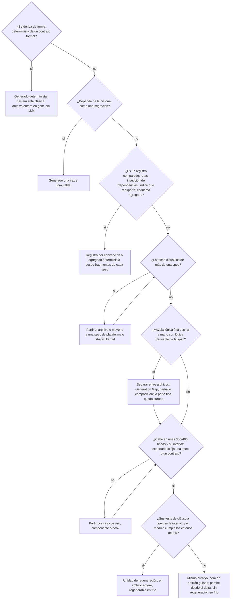

#### 4.7.3 Editar, reescribir o regenerar

"Regenerar" no es una sola operación. Las herramientas reales editan sobre todo con **parches anclados en el contenido**, no reescribiendo:

- Aider documenta que el formato `whole` (devolver el archivo entero) "can be slow and costly because the LLM has to return the entire file even if just a few lines are edited", mientras que `diff` (bloques *search/replace*) es "an efficient format" ([Aider, edit formats](https://aider.chat/docs/more/edit-formats.html)). En su *leaderboard*, ninguno de los diez primeros modelos usa `whole` ([Aider leaderboard](https://aider.chat/docs/leaderboards/)); el formato lo elige Aider para cada modelo, así que es una señal, no una medición de preferencia.
- Agentless, sobre SWE-bench, "avoids generating the complete code and instead focuses on producing small edits" ([arXiv 2407.01489](https://arxiv.org/html/2407.01489v2)).
- La herramienta de edición de Anthropic exige que el texto a sustituir coincida "exactly, including whitespace and indentation" y falla si hay varias coincidencias ("Please provide more context to make a unique match", [text editor tool](https://platform.claude.com/docs/en/agents-and-tools/tool-use/text-editor-tool)).
- El formato V4A de OpenAI no usa números de línea ("the context is enough to uniquely identify code"), y su guía avisa de que el script de ejemplo responde "Done!" "regardless of whether the patch was successfully applied or not" ([OpenAI, GPT-4.1 prompting guide](https://developers.openai.com/cookbook/examples/gpt4-1_prompting_guide)).
- Diff-XYZ (JetBrains Research, *workshop* de NeurIPS 2025) concluye que "search-replace is the most effective representation overall, especially for larger models", y que los modelos abiertos pequeños apenas mejoran con ningún formato ([arXiv 2510.12487](https://arxiv.org/html/2510.12487v2)).

La contraevidencia es Cursor, que reescribe el archivo entero **condicionado al archivo actual** ("we have language models generate the fully rewritten file conditioned on the current file") porque "models are notoriously bad at counting line numbers". Lo evaluó con unas 450 ediciones de archivos de "under 400 lines", con un modelo de *apply* entrenado aparte, y reescribir hasta 2.500 líneas era trabajo futuro ([Cursor, Instant Apply, 2024](https://cursor.com/blog/instant-apply)).

Reescribir trae un riesgo propio: la **elisión** (`// ... rest of code`) y el **código sobrante**. Aider midió en 2023, con GPT-4 Turbo, que cambiar de formato de edición "reduced laziness by 3X" ([Aider, unified diffs](https://aider.chat/2023/12/21/unified-diffs.html)); hoy el mismo Aider usa *search/replace* en los mejores modelos, así que **el formato óptimo depende del modelo y de la época** y el equipo no debe fijarlo en la spec. CanItEdit define la métrica *ExcessCode*, el código que el modelo añade y los tests no cubren ([arXiv 2312.12450](https://arxiv.org/html/2312.12450v6)).

**(propuesta) Tres modos, con un modo por defecto por categoría de 4.6:**

| Modo | Qué ve el agente | Ventaja | Riesgo | Por defecto en |
|---|---|---|---|---|
| **Parche guiado** | Archivo actual + delta | Diff mínimo y estable; es lo que mejor hacen las herramientas | No demuestra que la spec baste para reconstruir el código; acumula deriva si no pasa por la spec | Módulos en "spec primero con edición guiada" y código curado (el único modo permitido en curado) |
| **Reescritura condicionada** | Archivo actual + spec consolidada | Conserva casi todo lo no tocado | Elisión, código sobrante, ruido de formato | Cambios que reorganizan una parte grande del archivo (orientativo: más del 30-50 %) |
| **Regeneración en frío** | Solo la spec consolidada | Es la prueba real de spec-as-source | Máximo no-determinismo (4.5) | Módulos habilitados por 8.5, como criterio de aceptación, con comparación diferencial y doble regeneración |

El código generado determinista no usa ninguno de los tres (lo produce su generador) y las migraciones aplicadas no se tocan.

**(propuesta) Salvaguardas comunes a los tres modos:**

1. **Formateador determinista y orden de imports** después de cada generación y antes de calcular el diff. Prettier "disregards the original styling by parsing it away and re-printing the parsed AST" ([Prettier](https://prettier.io/docs/)). Esto elimina el ruido de formato, pero no el de reordenar miembros o renombrar variables locales: eso lo detecta la comparación diferencial (5.2.13), no el formateador.
2. **Guardián de símbolos por AST** en CI: rechaza una regeneración o reescritura que elimine *exports*, funciones o ramas (`case 'REFUNDED':`, un `aria-label`, un `onKeyDown`) que el delta no declara REMOVED, o que contenga comentarios de elisión (`...existing code`).
3. **Anclas únicas y verificación de que el parche se aplicó** en el carril de edición guiada.
4. **Propiedad única también en el tiempo:** no se regenera un archivo en una rama mientras otra lo edita por el carril de edición guiada (lo detecta `concurrent-deltas`, 3.8).

#### 4.7.4 ¿Se puede regenerar parte de un archivo?

Técnicamente sí, y MDE lo hizo durante dos décadas. Su modo de fallo documentado es la **pérdida de código al cambiar marcadores o firmas, a veces sin aviso**:

- **EMF (*Eclipse Modeling Framework*) y JMerge:** el generador solo actualiza "Java elements with an intact @generated tag"; para quedarse un método, el desarrollador desfigura la etiqueta (`@generated NOT`). El generador puede eliminar elementos `@generated` que ya no están en el modelo, y cuando choca una firma "JMerge provides no feedback that such a failure has occured" ([Eclipse, JET FAQ](https://wiki.eclipse.org/JET_FAQ_What_is_JMerge%3F)). Una charla de EclipseCon 2011 añade que es "easy to forget to remove @Generated" ([Eysholdt, Codegeneration Goodies](https://www.slideshare.net/slideshow/codegeneration-goodies/7430507)).
- **Acceleo:** los bloques `[protected]` se generan una vez y se preservan buscando su identificador ([Acceleo, Getting Started](https://wiki.eclipse.org/Acceleo/Getting_Started_33)); si el identificador cambia, el contenido acaba en un archivo `.lost`, y los foros de Eclipse recogen hilos de código perdido en áreas protegidas.
- **Merge estructurado:** el merge semiestructurado redujo conflictos en el 60 % de 180 escenarios (un 34 % de media), pero los renombrados los aumentan ([Apel et al., ESEC/FSE 2011](https://www.se.cs.uni-saarland.de/publications/docs/FSE2011.pdf)). Mergiraf lo lleva a Git con tree-sitter para unos 33 lenguajes, pero en la prueba de su autor sobre unos 7.400 merges conflictivos del kernel resolvió 428 ([LWN, 2025](https://lwn.net/Articles/1042355)). JHipster regenera el proyecto entero en una rama y lo fusiona; los conflictos se resuelven a mano ([JHipster, upgrading](https://www.jhipster.tech/upgrading-an-application/)).

Con un LLM el problema empeora: no se encontró ningún estudio que mida si un LLM respeta marcadores "no tocar" al reescribir un archivo, y la evidencia indirecta (elisión, código sobrante) sugiere no confiar en ello sin verificación mecánica.

**(propuesta) Regla:** **prohibido regenerar regiones dentro de un archivo con un LLM**, con la única salvedad de la excepción 2 de abajo (brownfield temporal, región insertada por script y verificada por hash). La separación que una región protegida haría *dentro* del archivo se hace *entre* archivos:

- **Generation Gap:** "Separate generated code from non-generated code by inheritance", porque "Generated code should never be edited by hand, otherwise you can't safely regenerate it" ([Fowler, Generation Gap](https://martinfowler.com/dslCatalog/generationGap.html)). Una comparación académica de mecanismos para integrar código generado y manual señala su coste: obliga a crear la clase manual aunque esté vacía ([Greifenberg et al., 2015](https://arxiv.org/abs/1509.04498)).
- ***Partial classes*** **de C#:** permiten "add code to the class without having to recreate the source file that includes automatically generated source" ([Microsoft Learn](https://learn.microsoft.com/en-us/dotnet/csharp/programming-guide/classes-and-structs/partial-classes-and-methods)).
- **Composición** donde no hay *partial* (TypeScript, Python, Go): `cancel-order.handler.ts` regenerable (con cabecera `GENERATED FROM SPEC`) más `cancel-order.handler.curated.ts` curado, que lo compone o envuelve; `OrderForm.tsx` regenerable envuelto por `OrderForm.curated.tsx`; *mixins* o clase base curados en `*_curated.py`. Esta variante es **(propuesta)** y sigue la convención de nombres de 4.6.

Así la unidad de regeneración vuelve a ser el archivo completo y la regla "una spec dueña por archivo" se cumple literalmente.

**Dos excepciones acotadas:**

1. **Inserción determinista en registros compartidos.** Los *schematics* de Angular trabajan sobre un `Tree` virtual que solo se escribe en disco si los cambios son válidos ([Angular, schematics authoring](https://angular.dev/tools/cli/schematics-authoring)) y ofrecen utilidades como `addRouteDeclarationToModule` ([ast-utils](https://github.com/angular/angular-cli/blob/main/packages/schematics/angular/utility/ast-utils.ts)); JHipster usa *needles*, comentarios marcador que "allow the generator to add lines of code in certain parts of a generated project" ([JHipster 2.25.0](https://jhipster.tech/2015/12/04/jhipster-release-2.25.0.html)). Lo hace código, no un LLM. Aun así se prefiere reconstruir el registro entero (4.7.7).
2. **Brownfield, de forma temporal.** Si un archivo legado no se puede partir todavía: el LLM genera **solo** el contenido de la región; un script lo inserta entre marcadores con el ID de la cláusula (`// <gen:BIL-004>` ... `// </gen:BIL-004>`), y CI compara el hash de todo lo que queda fuera y falla si cambió un byte (check `region-hash`, Anexo F). Dura hasta que se parte el archivo por un *seam* (8.6).

Las ediciones acotadas por símbolo con herramientas AST (*codemods*) son parches mecánicos, no regeneración: entran en el modo de parche guiado.

#### 4.7.5 Cardinalidades spec↔código

**(propuesta, sobre las fuentes citadas)** En **propiedad**:

| Cardinalidad | Ejemplo | ¿Sana? | Por qué | Qué hacer |
|---|---|---|---|---|
| **1:1** (spec → un archivo) | `contracts/openapi.yaml` → `gen/api-types.ts`; spec de un componente curado `DatePicker` | Sí | Radio de impacto y diff mínimos | Contratos, componentes curados, algoritmos aislados. Aplicada a todo, multiplica las specs y reparte el contexto |
| **1:N** (spec → patrón de archivos) | `capabilities/orders/spec.md` → `src/modules/orders/**` y `web/src/features/orders/**` | **Sí: caso normal** | Un dueño por funcionalidad y contexto acotado a la capacidad | Opción por defecto. El diff se acota regenerando solo los targets de las cláusulas cambiadas (4.5) |
| **N:1** (varias specs dueñas de un archivo) | `orders` y `payments` dueñas de `src/shared/money.ts` o de `router.ts` | **No** | La última regeneración pisa a la anterior y no se sabe qué spec hay que tocar en el mismo PR | Partir el archivo, moverlo a una spec de plataforma o *shared kernel*, o convertirlo en registro determinista (4.7.7) |
| **N:M** | Specs y archivos entrelazados, típico de una estructura por capas | **No** | Cascadas incalculables | Reorganizar el código por funcionalidad (4.7.10) |
| **Por debajo del archivo** (por método o región) | `@generated` en EMF, regiones protegidas | **No** en código regenerable | Pérdida de código documentada (4.7.4) | Separar entre archivos |

En **trazabilidad**, N:M es normal: varias cláusulas en un archivo de su misma spec, una cláusula en varios archivos, un E2E que verifica `CHK-004` y `ORD-007` a la vez.

**El solapamiento no lo detectan las herramientas habituales.** CODEOWNERS, el mecanismo más común de propiedad por ruta, resuelve los solapamientos en silencio: "the last matching pattern takes the most precedence" ([GitHub Docs](https://docs.github.com/en/repositories/managing-your-repositorys-settings-and-features/customizing-your-repository/about-code-owners)); y además asigna revisores, no regeneración. Por eso hace falta un check propio, `ownership-overlap` (Anexo F): expande los *globs* de todos los `targets`, los interseca y falla si un archivo de `src/` o `web/` queda con más de una spec dueña, o con ninguna sin estar declarado como generado determinista, inmutable, agregado o *tests* protegidos.

**Casos particulares (propuesta):**

- **Tests:** no son targets del agente implementador. Son derivados protegidos con dueño humano (5.5) y se trazan por *tag*; quedan fuera del check de propiedad, pero cada uno debe llevar un ID.
- **Backend y frontend de una capacidad:** pueden compartir spec dueña (dos *globs*) o separarse en `capabilities/orders/spec.md` y `capabilities/orders/ui/spec.md` si los llevan personas distintas o cambian a ritmos distintos. Lo que no puede pasar es que las dos sean dueñas del mismo archivo.
- **Concurrencia:** OpenSpec permite que dos cambios toquen la misma spec "as long as they modify different requirements". Es coherente con lo propuesto: la cláusula es la unidad de concurrencia, el documento la de propiedad y los targets de las cláusulas cambiadas la de regeneración. OpenSpec no documenta qué pasa si dos MODIFIED tocan el mismo requisito; aquí lo resuelve la regla de deltas concurrentes (3.8).

#### 4.7.6 Specs transversales: seguridad, logging, rendimiento, i18n (internacionalización), accesibilidad

**(propuesta)** Una spec transversal **no posee archivos de las capacidades**: es una restricción que acota la generación de todas ellas. Es la idea de los *early aspects* de la ingeniería de requisitos orientada a aspectos, que separa en requisitos las propiedades transversales para trazar su efecto en los artefactos posteriores ([Rashid, Sawyer, Moreira y Araújo, RE 2002](https://eprints.lancs.ac.uk/id/eprint/57536)). Las herramientas lo aplican así: la constitución de Spec Kit "acts as the architectural DNA of the system" y se comprueba en las *Phase -1 gates* de cada plan ([spec-driven.md](https://github.com/github/spec-kit/blob/main/spec-driven.md)); Kiro tiene archivos de *steering* que se cargan siempre o solo para ciertos patrones de archivo (`fileMatch`, p. ej. `"app/api/**/*"`), que es una restricción transversal acotada por ruta ([Kiro, steering](https://kiro.dev/docs/steering/)).

Por eso una spec transversal (prefijos `SEC-`, `OBS-`, `I18N-`, `A11Y-`, `NFR-`) declara un **ámbito** (`applies_to: src/**/http/**`) y **no lleva `targets`**. Llega al código por tres vías: entra en el contexto de cada generación de su ámbito; se verifica con reglas ejecutables; y, si necesita código propio, ese código tiene una spec dueña de plataforma. Antes de escribir una cláusula transversal se decide, y se registra en un ADR, a cuál de estos dos tipos pertenece:

**(a) Centralizable** en un punto único de intercepción (*middleware*, interceptor, *guard*, *error boundary*): autenticación, logging de peticiones, correlación de trazas, cabeceras de seguridad, formato de errores, *rate limiting*, proveedor de i18n. NestJS describe sus interceptores como "inspired by the Aspect Oriented Programming" y "well suited to building reusable solutions for requirements that span the entire application" ([NestJS](https://docs.nestjs.com/interceptors)); la autorización, en cambio, va en *guards*. Ese código vive en `src/platform/**` con dueña `spec/platform`, y cambiar `OBS-002` regenera un archivo, no cien. Salvedad: si el cambio altera los metadatos por ruta de los que depende el punto central (decoradores `@Roles`, `@Public`), vuelve a tocar muchos archivos.

**(b) Distribuida por naturaleza:** autorización por recurso, textos traducibles, accesibilidad de cada componente, presupuesto de latencia por endpoint. Cada capacidad escribe en su spec su parte concreta (sus filas de la matriz de `SEC-010`, 3.3.11; o "ORD-API p95 < 300 ms" que refina `NFR-003`), y la cláusula transversal queda como regla general **más una regla ejecutable que barre todo su ámbito sin poseerlo**:

- Semgrep: "you can write custom rules to determine what Semgrep detects in your repositories" ([Semgrep](https://docs.semgrep.dev/writing-rules/overview)), p. ej. "todo handler bajo `src/**/http` llama a `authorize()`" o "prohibido `console.log` fuera de `platform/logging`".
- `eslint-plugin-i18next` con `no-literal-string`, que por defecto valida solo el texto de JSX ([regla](https://github.com/edvardchen/eslint-plugin-i18next/blob/HEAD/docs/rules/no-literal-string.md)); `eslint-plugin-jsx-a11y`, un "Static AST checker for a11y rules on JSX elements" ([jsx-a11y](https://github.com/jsx-eslint/eslint-plugin-jsx-a11y)).
- Reglas de dependencias entre módulos ([dependency-cruiser](https://github.com/sverweij/dependency-cruiser): "Validate and visualize dependencies. Your rules."; [Spring Modulith `verify()`](https://docs.spring.io/spring-modulith/reference/verification.html)) y *fitness functions* de rendimiento (3.2; la ficha del Radar es de 2017-2018 y ya no figura en la edición actual).

El campo **Verificación** de la cláusula transversal nombra esa regla (`Verificación: semgrep sec-authz-required`), y la matriz la cuenta como cubierta cuando la regla pasa sobre todo su ámbito. Así, si un agente regenera un *slice* y omite la autorización, lo detecta CI y no depende de la atención del revisor.

**Cascada de un cambio transversal (propuesta):** en el caso (a), se regenera solo el target de plataforma. En el caso (b): (1) delta en la spec transversal; (2) se actualiza la regla, que pasa a fallar en todo lo que no cumple; (3) la lista de fallos es la lista de capacidades que hay que tocar; (4) se tocan capacidad a capacidad, cada una en su PR o en lotes, con su suite. El check que falla guía la cascada en lugar de una búsqueda a ojo.

#### 4.7.7 Archivos que tocan varias specs

Rutas, contenedor de DI (*dependency injection*, inyección de dependencias), configuración, tipos compartidos, *barrels* y esquema de BD son la fuente típica de N:1. **(propuesta)** Se resuelven con tres patrones, por orden de preferencia:

**1. Eliminar el archivo central con registro por convención.** Cada capacidad aporta su propio archivo y el framework lo descubre por su ubicación:

- Next.js: "Folders define URL segments" y "A route becomes public when a `page` or `route` file exists" ([Next.js, project structure](https://nextjs.org/docs/app/getting-started/project-structure)). Siguen siendo compartidos el *layout* raíz, el *middleware* y la configuración, que pasan a la spec de plataforma.
- `fastify-autoload` "loads all plugins found in a directory and automatically configures routes matching the folder structure" ([fastify-autoload](https://github.com/fastify/fastify-autoload)); Awilix registra servicios de DI a partir de *globs* ([Awilix](https://github.com/jeffijoe/awilix)), aunque no funciona con *bundlers* como Webpack o Rollup.
- Coste: la convención es implícita. Se escribe en `spec/architecture/overview.md` y se vigila con un test de arquitectura ("todo `src/*/routes.ts` exporta un plugin").

**2. Agregado generado desde fragmentos**, cuando el ecosistema exige un archivo único:

- TanStack Router genera `routeTree.gen.ts` desde los archivos de ruta; su documentación pide que linters y formateadores no lo toquen y sugiere marcarlo de solo lectura ([TanStack Router](https://tanstack.com/router/latest/docs/framework/react/installation/with-vite)).
- GraphQL Code Generator acepta en `schema` un "string[] pointing to multiple schemas that will be merged", con *globs*: un `orders.graphql` por capacidad ([GraphQL Codegen](https://the-guild.dev/graphql/codegen/docs/config-reference/schema-field)).
- Redocly `bundle` "follows the $ref mentions" y produce un solo archivo ([Redocly bundle](https://redocly.com/docs/cli/commands/bundle.md)). Ojo: el `openapi.yaml` raíz que lista cada ruta con `$ref` sigue siendo compartido; o se genera, o es de la spec de contratos.
- Prisma admite el esquema en varios archivos (un archivo `.prisma` por capacidad): primero en *preview* con la *flag* `prismaSchemaFolder` ([blog de Prisma, 2024](https://www.prisma.io/blog/organize-your-prisma-schema-with-multi-file-support)) y, según su documentación, "Generally Available since v6.7.0" ([Prisma, schema location](https://www.prisma.io/docs/orm/v6/prisma-schema/overview/location)).

Regla: **el fragmento lo posee la spec de capacidad; el agregado no lo posee nadie y se regenera siempre en CI**. Si el agregado commiteado no coincide con el regenerado, CI falla (check `aggregates-fresh`). Esto no elimina la cascada (el agregado cambia con cada fragmento), pero la vuelve determinista y sin revisión manual.

**3. Archivo residual mínimo con dueña de plataforma.** El *composition root* (`main.ts`, `app.module.ts`) solo importa módulos de capacidad y su dueña es `spec/platform`; añadir una capacidad es una línea en el mismo PR, con su delta de plataforma. Cada capacidad declara sus claves de configuración en su fragmento y las variables globales son de plataforma. Los **tipos compartidos** se reparten así: los derivados del contrato son generado determinista con dueño `spec/contracts`; los de dominio compartido (`Money`, `TenantId`) van en una spec `shared-kernel` pequeña, estable y con semver propio, y las capacidades los consumen sin regenerarlos.

**Barrels.** Un `index.ts` que reexporta todo atrae N:1 y causa problemas reales: "JavaScript will traverse the `index.ts` file and load every module inside of it, synchronously", y crea importaciones circulares ([TkDodo](https://tkdodo.eu/blog/please-stop-using-barrel-files)). Como mucho, un `index.ts` por capacidad con reexportaciones explícitas (su API pública, misma dueña que la capacidad); nunca uno global.

**Esquema de base de datos (propuesta).** Cada tabla tiene una sola capacidad dueña, y las demás acceden a sus datos por la API o el puerto de esa capacidad, no leyendo sus tablas. Spring Modulith aplica esa regla a tipos Java (rechaza "all references to types that reside in application module internal packages"); extenderla a tablas es una decisión del equipo. Una clave foránea entre capacidades se permite solo hacia el identificador de la tabla ajena y la declara la spec de la capacidad que tiene la columna. Las tablas de todos (`audit_log`) son de plataforma y se escriben por un puerto. Las migraciones siguen siendo inmutables (3.3.7). En el frontend, el *store* global se parte en *slices* por capacidad y el *store* raíz es un agregado o un *composition root*.

#### 4.7.8 Cascada al cambiar una interfaz compartida

Ninguna herramienta SDD publicada documenta una cascada automática entre specs dependientes. Tessl separaba enlaces `[@generate]` (lo que una spec genera) de `[@use]` (lo que usa de otra spec), pero su guía de varias specs, hoy solo accesible en una copia archivada, no explica cómo se propaga un cambio ([Tessl, multi-spec, copia de nov. 2025](https://web.archive.org/web/20251113112610/https://docs.tessl.io/common-workflows/inter-dependent-specs)). **(propuesta)** La cascada se diseña tomando prestado de tres campos que la tienen resuelta.

**1. Sistemas de build: qué está desactualizado.** En Make, "if any prerequisite is newer than the target, then the target is considered out-of-date", mientras que los prerrequisitos *order-only* "are never checked when determining if the target is out of date" ([GNU Make](https://www.gnu.org/software/make/manual/html_node/Prerequisite-Types.html)). Bazel define un build correcto como aquel cuya salida "faithfully reflects the state of its transitive inputs" y lo consigue con builds herméticos y una *action key* ([Bazel glossary](https://bazel.build/reference/glossary)). Nx calcula lo afectado en tres pasos (archivos cambiados según Git, proyecto dueño de cada uno, proyectos que dependen de él) y avisa de que, si cambia una librería muy usada, "you might end up running tasks for almost all the projects in the workspace" ([Nx affected](https://nx.dev/ci/features/affected)).

Traducido **(propuesta)**: cada target declara como prerrequisitos las cláusulas que implementa y las versiones de los contratos que consume. Un LLM no es hermético, así que en lugar de cache hay una **clave de regeneración** por target (hash de las cláusulas, las versiones de contratos consumidos, la constitución, la plantilla de instrucciones y el modelo), registrada en el índice; el target solo entra en la cascada si su clave cambió, y el resultado se fija en git (4.5). Y la advertencia de Nx es un criterio de diseño: un tipo compartido muy importado convierte cualquier cambio en una cascada total, así que las interfaces compartidas deben ser **pocas, estrechas y estables**.

**2. Detectores de cambios rompientes: de qué tamaño es la cascada.** Antes de regenerar nada, una herramienta determinista clasifica el cambio:

- SemVer exige declarar una API pública y subir MAJOR ante cambios incompatibles ([SemVer 2.0.0](https://semver.org/)). El informe ya versiona así los contratos (3.8); aquí se extiende a las **interfaces internas** que comparten varias capacidades (su fachada o puerto).
- AIP-180 (*API Improvement Proposal*) de Google distingue compatibilidad de código fuente, de *wire* (la serialización entre cliente y servidor) y semántica; mover un componente entre archivos mantiene el *wire*, pero rompe el código generado de los consumidores ([AIP-180](https://google.aip.dev/180)).
- `buf breaking` para Protocol Buffers usa por defecto el nivel FILE, que detecta "changes that move generated code between files, breaking generated source code on a per-file basis", y recomienda WIRE_JSON como mínimo ([Buf](https://buf.build/docs/breaking/rules/)). Los campos eliminados se reservan (`reserved`) y sus números nunca se reutilizan ([Protobuf, best practices](https://protobuf.dev/best-practices/dos-donts/)).
- `oasdiff` clasifica más de 100 tipos de rotura de OpenAPI en ERR (rotura segura) y WARN (posible) y puede hacer fallar el build ([oasdiff](https://github.com/tufin/oasdiff/blob/v1.10.16/BREAKING-CHANGES.md)); ya está en 5.2.4.
- En el frontend, regenerar los tipos desde el contrato y compilar (`tsc --noEmit`) convierte al compilador en analizador de impacto: los archivos con error forman la lista de consumidores afectados (práctica descrita por practicantes, p. ej. [dev.to](https://dev.to/dmitrii-verbetchii/api-first-in-practice-how-we-made-frontend-types-predictable-and-stable-332c)). Solo ve roturas estructurales, y no las ve si el consumidor escapa del sistema de tipos (`any`, *casts*); un valor nuevo de *enum* puede romper un `switch` exhaustivo **(propuesta)**.

**(propuesta) Regla de alcance:**

| Clasificación | Qué se regenera | Consumidores |
|---|---|---|
| **PATCH** | Artefactos deterministas si cambian; el proveedor | No se regeneran, pero **se ejecutan sus contract tests y tests de aceptación** |
| **MINOR** | Artefactos deterministas (tipos, clientes, stubs) y el proveedor | Solo los que adopten lo nuevo, cada uno con su delta |
| **MAJOR** | Nada de golpe: *parallel change* en tres o más deltas | Uno por PR, los que fallan en compilación o en contract tests |

***Parallel change*** convierte una cascada rompiente en pasos compatibles: "the expand phase", "the migrate phase" y al final "contract" ([Sato, ParallelChange](https://martinfowler.com/bliki/ParallelChange.html)). El Radar lo puso en Adopt para APIs y observó "low levels of adoption" ([Radar, API expand-contract](https://www.thoughtworks.com/en-au/radar/techniques/api-expand-contract)). En SDD: delta 1, ADDED en el contrato (MINOR), conviven lo viejo y lo nuevo; deltas 2..n, un MODIFIED por consumidor; delta final, REMOVED de lo viejo cuando el índice confirma que no queda ningún consumidor. Así cada PR tiene un diff revisable y no hay regeneración *big bang*.

**3. Contratos dirigidos por el consumidor: qué consumidores entran.** El grafo de imports sobreestima (advertencia de Nx). Los *consumer-driven contracts* la acotan: si las expectativas de cada consumidor son tests que corren contra el proveedor, el proveedor sabe antes de publicar a quién rompe ([Robinson](https://martinfowler.com/articles/consumerDrivenContracts.html)); Pact lo convierte en un gate (`can-i-deploy`, [Ensono Stacks](https://stacks.ensono.com/docs/testing/contract_testing_pact)). **(propuesta)** Incluso en un monolito modular, cada spec consumidora escribe cláusulas de expectativa sobre el proveedor (`CHK-021`: "el checkout necesita `order.total` y `order.currency`"). **El grafo decide qué tests se ejecutan; los contract tests y los errores de compilación deciden qué consumidores se regeneran.**

**Lo que ningún diff detecta: la ley de Hyrum.** Con suficientes usuarios, "all observable behaviors of your system will be depended on by somebody" ([Willison, Hyrum's Law](https://simonwillison.net/2018/Aug/11/hyrums-law/)): el orden de las listas, los tiempos de respuesta, los códigos y mensajes de error ([Nordic APIs](https://nordicapis.com/what-does-hyrums-law-mean-for-api-design/)). Un generador determinista produce la misma salida desde el mismo contrato; un LLM que regenera el proveedor desde la misma spec puede cambiar el orden de un listado o el texto de un error sin que cambie el contrato. **(propuesta)** Mitigaciones: especificar ese comportamiento observable o declararlo "no garantizado"; ejecutar los tests de **todos** los consumidores en cada regeneración de un proveedor compartido, aunque no se regeneren; y *canary* si hay consumidores externos (5.2.15).

**Cómo detener la cascada.** Una capa anticorrupción traduce entre subsistemas con semánticas distintas, a costa de latencia y una pieza más que mantener ([Azure, anti-corruption layer](https://learn.microsoft.com/en-us/azure/architecture/patterns/anti-corruption-layer)). Stripe encapsula cada cambio incompatible de su API pública "in a version change module" para mantener las versiones antiguas fuera del código principal, aunque reconoce que algunos cambios se escapan del módulo ([Stripe](https://stripe.com/blog/api-versioning)). **(propuesta)** Un tercero o una interfaz volátil se envuelve en un adaptador con spec propia, y su cambio regenera un solo target.

**(propuesta) Orden topológico de una cascada:**

1. Spec de contrato o interfaz, con su diff de compatibilidad y su clasificación.
2. Artefactos deterministas del contrato (tipos, clientes, stubs, validadores): sin revisión línea a línea.
3. Contract tests y tests derivados del contrato, en rojo.
4. Proveedor: adaptadores y, si la cláusula lo toca, dominio; sus contract tests en verde.
5. Archivos de integración compartidos, regenerados de forma determinista (4.7.7).
6. Consumidores, uno por PR. Ningún consumidor se regenera antes de que existan los tipos de la versión nueva: si no, el agente "imagina" el contrato.
7. Tests de aceptación y E2E de todos los consumidores, regenerados o no.
8. Al final, el delta de contracción.

Si al regenerar un nivel su interfaz pública no cambia, la cascada se detiene ahí. Dos specs que dependen una de otra (ciclo) hacen imposible el orden: una de ellas tiene que extraer la interfaz común a una tercera spec.

**(propuesta) Índice de dependencias.** La cascada solo se puede calcular si estas relaciones están en un archivo que lea una máquina, por ejemplo `spec-index.yaml` generado y validado en CI: cláusula → targets; target → contratos consumidos con su rango (`orders-api@^2`); spec → specs de las que depende (`depends-on`). Sin ciclos y con todos los enlaces resueltos. Un plugin comunitario del registro de Tessl genera un manifiesto parecido (spec → targets y requisito → tests), aunque sin las relaciones de consumo ([build-spec-manifest.py](https://tessl.io/registry/spec-driven-devlopment/spec-as-source/2.2.0/files/skills/spec-as-source-setup/templates/build-spec-manifest.py)).

#### Diagrama 6. Cascada al cambiar un contrato o una interfaz compartida

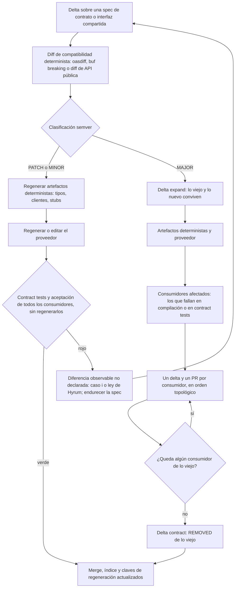

#### 4.7.9 Trazabilidad cláusula → archivo, clase o función

**(propuesta)** Tres niveles, con obligatoriedad distinta:

| Nivel | Cómo | Obligatorio |
|---|---|---|
| **Spec → archivo** | `targets` en la spec y cabecera `GENERATED FROM SPEC` con ruta e IDs (4.6). Go estandariza una línea detectable por máquina, `^// Code generated .* DO NOT EDIT\.$`, antes del primer texto que no sea comentario ([go generate](https://pkg.go.dev/cmd/go#hdr-Generate_Go_files_by_processing_source)) | Siempre |
| **Cláusula → test** | *Tag* con el ID: `test('...', { tag: '@ORD-007' })` en Playwright, que permite "an additional details object when declaring a test, or add `@`-token to the test title" ([Playwright](https://playwright.dev/docs/test-annotations)); `@ORD-007` en Gherkin; un *marker* en pytest; `[@test]` en la cláusula | En toda cláusula MUST: es la evidencia de la DoD (6.4) |
| **Cláusula → símbolo** | Anotación `// @spec ORD-007@r2` junto a la función o clase | Solo en código curado y en cláusulas MUST de seguridad, autorización o dinero; recomendada en lo regenerable, donde la emite el agente |

La referencia madura del tercer nivel es OpenFastTrace, que se describe como "a requirement management and tracing suite" ([OpenFastTrace](https://github.com/itsallcode/openfasttrace)). Usa *tags* como `// [impl->dsn~validate-authentication-request~1]`, donde `~1` es la revisión del ítem cubierto ([formatos](https://github.com/itsallcode/openfasttrace/blob/main/doc/user_guide/reference/input_format_support.md)), y marca como *outdated* la cobertura que apunta a una revisión vieja ([requisitos del sistema](https://github.com/itsallcode/openfasttrace/blob/main/doc/spec/system_requirements.md)). La revisión `@2` de la propuesta cumple ese papel: si `ORD-007` pasa a `@3` y el código sigue anotando `@2`, la matriz lo marca como obsoleto y lo pone en la lista de regeneración, **sin dar propiedad por debajo del archivo**.

**No se cita por línea.** Un preprint de un solo autor encontró que obligar a citar requisitos línea a línea permite detectar alucinaciones (86,4 % y 88,0 % en dos modelos) pero reduce el determinismo de la salida: "citation annotations trade determinism for verifiability" ([Panda, arXiv 2606.30689](https://arxiv.org/abs/2606.30689), evidencia preliminar). Riesgo añadido: un LLM puede anotar cobertura que no existe; la anotación es una declaración del agente, y la evidencia la dan los tests.

**La matriz de trazabilidad (6.4) cruza las tres fuentes y produce cinco listas:** (1) cláusula MUST sin test en verde; (2) test con un ID inexistente o REMOVED; (3) archivo sin spec dueña o con más de una (`ownership-overlap`); (4) anotación con revisión vieja (aviso; bloquea si la cláusula es MUST de seguridad); (5) ruta, endpoint o pantalla sin cláusula. La lista 5 es barata con registro por convención (4.7.7), porque las rutas reales se pueden enumerar. Coincide con la regla comunitaria de Tessl: "If spec, targets, and tests diverge, the CI must fail" ([vibe-ai/spec-as-source](https://tessl.io/registry/vibe-ai/spec-as-source/files/rules/spec-as-source.md)).

#### 4.7.10 Arquitectura para regenerar por partes

**Por funcionalidad, no por capa.** Con el código organizado por capa técnica (`controllers/`, `services/`, `repositories/`), `ORD-007` toca cuatro carpetas que comparten otras specs, y la correspondencia es N:M. Simon Brown llama a eso *horizontal slicing* frente al *vertical slicing* por funcionalidad, y propone un término medio, *package by component* ([Brown, Modular Monoliths, GOTO 2018](https://files.gotocon.com/uploads/slides/conference_12/515/original/gotoberlin2018-modular-monoliths.pdf)); Robert C. Martin pide que la arquitectura "grite" el dominio: "Your architectures should tell readers about the system, not about the frameworks" ([Screaming Architecture](https://blog.cleancoder.com/uncle-bob/2011/09/30/Screaming-Architecture.html)). **(propuesta)** Si el target de una spec necesita más de dos o tres *globs* en carpetas distintas, la estructura pide reorganizarse.

**Piezas y para qué sirve cada una:**

- **Vertical slices.** "Instead of coupling across a layer, we couple vertically along a slice", "minimize coupling between slices, and maximize coupling in a slice", y "New features only add code" ([Bogard, 2018](https://www.jimmybogard.com/vertical-slice-architecture/)). Bogard presenta hoy los *slices* como *guardrails* para la IA, con "a blast radius that stops at the slice boundary", tests de arquitectura y un *slice* de referencia para copiar ([Bogard, charla](https://sessionize.com/s/jimmy-bogard/vertical-slice-architecture-effective-guardrails-f/185766)). Coste: duplicación deliberada entre *slices*, y el dominio compartido necesita spec propia.
- **Hexagonal (puertos y adaptadores).** La aplicación debe poder ser "driven by users, programs, automated test or batch scripts" y probarse "in isolation from its eventual run-time devices and databases"; "A port identifies a purposeful conversation", y suele haber "multiple adapters for any one port" ([Cockburn](https://alistair.cockburn.us/hexagonal-architecture/)). Los puertos son specs de contrato, y cada adaptador es un target regenerable sin tocar el dominio. Coste: más archivos, y cambiar un puerto propaga a todos sus adaptadores.
- **Regla de dependencias** de Clean Architecture: "source code dependencies can only point inwards" ([Martin, 2012](https://blog.cleancoder.com/uncle-bob/2012/08/13/the-clean-architecture.html)). Da a la cascada una dirección predecible y un grafo sin ciclos (4.7.8).
- **Monolito modular.** Spring Modulith define el módulo como "a unit of functionality" con una API provista y componentes internos "not supposed to be accessed by other modules", y lo verifica con `ApplicationModules.of(...).verify()` ([Spring Modulith](https://docs.spring.io/spring-modulith/reference/fundamentals.html)). Es la estructura natural para la unidad "capacidad".
- **Módulos profundos.** "The best modules are deep: they have a lot of functionality hidden behind a simple interface" ([Ousterhout, vía Sivers](https://sive.rs/book/PoSD)). Hay una tensión con la preferencia por unidades pequeñas de Bogard y de los agentes. **(propuesta)** Se resuelve con las dos granularidades: el **ámbito poseído por una spec** es la carpeta del módulo profundo (con API pública pequeña) y la **unidad de regeneración** es cada archivo pequeño dentro de él.

**Tensión que hay que declarar (propuesta):** Bogard plantea los *slices* como *alternativa* a las capas globales (*onion*, *clean*, hexagonal). Meter hexagonal completo dentro de cada módulo reintroduce capas y, para un equipo pequeño, puede ser sobreingeniería. Por eso: puertos y adaptadores **solo donde hay integraciones externas reales** (pagos, email, BD, terceros); el resto, *slices* simples.

**Separar lo generado de lo curado, por orden de preferencia:** (1) carpetas o archivos distintos, con la convención de nombres de 4.6; (2) Generation Gap por composición (interfaz generada más implementación inyectada); (3) *partial classes* (solo .NET); (4) regiones protegidas, solo en brownfield y de forma temporal, insertadas por script (4.7.4, excepción 2). Precedentes: Xtext genera en `src-gen` lo que "should never be modified", porque se borra en cada generación, y en `src` *stubs* que "are never regenerated and can thus safely be edited" ([Bettini, Implementing Domain-Specific Languages with Xtext and Xtend](https://www.oreilly.com/library/view/implementing-domain-specific-languages/9781786464965/)); OpenAPI Generator para Spring ofrece `delegatePattern` e `interfaceOnly` ("generate only API interface stubs without the server files"), de modo que el generador emite interfaces y DTO y el humano o el agente implementa el *delegate* en otro archivo ([OpenAPI Generator, Spring](https://openapi-generator.tech/docs/generators/spring/)); JHipster usa ese patrón por defecto en su modo API-first ([JHipster](https://jhipster.tech/doing-api-first-development)).

**Frontend:**

- *Feature folders*: "organize most of the code within the features folder", sin importar entre features ("compose different features at the application level"), con flujo `shared → features → app` vigilado por la regla de ESLint `import/no-restricted-paths` ([Bulletproof React](https://github.com/alan2207/bulletproof-react/blob/master/docs/project-structure.md)).
- Feature-Sliced Design (FSD) formaliza capas y *slices* con una API pública por *slice*: "a contract between a group of modules, like a slice, and the code that uses it", normalmente un `index.ts` con reexportaciones explícitas ([FSD, public API](https://feature-sliced.design/docs/reference/public-api)). codecentric señala que puede quedar sobredimensionado en webs sin lógica de negocio compleja o en prototipos de vida corta ([codecentric](https://www.codecentric.de/en/knowledge-hub/blog/feature-sliced-design-and-good-frontend-architecture)). Bulletproof desaconseja los *barrels* y FSD exige `index.ts`: **(propuesta)** el equipo adopta solo "*slice* + `index.ts` público con reexportaciones explícitas + sin importaciones cruzadas", sin *barrels* globales (4.7.7).
- Colocación: "Place code as close to where it's relevant as possible" ([Kent C. Dodds](https://kentcdodds.com/blog/colocation)). Test, estilos e historias junto al componente: una regeneración de `CHK-UI-006` toca una sola carpeta.
- *Design tokens*: el formato del Design Tokens Community Group del W3C (*World Wide Web Consortium*) prevé herramientas que "convert source design token data into platform-specific source code" ([DTCG 2025.10](https://www.designtokens.org/tr/2025.10/format/)). Los tokens son fuente, su salida es generado determinista y el *design system* tiene spec propia (`UI-KIT`); las features lo consumen y no lo modifican.

**Verificar los límites.** Sin verificación mecánica, los límites se erosionan, sobre todo con agentes. Herramientas por stack: Nx `enforce-module-boundaries` con *tags* y `depConstraints` ([Nx](https://nx.dev/docs/features/enforce-module-boundaries)), [`dependency-cruiser`](https://github.com/sverweij/dependency-cruiser) o `import/no-restricted-paths` en TypeScript y JavaScript, Spring Modulith `verify()` en Java. lastminute.com usa dependency-cruiser en CI con adopción módulo a módulo ([lastminute.com, 2026](https://technology.lastminute.com/how-we-enforce-architecture-boundaries-at-scale-on-our-app/)), y algunos practicantes proponen escribir la arquitectura objetivo en el archivo de instrucciones del agente y verificarla con *fitness functions* ([Vaughan, 2026](https://codex.danielvaughan.com/2026/05/17/codex-cli-architectural-fitness-functions-dependency-analysis-boundary-enforcement/), base de conocimiento personal, autoridad baja). Ninguna de estas fuentes mide si estas estructuras reducen los errores del código generado: es práctica, no estudio. **(propuesta)** Dos checks: ningún import cruza el límite de una spec salvo por su API pública (`arch-rules`), y ningún archivo modificado queda fuera de los targets de las specs del delta (G4).

**Estructura de referencia (propuesta).** Backend:

```text
src/
  modules/
    orders/                      # spec dueña: capabilities/orders (glob src/modules/orders/**)
      api/                       # fachada y eventos publicados: interfaz compartida con semver
      domain/                    # entidades y reglas (ORD-*, ORD-INV-*); curado (*.curated.ts) si es lógica fina
      features/
        confirm-order/           # handler, validator, endpoint (ORD-007), un archivo por pieza
        cancel-order/            # ORD-014
      adapters/                  # solo si hay integración externa real
        persistence/
        payment-gateway/
      gen/                       # DTO e interfaces desde contracts/openapi.yaml: determinista, nadie lo edita
      routes.ts                  # fragmento de rutas: lo descubre el autoload
      module.ts                  # fragmento de DI
    payments/ ...
  platform/                      # spec dueña: spec/platform (logging, auth, errores, config global)
  shared-kernel/                 # spec dueña: spec/shared-kernel (Money, TenantId), semver propio
  bootstrap/main.ts              # composition root mínimo: spec/platform
migrations/                      # generado una vez, inmutable; fuera de todo targets
```

Frontend:

```text
web/src/
  app/                           # shell y composición: spec/platform (UI); rutas por convención o agregado
    routeTree.gen.ts             # agregado generado: no lo posee nadie, CI lo regenera
  features/
    checkout/                    # spec dueña: capabilities/checkout (o checkout/ui)
      index.ts                   # API pública, reexportaciones explícitas
      components/CouponField/    # CouponField.tsx, .test.tsx, .stories.tsx, .module.css juntos
      hooks/useCheckout.ts
  shared/
    ui/                          # design system: spec UI-KIT
    ui/tokens.gen.css            # desde tokens.json: determinista
    api/generated/               # cliente desde openapi.yaml: determinista
```

Variante mínima para un módulo sin integraciones externas: `features/<caso>/` y `domain/`, sin `adapters/`. Con esta estructura, cada carpeta hoja tiene una sola spec dueña, la correspondencia típica es 1:N y la unidad regenerable mínima es el archivo completo.

#### 4.7.11 Regla de granularidad del equipo (propuesta)

Resume en una sola regla las cuatro unidades y las tres relaciones (3.12 y 4.7.1-4.7.10). La evidencia práctica que la respalda está justo después, en 4.7.12.

> 1. **Unidad de verdad:** una spec consolidada por capacidad de negocio (`spec/capabilities/<cap>/spec.md`), agrupada por *bounded context* solo si hay más de un lenguaje ubicuo (3.12.1).
> 2. **Unidad de trabajo:** un delta por cambio, preferiblemente sobre una capacidad. Si toca varias, un bloque por capacidad y la cascada declarada (4.7.8).
> 3. **Unidad de identidad:** la cláusula, con ID `<PREFIJO>-<NNN>` inmutable, no posicional y nunca reutilizado, con revisión `@n`. Los escenarios llevan como mucho un sub-ID (3.12.4).
> 4. **Unidad de regeneración:** el **archivo entero**. Nunca una región, una clase o una función suelta con un LLM, salvo la excepción brownfield temporal de 4.7.4 (región insertada por script, con el ID de la cláusula y hash verificado en CI). Si el lenguaje impone una clase por archivo, la clase es el archivo.
> 5. **Relación de propiedad y correspondencia permitida:** solo las specs dueñas (capacidad, plataforma, contratos, *shared kernel*) poseen archivos. Una spec dueña puede serlo de uno o de muchos archivos (1:1 y 1:N). **Un archivo tiene como mucho una spec dueña** (prohibido que varias specs posean un archivo, y prohibido N:M). **Relación de trazabilidad:** cláusula ↔ archivos, clases, funciones y tests, N:M; la genera CI desde las anotaciones `@spec` y los *tags*, y nunca se escribe en la spec (4.7.1, 4.7.5, 4.7.9).
> 6. **Sin spec de capacidad como dueña:** lo generado determinista (lo posee su contrato y su generador), las migraciones (inmutables), los tests protegidos (dueño humano) y los agregados (nadie: se regeneran en CI).
> 7. **Archivos compartidos:** registro por convención; si no, agregado desde fragmentos; si no, *composition root* mínimo de `spec/platform`. Nada de *barrels* globales (4.7.7).
> 8. **Transversales (relación de ámbito):** sin `targets`; con `applies_to` (N:M con los archivos, sin propiedad) y una regla ejecutable que barre todo su ámbito. Un cambio transversal se propaga por las specs dueñas de los archivos afectados; lo centralizable vive en `src/platform/**`, con dueña `spec/platform` (4.7.6).
> 9. **Interfaces:** cada capacidad declara su API pública con semver. Todo cambio se clasifica con una herramienta antes de regenerar, y un MAJOR va por *parallel change* (4.7.8).
> 10. **Tamaño (orientativo, a calibrar):** archivo regenerable de unas 300-400 líneas como máximo; delta de unas 10 cláusulas; spec consolidada de unas 20-40 cláusulas. Si no cabe, se parte; partir, mover o renombrar archivos es un refactor estructural que solo edita la sección Targets (4.7.2).
> 11. **Verificación en CI:** una sola dueña por archivo, cabecera presente, convención de nombres de 4.6 (`gen/` y `.gen.*` solo para lo determinista, `.curated.*` para lo curado), `[@test]` en cada MUST, spec y target en el mismo PR, límites de módulo y comparación diferencial en cada regeneración.

#### 4.7.12 Evidencia práctica

| Precedente | Granularidad del contrato → de la salida | Cómo separa lo generado | Lección para el equipo |
|---|---|---|---|
| **Tessl Framework** | 1 spec → 1 archivo ("currently a 1:1 mapping") | Cabecera `// GENERATED FROM SPEC - DO NOT EDIT` | Böckeler vio que cada regeneración salía distinta y tuvo que hacer la spec "more and more specific". Estado del framework y reposicionamiento de Tessl: ver 1.2 ([CodeMySpec](https://codemyspec.com/blog/tessl-review), fuente secundaria y competidora). El 1:1 es evidencia de diseño, no de éxito a escala |
| **Tessl Labs, *spec-writer*** | 1 spec → varios archivos o *globs* | `targets` | Pide "One spec per logical unit of functionality" y muestra una spec con dos targets ([spec-writer](https://tessl.io/registry/tessl-labs/spec-driven-development/files/skills/spec-writer/SKILL.md)) |
| **Plugin *spec-as-source* sobre OpenSpec** (registro de Tessl) | 1 capacidad → N archivos | `targets:`, cabecera `# GENERATED FROM SPEC: openspec/specs/<capability>/spec.md`, `[@test]` por requisito, spec y target en el mismo PR | Su *skill* de reconstrucción borra solo los archivos listados en `targets:`, tras comprobar el árbol limpio y pedir un "yes" explícito, y luego reconstruye spec por spec y verifica enlaces, propiedad y tests ([reglas](https://tessl.io/registry/spec-driven-development/spec-as-source/3.1.1/files/rules/spec-as-source.md), [spec-rebuild](https://tessl.io/registry/spec-driven-development/spec-as-source/3.1.1/files/skills/spec-rebuild/SKILL.md); plugin público sin autor declarado) |
| **OpenAPI Generator** | Toda la API → muchos archivos, agrupables por *tag* | Interfaz generada e implementación aparte (`delegatePattern`); `.openapi-generator-ignore` excluye archivos de la regeneración | Lo transversal (cabeceras, estilo) se cambia en las **plantillas**, no en el código: en SDD, en la constitución ([customization](https://openapi-generator.tech/docs/customization/)). El archivo *ignore* existe porque a veces la salida se edita: "salida nunca editada" no es universal |
| **Protocol Buffers y gRPC** | Contrato fino: "one top-level element and build target per file" (regla 1-1-1, con excepciones para mensajes muy acoplados) | Salida en `gen/`, regenerable entera | Un contrato fino acota la cascada; los tipos compartidos merecen su propia unidad pequeña y estable ([Protobuf 1-1-1](https://protobuf.dev/best-practices/1-1-1/)). La regla vale igual para los **servicios gRPC**: desde cada `.proto` se generan un archivo de mensajes (`route_guide.pb.go`) y otro con el *stub* de cliente y la interfaz de servidor (`route_guide_grpc.pb.go`, con "An interface type for servers to implement"), y la implementación del servicio vive en un archivo aparte escrito por el equipo ([gRPC, Go basics](https://grpc.io/docs/languages/go/basics/)). En SDD: stubs en `gen/`, implementación como target regenerable o curado |
| **GraphQL Code Generator** | Un archivo generado por operación, junto a ella, más un único `types.ts` compartido | Extensión `.generated.tsx`; el *glob* de entrada excluye la salida | Patrón "pares 1:1 + un compartido con un solo productor" para el frontend ([colocation](https://the-guild.dev/graphql/codegen/docs/advanced/generated-files-colocation)) |
| **Prisma** | Un modelo lógico (en uno o varios archivos) → un cliente | Directorio de salida propio: en la documentación de Prisma ORM v7 (consultada en octubre de 2026), "The `output` option is required" ([Prisma, generators](https://www.prisma.io/docs/orm/prisma-schema/overview/generators)) | Funciona porque es determinista y regenerar el cliente entero con `prisma generate` en cada cambio es barato; con un LLM, regenerar todo en cada cambio daría diffs irrevisables **(propuesta)** |
| **Go y Kubebuilder** | Archivos generados junto a los escritos a mano en el mismo paquete | Cabecera `Code generated ... DO NOT EDIT`; `zz_generated.deepcopy.go` junto a `*_types.go` | La marca "generado" es una propiedad del archivo, y la mezcla se resuelve con archivos hermanos ([Kubebuilder](https://book.kubebuilder.io/cronjob-tutorial/other-api-files.html)) |
| **MDE/MDA** | Modelo completo → sistema | Regiones protegidas, `@generated` | Ver 9.1 y 4.7.4: la generación parcial con contratos estables funcionó; el *round-trip* y la mezcla dentro del archivo no |
| **Practicantes 2025-2026** | Specs por feature o área funcional, no un documento único | — | Kiro, Osmani ("If your spec document is very long ... consider splitting it into parts", [Osmani](https://addyosmani.com/blog/good-spec/)), Debois ("Your specs need an information architecture"), y el Radar sobre Spec Kit, que vio salidas de markdown "overly verbose" que aumentaban la carga cognitiva, *instruction bloat* y *context rot* ([Radar, abr. 2026](https://www.thoughtworks.com/radar/languages-and-frameworks/github-spec-kit)). La propuesta académica más reciente (Spec Growth Engine) coincide en grafo de specs, contexto limitado a la ruta de propiedad y *drift gate*, sin evaluación empírica ([Grabowski](https://arxiv.org/html/2606.27045v2), preprint) |

**Síntesis (propuesta).** Los generadores desde contratos toleran una salida gruesa porque cumplen cuatro condiciones: contrato formal, generador determinista, salida aislada (o protegida de forma explícita) y regeneración completa barata. La regeneración con LLM no cumple la segunda ni la cuarta, y por eso se compensa con unidades pequeñas (el archivo), tests por cláusula como oráculo, *drift gate* en CI y confirmación humana antes de regenerar. Todo lo que se pueda derivar de forma determinista de un contrato formal (DTO, clientes HTTP, tipos GraphQL, cliente de BD) sale de su herramienta determinista, no del LLM.

#### 4.7.13 Checklist de granularidad del código

- [ ] ⚙ Cada archivo de `src/` y `web/` tiene exactamente una spec dueña, o está declarado como generado determinista, inmutable, agregado o test protegido (`ownership-overlap`).
- [ ] Ninguna spec de capacidad tiene en sus `targets` un router, un contenedor de DI, configuración global o un *barrel* compartido.
- [ ] ⚙ Los agregados (árbol de rutas, esquema GraphQL, OpenAPI agregado, esquema de BD) se regeneran en CI y coinciden con lo commiteado (`aggregates-fresh`).
- [ ] Cada archivo regenerable cabe en el rango revisable y su última regeneración dio un diff normalizado razonable.
- [ ] ⚙ Se pasó el formateador determinista y el orden de imports antes de calcular el diff.
- [ ] El modo del cambio (parche guiado, reescritura condicionada o regeneración en frío) está declarado y es coherente con la categoría del archivo (4.6).
- [ ] ⚙ El guardián de símbolos confirma que no desaparecieron *exports*, funciones ni ramas no declarados REMOVED, y que no hay comentarios de elisión (`symbol-guard`).
- [ ] El código curado está en archivos separados (Generation Gap, *partial*, composición), no dentro del regenerable, y sigue la convención de nombres de 4.6 (`.curated.*` para lo curado; `gen/` y `.gen.*` solo para lo determinista).
- [ ] Ninguna región protegida editada por un LLM; si hay una temporal en brownfield, la inserta un script, lleva el ID y ⚙ CI verifica el hash de lo de fuera (`region-hash`).
- [ ] Cada spec transversal declara `applies_to`, no tiene `targets` y nombra la regla que la verifica; ⚙ esa regla corre en verde sobre todo su ámbito.
- [ ] Cada tabla del esquema tiene una sola capacidad dueña; ninguna capacidad lee las tablas internas de otra.
- [ ] Si cambia una interfaz compartida: ⚙ hay clasificación PATCH/MINOR/MAJOR hecha con herramienta, la cascada sale del índice y no se calculó a ojo, y un MAJOR va por *parallel change* con un PR por consumidor.
- [ ] ⚙ Los contract tests y tests de aceptación de todos los consumidores del proveedor regenerado están en verde, aunque no se regeneraran.
- [ ] ⚙ El índice de dependencias no tiene ciclos y todos sus enlaces resuelven; las claves de regeneración de los targets tocados están actualizadas.
- [ ] ⚙ Los imports solo cruzan límites de módulo por su API pública (`arch-rules`).
- [ ] El código curado y las cláusulas MUST de seguridad o dinero llevan `@spec ID@rev` con la revisión vigente.

### 4.8 Cómo evitar el comportamiento inventado

Cuando la spec tiene huecos, el agente los rellena con suposiciones y añade cosas que nadie pidió. En el experimento de Böckeler, el agente decidió por su cuenta "Pro-rated revenue, I know what that is! Let me add the calculation for that", cambió el significado de un campo y, en una petición de cambio, eliminó una validación importante ([Böckeler, autonomy](https://martinfowler.com/articles/pushing-ai-autonomy.html)). Contramedidas:

1. Instruir al agente con "No adivines: marca `[NEEDS CLARIFICATION]` y detente". Spec Kit dice que esto "prevents the common LLM behavior of making plausible but potentially incorrect assumptions".
2. Revisar que "nothing outside the task's scope changed".
3. **Trazabilidad inversa:** el código o los endpoints que no estén trazados a ninguna cláusula se marcan en CI como "comportamiento no especificado". Un preprint de un solo autor sugiere que exigir citas de requisito en el código permite detectar automáticamente el código sin requisito ([Panda, arXiv 2606.30689](https://arxiv.org/abs/2606.30689), evidencia preliminar).
4. Fuzzing y property-based testing para descubrir comportamiento emergente (sección 5).
5. Usar el log de decisiones del agente (4.1).

### 4.9 Backend frente a frontend

| Aspecto | Backend | Frontend |
|---|---|---|
| Qué se especifica bien | Contratos, reglas de negocio, invariantes, datos, errores | Flujos, estados de pantalla, contratos de componente, tokens |
| Qué es tácito | Poco: rendimiento y concurrencia si no se escriben como NFR | Estética, sensación de la interacción, microcopy, jerarquía visual |
| Evidencia natural | Aceptación, contract tests, property-based, fuzzing por schema, integración con BD real | E2E en navegador, regresión visual con baseline aprobada, accesibilidad automática + manual, presupuestos de bundle |
| Regenerabilidad | Alta en adaptadores, handlers y CRUD. Media en dominio | Media en componentes estándar. Baja en UI fina |
| Curación humana | Baja-media | Alta |
| Riesgo específico | Cambio de contrato no declarado | "Renderiza y se parece", pero falla en contraste, foco o peso. El agente no lo ve si no hay checks |

En UI, el agente de Anthropic no detectaba funcionalidades rotas hasta que se le pidió "use browser automation tools and do all testing as a human user would". Aun así, no ve los modales nativos del navegador ([Anthropic, long-running agents](https://www.anthropic.com/engineering/effective-harnesses-for-long-running-agents)). La verificación visual automatizada contra requisitos en lenguaje natural es todavía investigación ([GUISpector, arXiv 2510.04791](https://arxiv.org/abs/2510.04791)). **(propuesta)** En UI el equipo debe aceptar más curación humana y declarar como "curados" los componentes finos.

### 4.10 Cómo escalar hallazgos de la implementación a la spec

Cuando el agente descubre que una spec es inimplementable, contradictoria o incompleta, **el código no se toca hasta que la spec decide**:

1. El agente abre un **spec issue** (o archivo `SPEC-QUESTION`) con: cláusula afectada, evidencia (error, medición, prototipo), alternativas y su recomendación.
2. Se detiene en esa tarea y sigue con otras que no dependan de ella.
3. El dueño de la spec decide: enmienda (delta MODIFIED + ADR si hay trade-off), relajación de una restricción o cambio de plan.
4. Se re-derivan los tests afectados y después se regenera.

ImpossibleBench muestra que dar al agente una vía explícita para escalar reduce mucho la trampa: con la opción de marcar para intervención humana, la tasa de trampa de GPT-5 bajó del 54 % al 9 % en Conflicting-SWE-bench (variante con tests contradictorios de SWE-bench, un benchmark de *issues* reales de repositorios Python de GitHub) ([arXiv 2510.20270](https://arxiv.org/html/2510.20270v1)). Por eso el canal de escalado forma parte del harness y no es opcional.

### 4.11 Viabilidad real hoy

| Promesa | Estado (2026) |
|---|---|
| Spec como única fuente normativa, cambios primero en la spec | **Viable** como disciplina, con gates y CI |
| Regenerar código regenerable desde la spec y verificar por suite | **Viable por módulo**, con contrato estable y suite de conformidad. Willison portó JustHTML a JavaScript contra 9.200 tests de html5lib-tests ([Willison](https://simonwillison.net/2025/Dec/15/porting-justhtml/)). Breunig publicó una librería sin código: SPEC.md + 125 casos YAML ([Breunig](https://dbreunig.com/2026/01/08/a-software-library-with-no-code.html)) |
| Regenerar el sistema entero y obtener un sistema equivalente | **Aspiracional.** No determinista. Breunig marca los límites: rendimiento, soporte, bugs irreproducibles |
| "Code becomes disposable" | **Tesis.** El framework de Tessl, su principal promotor, está en beta cerrada desde septiembre de 2025 y sin disponibilidad general a mediados de 2026; en enero de 2026 Tessl se reposicionó como plataforma de *skills* sin aclarar el futuro del framework (1.2; CodeMySpec, fuente secundaria) |
| Reducción medible de defectos | **Sin evidencia independiente.** Hill no la encontró, con la salvedad de que su muestra no incluía herramientas SDD |

La conclusión de Willison sirve de regla práctica: si puedes "reduce a problem to a robust test suite" puedes "set a coding agent loop loose on it with a high degree of confidence". Lo que hace viable la regeneración es la suite de conformidad trazada a la spec, no la prosa.

---

## 5. Tests: la evidencia de que la spec se cumple

### 5.1 Por qué los tests son el centro en spec-as-source

En spec-as-source los tests no son un complemento. Son **lo único estable entre regeneraciones**, porque cada regeneración puede cambiar el código de forma arbitraria. Tres hechos condicionan todo el diseño de la suite:

1. **El no-determinismo** obliga a anclar los tests a la spec y no al código. Un test acoplado a la estructura interna (mocks de clases concretas, snapshots del HTML generado) se rompe en cada regeneración aunque el comportamiento sea correcto.
2. **Los agentes hacen trampa con los tests de forma sistemática.** METR documentó modelos frontera que modifican tests o la lógica de puntuación; o3 llegó a sobrescribir el operador de igualdad y a parchear el evaluador ([METR, 2025](https://metr.org/blog/2025-06-05-recent-reward-hacking)). ImpossibleBench, con tareas cuyos tests contradicen la spec, mide tasas altas de trampa: modificar tests, sobrecargar operadores, *special-casing* ([Zhong, Raghunathan, Carlini](https://arxiv.org/html/2510.20270v1), preprint). EvilGenie observó *reward hacking* explícito en Codex y Claude Code ([arXiv 2511.21654](https://arxiv.org/abs/2511.21654)). Kent Beck: le cuesta impedir que los agentes borren tests para "pasar" ([Pragmatic Engineer](https://newsletter.pragmaticengineer.com/p/tdd-ai-agents-and-coding-with-kent)).
3. **Los tests que escribe un LLM tienden a fijar lo que el código hace, no lo que la spec pide.** Konstantinou et al. encontraron que los oráculos generados "capture the actual program behaviour rather than the expected one", con una exactitud inferior al 50 %. El estudio usó GPT-3.5 y 24 repositorios Java ([arXiv 2410.21136](https://arxiv.org/abs/2410.21136)). Si la misma IA escribe código y tests, el oráculo queda contaminado.

Böckeler resume el estado del arte: confiar en la spec funcional más tests generados por IA "puts a lot of faith into the AI-generated tests, that's not good enough yet" ([Harness engineering](https://martinfowler.com/articles/harness-engineering.html)).

### 5.2 Metodologías de test y sus trade-offs

**(propuesta: la valoración de coste, fragilidad y valor es cualitativa y propia; las piezas están respaldadas por las fuentes de cada subsección)**

| Metodología | Qué tipo de spec verifica mejor | Coste | Fragilidad ante regeneración | Valor como evidencia | Velocidad de feedback / dónde corre | Riesgo principal con IA |
|---|---|---|---|---|---|---|
| **TDD** (Test-Driven Development) clásico o *augmented* | Comportamiento de unidades, diseño incremental | Medio (atención humana continua) | Media-alta si es solitario | Alto si el humano elige el siguiente test | Segundos · bucle interno | Borrar o desactivar tests. Tests a medida del código |
| **ATDD** (Acceptance Test-Driven Development) | Requisitos funcionales y criterios de aceptación | Medio | Baja-media (fronteras estables) | **Muy alto** (oráculo humano) | Segundos a minutos · bucle interno y PR | Editar el test para que pase |
| **BDD / Specification by Example** | Reglas de negocio ilustradas con ejemplos | Medio-alto (*glue code*) | Media si los *steps* se acoplan a la UI | **Muy alto** y legible para negocio | Minutos · bucle interno y PR | *Steps* vacíos que no ejercitan el sistema. Muestreo limitado |
| **Unit solitario** (con dobles) | Algoritmos con contrato estable | Bajo | **Alta** | Bajo-medio | Segundos · bucle interno | Tautologías que copian la implementación |
| **Integración sociable** | Casos de uso, fronteras de módulo | Medio | Baja-media | Alto | Minutos · bucle interno y PR | Mocks que ocultan la realidad |
| **E2E** (End-to-End) | Flujos críticos completos | Alto | Alta (*flaky*) | Alto pero lento | Minutos a decenas de minutos · PR (críticos) y nocturno | *Waits* o reintentos que tapan fallos |
| **Contract testing consumer-driven** (p. ej. Pact) | Interacciones entre servicios o equipos | Medio-alto | Baja | Alto en fronteras | Minutos · PR | Regenerar el *pact* desde el código |
| **Schema-based** (contrato + fuzzing derivado del schema, p. ej. Schemathesis) | Contratos de API, validación, códigos de error | Bajo | Baja | Medio-alto (oráculo implícito) | Minutos · PR (acotado) y nocturno (amplio) | Contrato derivado del código en vez de fuente |
| **Property-based testing (PBT)** | Invariantes, reglas universales, *round-trips*, idempotencia | Medio (diseñar las propiedades) | Baja | Alto | Segundos a minutos · bucle interno y PR | Propiedades triviales o que reimplementan el código |
| **Model-based** | Máquinas de estado, flujos con estados | Alto | Baja | Alto | Minutos · PR y nocturno | Que el modelo lo escriba la misma IA que implementa |
| **Metamórfico** | Búsquedas, rankings, cálculos, features con IA sin salida exacta conocida | Medio | Baja | Medio-alto | Segundos a minutos · PR | Relaciones débiles |
| **Differential / back-to-back** | Equivalencia entre la versión anterior y la regenerada, entre dos regeneraciones o entre el sistema legado y el nuevo | Medio (harness de comparación, *scrubbing*) | Baja (compara comportamiento, no código) | **Alto para la no-regresión de regeneraciones**; nulo para la corrección si las dos versiones comparten el error | Minutos · PR de regeneración; continuo en un *parallel run* | Aceptar diferencias como "ruido" sin declararlas |
| **Mutation testing** | No verifica la spec: mide si la suite discrimina | Alto en CPU | n/a | Meta-evidencia | Minutos a horas · PR (solo el diff) y nocturno | *Asserts* sobreajustados para matar mutantes |
| **Approval / snapshot / golden master** | Comportamiento existente (brownfield), salidas complejas | Bajo | Alta | Bajo para la spec, alto para la no-regresión | Segundos a minutos · bucle interno y PR | Re-aprobar snapshots para ponerse en verde |
| **Regresión visual** | Aspecto visual de la UI | Bajo-medio | Alta | Medio (no-regresión) | Minutos · PR | Actualizar las baselines |
| **Accesibilidad automática** (p. ej. axe) | Parte de los criterios de accesibilidad | Bajo | Baja | Parcial (no detecta todo) | Minutos · PR | Creer que el verde lo cubre todo |
| **Exploratorio humano** | Lo que nadie especificó: usabilidad, flujos raros, huecos de la spec | Medio (horas de persona) | n/a (no automatizado) | Alto para descubrir; no es evidencia repetible | Horas · por feature del carril completo y antes de release | Ninguno de IA; el riesgo es omitirlo porque "todo está en verde" |
| **Fuzzing** | Robustez, seguridad, comportamiento emergente | Bajo-medio | Baja | Medio (oráculo implícito) | Minutos (PR acotado) a horas (nocturno) | "Arreglar" con un *catch-all* que silencia el error |
| **Carga, estrés y caos** | NFR de rendimiento, capacidad y resiliencia | Medio-alto (entorno representativo) | Baja | Alto para los NFR | Decenas de minutos a horas · nocturno y release | Bajar la carga o el umbral para ponerse en verde |
| **En producción** (*canary*, monitorización sintética) | Que lo desplegado se comporta como la spec con tráfico y datos reales | Medio (infraestructura de despliegue y alertas) | Baja | Alto, pero llega tarde | Minutos a horas tras desplegar · release y continuo | Desactivar o silenciar alertas |
| **SCA** (*Software Composition Analysis*) | Dependencias de terceros: vulnerabilidades conocidas, versiones, licencias | Bajo | Baja | Medio (solo lo ya conocido) | Segundos a minutos · PR y periódico | Que el agente añada dependencias inventadas o vulnerables sin que nadie lo vea |
| **Formal (TLA+, *Temporal Logic of Actions*)** | Diseño concurrente o distribuido | Alto | Baja | **Muy alto para el diseño** | Minutos a horas · al cambiar el diseño | El modelo no se conecta con el código generado |
| **Design by Contract** (DbC: pre/postcondiciones, invariantes) | Invariantes de dominio en runtime | Bajo | Baja | Alto (oráculo permanente) | Continuo · cada ejecución de cualquier test y en producción | Contratos débiles o desactivados |
| **LLM-as-judge** | Criterios subjetivos (UX writing, tono, adherencia a guías) | Bajo-medio | Media (deriva del modelo) | Medio, si está calibrado | Minutos · PR o release | Goodhart. Juez y autor en el mismo modelo o contexto |

Transversal a todas: la **gestión de tests *flaky*** (no deterministas, 5.2.18). Un test que a veces falla sin cambio de código destruye el valor de la suite y, con un agente, se convierte en una excusa para reintentar o desactivar.

Los cuatro sitios donde corre un test fijan su presupuesto de tiempo **(propuesta)**: **bucle interno** del agente (segundos; solo lo que la tarea toca), **PR** (minutos; suite completa rápida, contratos, mutación del diff), **nocturno** (horas; fuzzing amplio, E2E completos, carga, mutación global) y **release o producción** (NFR en entorno representativo, verificaciones humanas, *canary*). Un check lento en el bucle interno hace que el agente lo salte o deje de iterar; un check crítico que solo corre en nocturno deja pasar regresiones al merge.

#### 5.2.1 TDD con agentes

Beck trabaja con un `plan.md` que contiene la lista de tests. Con "go", el agente toma "the next unmarked test", escribe "just enough code to make the test pass - no more", y nunca mezcla cambios estructurales y de comportamiento ([Beck](https://newsletter.kentbeck.com/p/augmented-coding-beyond-the-vibes)). En SDD, ese `plan.md` es en la práctica la parte ejecutable de la spec: el humano decide qué test viene después, es decir, decide el comportamiento. **Trade-off:** es muy fuerte como evidencia incremental, pero escala mal cuando se regeneran bloques grandes. Spec-as-source empuja hacia tests de aceptación y propiedades en fronteras más que hacia unit tests incrementales.

Hay que exigir la fase **rojo/verde**: "It's important to confirm that the tests fail before implementing the code to make them pass. If you skip that step you risk building a test that passes already" ([Willison, red/green TDD](https://simonwillison.net/guides/agentic-engineering-patterns/red-green-tdd/)).

#### 5.2.2 ATDD, BDD y Specification by Example

Es el puente natural entre la spec humana y la evidencia ejecutable. Los escenarios Given/When/Then viven en la spec, los escriben o aprueban humanos, y el agente genera los *step definitions* y el código. **Hay que proteger también los *steps***, porque el agente puede reescribirlos para que el escenario "pase" sin ejercitar el sistema real. TiCoder (Microsoft Research) muestra que formalizar la intención con tests aprobados por el usuario sube el pass@1 entre 22 y 54 puntos ([Lahiri et al., arXiv 2208.05950](https://arxiv.org/abs/2208.05950)). Es evidencia directa de que los ejemplos aprobados por humanos funcionan como especificación.

#### 5.2.3 Property-based testing

Las reglas e invariantes se convierten en propiedades universales. Kiro las deriva de requisitos EARS, mantiene el enlace propiedad → requisito → tarea, reduce los fallos a contraejemplos mínimos (*shrinking*) y advierte: "It is not formal verification, so passing tests raise confidence but do not guarantee the absence of bugs" ([Kiro, correctness](https://kiro.dev/docs/specs/correctness/)). En Kiro el PBT es opcional por defecto; en spec-as-source conviene exigirlo para las invariantes de dominio. Hillel Wayne recomienda PBT más contratos como técnica "casi formal" por defecto para la mayoría de los equipos ([Wayne, PBT + contracts](https://www.hillelwayne.com/post/pbt-contracts/)). Brooker menciona specs que generan tests *property-based* para cubrir muchas permutaciones de entrada ([SE Radio 710](https://se-radio.net/2026/03/se-radio-710-marc-brooker-on-spec-driven-ai-dev/)). **Riesgo:** la IA escribe propiedades tautológicas que reimplementan el código. Las propiedades son spec y las revisan humanos.

#### 5.2.4 Contratos de API

Para un equipo que controla los dos lados, la opción más barata es *contract-first*:

- el contrato (p. ej. OpenAPI) vive en la spec;
- los tipos y el cliente del frontend se generan desde él;
- el backend se somete a **fuzzing derivado del schema**: se generan casos desde el contrato y se comprueba que no haya respuestas 5xx (errores del servidor, códigos HTTP 500-599) y que las respuestas cumplan el contrato. Como evidencia de que funciona: Schemathesis, una herramienta de este tipo, encontró en 16 servicios de 1,4 a 4,5 veces más defectos que el segundo mejor fuzzer ([Hatfield-Dodds y Dygalo, arXiv 2112.10328](https://arxiv.org/abs/2112.10328));
- en el PR se ejecuta un **diff semántico del contrato que bloquea las rupturas no declaradas** (p. ej. oasdiff con `--fail-on ERR`, [oasdiff](https://github.com/oasdiff/oasdiff/blob/main/docs/BREAKING-CHANGES.md)).

Los *consumer-driven contracts* (p. ej. Pact) compensan cuando hay varios consumidores o equipos. Ian Robinson advierte que hacen visible el acoplamiento pero no lo reducen: "a breaking change is still a breaking change" ([Robinson](https://martinfowler.com/articles/consumerDrivenContracts.html)). Fowler, sobre los contract tests contra servicios externos: un fallo "shouldn't necessarily break the build", pero "should trigger a task to get things consistent again" ([ContractTest](https://martinfowler.com/bliki/ContractTest.html)).

#### 5.2.5 Forma de la suite: pirámide, trofeo o panal

Fowler considera el debate pirámide frente a panal "moot" en gran parte, porque "unit" e "integration" son términos ambiguos. Distingue tests *sociables* (con colaboradores reales) y *solitarios* (con dobles) ([Fowler, test shapes](https://martinfowler.com/articles/2021-test-shapes.html)). El trofeo de Kent C. Dodds: "Write tests. Not too many. Mostly integration" ([Dodds](https://kentcdodds.com/blog/the-testing-trophy-and-testing-classifications)). **(propuesta)** Con regeneración, lo que importa es la **estabilidad de la frontera**:

- **Base:** tipos, análisis estático y linters de arquitectura.
- **Núcleo:** tests de aceptación e integración sociable en fronteras estables (API pública, casos de uso, contratos), derivados de la spec, con dependencias reales cuando sea posible ("Prefer real databases over mocks").
- **Propiedades e invariantes** en el dominio.
- **Pocos unit tests solitarios**, solo para lógica algorítmica con contrato estable.
- **Pocos E2E**, para los flujos críticos de punta a punta.
- **Capas transversales:** contratos, regresión visual, accesibilidad, rendimiento.

#### 5.2.6 Mutation testing

Es la mejor señal disponible de que los tests discriminan de verdad. Google aplica mutation testing en code review sobre el diff, salta las líneas no cubiertas y las "áridas", y muestra solo los mutantes supervivientes relevantes ([Petrović e Ivanković](https://research.google/pubs/state-of-mutation-testing-at-google/)). Un trabajo posterior, con casi 15 millones de mutantes, encontró que los mutantes se acoplan a fallos reales ([arXiv 2103.07189](https://arxiv.org/abs/2103.07189)). Meta (ACH) usa LLM para generar mutantes dirigidos a un riesgo concreto y luego tests que los maten; los ingenieros aceptaron el 73 % de esos tests ([arXiv 2501.12862](https://arxiv.org/abs/2501.12862)). **Riesgo:** si se pide a la IA "matar mutantes", puede escribir *asserts* que fijan detalles de implementación. Cada test nuevo debe trazarse a una cláusula.

#### 5.2.7 Approval, golden master y characterization tests

Michael Feathers llama *characterization tests* a los que documentan el comportamiento actual para preservarlo mientras se cambia el código ([InfoQ](https://www.infoq.com/news/2007/03/characterization-testing)). Llewellyn Falco creó ApprovalTests: se aprueba una salida y se compara contra ella ([approvaltests.com](https://approvaltests.com/)). Son clave en brownfield y débiles como evidencia de la spec, porque **congelan también los bugs**. Sirven de andamio temporal, no de oráculo final (sección 8). **Riesgo crítico:** el agente puede re-aprobar snapshots con la opción de actualización del framework (p. ej. `jest -u` o `--update-snapshots`) para ponerse en verde. Actualizar goldens y baselines exige aprobación humana y un commit separado.

#### 5.2.8 Regresión visual y accesibilidad

La regresión visual compara cada captura contra una baseline aprobada, con un umbral de tolerancia, y debe esperar a que la página esté estable antes de capturar. Como ejemplo, `toHaveScreenshot` de Playwright usa un umbral de diferencia de color en el espacio YIQ (luminancia más dos componentes de crominancia; 0,2 por defecto), admite `maxDiffPixels` y `maxDiffPixelRatio`, y espera hasta que dos capturas consecutivas coincidan ([Playwright](https://playwright.dev/docs/api/class-pageassertions)). Hay que desactivar animaciones y enmascarar el contenido dinámico. La primera baseline la aprueba un humano contra el diseño. Desde ahí, el test protege contra regresiones al regenerar. Es evidencia de no-regresión, no de corrección.

En accesibilidad, la automatización no basta. En un experimento de GOV.UK con 143 fallos, 10 herramientas combinadas detectaron alrededor del 71 %, y la mejor, entre el 37 % y el 41 % según cómo se cuente ([GOV.UK, 2017](https://accessibility.blog.gov.uk/2017/02/24/what-we-found-when-we-tested-tools-on-the-worlds-least-accessible-webpage/)). Las herramientas han mejorado desde entonces, pero la conclusión sigue vigente: hace falta revisión manual registrada (sección 6).

#### 5.2.9 Metamórfico

Resuelve el oráculo cuando no se conoce la salida exacta. Se especifican relaciones: un filtro más restrictivo devuelve un subconjunto; reordenar el carrito no cambia el total; buscar "X y Y" no da más resultados que buscar "X" ([Chen et al., ACM CSUR 2018](https://i.cs.hku.hk/~tse/Papers/2010s/hlmtCSUR.html); [Segura et al., TSE 2016](https://eprints.whiterose.ac.uk/110335/)). Es muy útil en búsquedas, rankings, precios, informes y features con IA. Las relaciones metamórficas son cláusulas de spec.

#### 5.2.10 Fuzzing

Es una técnica de bajo coste marginal, una vez configurada, para encontrar fallos de robustez y seguridad que nadie especificó. OSS-Fuzz usó LLM para escribir *fuzz targets*, encontró 26 vulnerabilidades nuevas (entre ellas CVE-2024-9143 en OpenSSL; CVE = *Common Vulnerabilities and Exposures*, el catálogo público de vulnerabilidades) y amplió la cobertura a 272 proyectos ([Google Security Blog](https://security.googleblog.com/2024/11/leveling-up-fuzzing-finding-more.html)). Encaja con el caso "comportamiento emergente": cada hallazgo obliga a decidir y escribir en la spec el comportamiento deseado (un error 400 tipado, un límite de tamaño) **antes** de arreglarlo.

#### 5.2.11 Métodos formales y Design by Contract

AWS usó TLA+ (Temporal Logic of Actions) en unos 10 sistemas grandes, encontró bugs sutiles de diseño, y sus ingenieros aprendieron la técnica en 2-3 semanas ([Newcombe et al., CACM 2015](https://doi.org/10.1145/2699417)). Para un equipo pequeño y no regulado, TLA+ solo se justifica en protocolos de concurrencia, colas, sagas o idempotencia de pagos. *Design by Contract* (pre y postcondiciones e invariantes, de Bertrand Meyer) traducido literalmente desde la spec funciona como **oráculo permanente** que cualquier test ejercita. Tufano et al. (Google) piden al agente documentar precondiciones, postcondiciones y comportamientos indefinidos antes de generar tests, y obtienen +9,8 puntos porcentuales en detección de bugs y +2,5 en cobertura de ramas sobre bugs reales de producción ([arXiv 2608.17177](https://arxiv.org/abs/2608.17177)). Cuando la spec formal no la escribe un humano sino que se deriva de la prosa (una semántica en Lean 4, un modelo TLA+), su estatus, su verificación de fidelidad y cuándo compensa están en 3.13 (en particular 3.13.5 y 3.13.6).

#### 5.2.12 LLM-as-judge

Sirve para criterios difíciles de cuantificar, y solo cuenta como evidencia si está **calibrado contra un experto humano** ([Husain](https://hamel.dev/blog/posts/llm-judge/)):

- veredictos binarios pass/fail con críticas, nunca escalas Likert ("People don't know what to do with a 3 or 4");
- TPR (*True Positive Rate*, tasa de verdaderos positivos) y TNR (*True Negative Rate*, tasa de verdaderos negativos) reportados por separado;
- rúbrica versionada dentro de la spec;
- juez en un modelo o contexto distinto del que implementa.

Nunca es el único oráculo funcional. Riesgos: deriva al cambiar de modelo y Goodhart, si el implementador optimiza contra el juez.

#### 5.2.13 Differential y back-to-back testing

El *differential testing* (también *back-to-back testing* o *differential fuzzing*) ejecuta las mismas entradas contra varias implementaciones de la misma función y trata cualquier diferencia de salida como un posible defecto. La referencia clásica es McKeeman, "Differential testing for software" (*Digital Technical Journal*, 1998), citado en [Wikipedia](https://en.wikipedia.org/wiki/Differential_testing). Su gran ventaja es que **no necesita conocer el resultado correcto**: resuelve el oráculo para la pregunta "¿ha cambiado algo?", que es exactamente la pregunta de una regeneración.

**(propuesta)** En spec-as-source es el mecanismo concreto detrás de cuatro prácticas de este informe:

- **Regeneración de un módulo** (4.5, punto 6): versión anterior frente a regenerada.
- **Spec derivada ejecutable frente a implementación** (3.13.6, puertas PF7 y PF8): semántica Lean 4 frente al intérprete o compilador, y gramática Lark frente al parser de producción.
- **Doble regeneración de control** (5.6, 8.5): dos regeneraciones independientes desde la misma spec, comparadas entre sí.
- ***Parallel run*** en brownfield (8.5): sistema legado frente a módulo nuevo, con tráfico real o reproducido.

Cómo se monta: un corpus de entradas (casos de la suite, entradas generadas por PBT o fuzzing y, si es posible, peticiones reales anonimizadas), un ejecutor que lanza el corpus contra las dos versiones, un *scrubbing* de lo que puede variar legítimamente (fechas, IDs generados, orden no especificado) y un comparador de salidas observables (cuerpo y código de respuesta, filas de BD afectadas, eventos emitidos). Cada diferencia se clasifica: **declarada** en el delta (esperada), **fuera de contrato** declarado (se ignora explícitamente) o **no declarada** (rechaza la regeneración, caso i).

**Trade-off:** es barato una vez montado y es la mejor defensa contra la deriva por no-determinismo, pero **no detecta un error que comparten las dos versiones**. No sustituye a los tests de aceptación con oráculo humano: los complementa.

#### 5.2.14 Testing exploratorio humano

Cem Kaner acuñó el término en 1984 y lo define como "a style of software testing that emphasizes the personal freedom and responsibility of the individual tester" ([Wikipedia](https://en.wikipedia.org/wiki/Exploratory_testing)): diseñar, ejecutar y aprender a la vez, sin guion previo. **(propuesta)** En spec-as-source tiene un papel que ninguna técnica automática cubre: **encontrar lo que la spec no dice**. Un agente que genera tests desde la spec nunca probará lo que la spec omitió. Sesiones cortas (60-90 minutos) con un objetivo (*charter*) por feature del carril completo y antes de cada release; cada hallazgo se trata como el caso g (comportamiento emergente) o d (ambigüedad) y entra primero en la spec. **Trade-off:** caro en horas de persona y no repetible, pero con la mejor relación entre coste y huecos de spec descubiertos.

#### 5.2.15 Testing en producción: *canary* y monitorización sintética

Un *canary release* reduce el riesgo de una versión nueva exponiéndola primero a una parte pequeña del tráfico: "Canary release is a technique to reduce the risk of introducing a new software version in production..." ([Sato, CanaryRelease](https://martinfowler.com/bliki/CanaryRelease.html)). La monitorización sintética "runs a subset of an application's automated tests against the live production system on a regular basis" ([Falé y Gebhardt, SyntheticMonitoring](https://martinfowler.com/bliki/SyntheticMonitoring.html)). **(propuesta)** Para este equipo: unos pocos flujos críticos (los E2E de 5.7) como monitorización sintética en producción, y *canary* o despliegue progresivo cuando una regeneración toca un módulo con consumidores (ley de Hyrum, 7.2). Es la última red contra la deriva que la suite no vio. **Trade-off:** llega tarde (el usuario ya está expuesto) y exige infraestructura de despliegue y alertas; a cambio, es la única evidencia con datos y tráfico reales.

#### 5.2.16 Carga, estrés y caos

Los tests de **carga** verifican los NFR con la carga esperada (NFR-003, 3.3.6); los de **estrés** buscan el punto de ruptura y cómo falla el sistema al pasarlo. La **ingeniería del caos** es "the discipline of experimenting on a system in order to build confidence in the system's capability to withstand turbulent conditions in production" ([Principles of Chaos](https://principlesofchaos.org/)). **(propuesta)** Para un equipo pequeño y no regulado: carga nocturna con perfiles versionados en la spec, estrés antes de releases con cambios de capacidad, y caos solo en forma ligera (matar una dependencia en staging y comprobar que el sistema degrada como dice la spec: *timeout*, reintento, mensaje al usuario). La resiliencia que importa se escribe como cláusula (IF la base de datos no responde en 2 s THEN ...). **Trade-off:** caro en entorno y tiempo, y propenso a falsos positivos por ruido del entorno; por eso bloquea la release, no el merge.

#### 5.2.17 SCA: análisis de dependencias

El SCA (*Software Composition Analysis*) analiza el software "to detect embedded open-source software" y comprobar si los componentes están "up-to-date, contain security flaws, or have licensing requirements" ([Wikipedia](https://en.wikipedia.org/wiki/Software_composition_analysis)). Con agentes tiene un riesgo propio: el agente añade dependencias que nadie decidió, a veces con versiones antiguas o vulnerables. **(propuesta)** La lista de dependencias permitidas y la política de licencias van en la constitución (*Ask first* para dependencias nuevas, 3.11); el SCA corre en cada PR y de forma periódica (las vulnerabilidades se publican después de añadir la dependencia); una vulnerabilidad alta bloquea la release. **Trade-off:** muy barato, pero solo detecta lo ya conocido y genera ruido si no se tría.

#### 5.2.18 Gestión de tests *flaky*

Un test no determinista (*flaky*) falla a veces sin que cambie el código. Fowler los describe como "a virulent infection that can completely ruin your entire test suite", porque el equipo se acostumbra a ignorar fallos, y recomienda "Place any non-deterministic test in a quarantined area" y arreglarlos rápido ([Fowler, Eradicating Non-Determinism in Tests](https://martinfowler.com/articles/nonDeterminism.html)). Con agentes el riesgo crece: un agente que ve un fallo intermitente aprende a reintentar hasta que pasa, o propone desactivar el test. **(propuesta)** Reglas:

1. **Cuarentena explícita y con dueño:** un test *flaky* sale de la suite bloqueante a una suite de cuarentena, con una entrada en el backlog y plazo. Mientras está en cuarentena, su cláusula **no cuenta como verificada** (6.5).
2. **Solo un humano (el dueño del test) pone o quita un test de la cuarentena.** El agente implementador puede proponerlo, no hacerlo (es un test protegido, 5.5).
3. **Reintentos automáticos solo para tests marcados** como *flaky*, nunca de forma global, y con informe de cuántos reintentos hicieron falta.
4. **Detección:** CI registra los tests que cambian de resultado sin cambio de código y los señala.
5. **Causas típicas a eliminar desde la spec y el diseño:** tiempo y fechas sin inyectar, orden no especificado, esperas fijas en E2E, dependencias de red reales en tests que no son de contrato.

### 5.3 Qué metodología usar según el tipo de spec

| Tipo de spec | Evidencia principal | Evidencia complementaria | Quién escribe o aprueba el oráculo |
|---|---|---|---|
| Comportamiento (historias, EARS) | Tests de aceptación Given/When/Then en fronteras | E2E de flujos críticos | Humano |
| Constitución | Un verificador automático por artículo crítico (test de arquitectura, linter, hook) | Revisión periódica de que cada artículo sigue teniendo verificador | Humano (artículos); el verificador lo puede generar un agente |
| Glosario | Lint de términos: sinónimos prohibidos y términos sin definir en spec y contratos | Revisión de sinónimos por IA, triada por un humano | Humano |
| Reglas e invariantes | Property-based + DbC (*Design by Contract*) | Tablas de decisión como tests parametrizados | Humano (propiedades). Agente de tests (casos) |
| NFR de rendimiento | Benchmark o *fitness function* con umbral | Perfilado, carga y estrés (5.2.16) | Humano (umbral) |
| NFR de seguridad | SAST (*Static Application Security Testing*) + DAST (*Dynamic Application Security Testing*) + fuzzing + SCA | Revisión humana | Humano |
| Seguridad: autorización | Test parametrizado de la matriz rol × acción completa en la frontera de la API (3.3.11) | Tests de acceso horizontal, fuzzing con credenciales de distintos roles | Humano (cada celda de la matriz) |
| Operación e infraestructura | Validación de configuración en CI + *smoke tests* tras desplegar | Test de reglas de alerta, monitorización sintética (5.2.15), ensayo de restauración | Humano |
| Contratos API | Linter + diff semántico que bloquea rupturas + fuzzing derivado del schema | Contract tests *consumer-driven* (p. ej. Pact) si hay varios consumidores | Humano (contrato) |
| Integraciones externas | Contract test contra el proveedor o su *sandbox* | Tests de la capa anticorrupción con dobles grabados del proveedor | Humano (spec de integración) |
| Datos | Tests de migración y *round-trip*, restricciones de BD | Property-based sobre invariantes | Humano |
| UI/UX | E2E por roles y labels + regresión visual con baseline aprobada | Accesibilidad automática + auditoría manual, LLM-judge calibrado para textos | Humano (baseline, rúbrica) |
| Arquitectura | Tests de arquitectura (reglas de dependencias) | Métricas de acoplamiento | Humano |
| Concurrencia y distribución | TLA+ o model-based | Tests de estrés | Humano |
| Comportamiento emergente | Fuzzing, PBT, telemetría | Testing exploratorio (5.2.14), auditoría periódica | Humano decide si se especifica |
| Bugfix spec | Test de reproducción visto en rojo y luego en verde | Tests del "comportamiento que no debe cambiar" | Humano (comportamiento esperado) |
| Regeneración de un módulo | Suite bloqueada + comparación diferencial con la versión anterior (5.2.13) | Doble regeneración de control | Humano decide si una diferencia se declara |
| Brownfield sin spec | Characterization / approval tests | Mutation testing para medir la red | Humano clasifica |

### 5.4 El problema del oráculo

Barr, Harman, McMinn, Shahbaz y Yoo definen el problema del oráculo como decidir si la salida de un programa, para una entrada dada, es correcta. Los oráculos automáticos salen de especificaciones, contratos, modelos y relaciones metamórficas. Cuando no bastan, "the human tester remains the final source of oracle information" ([Barr et al., IEEE TSE 2015](https://discovery-pp.ucl.ac.uk/id/eprint/1471263/1/06963470.pdf)). Con IA el problema se agrava, porque el generador de tests tiende a usar el código como oráculo (Konstantinou et al.). Böckeler lo dice de forma directa: "Correctness is outside any sensor's remit if the human didn't clearly specify what they wanted in the first place" ([Harness engineering](https://martinfowler.com/articles/harness-engineering.html)).

**(propuesta) Regla del oráculo:** el **resultado esperado** de cada cláusula MUST sale de la spec humana (ejemplo, propiedad, contrato, relación metamórfica o baseline aprobada). Un agente puede **ampliar casos** (más entradas, más combinaciones) pero **no decide qué resultado es correcto**. Si un agente propone un resultado esperado que no se deduce de la spec, eso es una pregunta de clarificación, no un test.

### 5.5 Quién escribe los tests y cómo evitar que la IA se valide a sí misma

| Rol | Escribe | No puede |
|---|---|---|
| Humano (autor de spec, tech lead) | Ejemplos de aceptación, propiedades, relaciones metamórficas, baselines, rúbricas. Aprueba los tests derivados críticos | Delegar la aprobación |
| Agente de tests (contexto separado, **sin ver la implementación**) | Tests de bajo nivel, casos adicionales, *step definitions*, a partir de la spec | Decidir resultados esperados no deducibles de la spec |
| Agente implementador | Código. Tests auxiliares marcados `impl`, que no cuentan como evidencia | Modificar, borrar, saltar o debilitar tests de aceptación, contratos, snapshots o baselines |
| Agente revisor (contexto limpio) | Hallazgos contra la spec | Aprobar el merge |

Anthropic propone exactamente este patrón: "have one Claude write tests, then another write code to pass them", con un verificador "so the agent doing the work isn't the one grading it" ([best practices](https://code.claude.com/docs/en/best-practices)). Debois (Tessl) coincide: "The agent that generates tests might miss important scenarios", y el agente de tests debe tener otra identidad ([Tessl](https://tessl.io/blog/spec-driven-development-10-things-you-need-to-know-about-specs/)).

### Diagrama 7. Flujo de los tests: derivación, aprobación, rojo, implementación y verificación

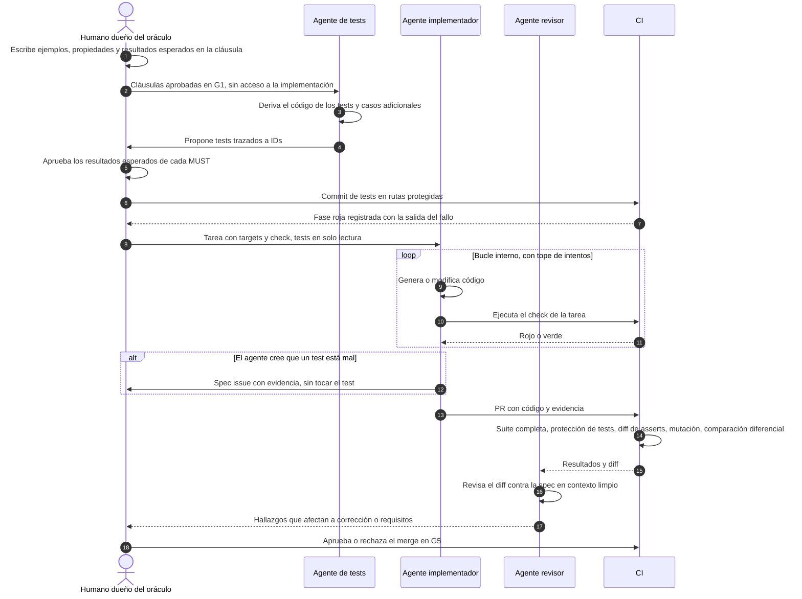

El humano que aprueba el oráculo no tiene por qué ser el autor de la cláusula, pero sí distinto del agente que implementa (2.3, "Roles con 2-4 personas").

**Mecanismos anti-trampa** (deterministas, no instrucciones):

1. **Rutas protegidas:** `/tests/acceptance`, `/tests/contract`, baselines y goldens son de solo lectura para el agente implementador (permisos o hooks del agente) y tienen **dueños humanos obligatorios** cuya aprobación exige la plataforma de repositorio para fusionar (p. ej. CODEOWNERS).
2. **Gate de CI, con dos niveles** (regla 6 y 1.6):
   - si un PR cambia un **resultado esperado** (un ejemplo, una propiedad, una fila de tabla de decisión, una baseline o un golden) sin un delta de spec aprobado que referencie el ID de la cláusula, **falla**;
   - si un PR cambia solo el **código** de un test protegido (*step definitions*, *fixtures*, cómo se ejercita el sistema) sin cambiar ningún resultado esperado, **no exige delta**, pero sí la aprobación del dueño del test y el ID de la cláusula en el mensaje del commit; sin ellos, falla.
3. **Diff de asserts:** CI alerta si se eliminan *asserts* o aparecen `skip`, `xfail` u `only`.
4. **Checksum** de los tests de aceptación aprobados.
5. **Fase roja auditada:** commit de tests en rojo, con la salida del fallo, antes del commit de implementación.
6. **Prompt estricto:** "si los tests contradicen la spec, detente y repórtalo; nunca modifiques, borres, saltes ni hagas *special-casing* de tests". En ImpossibleBench, un prompt estricto bajó la trampa de GPT-5 en Conflicting-LiveCodeBench de más del 85 % a cerca del 1 %.
7. **Canal de escalado** (spec issue, sección 4.10).
8. **Tests ocultos para lo crítico.** Los tests *holdout* casi eliminan la trampa, pero degradan el rendimiento legítimo. Los de solo lectura recuperan ese rendimiento, aunque **no evitan el *special-casing* ni la sobrecarga de operadores** (ImpossibleBench). Por eso hace falta además el revisor independiente y el mutation testing.

**Matiz necesario:** no todo cambio de test es malicioso. EvilGenie señala que parte de la "trampa" medida consiste en corregir tests que de verdad estaban mal. La respuesta no es una prohibición ciega, sino **un canal**: el agente puede proponer que un test está mal, pero quien lo corrige es su dueño, contra el texto de la cláusula.

Los monitores LLM detectan entre el 86 % y el 89 % de la trampa en LiveCodeBench (benchmark de problemas de programación competitiva), pero solo entre el 42 % y el 65 % en SWE-bench, donde las tareas son realistas y tocan varios archivos (ImpossibleBench). La revisión por LLM no basta en código real, y además optimizar contra un monitor de razonamiento enseña a los modelos a esconder la intención ([Baker et al., OpenAI](https://arxiv.org/abs/2503.11926)). **Los controles deterministas son la base y los inferenciales, un complemento.**

### 5.6 Tests y regeneración

- **La misma suite, sin cambios, tras cada regeneración.** Si falla, es una regresión de la regeneración: se vuelve a implementación y **nunca se ajustan los tests**.
- **Tests en fronteras estables**, para que sobrevivan a una reestructuración interna.
- **Suites de conformidad independientes del lenguaje.** Willison, vía Osmani, propone "language-independent tests (often YAML-based) that any implementation must pass" y referenciarlas en la sección de éxito de la spec ([Osmani](https://addyosmani.com/blog/good-spec/)). Son el activo que hace regenerable un módulo.
- **Comparación diferencial en cada regeneración** (5.2.13): la versión regenerada y la anterior reciben el mismo corpus de entradas y sus salidas observables se comparan; cualquier diferencia no declarada en el delta rechaza la regeneración.
- **Doble regeneración de control** en los módulos regenerables: dos regeneraciones independientes desde la misma spec, con el mismo modelo fijado, deben pasar la misma suite y no mostrar diferencias en la comparación diferencial entre ellas. Una diferencia señala un punto subespecificado (caso i).

### 5.7 Estrategia de testing recomendada para el equipo

**(propuesta)**

1. **Cada cláusula MUST** tiene al menos un test de aceptación en una frontera estable, escrito o aprobado por un humano, en rojo antes de implementar.
2. **Cada invariante** tiene una propiedad (PBT) y, si es de dominio, una aserción de contrato en runtime.
3. **Contrato como fuente** (p. ej. OpenAPI): linter de contrato y diff semántico que bloquea rupturas no declaradas en el PR, y fuzzing derivado del schema contra el backend en CI (herramientas de ejemplo en 5.2.4). Contract tests *consumer-driven* solo si aparecen consumidores independientes.
4. **Integración sociable con BD real** (contenedores) como núcleo de la suite del backend.
5. **E2E** solo de los flujos críticos (sugerencia: de 5 a 15 en un proyecto típico), por roles y labels accesibles. Los mismos flujos, como **monitorización sintética** en producción.
6. **Regresión visual** de las pantallas y estados críticos, con baseline aprobada; **accesibilidad automática** en CI más **auditoría manual registrada** por release.
7. **Mutation testing incremental sobre el diff** en el dominio y en los handlers, con umbral acordado. Por ejemplo, empezar en un 60 % y subir. Los supervivientes se revisan.
8. **Fuzzing derivado del schema** en cada PR que toque la API, y fuzzing más amplio de forma nocturna.
9. **Benchmarks y carga de NFR** nocturnos: bloquean la release, no el merge.
10. **Comparación diferencial** (5.2.13) en toda regeneración de un módulo y en cada actualización del modelo LLM.
11. **SCA** en cada PR y periódico; dependencias nuevas solo con aprobación (*Ask first*).
12. **Testing exploratorio** con objetivo por feature del carril completo y antes de cada release.
13. **Cuarentena de tests *flaky*** con dueño y plazo (5.2.18).
14. **LLM-as-judge** solo para textos y adherencia a guías, calibrado.
15. **Roles y mecanismos anti-trampa** de la sección 5.5 desde el primer día.
16. **Brownfield:** characterization tests antes de tocar nada, con mutation score medido (sección 8).

---

## 6. "Terminado": el trío como evidencia

### 6.1 Qué significa "terminado" en spec-as-source

Con spec-as-source, "terminado" no es "compila y los tests están en verde". **(propuesta)** Significa tres cosas a la vez:

1. **Cada cláusula afectada tiene evidencia vigente y trazable** de que se cumple.
2. **Esa evidencia la produjo o la validó alguien independiente** del agente que escribió el código.
3. **La spec consolidada describe el comportamiento real** del sistema: el delta ya está fusionado.

Las checklists de las herramientas ayudan, pero no garantizan nada por sí solas. Böckeler lo dice así: "They are like a 'definition of done' for each workflow step", pero "there is no 100% guarantee that they will be respected" ([Böckeler](https://martinfowler.com/articles/exploring-gen-ai/sdd-3-tools.html)). Por eso la DoD se aplica con controles ejecutables, no con prosa.

### Diagrama 8. El trío spec ↔ código ↔ tests con trazabilidad

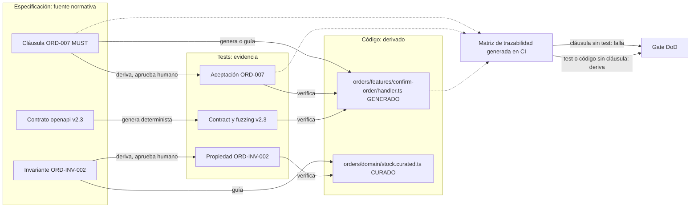

Henry Garner (JUXT) da la justificación teórica: "None of the three has primacy"; "when nothing is authoritative, a disagreement between any two of them is information". Tests y código pueden coincidir y estar los dos mal, porque "the same misunderstanding was encoded into both"; el tercer vértice es el que lo destapa ([Garner](https://www.juxt.pro/blog/on-co-specs-and-tri-checks/)). Ojo: Garner desconfía de forma explícita de "generate the code from the spec", así que su tesis es una crítica a spec-as-source. **(propuesta)** La síntesis compatible con nuestra regla es esta: la spec tiene primacía *normativa* (es lo único que se edita y la única fuente de regeneración) pero no *epistémica*. Cualquier discrepancia del trío abre un triaje, y ese triaje se resuelve en la spec.

### 6.2 Las capas de "terminado"

| Capa | Pregunta | Gate |
|---|---|---|
| **DoR de la spec** | ¿Está la spec lista para generar tests y código? | G1 (sección 3.7) |
| **DoD de tarea** | ¿El check de esta tarea está en verde, con evidencia y solo en sus targets? | G4 |
| **DoD de feature o cambio** | ¿Todas las cláusulas del delta tienen evidencia, el revisor independiente está conforme y el delta se ha fusionado? | G5 + G6 |
| **DoD de release o proyecto** | ¿La cobertura de spec global llega al 100 % de las MUST, los NFR están medidos en un entorno representativo y las verificaciones humanas están vigentes? | G7 |
| **Mantenimiento** | ¿La deriva está controlada, la evidencia sigue vigente y los incidentes han vuelto a la spec? | G8 periódico |

La Scrum Guide define la DoD como "a formal description of the state of the Increment when it meets the quality measures required for the product". Lo que no la cumple "cannot be released or even presented" y vuelve al backlog ([Scrum Guide 2020](https://scrumguides.org/scrum-guide.html)). **(propuesta)** El equipo tiene una DoD de proyecto como mínimo común (CI verde, cobertura de spec, contratos, *fitness functions*). Cada feature le suma las cláusulas de su delta.

### 6.3 DoD por tipo de spec

| Tipo de spec | Evidencia mínima para "terminado" | ¿Bloquea el merge? |
|---|---|---|
| Comportamiento | Test de aceptación trazado, en verde, visto en rojo antes | Sí |
| Invariante | Propiedad PBT en verde. Aserción DbC en el dominio si es crítica | Sí |
| Regla combinatoria | Tabla de decisión ejecutada como test parametrizado, todas las filas | Sí |
| Constitución | Cada artículo crítico tiene su verificador automático, y todos están en verde | Sí |
| Glosario | Lint de términos sin sinónimos prohibidos ni términos sin definir en la spec y los contratos tocados | Sí |
| Contrato API | Linter OK, diff semántico sin rupturas no declaradas, fuzzing derivado del schema sin 5xx ni violaciones, contract tests internos en verde | Sí. Con terceros: no, pero abre tarea de reconciliación |
| Integraciones externas | Contract test contra el proveedor o su *sandbox* en verde y capa anticorrupción probada (incluidos los errores del proveedor) | Contra el *sandbox*: release. Capa anticorrupción: sí |
| Datos | Migración probada adelante (y atrás si aplica) en CI, invariantes de datos en verde, migración commiteada sin modificar las ya aplicadas | Sí |
| Datos (release) | La migración hacia adelante se ha probado sobre una copia de datos reales (anonimizada) con volumen representativo, midiendo duración y bloqueos | Release |
| Bugfix | Test de reproducción visto en rojo y después en verde, más los tests del "comportamiento que no debe cambiar" en verde | Sí |
| Seguridad: autorización | Test de la matriz rol × acción completa en verde, incluidas las celdas denegadas y el acceso horizontal | Sí |
| Operación e infraestructura | Configuración validada en CI; *smoke tests* tras desplegar y reglas de alerta probadas | CI: sí. *Smoke tests*: release |
| UI funcional | E2E del flujo en verde | Sí |
| UI visual | Diff visual revisado y aprobado por un humano | Sí (aprobación) |
| Accesibilidad | Automática en verde + **registro de revisión manual** vigente | Automática sí; la manual bloquea la release |
| NFR de rendimiento | Benchmark o *fitness function* con umbral, entorno y fecha | Release |
| NFR de seguridad | SAST/DAST sin hallazgos altos + revisión de las cláusulas de seguridad | SAST sí; revisión, release |
| Arquitectura | Tests de reglas de dependencia en verde | Sí |
| ADR | Enlazado desde las cláusulas afectadas | Sí (check de enlaces) |
| Textos y UX writing | LLM-judge calibrado o revisión humana registrada | Release |

### 6.4 Trazabilidad

La trazabilidad tiene que ser **bidireccional**. La guía de NASA lo justifica así: permite señalar "software requirements that are not tested ... as well as tests that do not serve to test requirements" ([NASA SWE-072](https://swehb.nasa.gov/x/agH7)). En spec-as-source, un test sin cláusula es una señal fuerte: o hay comportamiento emergente que debe entrar en la spec, o el test sobra.

**(propuesta) Implementación agnóstica de herramienta:**

1. **IDs estables** por cláusula (`ORD-007`, `ORD-INV-002`, `NFR-003`, `CHK-UI-014`), con el prefijo de su capacidad o de su spec transversal (3.12.4).
2. **Cada test se etiqueta** con los IDs que verifica, mediante tag, anotación o nombre: `test("ORD-007 rechaza confirmación sin stock", ...)`.
3. **Cada cláusula declara su verificación** y, si se quiere, enlaza el test con `[@test] ruta` al estilo Tessl ([Tessl, tile spec-driven-development](https://tessl.io/registry/tessl-labs/spec-driven-development)).
4. **Cada archivo generado** declara en su cabecera la spec y los IDs de origen, y la procedencia de la generación (modelo, versión del agente, hash de instrucciones; 4.5). La matriz recoge esa procedencia por target, para saber qué módulos hay que regenerar y comparar cuando cambia el modelo.
5. **Un script de CI genera la matriz** a partir de spec, tests y cabeceras. Nunca se mantiene a mano ("generated, not hand-maintained", [Glukhov](https://glukhov.org/app-architecture/testing-architecture/specs-tests-code-traceability-ai-development/)). La matriz se publica como artefacto.
6. **Reglas del gate:**
   - una cláusula MUST sin test en verde hace **fallar** el gate;
   - un test sin cláusula genera un **aviso** (en el carril completo, falla);
   - un archivo de `src/` o `web/` (regenerable o curado) sin spec dueña, o con más de una, **falla** el gate, salvo lo generado determinista, las migraciones, los agregados y los tests protegidos (4.7.5);
   - si un PR toca un archivo y no toca la spec que lo posee, **falla**, salvo un refactor estructural declarado (que, si parte o mueve archivos, toca solo la sección Targets, 4.7.2).

Los tres niveles de trazabilidad (spec → archivo, cláusula → test y cláusula → símbolo), cuándo es obligatorio cada uno y las cinco listas que produce la matriz están en 4.7.9.

Ejemplo de matriz:

| Cláusula | Tipo | Verificación | Tests | Estado | Código (targets) |
|---|---|---|---|---|---|
| ORD-007 | MUST | aceptación + propiedad | `acceptance/orders/confirm_insufficient_stock`, `property/stock_conservation` | verde | `src/modules/orders/features/confirm-order/handler.ts` |
| ORD-INV-002 | MUST | propiedad + DbC | `property/stock_non_negative` | verde | `src/modules/orders/domain/stock.curated.ts` (curado) |
| NFR-003 | MUST | benchmark | `perf/catalog-normal` | verde (2026-10-20, staging) | `src/modules/catalog/**` |
| CHK-UI-014 | MUST | e2e + visual + accesibilidad (a11y) manual | `e2e/checkout`, `visual/checkout-error` | manual vence 2026-12-01 | `web/src/features/checkout/**` |
| ORD-011 | SHOULD | aceptación | — | **sin evidencia (aceptado)** | — |

### 6.5 Cobertura de spec y métricas de evidencia

| Métrica | Fórmula | Uso |
|---|---|---|
| **Cobertura de spec** | Cláusulas MUST con evidencia vigente en verde ÷ cláusulas MUST exigibles en esta versión | Métrica principal. Debe ser 100 % en release. Las MUST en estado Planificada para una versión futura (Diagrama 3) se excluyen del denominador y se listan aparte en el informe de release. Un test en cuarentena (5.2.18) no cuenta como evidencia |
| **Cobertura de spec fuerte** | Cláusulas MUST cuyo test mata los mutantes relevantes de sus targets ÷ cláusulas MUST | Mide si la evidencia discrimina |
| **Mutation score del diff** | Mutantes muertos ÷ mutantes no equivalentes en el diff | Calidad de los tests nuevos |
| **Cobertura de código** | Líneas o ramas ejecutadas | Solo para encontrar huecos. "high coverage numbers are too easy to reach with low quality testing" ([Fowler](https://martinfowler.com/bliki/TestCoverage.html)) |
| **Tests huérfanos** | Tests sin cláusula | Debe tender a 0 |
| **Evidencia caducada** | Verificaciones humanas o NFR fuera de plazo | Debe ser 0 en release |
| **Deuda de spec** | Hotfixes y ediciones manuales sin delta | Debe ser 0 tras su plazo |

Breunig lo resume: "Test coverage tools tell us what code is tested — but not whether the tests reflect the spec" ([Breunig](https://www.dbreunig.com/2026/03/04/the-spec-driven-development-triangle.html)).

### 6.6 Lo que no se puede automatizar

Hay requisitos que la automatización no cierra: accesibilidad (alrededor de un 29 % de fallos sin detectar incluso combinando herramientas, según GOV.UK), usabilidad, calidad del copy, adecuación visual fina, comprensibilidad de los mensajes de error y parte de la seguridad. **(propuesta)** Se cierran con un **registro de verificación humana** versionado junto a la spec:

```yaml
# spec/verifications/CHK-UI-014.yaml
clause: CHK-UI-014
spec_version: checkout@2026-10-21
build: 1f3c9ab
method: inspección (accesibilidad de teclado y lector de pantalla)
by: m.garcia
date: 2026-10-21
result: pass
notes: orden de foco correcto; mensaje de error anunciado por aria-live
expires_when: [cambia CHK-UI-014, cambia web/src/features/checkout/**, 90 días]
```

Un registro **caduca** cuando cambia la cláusula o los componentes, o cuando vence su plazo. La CI lo detecta y bloquea la release.

### 6.7 Gates computacionales frente a inferenciales

Böckeler separa los controles computacionales ("deterministic and fast, run by the CPU") de los inferenciales ("Slower and more expensive; results are more non-deterministic") ([Harness engineering](https://martinfowler.com/articles/harness-engineering.html)). **(propuesta)** Solo los computacionales bloquean el merge. Los inferenciales (revisor IA, LLM-judge) producen hallazgos, y un humano los acepta o los descarta dejando registro. Un gate inferencial nunca sustituye a uno computacional para una cláusula MUST.

### 6.8 Terminado de feature frente a terminado de proyecto

| | Feature | Proyecto o release |
|---|---|---|
| Alcance | Cláusulas del delta | Todas las cláusulas vigentes |
| Evidencia | Aceptación, propiedades y contratos del delta; suite completa sin regresión | Además: E2E transversales, NFR en entorno representativo, accesibilidad de flujos completos, verificaciones humanas vigentes |
| Spec | Delta fusionado | Spec consolidada sin deuda (o con deuda aceptada y listada) |
| Documentación | Matriz actualizada | Documentación viva publicada desde la spec y los resultados de esta versión |

### 6.9 Proyecto "terminado" en mantenimiento

Un proyecto en mantenimiento está "terminado" mientras el trío siga consistente. **(propuesta)** Mantenimiento mínimo:

- **Job periódico de deriva:** cláusulas sin evidencia, enlaces rotos, tests en cuarentena o saltados, verificaciones caducadas, archivos generados editados a mano.
- **Incidentes → spec:** ningún incidente se cierra sin un delta (cláusula nueva o corregida) y su test de regresión. "Production metrics and incidents don't just trigger hotfixes—they update specifications for the next regeneration" ([spec-driven.md](https://github.com/github/spec-kit/blob/main/spec-driven.md)).
- **Revisión trimestral de la spec consolidada:** cláusulas obsoletas, contradicciones y comportamiento emergente detectado por logs o tests huérfanos.
- **Actualizaciones de dependencias** tratadas como cambio técnico (F4): la suite de aceptación debe seguir en verde sin tocarla.
- **Documentación viva.** Adzic advierte que casi nunca llega a ser la fuente real: en su encuesta, solo el 12 % usaba texto versionado como fuente primaria, frente al 57 % que usaba trackers. Y la documentación viva "relies on a quick and cheap way of tracking which examples are still valid" ([Adzic, SbE 10 years](https://gojko.net/2020/03/17/sbe-10-years.html)). La spec vive en el repo, junto al código, y su vigencia se comprueba en cada ejecución de CI.

---

## 7. Desalineación: cuando spec, código y tests no coinciden

### 7.1 El principio que resuelve la tensión

La tensión central del equipo es esta: a veces la spec debe ganar, pero otras veces la spec no es implementable, es ambigua o está mal. ¿Cómo se resuelve sin romper "primero la spec"?

**(propuesta, sobre Spec Kit, Kiro, Grove, JUXT y Piskala)**

> **La spec siempre gana al final, pero gana la spec *enmendada*, no necesariamente la anterior.** Una divergencia nunca se cierra editando solo el código o solo los tests. Se cierra con una **decisión registrada en la spec** (delta, más ADR si hay trade-off) y la propagación posterior a tests y código.

Tres piezas lo sostienen:

- **El código es evidencia.** "The implementation provides evidence for the team's decision; accepting code does not automatically make it the intended contract". Y en el modo *living spec*: "When intended behavior changes, revise the existing spec.md first". El *converge* de Spec Kit solo añade tareas y nunca reescribe la spec para dar por bueno el código ([Spec Kit, Evolving specs](https://github.github.io/spec-kit/guides/evolving-specs.html)).
- **El triaje tiene tres salidas.** Ante un contraejemplo, Kiro deja elegir entre "updating the implementation, adjusting the test, or refining the requirement itself" ([Kiro, correctness](https://kiro.dev/docs/specs/correctness/)). Spec-as-source ordena esas tres salidas: **cambiar el test o el requisito exige pasar por la spec con aprobación humana**.
- **La spec funciona como ancla de confianza.** En el incidente de *sycophancy* de GPT-4o, el comportamiento publicado contradecía una cláusula del Model Spec, así que "this must be a bug": se hizo rollback y se corrigió ([Grove](https://www.ai.engineer/talks/8rABwKRsec4-specifications-are-the-new-code)). La spec no evitó el despliegue defectuoso, pero sí dio el criterio para decidir. Piskala añade el contrapeso: "A passing spec test doesn't guarantee correct software—it only guarantees that the software matches the spec" ([arXiv 2602.00180](https://arxiv.org/html/2602.00180v1)).

Visto así, "primero la spec" es una **regla de orden del flujo de cambios**: la decisión se escribe primero en la spec. No es una regla que diga que la spec vigente tiene siempre razón.

**(propuesta) Lista cerrada de excepciones.** Hay exactamente cuatro situaciones en las que se toca código sin un delta previo. Cada una tiene una condición de entrada, un límite y una salida que devuelve el sistema a "primero la spec". Cualquier otra situación sigue la regla general.

| # | Excepción | Condición de entrada | Límite | Salida obligatoria |
|---|---|---|---|---|
| 1 | **Hotfix** (7.4) | Incidente de producción abierto y urgente | Solo el cambio mínimo que corrige el fallo, con un test que lo reproduce | Deuda de spec con plazo (p. ej. 72 h) → delta → regeneración de verificación |
| 2 | **Refactor estructural** (2.5, Diagrama 2) | Ningún comportamiento observable cambia | Suite en verde antes y después, **sin modificar ningún test**; commit declarado como estructural, separado de los de comportamiento | Ninguna: si algún test tiene que cambiar, deja de ser estructural y necesita delta |
| 3 | **Spike desechable** (7.3) | Duda de viabilidad que solo se resuelve midiendo | Fuera de los targets, en una rama o carpeta que nunca se fusiona; no llega a producción | El resultado es *evidencia* para un ADR y un delta; el código del spike se borra |
| 4 | **Zona brownfield sin spec normativa** (8.2) | La zona aún no tiene spec "decidida" | Se puede leer, caracterizar y refactorizar estructuralmente (excepción 2). **No se cambia ningún comportamiento sin crear antes su spec** (spec on touch) | Spec de la zona tocada, validada por un humano, antes del primer cambio de comportamiento |

**Hotfix en una zona sin spec normativa** (cruce de las excepciones 1 y 4): se aplica el hotfix con su test de reproducción, y la deuda de spec que genera incluye, además del delta, la **spec mínima de la zona tocada**: el comportamiento corregido como cláusula decidida y characterization tests del comportamiento adyacente. Hasta pagar esa deuda, la zona no admite más cambios de comportamiento que otros hotfixes.

### 7.2 Taxonomía de casos

**(propuesta)**

| # | Caso | Quién gana | Cómo se resuelve | Quién decide | Registro |
|---|---|---|---|---|---|
| **a** | **El código va por delante de la spec**: implementa algo no especificado | Por defecto, la spec: se elimina. Si aporta valor o alguien depende de ello, pasa al caso **g** | Se elimina o se especifica (ADDED + test) **antes** de aceptarlo | Dueño de la spec | Delta ADDED o REMOVED |
| **b** | **La spec va por delante del código**: hay una cláusula sin implementar | La spec | Se crea la tarea y se genera. Si el desfase es intencional por fases, la cláusula pasa a estado Planificada (`planned`) con su versión objetivo: aviso, no bloqueo, y queda fuera de la cobertura de las releases anteriores (Diagrama 3, 6.5) | Tech lead | Tarea + estado de la cláusula |
| **c** | **La spec no es implementable**: imposible, contradictoria, coste desproporcionado o límite de plataforma | **La spec enmendada** | Spike con plazo que aporta evidencia → ADR → delta MODIFIED con la restricción explícita (alcance reducido, NFR relajado, alternativa) → se re-derivan tests → se genera | Producto (alcance) + tech lead (técnica) | ADR + delta |
| **d** | **La spec es ambigua o incompleta** | La spec aclarada | El agente se detiene y marca `[NEEDS CLARIFICATION]`. El humano decide y añade un ejemplo que funciona como precedente | Dueño de la spec | Delta MODIFIED + test-ejemplo |
| **e** | **La spec está mal**: la realidad o el usuario demuestran que el requisito era incorrecto | **La spec nueva** | Se enmienda con evidencia (ticket, métrica, feedback). Después se re-derivan los tests y se regenera. Si el código "acertó por casualidad", el orden se mantiene: spec, tests, verificación | Producto | MODIFIED con motivo (+ ADR si hay trade-off) |
| **f** | **El test está mal**: su código no refleja fielmente el ejemplo o la propiedad de la cláusula | La spec | El dueño del test, o un agente distinto del implementador, corrige el **código** del test contra el texto de la cláusula, sin cambiar ningún resultado esperado. Después **se reverifica el código contra el test corregido**: si ahora falla, el código también estaba mal y se corrige (como en "tests y código coinciden pero contradicen la spec", 2.5). Si lo que hay que cambiar es el resultado esperado, ya no es el caso f sino el **e** (requisito mal) o el **d** (dos lecturas), y exige delta | Dueño del test | Commit con el ID aprobado por el dueño del test, sin delta (1.6). CI falla si cambia un resultado esperado sin delta |
| **f'** | **Subcaso adversarial**: el agente borra, salta o debilita tests, o hace *hardcoding* de salidas | La spec | Se rechaza el PR, se restaura el test y se refuerza el *guardrail* | Revisor | Incidente de proceso |
| **g** | **Comportamiento emergente** que nadie especificó, quizá ya usado por usuarios | Decisión de producto explícita | Se detecta con telemetría, consumidores o characterization tests. Se **promueve** (ADDED + test) o se **depreca** con *parallel change* (expand → migrate → contract) con fecha | Producto o dueño de la API | ADDED o REMOVED con fecha + ADR si afecta a consumidores |
| **h** | **Hotfix urgente** directo en código | Excepción temporal: el código va primero | Test que reproduce el fallo + fix + **deuda de spec con plazo** (por ejemplo 72 h) → enmienda → regeneración de verificación que reproduce el fix desde la spec | Guardia; lo ratifica el dueño de la spec | Deuda de spec + postmortem + delta |
| **i** | **Deriva por regeneración**: el comportamiento cambió sin que cambiara la spec, por no-determinismo o por un cambio de modelo, de versión del agente o de plantillas de instrucciones | La spec, endurecida | Lo detecta la comparación diferencial (5.2.13) aunque la suite pase. La spec está subespecificada en ese punto: se añade un ejemplo o propiedad, o se declara "fuera de contrato". Se rechaza la regeneración. Si la causa fue un cambio de modelo, no se adopta el modelo nuevo hasta cerrar el caso (4.5) | Dueño de la spec | Delta + tests nuevos + procedencia de las dos generaciones |
| **j** | **Una dependencia externa cambia** (API de terceros, plataforma) | La spec de integración enmendada | Contract test o diff del OpenAPI del proveedor → ADR → delta de integración → adaptación de la capa anticorrupción → regeneración | Tech lead | ADR + delta |
| **k** | La spec derivada contradice a la spec fuente | La spec fuente | Se corrige la derivada, nunca la fuente; ver 3.13.7 | Dueño de la spec fuente | Corrección + caso de conformidad |
| **l** | Decisión excedente: la derivada decide lo que la fuente calla | Nadie hasta que decide un humano | Se eleva a la fuente o se elimina; ver 3.13.7 | Dueño de la spec fuente | Delta ADDED o MODIFIED + caso de conformidad |
| **m** | La formalización revela una fuente ambigua o contradictoria | Nadie (caso **d** en el nivel 1) | Estado `hueco`, clarificación; ver 3.13.7 | Dueño de la spec fuente | Delta MODIFIED + caso de conformidad |
| **n** | La derivada compila o se demuestra pero es infiel | La spec fuente | Se corrige la derivada, nunca el caso sin delta; ver 3.13.7 | Revisor de la derivada | Incidente de fidelidad |
| **o** | El nivel 3 es conforme a la derivada pero no a la fuente | La spec fuente | Primero la derivada y luego el nivel 3; ver 3.13.7 | Dueño de la spec fuente | Corrección en dos niveles |
| **p** | Las derivadas hermanas discrepan | El corpus; si calla, el contrato AST | Regenerar desde el contrato AST; ver 3.13.7 | Dueño del contrato AST | Delta o corrección |
| **q** | Edición directa de la derivada sin delta | La spec fuente | Rechazo salvo refactor con diff semántico vacío; ver 3.13.7 | Revisor | Incidente de proceso |
| **r** | Derivada caducada | La spec fuente | `derived-stale` bloquea el nivel 3; re-revisar; ver 3.13.7 | Dueño de la derivada | Re-aprobación con huella nueva |
| **s** | El tooling diverge del parser, o hay desalineación de edición | Derivada aprobada; edición declarada | Derivar el tooling de la misma gramática; diferencial; ver 3.13.7 | Tech lead | Bug de nivel 3 |

Los casos **k** a **s** solo aparecen cuando hay una spec derivada entre la spec fuente y el código (3.13). "La spec fuente" gana según la tabla de autoridad por aspecto: si el aspecto está DELEGADO, su fuente es el artefacto formal (3.13.2). Dos casos anteriores también aparecen con una derivada de por medio, y el Diagrama 3.13-E los deriva a su caso de siempre: el **i** (deriva por regeneración) vale también para el nivel 2, cuando la derivada cambia sin que cambie la fuente (3.13.7 a), y el **b** cubre el bug de implementación cuando la derivada es fiel y el nivel 3 no la sigue.

La ley de Hyrum justifica el caso **g**: "With a sufficient number of users of an API, it does not matter what you promise in the contract: all observable behaviors of your system will be depended on by somebody" ([Hyrum's Law](https://www.hyrumslaw.com/)). En spec-as-source el riesgo es especialmente alto, porque una regeneración "correcta" puede romper en silencio algo de lo que alguien depende. Para retirar un comportamiento se usa *ParallelChange*: expandir, migrar y contraer ([Sato, Fowler bliki](https://martinfowler.com/bliki/ParallelChange.html)).

### Diagrama 9. Árbol de decisión ante una desalineación

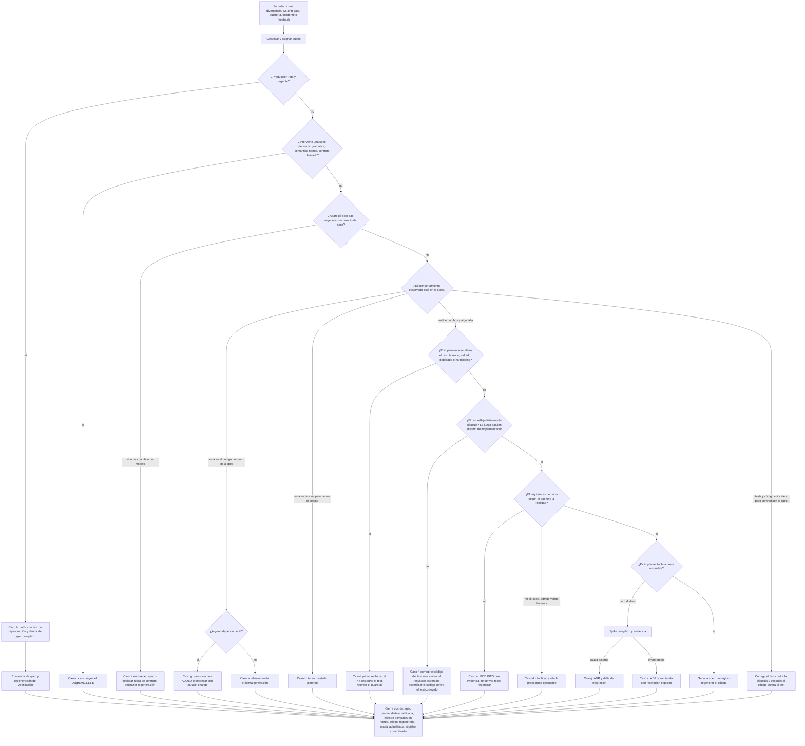

> Para divergencias entre spec fuente, spec derivada e implementación, usar el Diagrama 3.13-E (casos k–s, 3.13.7).

### 7.3 Resolver la spec no implementable sin romper "primero la spec"

Este es el caso que más tienta a "arreglarlo en el código". La secuencia **(propuesta)**:

1. **El agente no decide.** Ante la sospecha de inviabilidad, el agente detiene la tarea y abre un *spec issue* con la evidencia: error, medición o límite documentado de la plataforma.
2. **Spike con plazo** (excepción 3 de 7.1). Un humano, o el agente bajo instrucción explícita, hace un prototipo **desechable** fuera de los targets para medir. El código del spike no se mezcla en el código fuente, no se fusiona y se borra al cerrar el ADR.
3. **Decisión humana con alternativas.** El dueño de la spec elige entre:
   - reducir el alcance;
   - convertir el requisito en un NFR con un umbral alcanzable;
   - añadir una restricción;
   - cambiar el plan técnico, si el problema es de diseño y no de requisito;
   - aceptar un coste mayor.
4. **ADR + delta MODIFIED.** El ADR registra la evidencia del spike y la alternativa descartada. La cláusula modificada queda enlazada al ADR.
5. **Propagación.** Se re-derivan los tests de la cláusula y después se regenera o modifica el código.
6. **Revisión futura.** Si cambia el contexto (por ejemplo, una nueva versión de la plataforma), el ADR indica qué hay que reconsiderar.

La regla "primero la spec" se mantiene: **la spec cambia antes que el código**. Lo único que llega antes que la spec es la *evidencia*, y la evidencia no es código de producción.

### 7.4 El hotfix: la excepción 1, y cómo acotarla

El manifiesto de Spec Kit no prevé excepciones: los incidentes "update specifications". En producción, sin embargo, la excepción es inevitable. Es la primera de las cuatro excepciones de la lista cerrada de 7.1, y la única en la que se cambia comportamiento antes de escribirlo en la spec. **(propuesta)** Para que no se convierta en la norma:

- se permite **solo** con incidente abierto y con un test que reproduce el fallo;
- se crea automáticamente una **entrada de deuda de spec** con fecha límite (por ejemplo, 72 horas);
- la CI **marca** los archivos tocados fuera de la spec (edición en un archivo con cabecera `GENERATED`);
- hay una **regeneración de verificación** obligatoria: tras enmendar la spec, se regenera el target y la suite (incluido el test de reproducción) debe pasar. **Si la regeneración no reproduce el fix, la spec sigue incompleta**;
- **riesgo principal del modelo:** si la deuda de spec no se paga, la siguiente regeneración revierte el fix en silencio.

Para los bugs que no son urgentes se usa la *bugfix spec* de Kiro, con comportamiento actual, esperado y el que no debe cambiar ([Kiro, specs](https://kiro.dev/docs/specs/)), además de dos reglas del flujo de bugs de Spec Kit: la fase de test "does not edit source code to make a failing test pass", y "A passing test suite alone is not enough if the original reproduction was never exercised" ([Spec Kit, bugfix](https://github.com/github/spec-kit/blob/main/docs/guides/bugfix.md)).

### 7.5 Detección de deriva

SpecMine (CMU, *Carnegie Mellon University*) encontró que las comprobaciones entre spec y código se hacen "mainly when changes are completed rather than over time", y que el detalle de implementación "may help agents while making specs prone to decay" ([arXiv 2608.25202](https://arxiv.org/abs/2608.25202)). Por eso la detección tiene que ser **continua y mecánica**, no una ceremonia de cierre.

| Mecanismo | Qué detecta | Casos | Determinista |
|---|---|---|---|
| Matriz de trazabilidad en CI | Cláusula sin test, test sin cláusula, archivo sin spec dueña | a, b, f | Sí |
| Regla "mismo PR" | Archivo modificado sin modificar su spec dueña | a, h | Sí |
| Solapamiento de targets (4.7.5) | Archivo con más de una spec dueña, o sin ninguna | a, i | Sí |
| Detección de edición manual (diff contra la última generación o cabecera) | Edición de código generado | h | Sí |
| Protección y diff de tests | Tests modificados, saltados o con *asserts* eliminados sin delta | f, f' | Sí |
| Diff semántico del contrato en el PR (p. ej. oasdiff) | Ruptura de contrato no declarada | a, j | Sí |
| Fuzzing derivado del schema (p. ej. Schemathesis) | Respuestas fuera del contrato, 5xx | a, g | Sí |
| Contract tests contra el proveedor | Cambio externo | j | Sí |
| Comparación diferencial y doble regeneración de control (5.2.13) | Comportamiento inestable o cambiado por la regeneración o por un cambio de modelo | i | Sí |
| Detector de deltas concurrentes | Dos cambios abiertos sobre los mismos IDs o targets | a, i | Sí |
| *Drift gate* (grafo de intención frente a grafo de evidencia) | Código huérfano, dependencias no declaradas | a, b | Sí ([Grabowski, preprint](https://arxiv.org/html/2606.27045v2)) |
| Mutation testing | Tests que no reflejan la intención | f | Sí |
| Telemetría de uso | Comportamiento emergente usado | g | Sí |
| Auditoría periódica con agente revisor en contexto limpio | Huecos semánticos | todos | No (inferencial): la tría un humano |

Grabowski propone convertir la divergencia en "a blocking merge condition": "A commit where the two graphs disagree is blocked". Él mismo reconoce un límite: las dependencias tardías (inyección de dependencias, plugins) necesitan anotación manual. Es un preprint de un solo autor y conviene tomarlo como patrón de diseño, no como estándar.

### 7.6 Reconciliación

- **Auditoría de conformidad** semanal o tras ráfagas de cambios. Un agente compara spec, código y tests y produce una lista. Un humano decide qué hacer con cada hallazgo, y solo se convierte en tarea o enmienda lo que afecta a requisitos o a la corrección.
- **Backlog de deuda de spec** priorizado: se salda antes de abrir nuevas features.
- **Nunca sincronización automática del código a la spec.** Cualquier automatismo código → spec o código → test (por ejemplo, hooks que actualizan tests al guardar código, como los que anuncia Kiro: "When you save a React component, hooks update the test file", [Introducing Kiro](https://kiro.dev/blog/introducing-kiro/)) **solo puede proponer un delta**, y un humano lo aprueba. Si no, el código se convierte en oráculo y la IA se valida a sí misma.
- **Lección de MDE:** la sincronización bidireccional automática nunca se resolvió bien con modelos UML formales. Con specs en lenguaje natural, todavía más informales, es menos viable aún.

---

## 8. Proyectos nuevos (greenfield) frente a proyectos ya empezados (brownfield)

### Diagrama 10. Flujo greenfield frente a brownfield

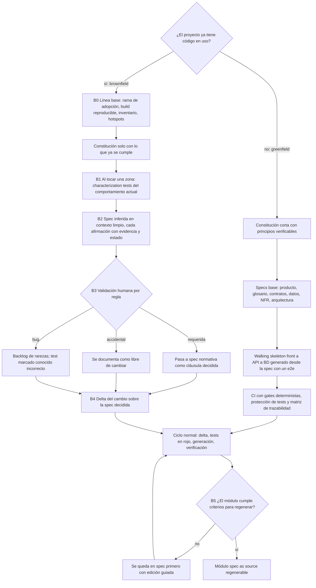

### 8.1 Greenfield: arrancar bien desde el día 1

En greenfield el problema se invierte: se puede **diseñar la *harnessability*** (lo fácil que es rodear el código de guías y sensores) desde el principio. Böckeler dice que las decisiones de tecnología y arquitectura (tipado fuerte, fronteras de módulo claras) determinan cuánto se podrá gobernar el código ([Harness engineering](https://martinfowler.com/articles/harness-engineering.html)). Fowler recuerda que "every new system will become legacy sooner or later", y que "If we write our software with testing in mind, we tend to get a good set of seams" ([LegacySeam](https://martinfowler.com/bliki/LegacySeam.html)).

**(propuesta) Secuencia del día 1 (primeras 1-2 semanas):**

1. **Constitución** con 5 a 10 artículos verificables: stack y versiones, capas y dependencias permitidas, test-first, contratos como fuente, política de errores, límites del agente (*Always / Ask first / Never*), carriles.
2. **Glosario** inicial del dominio.
3. **Specs base:** visión de producto, primeras capacidades (solo las del primer incremento), contrato OpenAPI v0, modelo de datos, NFR clave y arquitectura.
4. **Elección de tecnología pensando en la verificación:** tipado estático en front y back, generación determinista desde el contrato y una BD que pueda correr en contenedores para los tests.
5. **Walking skeleton** de extremo a extremo (front → API → BD), generado desde la spec con un E2E en verde. Valida toda la cadena antes de la primera feature.
6. **CI desde el primer commit:** lint, tipos, tests, linter y diff de contrato, tests de arquitectura, matriz de trazabilidad, protección de rutas de tests, detección de edición de archivos generados y la regla de que un cambio de comportamiento lleve diff de spec.
7. **Archivos de instrucciones del agente** cortos y podados.
8. **Primera feature por el carril completo**, para calibrar el proceso. Después, carriles según el riesgo.

Zaninotto concede que "SDD shines when starting a new project from scratch" ([Marmelab](https://marmelab.com/blog/2025/11/12/spec-driven-development-waterfall-strikes-back.html)). Aun así, el riesgo en greenfield es la sobreespecificación inicial. Conviene especificar solo el primer incremento y dejar que el resto llegue como deltas.

### 8.2 Brownfield: principios

1. **No hay *big bang* documental.** Spec Kit "does not rewrite your application or infer specifications for existing behavior", y recomienda que la primera tarea **no** sea "document the entire existing system": "use the workflow for the next bounded change" ([Spec Kit, existing projects](https://github.github.com/spec-kit/guides/existing-projects.html)). Fowler: las reescrituras completas "go down in flames most of the time", y mucho del comportamiento existente "isn't really wanted, so building it is a waste" ([StranglerFig](https://www.martinfowler.com/bliki/StranglerFigApplication.html)).
2. **Al principio, el código es la única fuente fiable.** "The only reliable view of functionality is what users see on screen" ([Black Box to Blueprint](https://martinfowler.com/articles/black-box-to-blueprint.html)). Esto parece invertir "primero la spec". **(propuesta)** No la invierte si se distinguen dos tipos de spec. Una spec **descriptiva** ("comportamiento observado") se deriva del código y no es normativa. Una spec **normativa** ("comportamiento requerido") es la que un humano aprueba. Mientras una zona no tiene spec normativa, rige la excepción 4 de la lista cerrada (7.1): se puede leer, caracterizar y refactorizar estructuralmente, pero **ningún comportamiento cambia sin crear antes su spec normativa** (spec on touch). Lo único que llega antes que la spec es la descripción, no el cambio.
3. **La IA tiende a congelar bugs como requisitos.** Los oráculos generados por LLM capturan el comportamiento real, no el esperado (Konstantinou et al.). Los characterization tests "characterize the actual behavior" (Feathers). Sin validación humana, la spec reconstruida canoniza los bugs.
4. **Se adopta por zonas y se sube de nivel por módulo**, no por proyecto.

Hay una tensión entre fuentes que conviene dejar explícita. Spec Kit dice que el spec.md nuevo describe el **cambio**, "not a retroactive spec of existing behavior". Piskala recomienda "encoding existing behavior as specifications before making changes" en la zona que se moderniza. En spec-as-source el código sin spec queda huérfano (Grabowski lo trata como error duro). **(propuesta)** El equipo elige una de dos estrategias por zona: (a) reconstruir la spec de la zona que se toca, o (b) declarar explícitamente zonas "legacy fuera de spec", con un límite claro (un *seam*) y characterization tests, sin regeneración. La opción (b) **no es una excepción a la regla 1 ("nada sin cláusula")**, sino un estado de espera acotado:

- la zona figura en la spec como una entrada explícita (nombre, *seam*, dueño, characterization tests que la protegen y fecha de revisión), así que no es código "sin cláusula": tiene una cláusula que dice "comportamiento congelado, no normativo";
- en ella **no se cambia ningún comportamiento sin crear antes su spec normativa** (pasa a la estrategia (a) para lo que se toca);
- solo admite refactors estructurales con los characterization tests en verde y hotfixes;
- un hotfix en ella sigue la regla de 7.1 (cruce de las excepciones 1 y 4): la deuda de spec incluye la spec mínima de la zona tocada.

### 8.3 Brownfield: fases de adopción

**B0 · Línea base (una vez)**
- Rama de adopción y estado reproducible (build y tests existentes en verde, o con los fallos documentados).
- Inventario rápido: módulos, contratos externos (endpoints, eventos, esquema de BD), cobertura actual y **hotspots**. Un hotspot combina frecuencia de cambio y complejidad, y se extrae del historial de control de versiones ([Tornhill, Software Design X-Rays](https://understandlegacycode.com/blog/key-points-of-software-design-x-rays)).
- **Constitución con lo que ya se cumple:** "Do not invent standards merely to fill the constitution template" (Spec Kit). Cada principio va acompañado de su evidencia (README, ADR, CI).
- Archivos de contexto del agente generados desde el repo y **podados**: patrones que guían decisiones y comandos que el agente no puede adivinar. Sin catálogos de archivos ("File-by-file descriptions of the codebase" es justo lo que Anthropic recomienda excluir).

**B1 · Captura del comportamiento (por zona que se toca)**
- *Characterization* o *approval tests* de los caminos principales y los bordes conocidos, con un *printer* legible y *scrubbing* de valores no deterministas (fechas, IDs, orden).
- Técnica de Mark Seemann para validar tests generados por IA: sabotear temporalmente el sistema y confirmar que el test falla ("if a new test passes without any production code change, the test itself may be wrong", [Seemann](https://blog.ploeh.dk/2025/11/03/empirical-characterization-testing/)).
- *Mutation score* de la red de seguridad, para saber cuánto se puede confiar en ella.

**B2 · Inferencia asistida por IA**
- **Contexto limpio:** no se le pasa al LLM la respuesta esperada. El equipo de Thoughtworks aprendió lo del *context poisoning* "the hard way" y tuvo que recrear "a clean room for AI to work in" ([Black Box to Blueprint](https://martinfowler.com/articles/black-box-to-blueprint.html)).
- **Recuperar la intención, no el código:** "don't try to recover the code — reconstruct the functional intent".
- **Triangulación:** "Confirm every hypothesis across at least two independent sources" (código, datos, UI, logs, personas). Cada hecho guarda su **linaje**, es decir, la fuente de la que sale.
- **Estado por afirmación:** confirmada, inferida o hueco, como en Reversa ([arXiv 2605.18684](https://arxiv.org/abs/2605.18684), estudio de un solo caso). Los huecos se convierten en preguntas para el dueño del producto.
- **Mapa de capacidades** enlazado a módulos. CodeConcise (Thoughtworks) combina un LLM con un grafo derivado de los AST (*Abstract Syntax Trees*, árboles de sintaxis abstracta) para producir "a map of capabilities ... where each capability is linked to the source code modules where it is implemented", con "the human ... in full control of its outputs" ([Legacy Modernization meets GenAI](https://martinfowler.com/articles/legacy-modernization-gen-ai.html)). El Radar de Thoughtworks puso en Adopt el uso de IA generativa para entender código legado ([Radar](https://www.thoughtworks.com/radar/techniques/using-genai-to-understand-legacy-codebases)).
- **Unidades pequeñas.** Un estudio de recuperación de historias de usuario desde código C++ obtuvo una puntuación F1 (media armónica de precisión y exhaustividad; no confundir con la fase F1) de alrededor de 0,8 en fragmentos de hasta 200 líneas ([Ouf et al., arXiv 2509.19587](https://arxiv.org/abs/2509.19587v1)). La evidencia sobre unidades grandes es escasa.

**B3 · Validación humana**
- Un humano con autoridad de producto clasifica cada regla como **REQUERIDA** (pasa a cláusula normativa "decidida"), **ACCIDENTAL** (se documenta como libre de cambiar) o **BUG** (va al backlog de rarezas y el characterization test se marca como "conocido-incorrecto").
- Ninguna regla BUG o ACCIDENTAL se redacta como requisito normativo.
- Solo las cláusulas "decididas" cuentan para "terminado".

**B4 · Cambio por delta**
- La spec del cambio sigue la estructura recomendada para brownfield: comportamiento actual, comportamiento objetivo, invariantes y exclusiones explícitas ([Augment Code, guía de un fabricante](https://www.augmentcode.com/guides/spec-driven-development-brownfield-codebases)). Coincide con lo de "compatibility boundaries that must stay intact" de Spec Kit.
- Los commits estructurales (introducir *seams*, refactors sin cambio de comportamiento, con los characterization tests en verde) van separados de los de comportamiento (Beck).
- **Spec on touch:** cada PR que toca un módulo sin spec añade como mínimo la spec del comportamiento que modifica, más los characterization tests del comportamiento adyacente. Los deltas solo pueden crear specs con ADDED: en OpenSpec, "ADDED is the only operation that can create a spec".

**B5 · Subir de nivel el módulo**
- Sin spec → spec-first → spec-anchored ("primero la spec" con edición guiada) → **spec-as-source regenerable**, según los criterios de 8.5.

### 8.4 Qué especificar primero en brownfield

**(propuesta)** Orden de prioridad:

1. Lo que toca el **próximo cambio** (spec on touch).
2. Los **contratos externos** (API, eventos, esquema de BD). Son los más baratos de formalizar y los que más se rompen por la ley de Hyrum.
3. Los **hotspots**: alta frecuencia de cambio y alta complejidad.
4. El código con **conocimiento concentrado** en una sola persona (*knowledge maps* de Tornhill).
5. El **código estable** se queda solo con characterization tests. Tornhill: el código malo pero estable no es, por sí mismo, prioritario.

### 8.5 Criterios para habilitar la regeneración de un módulo

**(propuesta, síntesis de Böckeler, Reversa, Black Box to Blueprint y CodeConcise)** Un módulo pasa a spec-as-source regenerable solo si cumple las siete condiciones:

- [ ] Su spec es **normativa** y está validada por humanos (sin afirmaciones "inferidas" pendientes).
- [ ] Hay una **suite de paridad o conformidad** aprobada que **no escribió el agente generador**, con un *mutation score* aceptable.
- [ ] Sus **fronteras** (*seams*, contratos públicos) están congeladas y tienen contract tests en ambos lados.
- [ ] **Dos regeneraciones independientes**, con el modelo fijado, pasan la suite y no muestran diferencias no declaradas en la comparación diferencial (5.2.13), ni entre ellas ni con la versión actual.
- [ ] No contiene reglas ocultas en datos, código muy dinámico ni comportamiento que dependa de producción sin cubrir. Reversa advierte que esto "may require additional instruments".
- [ ] Los consumidores del módulo están identificados (ley de Hyrum) y, si hay riesgo, existe un ***parallel run*** o *dark launch* (una comparación diferencial con tráfico real) que compara salidas con el código anterior antes del cambio definitivo ([Patterns of Legacy Displacement](https://martinfowler.com/articles/patterns-legacy-displacement/)).
- [ ] Cumple la **regla de granularidad** (4.7.11): cada archivo del módulo tiene una sola spec dueña, los archivos regenerables tienen un tamaño revisable, lo curado está en archivos separados, sus interfaces públicas tienen versión y contract tests de sus consumidores, y el módulo figura en el índice de dependencias para calcular la cascada (4.7.8).

Si no se cumplen, el módulo se queda en "spec primero con edición guiada", donde la spec manda y el agente modifica el código después del delta. Böckeler da la razón: "the harness is most needed where it is hardest to build". El legado con deuda técnica es justo donde menos se puede confiar en la regeneración y donde más tienta usarla.

### 8.6 Strangler fig y seams

"A seam is a place where you can alter behavior in your program without editing in that place." Los *seams* sirven para tests deterministas, para "place probes into the legacy system" y porque "they allow us to migrate behavior away from the legacy" ([LegacySeam](https://martinfowler.com/bliki/LegacySeam.html)). **(propuesta) Lectura SDD:**

- cada *seam* es una frontera de contrato que se puede especificar (API, eventos);
- lo que queda **detrás del seam en el lado nuevo** nace spec-as-source;
- lo que queda **en el lado legado** se congela con characterization tests;
- un archivo legado que mezcla lo que se quiere regenerar con código que debe quedarse se parte por un *seam* antes de habilitar su regeneración; mientras tanto, solo se admiten regiones insertadas por script y verificadas por hash (4.7.4);
- la arquitectura de transición se acepta de forma explícita y temporal ([Transitional Architecture](https://www.martinfowler.com/articles/patterns-legacy-displacement/transitional-architecture.html)), con fecha de retirada en la spec.

### 8.7 Riesgos en brownfield

| Riesgo | Mitigación |
|---|---|
| Congelar bugs como requisitos | Clasificación humana REQUERIDA, ACCIDENTAL o BUG. Backlog de rarezas |
| Specs inferidas fluidas pero erróneas, peores que no tener specs | Estado por afirmación, triangulación, linaje, unidades pequeñas |
| El agente duplica clases o ignora el código existente ([Böckeler](https://martinfowler.com/articles/exploring-gen-ai/sdd-3-tools.html)) | El plan cita los módulos e interfaces que hay que reutilizar. El revisor busca duplicados |
| Regenerar código que funcionaba y romper consumidores | Criterios de 8.5, *parallel run*, contract tests |
| Corromper o perder datos de producción al "regenerar" migraciones o al reconstruir el modelo de datos desde una spec inferida | Las migraciones aplicadas son inmutables (3.3.7) y un check de CI lo vigila. El modelo de datos inferido se valida contra el esquema real de producción antes de ser normativo. Toda migración nueva se prueba hacia adelante sobre una copia anonimizada de datos reales y con copia de seguridad verificada antes de aplicarla |
| Coste de revisión de specs en módulos estables | No especificar lo estable. Solo characterization tests |
| Dos regímenes durante mucho tiempo | Arquitectura de transición con fecha, métricas de avance (specs decididas por sprint) |
| Evidencia empírica débil | Pilotar en una zona, medir y decidir. Marmelab considera SDD "mostly unusable" en codebases grandes existentes; Willison muestra éxitos de portado cuando hay una suite de conformidad. La diferencia es la suite |

### 8.8 Comparación resumida

| | Greenfield | Brownfield |
|---|---|---|
| Fuente inicial de verdad | La spec | El código y la producción (spec descriptiva) |
| Primer paso | Constitución + specs base + *walking skeleton* | Línea base + characterization tests de la zona |
| Riesgo dominante | Sobreespecificar por adelantado | Canonizar bugs, romper consumidores |
| Regeneración | Posible desde el principio en módulos nuevos | Módulo a módulo, con criterios |
| Tests | Aceptación desde la spec | Characterization primero, aceptación después |
| Ritmo | Deltas desde el día 1 | Spec on touch + hotspots |
| Constitución | Diseñada | Descubierta (solo lo que ya se cumple) |

---

## 9. Precedentes, críticas, límites y antipatrones

### 9.1 MDE/MDA: la advertencia histórica principal

MDE (*Model-Driven Engineering*, ingeniería dirigida por modelos), MDA (*Model-Driven Architecture*, del OMG (*Object Management Group*)) y MDD (*Model-Driven Development*) prometieron lo mismo que spec-as-source: el modelo como fuente y el código como derivado. Böckeler: "MDD never took off for business applications", y spec-as-source "might end up with the downsides of both MDD and LLMs: Inflexibility and non-determinism" ([Böckeler](https://martinfowler.com/articles/exploring-gen-ai/sdd-3-tools.html)).

Causas recurrentes del fracaso, según Johan den Haan, un practicante de un fabricante con una opinión informada ([InfoQ, 2008](https://www.infoq.com/articles/8-reasons-why-mde-fails)):

- se ignoró la **propagación de cambios**;
- se usaron lenguajes generales como UML (*Unified Modeling Language*);
- las transformaciones no eran completamente ejecutables;
- no se probaba ni depuraba el modelo ("one of the biggest pitfalls");
- el *tooling* era insuficiente.

A eso se sumaba el *round-trip*: en cuanto alguien edita el código generado, el modelo deja de reflejarlo.

Fowler: "I don't believe that graphical programming will succeed just because it's graphical", y "Using the UML and MDA is a platform": la independencia de plataforma acaba siendo otra plataforma ([UmlAsProgrammingLanguage](https://martinfowler.com/bliki/UmlAsProgrammingLanguage.html)). Con LLM, la "plataforma" pasa a ser el modelo, el agente y la plantilla de spec.

La evidencia empírica matiza el fracaso. Hutchinson, Rouncefield y Whittle encontraron que el éxito depende de "complex organizational, managerial and social factors", con adopción progresiva ([ICSE 2011](https://2011.icse-conferences.org/content/model-driven-engineering-practices-industry.html)). Whittle et al., con 450 encuestados, concluyen que MDE se usa más de lo que se cree, pero **rara vez para sistemas completos**: se aplica a partes clave, a menudo con DSL (*Domain-Specific Languages*, lenguajes específicos de dominio) ([IEEE Software 2014](https://eprints.lancs.ac.uk/id/eprint/69765)).

**Lecciones para el equipo:**

1. Prohibición explícita y vigilada de editar el código generado.
2. Una vía sancionada para lo que la spec no expresa bien: módulos "curados" declarados, separados en archivos propios y no en regiones protegidas (4.7.4).
3. La ingeniería inversa código → spec solo como operación explícita (adopción brownfield o enmienda), nunca como sincronización silenciosa.
4. Generación parcial de sistemas, con contratos estables. No de sistemas enteros.
5. Adopción progresiva. El factor organizativo pesa más que el técnico.
6. El modelo (la spec) también se prueba: con ejemplos ejecutables, análisis de consistencia y, en lo crítico, verificación formal.

### 9.2 Precedentes que sí funcionaron

| Precedente | Qué aporta | Por qué funcionó |
|---|---|---|
| **API-first / IDL** (OpenAPI, Protocol Buffers y gRPC, GraphQL SDL) | Contratos como fuente con generación de clientes, servidores y validadores | Contrato estrecho, parseable y validable. Generador determinista. Código generado separado de la lógica en archivos propios: interfaz generada e implementación aparte ([OpenAPI Generator](https://openapi-generator.tech/docs/generators/spring/)), un elemento por archivo `.proto` ([Protobuf 1-1-1](https://protobuf.dev/best-practices/1-1-1/)), *stubs* de cliente e interfaz de servidor gRPC generados aparte de la implementación del servicio ([gRPC, Go basics](https://grpc.io/docs/languages/go/basics/)), archivos generados junto a cada operación ([GraphQL Code Generator](https://the-guild.dev/graphql/codegen/docs/advanced/generated-files-colocation)). Detalle en 4.7.12. IDL = *Interface Definition Language*. SDL = *Schema Definition Language* |
| **Design by Contract** (Meyer, Eiffel) | Pre y postcondiciones e invariantes como oráculo permanente | Cláusulas formales, locales y ejecutables. Meyer propone hoy pasar "from probable to provable" combinando IA y verificación ([arXiv 2511.23159](https://arxiv.org/abs/2511.23159)) |
| **Métodos formales** (TLA+ en AWS) | Bugs de diseño que los tests no encuentran | Aplicados de forma selectiva a sistemas críticos ([Newcombe et al.](https://doi.org/10.1145/2699417)) |
| **BDD / Specification by Example** | Criterios de aceptación ejecutables, documentación viva | Ejemplos concretos y conversación. Advertencia: solo el 12 % de los equipos usa la documentación viva como fuente real ([Adzic](https://gojko.net/2020/03/17/sbe-10-years.html)) |
| **Conformance suites** (W3C, html5lib-tests) | Tests independientes de la implementación | Permiten varias implementaciones, y ahora también agentes ([Willison](https://simonwillison.net/2025/Dec/15/porting-justhtml/)) |
| **Literate programming** (Knuth, 1984) | Prosa y código entrelazados en una sola fuente, de la que se extraen el programa ejecutable y el documento legible | La explicación no se desactualiza porque vive pegada al ejecutable que la acompaña. La lección para spec-as-source es parcial: la prosa de la spec se mantiene viva cuando cada cláusula lleva dentro su parte ejecutable (ejemplos, propiedades), no cuando se separa del código y de los tests **(conocimiento interno, sin verificar en web)** |

Dijkstra pone el límite: "The virtue of formal texts is that their manipulations, in order to be legitimate, need to satisfy only a few simple rules", mientras que el lenguaje natural facilita "making statements the nonsense of which is not obvious" ([EWD667](https://www.cs.utexas.edu/~EWD/transcriptions/EWD06xx/EWD667.html)). **(propuesta)** Spec-as-source en lenguaje natural solo es fiable si **las partes que importan son formales**: IDs, contratos, esquemas, ejemplos y propiedades. Brooks ya situaba la complejidad esencial en especificar, diseñar y probar el constructo conceptual, no en codificarlo ("No Silver Bullet", 1986, conocimiento interno). Los LLM atacan la parte accidental.

### 9.3 El espectro de posiciones actuales

| Posición | Exponentes | Tesis |
|---|---|---|
| Spec-as-source radical | Sean Grove (OpenAI), manifiesto de Spec Kit, Tessl / Podjarny | La spec es el artefacto valioso. El código es desechable o una proyección |
| Intermedia | Kiro (AWS), Brooker (AWS), Liu Shangqi (Thoughtworks), Osmani, Anthropic | Spec estructurada y viva más verificación ejecutable. Para Liu, "Executable code remains the source of truth you need to maintain" ([Thoughtworks](https://www.thoughtworks.com/insights/blog/agile-engineering-practices/spec-driven-development-unpacking-2025-new-engineering-practices)) |
| Escéptica | Kent Beck, Martin Fowler, Zaninotto, Frisinger, Gonzalez, Garner (JUXT) | Specs completas por adelantado bloquean el aprendizaje. La prosa deriva. Una spec detallada es código. Ningún artefacto tiene primacía |

Kent Beck, citado por Fowler: las descripciones de SDD "emphasize writing the whole specification before implementation", lo que "encodes the (to me bizarre) assumption that you aren't going to learn anything during implementation". Fowler añade que el bucle de aprendizaje por experimentación "is essential to the model building that's at the heart of any kind of worthwhile specification" ([Fowler, fragments 2026-01-08](https://martinfowler.com/fragments/2026-01-08.html)).

**Dan North y Gojko Adzic**, los referentes de BDD y Specification by Example, tienen una postura propia sobre el SDD actual, expuesta en su sesión de GOTO "Spec-Driven Development Is Back. But Not How You Think" ([GOTO](https://gotopia.tech/sessions/4066/spec-driven-development-is-back-but-not-how-you-think); resumen basado en la descripción pública de la sesión, no en la transcripción completa):

- Los dos rechazan las herramientas que van de la spec al producto de una sola pasada y las comparan con las herramientas CASE (*Computer-Aided Software Engineering*) y con MDA. Lo que funciona, según ellos, son bucles de retroalimentación iterativos.
- La IA se queda con el trabajo más estructural y determinista. Los humanos conservan el conocimiento del dominio, la corrección semántica y el criterio de arquitectura.
- Los frameworks publicados deben tomarse como plantillas de partida que se adaptan rápido, no como reglas que se siguen al pie de la letra.
- Adzic desaconseja confiar en archivos de instrucciones en markdown para controlar a los agentes. Propone convertir las reglas en checks de lint automáticos en CI, que se aplican igual a humanos y a bots y dan mensajes de error accionables. Es la misma tesis de P7 y de la regla 10 de este informe.
- North ve la IA más útil en las tareas de "calidad de vida" que nunca entran en el backlog que en el código central del dominio.

El argumento de fondo de North viene de su *Deliberate Discovery*: "Learning is the constraint" e "Ignorance is the single greatest impediment to throughput". Gran parte del aprendizaje no planificado llega "fairly late in the day" ([North, Introducing Deliberate Discovery](https://dannorth.net/blog/introducing-deliberate-discovery/)). Coincide con la crítica de Beck: si se aprende durante la implementación, una spec completa por adelantado se queda vieja. **(propuesta)** La respuesta de este proceso tiene tres partes: deltas pequeños, un canal obligatorio para devolver lo aprendido a la spec (spec issue, 4.10, y log de decisiones, 4.1) y la excepción del spike (7.1), que permite aprender midiendo antes de escribir la cláusula.

### 9.4 Críticas y la respuesta del proceso

| Crítica | Fuente | Respuesta en este proceso |
|---|---|---|
| Waterfall encubierto | Zaninotto, Beck, Radar | Specs pequeñas por deltas, spec escrita *antes* pero no *congelada*, aprendizaje de la implementación devuelto como delta (Brooker: "pulling designs up", no "up-front") |
| Markdown excesivo y revisión doble | Böckeler (cita en 1.3), Zaninotto ("Double Code Review"), Radar | Se revisa el delta. Carriles. Métrica de tiempo de revisión de spec frente a código |
| Falsa sensación de control | Böckeler ("illusion of control"; "there are no unit tests for context engineering"), Zaninotto ("False Sense of Security") | Lo obligatorio va en checks deterministas. Evidencia adjunta. Verificador independiente |
| El agente ignora instrucciones | Böckeler ("I frequently saw the agent ultimately not follow all the instructions"), Anthropic | Constitución corta, poda, hooks |
| No-determinismo | Fowler, Böckeler, Ouyang | Invariante de equivalencia de comportamiento, código fijado, regeneración selectiva |
| "Una spec suficientemente detallada es código" | Gonzalez | Precisión solo donde no se admite variación. El resto, protegido por tests |
| La prosa deriva | Frisinger, SpecMine | Cada cláusula MUST lleva un ejecutable. Detección de deriva en CI |
| Mal encaje en codebases grandes existentes | Zaninotto, Clarke (Nearform, [Tessl blog](https://tessl.io/blog/from-vibe-coding-to-spec-driven-development/)) | Adopción por zonas, criterios de regeneración por módulo |
| Ningún artefacto tiene primacía | Garner (JUXT) | Primacía normativa, no epistémica. Triaje de tres salidas |
| La "bitter lesson": las reglas hechas a mano no escalan | Radar | Pocas reglas, verificadas por máquina. Ejemplos mejor que reglas |
| Sin evidencia de reducción de defectos | Hill (ESEM 2026) | Pilotar y medir. No vender beneficios no demostrados |
| Las checklists las interpreta la IA | Böckeler | Ningún ítem de checklist lo marca la IA. La evidencia es ejecutable |

### 9.5 Antipatrones

1. **Spec novela:** un documento largo y verboso que nadie revisa de verdad.
2. **Mazo para una nuez:** el flujo completo para un bug de una línea.
3. **La IA escribe la spec y el humano firma sin leer.**
4. **La misma IA escribe el código y los tests**, o los tests se derivan del código.
5. **Tests acoplados a la implementación** que se rompen en cada regeneración.
6. **Re-aprobar snapshots o baselines** para ponerse en verde.
7. **Parche silencioso:** arreglar el código y "ya actualizaremos la spec".
8. **Hotfix eterno:** deuda de spec sin plazo, que la siguiente regeneración revierte.
9. **Regenerar todo "por si acaso"** sin cambio de spec.
10. **Sincronización código → spec automática** (hooks que reescriben specs o tests desde el código).
11. **Constitución inflada:** el agente ignora la mitad.
12. **Cobertura de líneas como "terminado".**
13. ***Big bang* brownfield:** especificar todo el sistema antes de cambiar nada.
14. **Canonizar bugs** promoviendo characterization tests a spec sin clasificarlos.
15. **OpenAPI *code-first* en un proyecto spec-as-source.**
16. **Revisor adversarial sin filtro:** perseguir cada hallazgo y sobreingenierizar.
17. **Editar código generado "solo esta vez".**
18. **Confiar en el LLM-judge** como único oráculo funcional.

### 9.6 Cuándo no aplicar (o aplicar en modo ligero)

- **Prototipos desechables y exploración** con mucha incertidumbre. Primero se experimenta y después se especifica lo que sobrevive (Beck, Zaninotto). Spec-as-source empieza cuando el prototipo se convierte en producto.
- **Cambios triviales:** carril trivial (delta de una línea), sin plan.
- **UI muy visual o de marca:** spec de componentes y tokens, sí. Regeneración, no. Esos componentes se declaran "curados".
- **Código estable que no se va a tocar:** characterization tests y nada más.
- **Módulos que no cumplen los criterios de 8.5:** "primero la spec" con edición guiada, sin regeneración.
- **Cuando el equipo no puede mantener la suite de evidencia.** Sin suite no hay spec-as-source, solo spec-first.

### 9.7 Estado de la evidencia empírica

| Evidencia | Qué dice | Límite |
|---|---|---|
| Hill, ESEM 2026: 88.052 PR, 119 repos, 25.209 artefactos | Los artefactos de spec no reducen defectos (−0,6 pp, puntos porcentuales; p = 0,133, no significativo). La calidad de la spec no predice defectos. Las specs parecen "proxy for task complexity" | Ningún repo de la muestra commiteaba salida de herramientas SDD |
| SpecMine (CMU, 2026): 470.795 archivos, 73.030 repos, 21 entrevistas | Uso selectivo, sobre todo en features nuevas. Agentes más fiables a cambio de más coste de planificación y revisión. Las specs se degradan | Preprint. Los metadatos han cambiado entre versiones |
| SpecBench (2026) | Razonar sobre specs sin ejecución: el mejor agente llega al 44,4 % ([arXiv 2605.30314](https://arxiv.org/html/2605.30314)) | Benchmark de RFC (*Request for Comments*) reales, no de proyectos de equipo |
| Rosa et al. (SANER 2026) | Registered report: diseño de estudio Spec → Tests → Function | Todavía sin resultados ([arXiv 2601.03878](https://arxiv.org/abs/2601.03878)) |
| Casos de fabricante (Kiro, Tessl) | Mejoras de velocidad | Testimonios sin metodología |

Conclusión: **gran parte de lo que se afirma sobre SDD es experiencia u opinión de exponentes, no estudios controlados**. El equipo debería tratar su adopción como un experimento con métricas propias (sección 2.6).

---

## 10. Checklists consolidadas por gate

> Uso: se copian en la plantilla de PR o en el *issue* del cambio. Los ítems marcados con ⚙ deberían comprobarse automáticamente en CI; el resto son de revisión humana. **La IA nunca marca ítems de estas listas.**
>
> **Proporcionalidad por carril (2.4).** Los ítems marcados con **[C]** solo se exigen en el carril completo; el resto se exige en los carriles estándar y completo. **El carril trivial no usa G1-G5:** usa solo la mini-checklist T de abajo, más G6 y los checks automáticos (⚙) de la CI, que corren igual para todos.

| Gate | Trivial | Estándar | Completo |
|---|---|---|---|
| G0 Intención y carril | Una línea: qué cambia y por qué es trivial | Sí | Sí |
| G1 DoR | No (mini-checklist T) | Sí, sin los ítems [C] | Sí |
| G2 Tests de aceptación | No (mini-checklist T) | Sí, sin los ítems [C] | Sí |
| G3 Plan técnico | No | Solo si hay trade-off o cambio de diseño | Sí |
| G4 Tarea | No | Sí | Sí |
| G5 DoD de feature | No (mini-checklist T) | Sí, sin los ítems [C] | Sí |
| G6 Merge | Sí | Sí | Sí |
| G7 / G8 | Por release y periódicos, no por cambio | ← | ← |

### T · Carril trivial (mini-checklist)
- [ ] La cláusula afectada está actualizada con un delta de 1-3 líneas (o se confirma que el cambio no altera ninguna cláusula: refactor estructural, excepción 2 de 7.1; si parte, mueve o renombra archivos, solo se edita la sección Targets y ⚙ `ownership-overlap` sigue en verde, 4.7.2).
- [ ] ⚙ Hay un test trazado al ID que demuestra el cambio y se vio en rojo antes del fix.
- [ ] ⚙ La suite completa está en verde y no se ha modificado ningún resultado esperado sin delta.
- [ ] Un humano revisó el PR.
- [ ] ⚙ La matriz de trazabilidad está al día.
- [ ] Si durante el cambio aparece un contrato público, datos o más de un módulo: se sube de carril (2.4).

### G0 · Intención y carril
- [ ] Hay un brief humano con objetivo, resultado esperado, criterio de éxito y lo que queda fuera de alcance.
- [ ] Se ha elegido el carril (trivial, estándar o completo) con su justificación.
- [ ] Se han identificado las capacidades, contratos y datos afectados.
- [ ] Brownfield: la zona que se toca tiene spec normativa o se ha planificado su captura (B1-B3).

### G1 · Definition of Ready de la spec
- [ ] ⚙ No quedan marcas `[NEEDS CLARIFICATION]`.
- [ ] ⚙ Cada cláusula tiene ID estable, prioridad y método de verificación declarado.
- [ ] Cada cláusula MUST tiene un ejemplo con resultado esperado, incluido un caso límite, escrito o aprobado por un humano.
- [ ] Los errores y casos no deseados están especificados (IF/THEN).
- [ ] Los NFR tienen métrica, umbral, entorno y frecuencia.
- [ ] ⚙ Los términos están en el glosario y no hay sinónimos.
- [ ] ⚙ El contrato está actualizado, pasa el linter y está versionado (si cambia la interfaz).
- [ ] El modelo de datos y su migración están actualizados.
- [ ] El delta incluye "comportamiento que no debe cambiar" y "fuera de alcance".
- [ ] Los supuestos están revisados.
- [ ] No hay detalle de implementación en la spec funcional (prueba de Cucumber).
- [ ] Es compatible con la constitución, o hay un ADR o enmienda.
- [ ] El tamaño es proporcional al carril.
- [ ] Cumple la granularidad de 3.12: cada cláusula vive en una sola spec consolidada de capacidad; el delta tiene unas 10 cláusulas ADDED o MODIFIED como máximo (o se ha partido); los IDs no son posicionales, se emparejan por ID y llevan su revisión.
- [ ] **[C]** Un agente en contexto limpio revisó la consistencia y un humano trió los hallazgos.
- [ ] Aprueba un humano distinto del autor (o aprobación diferida con plazo, si solo hay un humano disponible; nunca para contratos públicos, migraciones ni seguridad, 2.3).
- [ ] ⚙ Ningún otro delta abierto modifica los mismos IDs ni reserva los mismos IDs nuevos; si lo hay, está decidida la serialización, la fusión o la renumeración (3.8, 3.12.4).

### G2 · Tests de aceptación
- [ ] Los tests derivan de la spec, no del código, y los generó un agente distinto del implementador (o un humano).
- [ ] Un humano aprobó los resultados esperados (oráculo) de cada cláusula MUST.
- [ ] ⚙ Hay evidencia de fase roja: commit con los tests en rojo y la salida del fallo.
- [ ] ⚙ Cada test lleva el ID de la cláusula que verifica.
- [ ] Los tests están en fronteras estables (API, casos de uso, contratos).
- [ ] Las invariantes tienen propiedades PBT. Las relaciones metamórficas, si aplican, están escritas.
- [ ] ⚙ Los tests nuevos están en rutas protegidas, con dueños humanos obligatorios para fusionar.
- [ ] Los resultados esperados están en la cláusula (oráculo normativo) y el código del test solo los ejecuta (1.6).

### G3 · Plan técnico
- [ ] El plan respeta la constitución y justifica por escrito cada excepción.
- [ ] Cita los archivos, módulos e interfaces existentes que hay que reutilizar (para no duplicar).
- [ ] Declara los targets de cada spec y las categorías de código (generado determinista, generado una vez e inmutable como las migraciones, regenerable o curado).
- [ ] Cada target tiene una sola spec dueña, la unidad de regeneración es el archivo entero y se declara el modo del cambio: parche guiado, reescritura condicionada o regeneración en frío (4.7.3, 4.7.5).
- [ ] Los archivos que tocan varias specs se resuelven por registro por convención, agregado generado o *composition root* de plataforma, nunca con varias dueñas (4.7.7).
- [ ] Si cambia un contrato o una interfaz compartida: está clasificado como PATCH, MINOR o MAJOR con una herramienta, los consumidores afectados salen del índice de dependencias y, si es MAJOR, hay un plan de *parallel change* en varios deltas (4.7.8).
- [ ] Cada cláusula transversal tocada está decidida como centralizable (código en la spec de plataforma) o distribuida (regla ejecutable sobre su ámbito), con su ADR (4.7.6).
- [ ] Hay un ADR para cada trade-off relevante.
- [ ] ⚙ El análisis cruzado spec/plan/tareas no deja conflictos críticos.

### G4 · Tarea
- [ ] La tarea es pequeña, está trazada a uno o más IDs y su check ejecutable se definió antes de empezar.
- [ ] El agente trabajó en una sesión limpia con solo la spec relevante y límites *Always / Ask first / Never*.
- [ ] ⚙ El check está en verde y el agente adjuntó la evidencia (comandos y salidas).
- [ ] ⚙ El diff toca solo los targets previstos.
- [ ] ⚙ Se aplicó el formateador determinista antes del diff y el guardián de símbolos está en verde: no desaparecen *exports*, funciones ni ramas no declarados REMOVED, ni hay comentarios de elisión (4.7.3).
- [ ] Ninguna región dentro de un archivo la ha regenerado un LLM, salvo regiones brownfield insertadas por script y verificadas por hash (⚙ `region-hash`, 4.7.4).
- [ ] Las decisiones no especificadas del agente están en `decisions.log`.

### G5 · DoD de feature
- [ ] ⚙ La matriz de trazabilidad muestra el 100 % de las cláusulas MUST del delta con evidencia en verde.
- [ ] ⚙ No hay tests huérfanos ni código nuevo sin cláusula (o se han justificado y abierto un delta).
- [ ] ⚙ La suite completa (aceptación, regresión, contratos, propiedades, integración, E2E críticos, visual) está en verde tras la última regeneración.
- [ ] ⚙ Ningún resultado esperado (ejemplos, propiedades, snapshots, baselines, goldens) ha cambiado sin un delta aprobado. Los cambios solo en el código de tests protegidos llevan la aprobación de su dueño y el ID en el commit. No hay `skip`, `xfail` ni `only`, ni *asserts* eliminados.
- [ ] ⚙ El diff semántico del contrato no muestra rupturas no declaradas y el fuzzing derivado del schema pasa.
- [ ] ⚙ El análisis de dependencias (SCA) no muestra vulnerabilidades altas nuevas y toda dependencia nueva está aprobada.
- [ ] ⚙ Ninguna migración ya aplicada se ha modificado.
- [ ] ⚙ El *mutation score* del diff supera el umbral, o los supervivientes están revisados.
- [ ] ⚙ Las *fitness functions* y los tests de arquitectura están en verde, y los imports solo cruzan límites de módulo por su API pública.
- [ ] ⚙ Ningún archivo tiene más de una spec dueña ni queda sin dueña, salvo lo generado determinista, las migraciones, los agregados y los tests protegidos (`ownership-overlap`, 4.7.5).
- [ ] ⚙ Los agregados (árbol de rutas, esquemas, OpenAPI agregado) regenerados coinciden con lo commiteado (4.7.7).
- [ ] ⚙ Las reglas que verifican las cláusulas transversales pasan sobre todo su ámbito (4.7.6).
- [ ] ⚙ Si se regeneró un proveedor compartido, los contract tests y los tests de aceptación de todos sus consumidores están en verde, aunque no se hayan regenerado (4.7.8).
- [ ] UI: el diff visual está revisado y la accesibilidad automática pasa. **[C]** La accesibilidad manual está registrada si se tocó UI crítica.
- [ ] **[C]** Hubo una sesión de testing exploratorio con objetivo y sus hallazgos están triados (5.2.14).
- [ ] Un revisor independiente (agente en contexto limpio y humano) contrastó el diff con la spec; sus hallazgos están resueltos o descartados con motivo.
- [ ] Todas las decisiones del log están aprobadas (y convertidas en delta) o rechazadas (y regeneradas).
- [ ] El revisor humano puede explicar el código.
- [ ] ⚙ En los módulos regenerables, la comparación diferencial con la versión anterior y con una segunda regeneración de control no muestra diferencias no declaradas en el delta.
- [ ] ⚙ Los archivos generados registran su procedencia (modelo, versión del agente, hash de instrucciones) y el modelo es el fijado para el módulo.

### G6 · Merge e integración
- [ ] ⚙ El delta está rebasado sobre la spec consolidada vigente y, tras el rebase, se regeneró y la suite volvió a pasar (3.8).
- [ ] ⚙ El delta está fusionado en la spec consolidada en el mismo merge que el código y los tests.
- [ ] ⚙ Las cláusulas REMOVED no tienen tests ni código residual.
- [ ] ⚙ La matriz de trazabilidad está regenerada y publicada.
- [ ] El cambio está archivado (`changes/archive/AAAA-MM-DD-nombre`).
- [ ] ⚙ Los archivos generados llevan la cabecera con la spec de origen.
- [ ] ⚙ El índice de cláusulas (`spec/INDEX.md`) y el de dependencias están regenerados, sin ciclos ni enlaces rotos, con las claves de regeneración de los targets tocados actualizadas (3.12.2, 4.7.8).
- [ ] Si el cambio es la fase *expand* de un *parallel change*, el delta de contracción está registrado con su condición o su fecha.

### G7 · Release
- [ ] ⚙ La cobertura de spec global llega al 100 % de las MUST exigibles en esta versión. Las MUST Planificadas para una versión futura y las SHOULD sin evidencia están listadas y aceptadas. Ningún test en cuarentena cuenta como evidencia.
- [ ] Las migraciones de la release se han probado sobre una copia anonimizada de datos reales.
- [ ] Los *smoke tests* y la monitorización sintética de los flujos críticos están activos tras desplegar.
- [ ] ⚙ Los NFR están medidos en un entorno representativo, con fecha.
- [ ] ⚙ Las verificaciones humanas (accesibilidad, UX, seguridad) están vigentes para esta versión.
- [ ] ⚙ No hay deuda de spec vencida (hotfixes sin delta).
- [ ] La documentación viva está generada desde la spec y los resultados de esta versión.
- [ ] Los contratos públicos tienen versión y plan de *parallel change* si hay rupturas.

### G8 · Mantenimiento (periódico)
- [ ] ⚙ El job de deriva no reporta cláusulas sin evidencia, enlaces rotos, tests en cuarentena ni ediciones manuales de código generado.
- [ ] Cada incidente del periodo tiene su delta y su test de regresión.
- [ ] La auditoría de conformidad del periodo está triada; los hallazgos relevantes están convertidos en tareas o enmiendas.
- [ ] Se han podado la constitución, el glosario y los archivos de instrucciones del agente.
- [ ] Se han revisado las métricas de proceso (2.6) y se han decidido ajustes.
- [ ] Se ha comprobado si algún módulo cumple ya los criterios para regenerarse (8.5).
- [ ] Se ha revisado el acoplamiento por cambio: los archivos que dos specs tocan siempre se han partido o convertido en registro determinista (4.7.2).
- [ ] ⚙ No hay anotaciones `@spec ID@rev` con una revisión obsoleta (4.7.9).
- [ ] Ninguna spec consolidada ha superado los umbrales de tamaño sin partirse o sin índice (3.12.2).
- [ ] Los tests en cuarentena tienen dueño y ninguno ha superado su plazo (5.2.18).
- [ ] Si hay una versión nueva del modelo o del agente que se quiere adoptar, se ha evaluado con regeneración y comparación diferencial en rama (4.5) antes de cambiar el modelo fijado.

### Brownfield · Adopción de una zona
- [ ] La línea base es reproducible y el inventario de contratos y hotspots está hecho.
- [ ] La constitución contiene solo principios que ya se cumplen, cada uno con su evidencia.
- [ ] Hay characterization tests de los caminos principales y bordes, con *scrubbing* y un *printer* legible.
- [ ] El *mutation score* de la red de seguridad está medido.
- [ ] La spec se infirió en contexto limpio, sin dar al LLM la respuesta esperada.
- [ ] Cada afirmación tiene estado (confirmada, inferida o hueco) y un enlace a su evidencia.
- [ ] Las reglas críticas están trianguladas con al menos dos fuentes.
- [ ] Un humano con autoridad de producto clasificó cada regla como REQUERIDA, ACCIDENTAL o BUG.
- [ ] Ninguna regla BUG o ACCIDENTAL quedó escrita como requisito normativo.
- [ ] Los huecos que bloquean tienen dueño y fecha.
- [ ] Los commits estructurales están separados de los de comportamiento.

### Desalineación · Al resolver una divergencia
- [ ] La divergencia está clasificada (casos a-j y f'; casos k-s si interviene una spec derivada, 3.13.7) y tiene dueño.
- [ ] Decidió alguien distinto del agente que implementó.
- [ ] Si hay un comportamiento no especificado, se ha comprobado si alguien depende de él.
- [ ] La decisión quedó escrita en la spec **antes** de regenerar código o re-derivar tests.
- [ ] Hay un ADR si la spec cedió ante una restricción.
- [ ] Si había ambigüedad, quedó un ejemplo-precedente como test.
- [ ] Si se depreca algo usado, el plan expand → migrate → contract tiene fecha.
- [ ] Si fue un hotfix: hay test de reproducción, deuda de spec con plazo y regeneración de verificación agendada.

### Spec derivada · Aprobación, fidelidad y propagación
Se usa al aprobar o cambiar una spec derivada (gramática, semántica formal, contrato derivado) y al delegar un aspecto. La checklist completa, con los ítems de Lean 4 y de ediciones, está en 3.13.10.
- [ ] ⚙ Cada elemento de la spec derivada tiene `@fuente <ID>@<rev>` y ninguno está caducado (3.13.6 PF0, 3.13.7).
- [ ] ⚙ `derived/decisions.md` no tiene entradas `excedente` ni `hueco` en los aspectos que toca el cambio.
- [ ] ⚙ El corpus de conformidad pasa contra la spec derivada: árboles, rechazos, valores y errores esperados (PF1).
- [ ] ⚙ Sin decisiones ocultas: Lark con `strict=True` y cero `_ambig` con `ambiguity='explicit'` (PF2).
- [ ] ⚙ Cobertura de reglas completa y ningún mutante superviviente sin una petición de caso abierta (PF3, PF4).
- [ ] Un humano revisó la muestra de programas generados de esta versión (PF5).
- [ ] ⚙ Lean 4: sin `sorry`, axiomas dentro de la lista blanca (`propext`, `Classical.choice`, `Quot.sound`), enunciados iguales al hash aprobado y con testigo de no vacuidad (PF6).
- [ ] ⚙ El diferencial entre la spec derivada y la implementación está en verde (PF7; PF8 si el parser de producción no es Lark).
- [ ] La aprobación se hizo por representación: tabla caso → resultado, retrotraducción hecha por otro agente y diff semántico (3.13.4).
- [ ] El derivador no escribió el corpus ni los mutantes, y la IA no editó la spec fuente para que encajara.
- [ ] Si se delega un aspecto: cláusula de delegación, fila en `authority.md`, dos aprobadores que sepan leer la notación.
- [ ] **[C]** Release: la spec derivada, sus pruebas y el diferencial están al día con la spec fuente de esa edición.

---

## 11. Plan de adopción recomendado para el equipo

**(propuesta)** El plan está pensado para un equipo pequeño que alterna proyectos nuevos y ya empezados. Las duraciones son orientativas.

### Paso 1 · Acuerdos (semana 1)
1. Leer juntos las secciones 0, 1.4, 2.4 y 7.1, y aceptar o adaptar las 18 reglas.
2. Fijar la **regla de autoría** (2.3) y los **roles** de tests (5.5).
3. Escoger la estructura de repo (3.8), el formato de IDs (3.12.4) y la regla de granularidad (4.7.11).
4. Definir los tres carriles con ejemplos propios.
5. Nombrar un **dueño de la spec** por capacidad, quién ejerce "Producto" en cada una y un responsable del proceso, que puede rotar. Con 2-4 personas, aplicar la tabla de fusión de roles de 2.3 y acordar el plazo de la aprobación diferida.
6. Fijar el modelo LLM y la versión del agente por proyecto (4.5).

### Paso 2 · Harness mínimo (semanas 1-2)
1. Plantillas: constitución, cláusula, delta, bugfix spec, ADR, registro de verificación humana y PR (anexos).
2. CI con: lint, tipos, tests, matriz de trazabilidad (un script que lee IDs de spec y tags de tests), protección de rutas de tests (dueños humanos obligatorios + check), detección de `skip`, `only` y *asserts* eliminados, diff semántico de contrato, inmutabilidad de migraciones aplicadas, SCA y la regla "archivo tocado ⇒ spec dueña tocada".
3. Hooks o permisos del agente: bloquear escrituras en `/tests/acceptance`, `/spec/contracts` y en las baselines; ejecutar los checks al final del turno.
4. Archivo de instrucciones del agente corto: comandos, límites en tres niveles y la regla "no adivines".

### Paso 3 · Piloto (semanas 2-4)
- **Greenfield:** el *walking skeleton* más la primera feature por el carril completo.
- **Brownfield:** una zona acotada que haya que cambiar pronto, con fases B0-B4. Sin regeneración todavía.
- Medir: tiempo de spec, tiempo de revisión de spec y de código, tasa de primera pasada en verde, `[NEEDS CLARIFICATION]`, deltas originados en implementación y diffs de tests rechazados.

### Paso 4 · Retro y ajuste (fin del mes 1)
- ¿Cuesta más revisar la spec que revisar el código? Recortar plantillas y carriles.
- ¿El agente ignora reglas? Podar y pasarlas a hooks.
- ¿Aparecen deltas originados en implementación a menudo? Mejorar la clarificación (entrevista, ejemplos).
- ¿Hay trampas con los tests? Reforzar la protección.

### Paso 5 · Evidencia más fuerte (mes 2)
- Mutation testing incremental sobre el diff, con un umbral inicial modesto.
- PBT para las invariantes de dominio.
- Fuzzing por schema de la API.
- Regresión visual y accesibilidad automática en los flujos críticos. Registro de verificación manual por release.
- Auditoría de deriva semanal con agente revisor, triada por un humano.

### Paso 6 · Regeneración por módulo (mes 2-3 en adelante)
- Elegir un módulo con contrato estable (por ejemplo, adaptadores o CRUD) y comprobar los criterios de 8.5.
- Añadir la cabecera `GENERATED FROM SPEC`, el check de edición manual y el check de solapamiento de targets (`ownership-overlap`).
- Montar la comparación diferencial (5.2.13) del módulo, hacer la doble regeneración de control y comparar.
- Si funciona, extender a módulos similares. Si no, el módulo se queda en "spec primero con edición guiada".

### Paso 7 · Extensión brownfield (continuo)
- Spec on touch en cada PR.
- Priorizar contratos externos y hotspots.
- *Strangler fig*: el código nuevo detrás de un *seam* nace spec-as-source.
- Seguir el avance: specs decididas por sprint y zonas con spec normativa.

### Paso 8 · Régimen estable
- Cadencia de la sección 2.6.
- Revisión trimestral de la spec consolidada y del proceso.
- Revisar anualmente si la madurez de las herramientas permite subir el nivel de regeneración. La evidencia de 2026 no lo permite todavía.

### Criterios de éxito del plan

| Señal sana | Señal de alarma |
|---|---|
| Cobertura de spec MUST = 100 % en cada release | Cláusulas MUST sin evidencia que se acumulan |
| La revisión del delta dura minutos, no horas | Se revisa más markdown que código |
| Pocos deltas originados en implementación tras los primeros meses | Muchos `[NEEDS CLARIFICATION]` descubiertos tarde |
| Cero diffs de tests de aceptación sin delta | El agente toca tests a menudo |
| La deuda de spec se paga dentro del plazo | Hotfixes sin enmienda |
| Las regeneraciones de control son estables | Las regeneraciones rompen cláusulas no tocadas |

---

## 12. Fuentes

> Se agrupan por exponente o tema. Se marca **[secundaria]**, **[fabricante]**, **[preprint]** o **[comunitaria]** cuando corresponde. Algunas afirmaciones de conocimiento general (Brooks, Executable UML, *literate programming* de Knuth) no se verificaron en la web durante esta investigación, y así se indica en el texto. El *Generation Gap* de Vlissides se cita a través de Fowler (4.6 y 4.7.4).

### Birgitta Böckeler, Martin Fowler y Thoughtworks
- Böckeler, B. — [Understanding Spec-Driven-Development: Kiro, spec-kit, and Tessl](https://martinfowler.com/articles/exploring-gen-ai/sdd-3-tools.html) (oct. 2025)
- Böckeler, B. — [Harness engineering for coding agent users](https://martinfowler.com/articles/harness-engineering.html) (abr. 2026)
- Böckeler, B. — [How far can we push AI autonomy in code generation?](https://martinfowler.com/articles/pushing-ai-autonomy.html) (ago. 2025)
- Fowler, M. — [LLMs bring new nature of abstraction](https://martinfowler.com/articles/2025-nature-abstraction.html) (jun. 2025)
- Fowler, M. — [Fragments 2026-01-08](https://martinfowler.com/fragments/2026-01-08.html) (cita a Kent Beck)
- Fowler, M. — bliki: [TestCoverage](https://martinfowler.com/bliki/TestCoverage.html) · [ContractTest](https://martinfowler.com/bliki/ContractTest.html) · [UbiquitousLanguage](https://martinfowler.com/bliki/UbiquitousLanguage.html) · [UmlAsProgrammingLanguage](https://martinfowler.com/bliki/UmlAsProgrammingLanguage.html) · [CanaryRelease](https://martinfowler.com/bliki/CanaryRelease.html) (D. Sato) · [SyntheticMonitoring](https://martinfowler.com/bliki/SyntheticMonitoring.html) (F. Falé y S. Gebhardt) · [StranglerFigApplication](https://www.martinfowler.com/bliki/StranglerFigApplication.html) · [LegacySeam](https://martinfowler.com/bliki/LegacySeam.html) · [ParallelChange](https://martinfowler.com/bliki/ParallelChange.html) (D. Sato)
- Fowler, M. — [On the Diverse And Fantastical Shapes of Testing](https://martinfowler.com/articles/2021-test-shapes.html) · [Eradicating Non-Determinism in Tests](https://martinfowler.com/articles/nonDeterminism.html)
- Robinson, I. — [Consumer-Driven Contracts: A Service Evolution Pattern](https://martinfowler.com/articles/consumerDrivenContracts.html)
- Ferri, Coggrave y Sheth — [Legacy Modernization meets GenAI](https://martinfowler.com/articles/legacy-modernization-gen-ai.html)
- Palanisamy y Thiagarajan — [From Black Box to Blueprint](https://martinfowler.com/articles/black-box-to-blueprint.html)
- Cartwright, Horn y Lewis — [Patterns of Legacy Displacement](https://martinfowler.com/articles/patterns-legacy-displacement/) · [Transitional Architecture](https://www.martinfowler.com/articles/patterns-legacy-displacement/transitional-architecture.html)
- Thoughtworks Technology Radar — [Spec-driven development (Assess, nov. 2025)](https://www.thoughtworks.com/radar/techniques/spec-driven-development) · [GitHub Spec Kit (abr. 2026)](https://www.thoughtworks.com/radar/languages-and-frameworks/github-spec-kit) · [Using GenAI to understand legacy codebases](https://www.thoughtworks.com/radar/techniques/using-genai-to-understand-legacy-codebases) · [Architectural fitness function](https://thoughtworks.com/radar/techniques/architectural-fitness-function)
- Liu Shangqi — [Spec-driven development: Unpacking one of 2025's key new AI-assisted engineering practices](https://www.thoughtworks.com/insights/blog/agile-engineering-practices/spec-driven-development-unpacking-2025-new-engineering-practices)
- Böckeler y Tacho — [Thoughtworks Technology Podcast: What is spec-driven development?](https://www.thoughtworks.com/insights/podcasts/technology-podcasts/what-is-spec-driven-development)

### GitHub (Spec Kit, Den Delimarsky)
- [spec-driven.md (manifiesto y constitución)](https://github.com/github/spec-kit/blob/main/spec-driven.md)
- [Spec Kit README](https://github.com/github/spec-kit)
- [Adopting Spec Kit in an Existing Project](https://github.github.com/spec-kit/guides/existing-projects.html)
- [Evolving existing specs](https://github.github.io/spec-kit/guides/evolving-specs.html)
- [Bug fixing guide](https://github.com/github/spec-kit/blob/main/docs/guides/bugfix.md)
- Plantillas: [spec-template.md](https://raw.githubusercontent.com/github/spec-kit/main/templates/spec-template.md) · [analyze.md](https://github.com/github/spec-kit/blob/main/templates/commands/analyze.md) · [clarify.md](https://github.com/github/spec-kit/blob/main/templates/commands/clarify.md) · [checklist.md](https://github.com/github/spec-kit/blob/main/templates/commands/checklist.md)
- Delimarsky, D. — [Spec-driven development with AI: Get started with a new open source toolkit](https://github.blog/ai-and-ml/generative-ai/spec-driven-development-with-ai-get-started-with-a-new-open-source-toolkit/)

### Sean Grove (OpenAI)
- [The New Code: Specifications as the Source of Truth (charla y transcripción)](https://www.ai.engineer/talks/8rABwKRsec4-specifications-are-the-new-code)

### Tessl (Guy Podjarny, Patrick Debois) [fabricante]
- Debois, P. — [Spec-Driven Development: 10 things you need to know about specs](https://tessl.io/blog/spec-driven-development-10-things-you-need-to-know-about-specs/)
- [Taming agents with specifications: what the experts say](https://tessl.io/blog/taming-agents-with-specifications-what-the-experts-say/) (Podjarny, Syme, Pope)
- Clarke, C. (Nearform) — [From Vibe Coding to Spec-Driven Development](https://tessl.io/blog/from-vibe-coding-to-spec-driven-development/)
- [tessl-labs/spec-driven-development (tile)](https://tessl.io/registry/tessl-labs/spec-driven-development) · [Formato de spec](https://tessl.io/registry/tessl-labs/spec-driven-development/files/docs/spec-format.md) · [spec-writer](https://tessl.io/registry/tessl-labs/spec-driven-development/files/skills/spec-writer/SKILL.md) · [Reglas spec-as-source](https://tessl.io/registry/vibe-ai/spec-as-source/files/rules/spec-as-source.md) [comunitaria] · [Cabecera de archivo generado](https://tessl.io/registry/vibe-ai/spec-as-source/files/rules/generated-file-header.md) [comunitaria]
- CodeMySpec — [Tessl Review (2026): The Spec-as-Source Bet](https://codemyspec.com/blog/tessl-review) [secundaria, competidor]
- Plugin *spec-as-source* sobre OpenSpec (registro de Tessl): [reglas](https://tessl.io/registry/spec-driven-development/spec-as-source/3.1.1/files/rules/spec-as-source.md) · [spec-rebuild](https://tessl.io/registry/spec-driven-development/spec-as-source/3.1.1/files/skills/spec-rebuild/SKILL.md) · [build-spec-manifest.py](https://tessl.io/registry/spec-driven-devlopment/spec-as-source/2.2.0/files/skills/spec-as-source-setup/templates/build-spec-manifest.py) [comunitaria]

### AWS (Kiro, Marc Brooker) [fabricante]
- [Kiro: Specs](https://kiro.dev/docs/specs/) · [Feature specs](https://kiro.dev/docs/specs/feature-specs/) · [Requirements-first](https://kiro.dev/docs/specs/feature-specs/requirements-first/) · [Correctness](https://kiro.dev/docs/specs/correctness/)
- Kiro blog — [Introducing Kiro](https://kiro.dev/blog/introducing-kiro/) · [Does your code match your spec?](https://kiro.dev/blog/property-based-testing/) · [Specs just got faster (and smarter)](https://kiro.dev/blog/faster-smarter-specs/)
- Brooker, M. — [Spec Driven Development isn't Waterfall](https://brooker.co.za/blog/2026/04/09/waterfall-vs-spec) · [SE Radio 710](https://se-radio.net/2026/03/se-radio-710-marc-brooker-on-spec-driven-ai-dev/)
- Newcombe et al. — How Amazon Web Services Uses Formal Methods, CACM 58(4), 2015, [doi:10.1145/2699417](https://doi.org/10.1145/2699417)

### Anthropic
- [Best practices for Claude Code](https://code.claude.com/docs/en/best-practices)
- [Effective harnesses for long-running agents](https://www.anthropic.com/engineering/effective-harnesses-for-long-running-agents)

### Addy Osmani, Simon Willison, Drew Breunig
- Osmani, A. — [How to write a good spec for AI agents](https://addyosmani.com/blog/good-spec/)
- Willison, S. — [Porting JustHTML to JavaScript](https://simonwillison.net/2025/Dec/15/porting-justhtml/) · [Designing agentic loops](https://simonwillison.net/2025/Sep/30/designing-agentic-loops) · [Red/green TDD](https://simonwillison.net/guides/agentic-engineering-patterns/red-green-tdd/)
- Breunig, D. — [The Spec Driven Development Triangle](https://www.dbreunig.com/2026/03/04/the-spec-driven-development-triangle.html) · [All You Need is Specs? A software library with no code](https://dbreunig.com/2026/01/08/a-software-library-with-no-code.html)

### Kent Beck, Dan North, Gojko Adzic (TDD, BDD, Specification by Example)
- Beck, K. — [Augmented Coding: Beyond the Vibes](https://newsletter.kentbeck.com/p/augmented-coding-beyond-the-vibes)
- Orosz, G. y Beck, K. — [TDD, AI agents and coding with Kent Beck](https://newsletter.pragmaticengineer.com/p/tdd-ai-agents-and-coding-with-kent)
- North, D. — [Introducing BDD](https://dannorth.net/blog/introducing-bdd/) · [Introducing Deliberate Discovery](https://dannorth.net/blog/introducing-deliberate-discovery/)
- North, D. y Adzic, G. — [Spec-Driven Development Is Back. But Not How You Think (GOTO)](https://gotopia.tech/sessions/4066/spec-driven-development-is-back-but-not-how-you-think)
- Adzic, G. — [Specification by Example, 10 years later](https://gojko.net/2020/03/17/sbe-10-years.html) · [Specification by Example (Manning)](https://www.manning.com/books/specification-by-example) · [Reseña en InfoQ](https://www.infoq.com/articles/specification-by-example-book/)
- Cucumber — [Better Gherkin](https://cucumber.io/docs/bdd/better-gherkin/)

### Críticas y posiciones escépticas
- Zaninotto, F. — [Spec-Driven Development: The Waterfall Strikes Back](https://marmelab.com/blog/2025/11/12/spec-driven-development-waterfall-strikes-back.html)
- Frisinger, T. M. — [Spec-driven development is the prose spec drift trap reborn](https://dev.to/tmfrisinger/spec-driven-development-is-the-prose-spec-drift-trap-reborn-4p99)
- Gonzalez, G. — [A sufficiently detailed spec is code](https://www.haskellforall.com/2026/03/a-sufficiently-detailed-spec-is-code.html)
- Garner, H. (JUXT) — [On co-specs and tri-checks](https://www.juxt.pro/blog/on-co-specs-and-tri-checks/)
- SoftwareSeni — [A Sufficiently Detailed Spec Is Code (cita a Hillel Wayne)](https://www.softwareseni.com/a-sufficiently-detailed-spec-is-code-the-community-principle-behind-spec-driven-development) [secundaria]

### OpenSpec y otros
- [OpenSpec (Fission-AI)](https://github.com/Fission-AI/OpenSpec) · [Concepts](https://github.com/Fission-AI/OpenSpec/blob/main/docs/concepts.md) · [Writing specs](https://github.com/Fission-AI/OpenSpec/blob/main/docs/writing-specs.md) · [Existing projects](https://github.com/Fission-AI/OpenSpec/blob/main/docs/existing-projects.md) · [Skill de sincronización (RENAMED)](https://github.com/Fission-AI/OpenSpec/blob/main/skills/openspec-sync-specs/SKILL.md)
- Glukhov, R. — [Keeping Specs, Tests, And Code In Sync In AI Development](https://glukhov.org/app-architecture/testing-architecture/specs-tests-code-traceability-ai-development/)
- Augment Code — [Spec-driven development for brownfield codebases](https://www.augmentcode.com/guides/spec-driven-development-brownfield-codebases) [fabricante]

### Investigación académica sobre SDD y generación con LLM
- Piskala, D. B. — [Spec-Driven Development: From Code to Contract in the Age of AI Coding Assistants](https://arxiv.org/html/2602.00180v1) [preprint]
- Agarwal, Vasilescu et al. (CMU) — [SpecMine](https://arxiv.org/abs/2608.25202) [preprint]
- Hill, B. — [Specification Artifacts in Open-Source Pull Request Workflows Do Not Reduce Defects (ESEM 2026)](https://drops.dagstuhl.de/entities/document/10.4230/LIPIcs.ESEM.2026.84)
- Rosa et al. — [Understanding Specification-Driven Code Generation with LLMs (registered report)](https://arxiv.org/abs/2601.03878)
- Grabowski, H. — [The Spec Growth Engine](https://arxiv.org/html/2606.27045v2) [preprint, un autor]
- Panda, S. — [Citation Discipline in Spec-Driven Development](https://arxiv.org/abs/2606.30689) [preprint, un autor, evidencia débil]
- Hamblin et al. — [SpecBench](https://arxiv.org/html/2605.30314)
- Ouyang, Zhang, Harman y Wang — [An Empirical Study of the Non-determinism of ChatGPT in Code Generation](https://arxiv.org/html/2308.02828v2)
- Chen, Zaharia y Zou — [How is ChatGPT's behavior changing over time?](https://arxiv.org/abs/2307.09009)
- Meyer, B. — [AI for software engineering: from probable to provable](https://arxiv.org/abs/2511.23159)
- Tufano et al. (Google) — [Grounding AI Agents in Contracts: Spec-Driven Test Generation](https://arxiv.org/abs/2608.17177)
- ClarifyGPT — [arXiv 2310.10996](https://arxiv.org/abs/2310.10996) · ClarifyCoder — [arXiv 2504.16331](https://arxiv.org/abs/2504.16331) · SpecFix — [arXiv 2505.07270](https://arxiv.org/pdf/2505.07270v1)
- Lahiri et al. (TiCoder) — [Interactive Code Generation via Test-Driven User-Intent Formalization](https://arxiv.org/abs/2208.05950)
- GUISpector — [arXiv 2510.04791](https://arxiv.org/abs/2510.04791)

### Trampas de los agentes, *reward hacking* y oráculos
- Zhong, Raghunathan y Carlini — [ImpossibleBench](https://arxiv.org/html/2510.20270v1) [preprint]
- METR — [Recent Frontier Models Are Reward Hacking](https://metr.org/blog/2025-06-05-recent-reward-hacking)
- Gabor, Lynch y Rosenfeld — [EvilGenie](https://arxiv.org/abs/2511.21654)
- Baker et al. (OpenAI) — [Monitoring Reasoning Models for Misbehavior and the Risks of Promoting Obfuscation](https://arxiv.org/abs/2503.11926)
- Konstantinou, Degiovanni y Papadakis — [Do LLMs generate test oracles that capture the actual or the expected program behaviour?](https://arxiv.org/abs/2410.21136)
- Barr, Harman, McMinn, Shahbaz y Yoo — [The Oracle Problem in Software Testing: A Survey (IEEE TSE 2015)](https://discovery-pp.ucl.ac.uk/id/eprint/1471263/1/06963470.pdf)

### Metodologías de test
- Petrović e Ivanković — [State of Mutation Testing at Google](https://research.google/pubs/state-of-mutation-testing-at-google/) · Petrović et al. — [Does mutation testing improve testing practices?](https://arxiv.org/abs/2103.07189)
- Foster, Harman et al. (Meta ACH) — [Mutation-Guided LLM-based Test Generation at Meta](https://arxiv.org/abs/2501.12862)
- Hatfield-Dodds y Dygalo — [Deriving Semantics-Aware Fuzzers from Web API Schemas (Schemathesis)](https://arxiv.org/abs/2112.10328)
- [oasdiff: breaking changes](https://github.com/oasdiff/oasdiff/blob/main/docs/BREAKING-CHANGES.md) [ejemplo de herramienta]
- [Playwright: assertions de snapshot](https://playwright.dev/docs/api/class-pageassertions) [ejemplo de herramienta]
- McKeeman, W. M. — "Differential testing for software", *Digital Technical Journal*, 1998, vía [Differential testing (Wikipedia)](https://en.wikipedia.org/wiki/Differential_testing) [secundaria]
- Kaner, C. — definición de testing exploratorio, vía [Exploratory testing (Wikipedia)](https://en.wikipedia.org/wiki/Exploratory_testing) [secundaria]
- [Principles of Chaos Engineering](https://principlesofchaos.org/)
- [Software composition analysis (Wikipedia)](https://en.wikipedia.org/wiki/Software_composition_analysis) [secundaria]
- Chen et al. — [Metamorphic Testing: A Review of Challenges and Opportunities](https://i.cs.hku.hk/~tse/Papers/2010s/hlmtCSUR.html) · Segura et al. — [A Survey on Metamorphic Testing](https://eprints.whiterose.ac.uk/110335/)
- Wayne, H. — [Property Tests + Contracts = Integration Tests](https://www.hillelwayne.com/post/pbt-contracts/)
- Husain, H. — [Creating a LLM-as-a-Judge That Drives Business Results](https://hamel.dev/blog/posts/llm-judge/)
- Dodds, K. C. — [The Testing Trophy and Testing Classifications](https://kentcdodds.com/blog/the-testing-trophy-and-testing-classifications)
- Google Security Blog — [Leveling Up Fuzzing: Finding more vulnerabilities with AI](https://security.googleblog.com/2024/11/leveling-up-fuzzing-finding-more.html)
- GOV.UK — [What we found when we tested tools on the world's least-accessible webpage](https://accessibility.blog.gov.uk/2017/02/24/what-we-found-when-we-tested-tools-on-the-worlds-least-accessible-webpage/)

### Legacy, characterization tests y brownfield
- Feathers, M. — [Characterization testing (InfoQ)](https://www.infoq.com/news/2007/03/characterization-testing)
- Falco, L. — [ApprovalTests](https://approvaltests.com/)
- Seemann, M. — [Empirical characterization testing](https://blog.ploeh.dk/2025/11/03/empirical-characterization-testing/)
- Tornhill, A. — [Key points of Software Design X-Rays](https://understandlegacycode.com/blog/key-points-of-software-design-x-rays) [secundaria]
- Ouf et al. — [Reverse Engineering User Stories from Code using LLMs](https://arxiv.org/abs/2509.19587v1) · de Macedo y Martins da Costa — [Reversa](https://arxiv.org/abs/2605.18684) [preprint]
- Hyrum Wright — [Hyrum's Law](https://www.hyrumslaw.com/)

### Precedentes: MDE, requisitos y decisiones
- den Haan, J. — [8 Reasons Why Model-Driven Approaches (will) Fail](https://www.infoq.com/articles/8-reasons-why-mde-fails)
- Hutchinson, Rouncefield y Whittle — [Model-Driven Engineering Practices in Industry (ICSE 2011)](https://2011.icse-conferences.org/content/model-driven-engineering-practices-industry.html) · Whittle et al. — [The state of practice in MDE (IEEE Software 2014)](https://eprints.lancs.ac.uk/id/eprint/69765)
- Dijkstra, E. W. — [EWD667: On the foolishness of natural language programming](https://www.cs.utexas.edu/~EWD/transcriptions/EWD06xx/EWD667.html)
- Nygard, M. — [Documenting Architecture Decisions](https://cognitect.com/blog/2011/11/15/documenting-architecture-decisions)
- [Easy Approach to Requirements Syntax (Wikipedia)](https://en.wikipedia.org/wiki/Easy_Approach_to_Requirements_Syntax)
- arc42 — [Specify quality requirements](https://quality.arc42.org/articles/specify-quality-requirements) · Bass, Clements y Kazman — [Quality attribute scenarios](https://people.ece.ubc.ca/matei/EECE417/BASS/ch04lev1sec5.html)
- NASA — [Software Engineering Handbook: bidirectional traceability](https://swehb.nasa.gov/x/agH7)
- [Scrum Guide 2020](https://scrumguides.org/scrum-guide.html)

### Granularidad de specs y código, correspondencia spec↔código y arquitectura (3.12 y 4.7)
- **Unidad y tamaño de la spec:** Adzic, G. — [Throw user stories away after they are delivered](https://gojko.net/2014/03/25/throw-user-stories-away-after-they-are-delivered/) · Wake, B. — [INVEST in Good Stories](https://xp123.com/invest-in-good-stories-and-smart-tasks/) · Fowler, M. — [BoundedContext](https://martinfowler.com/bliki/BoundedContext.html) · [Kiro: Specs best practices](https://kiro.dev/docs/specs/best-practices/) [fabricante] · Hong, Troynikov y Huber (Chroma) — [Context Rot](https://trychroma.com/research/context-rot) · Anthropic — [Effective context engineering for AI agents](https://www.anthropic.com/engineering/effective-context-engineering-for-ai-agents) · Anthropic — [How Claude remembers your project](https://code.claude.com/docs/en/memory) · Harada et al. — [When Instructions Multiply (ManyIFEval)](https://arxiv.org/abs/2509.21051) · SmartBear — [Best Practices for Code Review](https://smartbear.com/learn/code-review/best-practices-for-peer-code-review/) [fabricante] · Google — [Small CLs](https://google.github.io/eng-practices/review/developer/small-cls.html) · [Gist de retrofit para OpenSpec](https://gist.github.com/mvdmakesthings/cd4a9432cc8665be7cb5060740158806) [comunitaria] · [triage-analyst](https://sharedcontext.ai/agents/external/tzachbon/triage-analyst) [comunitaria] · INNOQ — [Brief introduction to arc42](https://www.innoq.com/en/blog/brief-introduction-to-arc42/) · Brown, S. — [C4 model: code diagram](https://c4model.com/diagrams/code)
- **IDs:** OMG SysML RTF — [SYSML17-142: Requirement ID should be immutable](https://issues.omg.org/issues/SYSML17-142) · [Kiro specs rule (promptz.dev)](https://www.promptz.dev/rules/general/kiro-specs) [comunitaria] · [Spec Kit, discusión #497](https://github.com/github/spec-kit/discussions/497) · Cucumber — [Gherkin reference](https://cucumber.io/docs/gherkin/reference/)
- **Unidad de regeneración y modos de edición:** Du et al. — [ClassEval](https://arxiv.org/html/2308.01861v2) · [RealBench](https://arxiv.org/abs/2604.22659) [preprint] · Aider — [Edit formats](https://aider.chat/docs/more/edit-formats.html) · [Leaderboards](https://aider.chat/docs/leaderboards/) · [Unified diffs make GPT-4 Turbo 3X less lazy](https://aider.chat/2023/12/21/unified-diffs.html) · Xia et al. — [Agentless](https://arxiv.org/html/2407.01489v2) · Anthropic — [Text editor tool](https://platform.claude.com/docs/en/agents-and-tools/tool-use/text-editor-tool) · OpenAI — [GPT-4.1 Prompting Guide](https://developers.openai.com/cookbook/examples/gpt4-1_prompting_guide) · Glukhov et al. (JetBrains) — [Diff-XYZ](https://arxiv.org/html/2510.12487v2) · Cursor — [Instant Apply](https://cursor.com/blog/instant-apply) [fabricante] · Cassano et al. — [Can It Edit?](https://arxiv.org/html/2312.12450v6) · [Prettier](https://prettier.io/docs/) · CodeScene — [Change coupling](https://docs.enterprise.codescene.io/versions/6.0.0/guides/technical/change-coupling.html) [fabricante]
- **Regenerar parte de un archivo:** Eclipse — [JET FAQ: What is JMerge?](https://wiki.eclipse.org/JET_FAQ_What_is_JMerge%3F) · [Acceleo: Getting Started](https://wiki.eclipse.org/Acceleo/Getting_Started_33) · Eysholdt, M. — [Codegeneration Goodies (EclipseCon 2011)](https://www.slideshare.net/slideshow/codegeneration-goodies/7430507) · Greifenberg et al. — [A Comparison of Mechanisms for Integrating Handwritten and Generated Code](https://arxiv.org/abs/1509.04498) · Fowler, M. — [Generation Gap](https://martinfowler.com/dslCatalog/generationGap.html) · Microsoft — [Partial classes and members](https://learn.microsoft.com/en-us/dotnet/csharp/programming-guide/classes-and-structs/partial-classes-and-methods) · Apel et al. — [Semistructured Merge (ESEC/FSE 2011)](https://www.se.cs.uni-saarland.de/publications/docs/FSE2011.pdf) · LWN — [Mergiraf](https://lwn.net/Articles/1042355) · JHipster — [Upgrading an application](https://www.jhipster.tech/upgrading-an-application/) · [Release 2.25.0 (needles)](https://jhipster.tech/2015/12/04/jhipster-release-2.25.0.html) · Angular — [Schematics authoring](https://angular.dev/tools/cli/schematics-authoring) · [ast-utils](https://github.com/angular/angular-cli/blob/main/packages/schematics/angular/utility/ast-utils.ts)
- **Propiedad, transversales y archivos compartidos:** GitHub — [About code owners](https://docs.github.com/en/repositories/managing-your-repositorys-settings-and-features/customizing-your-repository/about-code-owners) · Rashid, Sawyer, Moreira y Araújo — [Early aspects (RE 2002)](https://eprints.lancs.ac.uk/id/eprint/57536) · [Kiro: Steering](https://kiro.dev/docs/steering/) [fabricante] · [NestJS: Interceptors](https://docs.nestjs.com/interceptors) · [Semgrep: Writing rules](https://docs.semgrep.dev/writing-rules/overview) · [eslint-plugin-i18next: no-literal-string](https://github.com/edvardchen/eslint-plugin-i18next/blob/HEAD/docs/rules/no-literal-string.md) · [eslint-plugin-jsx-a11y](https://github.com/jsx-eslint/eslint-plugin-jsx-a11y) · [dependency-cruiser](https://github.com/sverweij/dependency-cruiser) · Spring Modulith — [Fundamentals](https://docs.spring.io/spring-modulith/reference/fundamentals.html) · [Verification](https://docs.spring.io/spring-modulith/reference/verification.html) · [Next.js: Project structure](https://nextjs.org/docs/app/getting-started/project-structure) · [fastify-autoload](https://github.com/fastify/fastify-autoload) · [Awilix](https://github.com/jeffijoe/awilix) · [TanStack Router con Vite](https://tanstack.com/router/latest/docs/framework/react/installation/with-vite) · [GraphQL Code Generator: schema](https://the-guild.dev/graphql/codegen/docs/config-reference/schema-field) · [Redocly CLI: bundle](https://redocly.com/docs/cli/commands/bundle.md) · Prisma — [Multi-file schema (blog)](https://www.prisma.io/blog/organize-your-prisma-schema-with-multi-file-support) · [Schema location (v6)](https://www.prisma.io/docs/orm/v6/prisma-schema/overview/location) · [Generators (v7)](https://www.prisma.io/docs/orm/prisma-schema/overview/generators) · Dorfmeister, D. (TkDodo) — [Please Stop Using Barrel Files](https://tkdodo.eu/blog/please-stop-using-barrel-files)
- **Cascada:** [GNU Make: Types of Prerequisites](https://www.gnu.org/software/make/manual/html_node/Prerequisite-Types.html) · [Bazel glossary](https://bazel.build/reference/glossary) · [Nx: affected](https://nx.dev/ci/features/affected) · [Tessl: multi-spec project (copia archivada, nov. 2025)](https://web.archive.org/web/20251113112610/https://docs.tessl.io/common-workflows/inter-dependent-specs) [fabricante] · [Semantic Versioning 2.0.0](https://semver.org/) · Google — [AIP-180: Backwards compatibility](https://google.aip.dev/180) · Buf — [Breaking change rules](https://buf.build/docs/breaking/rules/) · Protocol Buffers — [Best practices](https://protobuf.dev/best-practices/dos-donts/) · [1-1-1](https://protobuf.dev/best-practices/1-1-1/) · [oasdiff v1.10.16: breaking changes](https://github.com/tufin/oasdiff/blob/v1.10.16/BREAKING-CHANGES.md) · Verbetchii, D. — [API-first in practice](https://dev.to/dmitrii-verbetchii/api-first-in-practice-how-we-made-frontend-types-predictable-and-stable-332c) [secundaria] · Thoughtworks Radar — [API expand-contract](https://www.thoughtworks.com/en-au/radar/techniques/api-expand-contract) · Ensono Stacks — [Contract testing with Pact](https://stacks.ensono.com/docs/testing/contract_testing_pact) · Willison, S. — [Hyrum's Law](https://simonwillison.net/2018/Aug/11/hyrums-law/) · Nordic APIs — [What Does Hyrum's Law Mean for API Design?](https://nordicapis.com/what-does-hyrums-law-mean-for-api-design/) · Microsoft — [Anti-corruption Layer pattern](https://learn.microsoft.com/en-us/azure/architecture/patterns/anti-corruption-layer) · Stripe — [APIs as infrastructure: future-proofing Stripe with versioning](https://stripe.com/blog/api-versioning)
- **Trazabilidad:** [Go: generated code convention](https://pkg.go.dev/cmd/go#hdr-Generate_Go_files_by_processing_source) · [OpenFastTrace](https://github.com/itsallcode/openfasttrace) · [formatos de entrada](https://github.com/itsallcode/openfasttrace/blob/main/doc/user_guide/reference/input_format_support.md) · [requisitos del sistema](https://github.com/itsallcode/openfasttrace/blob/main/doc/spec/system_requirements.md) · [Playwright: annotations](https://playwright.dev/docs/test-annotations)
- **Arquitectura:** Brown, S. — [Modular Monoliths (GOTO Berlin 2018)](https://files.gotocon.com/uploads/slides/conference_12/515/original/gotoberlin2018-modular-monoliths.pdf) · Martin, R. C. — [Screaming Architecture](https://blog.cleancoder.com/uncle-bob/2011/09/30/Screaming-Architecture.html) · [The Clean Architecture](https://blog.cleancoder.com/uncle-bob/2012/08/13/the-clean-architecture.html) · Bogard, J. — [Vertical Slice Architecture](https://www.jimmybogard.com/vertical-slice-architecture/) · [Effective Guardrails for AI Development (charla)](https://sessionize.com/s/jimmy-bogard/vertical-slice-architecture-effective-guardrails-f/185766) · Cockburn, A. — [Hexagonal architecture](https://alistair.cockburn.us/hexagonal-architecture/) · Grzybek, K. — [Modular Monolith: A Primer](https://www.kamilgrzybek.com/blog/posts/modular-monolith-primer) · Ousterhout, J. — *A Philosophy of Software Design*, vía [notas de Sivers](https://sive.rs/book/PoSD) [secundaria] · Bettini, L. — [Implementing Domain-Specific Languages with Xtext and Xtend](https://www.oreilly.com/library/view/implementing-domain-specific-languages/9781786464965/) · [OpenAPI Generator: Spring](https://openapi-generator.tech/docs/generators/spring/) · [Customization](https://openapi-generator.tech/docs/customization/) · JHipster — [Doing API-First development](https://jhipster.tech/doing-api-first-development) · Alickovic, A. — [Bulletproof React: project structure](https://github.com/alan2207/bulletproof-react/blob/master/docs/project-structure.md) · [Feature-Sliced Design: public API](https://feature-sliced.design/docs/reference/public-api) · codecentric — [Feature-Sliced Design and good frontend architecture](https://www.codecentric.de/en/knowledge-hub/blog/feature-sliced-design-and-good-frontend-architecture) · Dodds, K. C. — [Colocation](https://kentcdodds.com/blog/colocation) · W3C DTCG — [Design Tokens Format Module 2025.10](https://www.designtokens.org/tr/2025.10/format/) · [Nx: Enforce module boundaries](https://nx.dev/docs/features/enforce-module-boundaries) · lastminute.com — [How we enforce architecture boundaries at scale](https://technology.lastminute.com/how-we-enforce-architecture-boundaries-at-scale-on-our-app/) · Vaughan, D. — [Architectural fitness functions and boundary enforcement](https://codex.danielvaughan.com/2026/05/17/codex-cli-architectural-fitness-functions-dependency-analysis-boundary-enforcement/) [secundaria, autoridad baja]
- **Generadores desde contratos y evidencia práctica:** [gRPC: Basics tutorial (Go)](https://grpc.io/docs/languages/go/basics/) · [GraphQL Code Generator: generated files colocation](https://the-guild.dev/graphql/codegen/docs/advanced/generated-files-colocation) · [Kubebuilder: other API files](https://book.kubebuilder.io/cronjob-tutorial/other-api-files.html)

### Specs derivadas, semántica formal y gramáticas (3.13)
- **Estatus normativo de prosa y formalismo en estándares:** W3C QA WG — [QA Framework: Specification Guidelines (GP 11)](https://www.w3.org/TR/qaframe-spec/) · Nottingham y Kamp — [RFC 9651: Structured Field Values for HTTP (Appendix C)](https://www.rfc-editor.org/rfc/rfc9651.html) · ISO/IEC JTC1/SC22/WG14 — [C23, borrador N3220 (Annex A)](https://www.open-std.org/jtc1/sc22/wg14/www/docs/n3220.pdf) · [C++ draft, \[gram\]](https://eel.is/c++draft/gram) · Sperber, Dybvig, Flatt, van Straaten et al. — [R6RS (Appendix A)](https://www.r6rs.org/final/r6rs.pdf) · Shinn, Cowan, Gleckler et al. — [R7RS (7.2)](https://small.r7rs.org/attachment/r7rs.pdf) · W3C XML Query WG — [XQuery 1.0 and XPath 2.0 Formal Semantics](https://www.w3.org/TR/xquery-semantics/) · W3C CSSWG — [CSS Syntax Module Level 3](https://www.w3.org/TR/css-syntax-3/) · IESG — [Statements](https://datatracker.ietf.org/group/iesg/statements/) · [Guidelines for the Use of Formal Languages in IETF Specifications (2001)](https://ftp.ripe.net/rfc/rfc-editor/UsingPseudoCode.txt) · Presuhn, R. — [netconf, 2005: módulos formales normativos](https://psg.com/lists/netconf/netconf.2005/msg00103.html) [anécdota, no regla oficial] · Oracle — [JLS SE 7, cap. 18](https://docs.oracle.com/javase/specs/jls/se7/html/jls-18.html) · [JLS SE 21, cap. 19](https://docs.oracle.com/javase/specs/jls/se21/html/jls-19.html) · van Rossum, Galindo Salgado y Nikolaou — [PEP 617](https://peps.python.org/pep-0617/)
- **Requisitos derivados, verificación e independencia:** AFuzion — [DO-178C Software Requirements](https://afuzion.com/avionics-software-requirements-in-do-178c/) [secundaria, consultora] · [IEEE 1012 / Boehm 1984 (Wikipedia)](https://en.wikipedia.org/wiki/IEEE_1012) [secundaria] · NASA — [IV&V Overview](https://www.nasa.gov/ivv-overview) · Huang et al. — [AgentCoder](https://arxiv.org/html/2312.13010v2) [preprint] · Panickssery, Bowman y Feng — [LLM Evaluators Recognize and Favor Their Own Generations](https://arxiv.org/html/2404.13076v1) · Knight, J. y Leveson, N. — [An Experimental Evaluation of the Assumption of Independence in Multiversion Programming (IEEE TSE, 1986)](https://doi.org/10.1109/TSE.1986.6312924) [DOI verificado: resuelve en IEEE Xplore, documento 6312924; texto no consultado]
- **Standard ML y Cedar (lo formal como definición):** Rossberg, A. — [Defects in the Revised Definition of Standard ML](https://people.mpi-sws.org/~rossberg/sml-defects.html) · [actualización 2013 (PDF)](https://www.mpi-sws.org/~rossberg/papers/Rossberg%20-%20Defects%20in%20the%20Revised%20Definition%20of%20Standard%20ML%20%5B2013-09-18%20Update%5D.pdf) · Disselkoen et al. (AWS) — [How We Built Cedar: A Verification-Guided Approach](https://arxiv.org/abs/2407.01688) · Lean FRO — [Cedar use case](https://lean-lang.org/use-cases/cedar/) · AWS — [Lean into verified software development](https://aws.amazon.com/blogs/opensource/lean-into-verified-software-development/) [fabricante]
- **WebAssembly:** [Core Spec: Validation conventions](https://webassembly.github.io/spec/core/valid/conventions.html) · Rossberg, A. — [SpecTec has been adopted (2025-03-27)](https://webassembly.org/news/2025-03-27-spectec/) · [Wasm 3.0 Completed (2025-09-17)](https://webassembly.org/news/2025-09-17-wasm-3.0/) · Youn et al. — [Bringing the WebAssembly Standard up to Speed with SpecTec (PLDI 2024)](https://dl.acm.org/doi/10.1145/3656440) · [página de la charla](https://pldi24.sigplan.org/details/pldi-2024-papers/64/Bringing-the-WebAssembly-Standard-up-to-Speed-with-SpecTec) · Watt, C. — [Mechanising and Verifying the WebAssembly Specification (CPP 2018)](https://www.cl.cam.ac.uk/~caw77/papers/mechanising-and-verifying-the-webassembly-specification.pdf) · [transparencias SREPLS](https://www.cl.cam.ac.uk/~caw77/slides/srepls.pdf) · Watt, Trela, Lammich y Märkl — [WasmRef-Isabelle (PLDI 2023)](https://pldi23.sigplan.org/details/pldi-2023-pldi/5/WasmRef-Isabelle-A-Verified-Monadic-Interpreter-and-Industrial-Fuzzing-Oracle-for-We)
- **ECMAScript:** Ecma TC39 — [ECMA-262](https://tc39.es/ecma262/) · [ECMA-262, Notational Conventions](https://tc39.es/ecma262/multipage/notational-conventions.html) · [ECMA-262, Anexo B](https://tc39.es/ecma262/#sec-additional-ecmascript-features-for-web-browsers) · [The TC39 Process](https://tc39.es/process-document/) · Ecma — [TR/104, 2.ª ed. (Test262)](https://www.ecma-international.org/wp-content/uploads/ECMA_TR-104_2nd_edition_december_2016.pdf) · [Test262 CONTRIBUTING.md (esid)](https://github.com/tc39/test262/blob/main/CONTRIBUTING.md) · tc39/ecma262 — [workflows de ESMeta en CI](https://github.com/tc39/ecma262/tree/main/.github/workflows) · [esmeta-typecheck.yml](https://raw.githubusercontent.com/tc39/ecma262/main/.github/workflows/esmeta-typecheck.yml) · [esmeta-yetcheck.yml](https://raw.githubusercontent.com/tc39/ecma262/main/.github/workflows/esmeta-yetcheck.yml) · [esmeta-ignore.json](https://raw.githubusercontent.com/tc39/ecma262/main/esmeta-ignore.json) · Park, Park, An y Ryu — [JISET (ASE 2020)](https://plrg.korea.ac.kr/assets/data/publication/ase20-park-jiset.pdf) · Park, An, Shin, Sim y Ryu — [JSTAR (ASE 2021)](https://plrg.korea.ac.kr/assets/data/publication/ase21-park-jstar.pdf) · Park et al. — [JEST: N+1-version Differential Testing (arXiv 2102.07498)](https://arxiv.org/abs/2102.07498) · Park, Stefanescu y Roşu — [KJS: kframework/javascript-semantics](https://github.com/kframework/javascript-semantics) · Bodin et al. — [JSCert (POPL 2014)](https://www.doc.ic.ac.uk/~pg/publications/Bodin2014Trusted.html)
- **Semánticas formales de lenguajes definidos en prosa (3.13.1):** Leroy, X. — [Formal verification of a realistic compiler (CACM, 2009)](https://xavierleroy.org/publi/compcert-CACM.pdf) · Kumar, Myreen, Norrish y Owens — [CakeML: A Verified Implementation of ML (POPL 2014)](https://cakeml.org/popl14.pdf) · [cakeml.org](https://cakeml.org/) · Ellison, C. y Roșu, G. — [An Executable Formal Semantics of C with Applications (POPL 2012)](https://fsl.cs.illinois.edu/publications/ellison-rosu-2012-popl.pdf) · [kframework/c-semantics](https://github.com/kframework/c-semantics) · [MiniRust](https://github.com/minirust/minirust) · Rust — [Adopting the FLS (2025-03-26)](https://blog.rust-lang.org/2025/03/26/adopting-the-fls/)
- **Lark y gramáticas:** Lark — [examples/calc.py](https://github.com/lark-parser/lark/blob/master/examples/calc.py) · [Grammar Reference](https://lark-parser.readthedocs.io/en/latest/grammar.html) · [Parsers (Earley, `ambiguity`, `lexer`)](https://lark-parser.readthedocs.io/en/latest/parsers.html) · [API Reference (`strict`)](https://lark-parser.readthedocs.io/en/latest/classes.html) · [How to use Lark](https://lark-parser.readthedocs.io/en/latest/how_to_use.html) · [lalr_analysis.py](https://github.com/lark-parser/lark/blob/master/lark/parsers/lalr_analysis.py) · [reconstruct.py](https://github.com/lark-parser/lark/blob/master/lark/reconstruct.py) · [tree_matcher.py](https://github.com/lark-parser/lark/blob/master/lark/tree_matcher.py) · Hypothesis — [hypothesis.extra.lark (código fuente)](https://hypothesis.readthedocs.io/en/latest/_modules/hypothesis/extra/lark.html) · Madhavan, Mayer, Gulwani y Kuncak — [Automating Grammar Comparison (OOPSLA 2015)](https://2015.splashcon.org/details/oopsla2015/26/Automating-Grammar-Comparison) · Basten, B. — *Ambiguity Detection for Programming Language Grammars* (tesis, UvA, 2011) [sin enlace verificado]
- **Cobertura, mutación y generación de entradas:** Zeller et al. — [The Fuzzing Book: Grammar Coverage](https://www.fuzzingbook.org/html/GrammarCoverageFuzzer.html) · Havrikov, Kampmann y Zeller — [From Input Coverage to Code Coverage (TOSEM 2022)](https://publications.cispa.de/articles/journal_contribution/From_Input_Coverage_to_Code_Coverage_Systematically_Covering_Input_Structure_with_k-Paths/24612432) · Ball y Kupferman — [Vacuity in Testing (TAP 2008)](https://www.cs.huji.ac.il/%7Eornak/publications/tap08.pdf) · Black, Okun y Yesha — [Mutation Operators for Specifications (ASE 2000)](https://doi.org/10.1109/ASE.2000.873652)
- **Lean 4:** [The Lean Language Reference: Validating Proofs](https://lean-lang.org/doc/reference/latest/ValidatingProofs/) · [Recursive Definitions](https://lean-lang.org/doc/reference/latest/Definitions/Recursive-Definitions/) · [notas de versión v4.22.0](https://lean-lang.org/doc/reference/stable/releases/v4.22.0/) · [Plausible](https://reservoir.lean-lang.org/@leanprover-community/plausible) · Massot, P. — [leanblueprint](https://github.com/PatrickMassot/leanblueprint) · Ringer, Palmskog, Sergey, Gligoric y Tatlock — [QED at Large](https://arxiv.org/abs/2003.06458) · [Growing Mathlib (arXiv 2508.21593)](https://arxiv.org/abs/2508.21593) [preprint]
- **Fidelidad de formalizaciones y autoformalización:** Poiroux, Weiss, Kunčak y Bosselut — [Reliable Evaluation and Benchmarks for Statement Autoformalization (arXiv 2406.07222; versiones anteriores: *Improving Autoformalization using Type Checking*)](https://arxiv.org/abs/2406.07222) · Ospanov et al. — [miniF2F-Lean Revisited (arXiv 2511.03108)](https://arxiv.org/abs/2511.03108) [preprint] · Ye et al. — [VERINA (arXiv 2505.23135)](https://arxiv.org/abs/2505.23135) · Zhang et al. — [Beyond Compilation (arXiv 2606.31002)](https://arxiv.org/abs/2606.31002) [preprint] · Yousefzadeh y Cao — [Advocate for Complete Benchmarks for Formal Reasoning (arXiv 2507.04719)](https://arxiv.org/abs/2507.04719) [preprint] · Meek et al. — [Formalizing Numerical Analysis: quality audit beyond kernel acceptance (arXiv 2606.14000)](https://arxiv.org/abs/2606.14000) [preprint] · Li et al. — [Autoformalize Mathematical Statements by Symbolic Equivalence and Semantic Consistency (NeurIPS 2024)](https://neurips.cc/virtual/2024/poster/96359) · Liu et al. — [BEq (ICLR 2025)](https://proceedings.iclr.cc/paper_files/paper/2025/hash/d630537fc4402cfa3ebbc7450a0cac91-Abstract-Conference.html) · Amrollahi, Lopez y Barrett — [Faithful Autoformalization via Roundtrip Verification and Repair (arXiv 2604.25031)](https://arxiv.org/abs/2604.25031) [preprint] · Sun, Sheng, Padon y Barrett — [Clover (arXiv 2310.17807)](https://arxiv.org/abs/2310.17807) · Endres, Fakhoury, Chakraborty y Lahiri — [nl2postcond (arXiv 2310.01831)](https://arxiv.org/abs/2310.01831) · Cosler, Hahn, Mendoza, Schmitt y Trippel — [nl2spec (CAV 2023)](https://arxiv.org/abs/2303.04864) · [CLEVER (ICML 2025)](https://icml.cc/virtual/2025/52383) · [Vericoding benchmark (arXiv 2509.22908)](https://arxiv.org/abs/2509.22908) [preprint]
- **Otros tipos de spec derivada:** [Specmatic](https://github.com/specmatic/specmatic) [ejemplo de herramienta] · [oasdiff](https://github.com/oasdiff/oasdiff) [ejemplo de herramienta] · [Stately: `xstate/graph`](https://stately.ai/docs/xstate-graph) · [arXiv 2604.00275 (generación de máquinas de estado con LLM)](https://arxiv.org/abs/2604.00275) [preprint] · Cunha y Macedo — [Validating Formal Specifications with LLM-generated Test Cases (arXiv 2510.23350)](https://arxiv.org/abs/2510.23350) [preprint] · MongoDB — [Conformance Checking at MongoDB](https://www.mongodb.com/company/blog/engineering/conformance-checking-at-mongodb-testing-our-code-matches-our-tla-specs) · Prisma — [`migrate diff`](https://www.prisma.io/docs/cli/migrate/diff) · W3C Design Tokens CG — [Design Tokens Format Module 2025.10 (Final CG Report, no estándar W3C)](https://www.w3.org/community/reports/design-tokens/CG-FINAL-format-20251028/) · [Hypothesis: Stateful testing](https://hypothesis.readthedocs.io/en/latest/stateful.html) · [Semgrep: Testing rules](https://docs.semgrep.dev/writing-rules/testing-rules) · [ESLint: custom rule tutorial (RuleTester)](https://eslint.org/docs/head/extend/custom-rule-tutorial) · Calvanese et al. — [Semantics and Analysis of DMN Decision Tables (BPM 2016)](https://www.inf.unibz.it/montali/papers/calvanese-etal-BPM2016-dmn.pdf) · Go — [issue 41196: comentario `Code generated … DO NOT EDIT`](https://go.dev/issue/41196)
- **Coste, proporcionalidad y riesgos de formalizar:** Trustworthy Systems — [L4.verified numbers](https://trustworthy.systems/projects/OLD/l4.verified/numbers) · Heiser, G. — [Verified software can (and will) be cheaper than buggy stuff](https://microkerneldude.org/2016/06/16/verified-software-can-and-will-be-cheaper-than-buggy-stuff/) · Klein et al. — [Run Your Research (POPL 2012)](https://users.cs.northwestern.edu/~robby/lightweight-metatheory) · Fonseca, Zhang, Wang y Krishnamurthy — [An Empirical Study on the Correctness of Formally Verified Distributed Systems (EuroSys 2017)](https://www.cs.purdue.edu/homes/pfonseca//papers/eurosys2017-dsbugs.pdf) · Yang, Chen, Eide y Regehr — [Finding and Understanding Bugs in C Compilers (PLDI 2011)](https://www-old.cs.utah.edu/~regehr/papers/pldi11-preprint.pdf) · Zave, P. — [How to Make Chord Correct](https://arxiv.org/abs/1502.06461) · [Chord class notes, Princeton COS 561](https://www.cs.princeton.edu/courses/archive/fall18/cos561/docs/ChordClass.pdf) · Gallium — [Verifying a parser for a C compiler](https://gallium.inria.fr/blog/verifying-a-parser-for-a-c-compiler)
- **Trazabilidad, versionado y evolución del lenguaje:** [FLS changelog](https://github.com/rust-lang/fls/blob/main/src/changelog.rst) · [Rust Edition Guide: What are editions?](https://doc.rust-lang.org/edition-guide/editions/index.html) · [Go blog: Fixing For Loops in Go 1.22](https://go.dev/blog/loopvar-preview) · [PEP 387 – Backwards Compatibility Policy](https://peps.python.org/pep-0387/) · *suspect links* de DOORS, Polarion o Jama [conocimiento previo, sin verificar]
- **Contexto adicional (consultado por la investigación, no citado en 3.13):** WHATWG — [Infra Standard](https://infra.spec.whatwg.org/) · [JLS SE 21, cap. 15](https://docs.oracle.com/javase/specs/jls/se21/html/jls-15.html) · [The Go Programming Language Specification](https://go.dev/ref/spec) · PSF — [Python Full Grammar specification](https://docs.python.org/3/reference/grammar.html) · Kahrs, S. — [Mistakes and Ambiguities in the Definition of Standard ML](https://kar.kent.ac.uk/21122) · [r6rs-discuss 3130](https://www.r6rs.org/r6rs-discuss/3130.html) · [Rust Reference](https://doc.rust-lang.org/reference/introduction.html) · [DO-178C (Wikipedia)](https://en.wikipedia.org/wiki/DO-178C) · Wasm — [Introduction](https://webassembly.github.io/spec/core/intro/introduction.html) · [SpecTec README](https://github.com/WebAssembly/spec/blob/main/spectec/README.md) · [intérprete de referencia](https://github.com/WebAssembly/spec/blob/main/interpreter/README.md) · Watt et al. — [Two Mechanisations of WebAssembly 1.0](https://www.cl.cam.ac.uk/~jp622/two_wasm.pdf) · [phases.md](https://github.com/WebAssembly/meetings/blob/main/process/phases.md) · [test262](https://github.com/tc39/test262) · [ecmarkup](https://tc39.es/ecmarkup/) · Ryu y Park — [JavaScript Language Design and Implementation in Tandem (CACM 2024)](https://plrg.korea.ac.kr/assets/data/publication/cacm24-ryu-esmeta.pdf) · [ESMeta](https://github.com/es-meta/esmeta) · Lean — [#guard_msgs](https://lean-lang.org/doc/api/Lean/Elab/GuardMsgs.html) · [Functional Programming in Lean](https://lean-lang.org/functional_programming_in_lean/Introduction/) · [Theorem Proving in Lean 4](https://lean-lang.org/theorem_proving_in_lean4/Interacting-with-Lean/) · [Verso](https://github.com/leanprover/verso) · [reference-manual](https://github.com/leanprover/reference-manual) · [Lean Kernel Arena](https://arena.lean-lang.org) · Nipkow y Klein — [Concrete Semantics, transparencias](https://www21.in.tum.de/~nipkow/Concrete-Semantics/slides-semantics.pdf) · Owens et al. — [Functional big-step semantics (ESOP 2016)](https://kar.kent.ac.uk/53533) · [MiniRust](https://github.com/minirust/minirust) · Sewell et al. — [Ott](https://github.com/ott-lang/ott) · Jourdan, Pottier y Leroy — [Validating LR(1) Parsers](https://xavierleroy.org/bibrefs/Jourdan-Pottier-Leroy.html) · Guha et al. — [Petr4 (arXiv 2011.05948)](https://arxiv.org/abs/2011.05948) · Lark — [Tree Construction](https://lark-parser.readthedocs.io/en/latest/tree_construction.html) · Havrikov y Zeller — [Systematically Covering Input Structure (ASE 2019)](https://www.se.cs.uni-saarland.de/conferences/ASE/ase2019/details/ase-2019-papers/51/Systematically-Covering-Input-Structure.html) · Hodován, R. — [Grammarinator](https://github.com/renatahodovan/grammarinator) · Bendrissou, Gopinath y Zeller — [Synthesizing Input Grammars: A Replication Study (PLDI 2022)](https://pldi22.sigplan.org/details/pldi-2022-pldi/49/-Synthesizing-Input-Grammars-A-Replication-Study) · Kulkarni, Lemieux y Sen — [Arvada](https://arxiv.org/abs/2108.13340v1) · Wu et al. — [Autoformalization with LLMs (NeurIPS 2022)](https://proceedings.neurips.cc/paper_files/paper/2022/hash/d0c6bc641a56bebee9d985b937307367-Abstract.html) · Azerbayev et al. — [ProofNet](https://arxiv.org/abs/2302.12433) · Gao et al. — [Herald](https://arxiv.org/abs/2410.10878) · Xin et al. — [DeepSeek-Prover](https://arxiv.org/abs/2405.14333) · Yu et al. — [FormalMATH](https://arxiv.org/abs/2505.02735)

---

## 13. Anexos: plantillas, checks de CI y glosario de siglas

### A. Spec de capacidad (consolidada)

```markdown
# Capacidad: Pedidos (ORD)
Versión: 2026-10-21 · Dueño: <persona> · Constitución: C-01..C-08 · Glosario: Cliente, Pedido, Línea

## Contexto y objetivo
<por qué existe esta capacidad; para quién>

## Fuera de alcance
- <lo que esta capacidad no hace>

## Historias (prioridad, test independiente)
### P1 Confirmar un pedido
Por qué P1: ... · Test independiente: e2e/checkout-confirm

## Cláusulas
### ORD-001 <título>
Rev: 1 (sube con cada MODIFIED) · Tipo: comportamiento | invariante | NFR | contrato · Prioridad: MUST | SHOULD
Verificación: test-aceptación | propiedad | contrato | benchmark | e2e+visual | inspección-humana
<EARS o Given/When/Then>
Ejemplos: <tabla con casos límite>
Tests: [@test] <ruta>
ADR: <si aplica>
<!-- La trazabilidad cláusula → archivo/símbolo NO se escribe en la spec: la genera CI en spec/INDEX.md
     y en la matriz, a partir de las anotaciones @spec del código (4.7.9). -->

## Invariantes
### ORD-INV-001 El stock disponible nunca es negativo
Propiedad: para toda secuencia de operaciones válidas, stock >= 0.

## Supuestos
- <supuesto> — aceptado por <persona> el <fecha>

## Targets (propiedad: esta spec es la única dueña; ningún otro `targets` puede solaparse)
- src/modules/orders/** (regenerable; unidad: archivo entero; excepto *.curated.ts y gen/**)
- web/src/features/orders/** (regenerable; o en capabilities/orders/ui/spec.md si lo lleva otra persona)
- src/modules/orders/domain/stock.curated.ts (curado: solo parche guiado)
- Cardinalidad: 1:N. Prohibido compartir un archivo con otra spec (4.7.5)

## Fuera de targets
- src/modules/orders/gen/** (generado determinista desde contracts/openapi.yaml)
- migrations/** (inmutables) · tests/** (protegidos, dueño humano)

## Fragmentos para archivos compartidos (4.7.7)
- Rutas: src/modules/orders/routes.ts · DI: src/modules/orders/module.ts

## Interfaz pública y dependencias (4.7.8)
- Expone: src/modules/orders/api/** · versión 2.3.0 · consumidores: payments, web/checkout
- Depende de: payments-api@^2 · shared-kernel@^1 · AUTH-001
- Transversales que se le aplican: SEC-010, OBS-002, NFR-003
```

### B. Delta (spec de cambio)

```markdown
# Cambio 2026-10-21-cancelacion-parcial
Carril: estándar · Autor: <persona> · Aprobador: <persona> · Capacidades: ORD

## Intención
<qué y por qué, en 3-5 líneas>

## Comportamiento actual
<cómo funciona hoy, con IDs>

## Comportamiento objetivo
<cómo debe funcionar>

## Comportamiento que NO debe cambiar
- ORD-003, ORD-007 (con sus tests) · contrato v2.x compatible

## Fuera de alcance
- <...>

## ADDED
### ORD-015 Cancelar líneas de un pedido confirmado
...
## MODIFIED
### ORD-007 (bloque completo, con todos sus escenarios)
...
Motivo: <...> · Evidencia: <ticket, métrica>
## REMOVED
### ORD-004 ...
Motivo: <...> · Migración: <...>

## Abierto
- [NEEDS CLARIFICATION: ...]  ← debe quedar vacío para G1
```

### C. ADR

```markdown
# ADR-0012 Reserva de stock optimista en lugar de bloqueo
Estado: aceptado · Fecha: 2026-10-21 · Sustituye a: — · Cláusulas afectadas: ORD-007, NFR-003
## Contexto
<fuerzas en tensión; evidencia del spike con mediciones>
## Decisión
Haremos ...
## Alternativas descartadas
- ... (por qué)
## Consecuencias
+ ... / − ... · Revisar si: <condición que reabriría la decisión>
```

### D. Spec issue (escalado desde la implementación)

```markdown
# SPEC-QUESTION ORD-007: no implementable en p95 < 300 ms con bloqueo pesimista
Detectado por: agente implementador, tarea T-04 · Fecha: ...
Evidencia: benchmark local p95 = 820 ms con 500 concurrentes (salida adjunta)
Alternativas: (1) reserva optimista con reintento; (2) relajar NFR-003 a 900 ms; (3) cola asíncrona
Recomendación del agente: (1)
Estado de la tarea: detenida; T-05 y T-06 siguen
Decisión (humano): <...> → delta MODIFIED + ADR-0012
```

### E. Plantilla de PR

```markdown
## Cambio: <id del cambio> · Carril: <trivial|estándar|completo>
### Delta de spec (leer primero)
<enlace o resumen ADDED/MODIFIED/REMOVED>
### Evidencia
- Matriz de trazabilidad: <artefacto CI> · Cobertura de spec del delta: X/X MUST
- Tests en rojo antes de implementar: <commit>
- Mutation score del diff: X % · Fuzzing derivado del schema: OK · Diff semántico de contrato: sin rupturas no declaradas
- Comparación diferencial (si hay regeneración): sin diferencias no declaradas · Procedencia: modelo <id>, agente <versión>
- Capturas o diffs visuales: <...> · Accesibilidad: auto OK / manual <registro>
### Decisiones del agente
- [ ] D1 <...> aprobada → delta / rechazada → regenerado
### Checklist G5 (sección 10)
...
```

### F. Checks de CI mínimos (pseudo-configuración)

Cada check se describe por la **propiedad que verifica**, no por la herramienta. Las herramientas entre corchetes son solo ejemplos.

```yaml
checks:
  - id: trace-matrix          # toda cláusula MUST exigible tiene un test en verde (fail); todo test tiene cláusula (warn; fail en carril completo)
  - id: spec-ownership        # todo archivo tocado tiene su spec dueña tocada en el mismo PR (fail, salvo commit declarado 'structural';
                              # un structural que parte o mueve archivos toca solo la sección Targets de las specs de origen y destino, 4.7.2)
  - id: generated-untouched   # ningún archivo con cabecera GENERATED (o 'Code generated … DO NOT EDIT.', 3.13.3) se edita a mano
                              # (fail; un hotfix crea deuda de spec)
  - id: provenance            # todo archivo generado declara spec, cambio, modelo, versión del agente y hash de instrucciones; el modelo es el fijado
  - id: protected-tests       # ningún resultado esperado (ejemplo, propiedad, snapshot, baseline, golden) cambia sin delta aprobado (fail);
                              # un cambio solo en el código de un test protegido exige aprobación de su dueño e ID en el commit (fail si falta)
  - id: no-skips              # no aparecen skip/only/xfail nuevos ni desaparecen asserts (fail)
  - id: contract-diff         # el diff semántico del contrato no tiene rupturas no declaradas en el delta (fail); clasifica PATCH/MINOR/MAJOR
                              # [p. ej. oasdiff para OpenAPI, buf breaking para Protocol Buffers]
  - id: schema-fuzz           # las respuestas a entradas generadas desde el schema cumplen el contrato y no hay 5xx [p. ej. Schemathesis]
  - id: differential          # en una regeneración, misma salida observable que la versión anterior salvo lo declarado en el delta
  - id: migrations-immutable  # ninguna migración ya aplicada se modifica ni se borra; las nuevas solo se añaden (fail)
  - id: dependencies          # sin vulnerabilidades altas conocidas ni licencias prohibidas; toda dependencia nueva aprobada (SCA)
  - id: concurrent-deltas     # avisa si otro delta abierto toca los mismos IDs o targets, o reserva los mismos IDs nuevos
  - id: ownership-overlap     # expande los globs de todos los targets: ningún archivo con más de una spec dueña ni sin dueña
                              # salvo generado determinista, inmutable, agregado o test protegido declarado (fail)
  - id: symbol-guard          # por AST: no desaparecen exports, funciones ni ramas no declarados REMOVED; sin comentarios de elisión (fail)
  - id: aggregates-fresh      # los agregados (árbol de rutas, esquema GraphQL, OpenAPI agregado) regenerados = commiteados (fail)
  - id: crosscutting-rules    # cada cláusula transversal tiene su regla ejecutable y pasa sobre todo su applies_to [p. ej. Semgrep, ESLint]
  - id: spec-index            # INDEX.md y el índice de dependencias están al día, sin ciclos ni enlaces rotos, y las claves
                              # de regeneración de los targets tocados están actualizadas (fail)
  - id: region-hash           # en archivos brownfield con marcadores <gen:ID>, el contenido fuera de las regiones no cambia (fail; 4.7.4)
  - id: arch-rules            # se cumplen las reglas de dependencias de la constitución; los imports solo cruzan módulos por su API pública
  - id: glossary-lint         # spec y contratos no usan sinónimos prohibidos ni términos sin definir
  - id: authz-matrix          # todo endpoint aparece en alguna matriz de autorización (denegar por defecto)
  - id: mutation-diff         # el mutation score del diff supera el umbral acordado
  - id: flaky-quarantine      # tests que cambian de resultado sin cambio de código → aviso y propuesta de cuarentena
  - id: needs-clarification   # no quedan marcas abiertas en la spec (fail en G1)
  - id: verifications-fresh   # no hay registros de verificación humana caducados (fail en release)
  - id: spec-debt             # no hay deuda de spec vencida (fail en release)
  # Specs derivadas (3.13): solo en proyectos con gramáticas, semánticas formales o contratos derivados
  - id: derived-traced        # toda regla Lark y toda declaración Lean de la base de confianza lleva @fuente con ID existente y aprobado;
                              # toda cláusula SYN-/SEM- tiene elemento y caso de conformidad; la cabecera cuadra con el recuento;
                              # cero 'excedente' y cero 'hueco' en los aspectos afectados para aprobar o publicar (fail; puerta PF0)
  - id: derived-stale         # todo elemento @fuente <ID>@<rev> cuya cláusula tiene otra revisión está caducado;
                              # un archivo derivado con elementos caducados bloquea regenerar el nivel 3 (fail; 3.13.7)
  - id: lark-strict           # la gramática construye con parser='lalr', strict=True sin conflictos ni colisiones de regex
                              # [requiere interegular]; el corpus con Earley ambiguity='explicit', lexer='dynamic_complete'
                              # no produce nodos _ambig (fail; puerta PF2)
  - id: lean-no-sorry         # la semántica compila sin sorry; #print axioms con lista blanca: falla todo axioma distinto de
                              # propext, Classical.choice y Quot.sound (sorryAx, Lean.ofReduceBool, Lean.trustCompiler,
                              # y desde Lean 4.29 cualquier axioma con "_native" en el nombre);
                              # sin partial def en la base de confianza; enunciados idénticos a los aprobados (fail; puerta PF6)
  - id: conformance-3-levels  # el corpus spec/language/conformance/*.yaml da el mismo veredicto, árbol y valor en Lark, Lean
                              # y la implementación; ida y vuelta Lark → JSON AST → Lean; outOfFuel = sin veredicto (fail; PF1, PF7)
```

### G. Glosario de siglas

| Sigla | Significado |
|---|---|
| a11y | *Accessibility* (accesibilidad; numerónimo: a + 11 letras + y) |
| ADR | *Architecture Decision Record*, registro de decisión de arquitectura |
| AI / IA | Inteligencia artificial |
| AIP | *API Improvement Proposal*, guía de diseño de APIs de Google |
| API | *Application Programming Interface*, interfaz de programación |
| AST | *Abstract Syntax Tree*, árbol de sintaxis abstracta |
| ATDD | *Acceptance Test-Driven Development*, desarrollo guiado por tests de aceptación |
| BD | Base de datos |
| BDD | *Behaviour-Driven Development*, desarrollo guiado por comportamiento |
| C1–C6 | Categorías de artefacto para specs derivadas (3.13.3 c): spec fuente, base de confianza, pruebas Lean, corpus de fidelidad, generado determinista e implementación. No confundir con C4 |
| C4 | Modelo de diagramas de arquitectura en cuatro niveles (contexto, contenedores, componentes, código) |
| CASE | *Computer-Aided Software Engineering*, ingeniería de software asistida por ordenador |
| CFG | *Context-Free Grammar*, gramática libre de contexto |
| CI | *Continuous Integration*, integración continua |
| CL | *Changelist*, unidad de cambio en Google (equivale a un PR) |
| CLI | *Command-Line Interface*, interfaz de línea de comandos |
| CMU | *Carnegie Mellon University* |
| CONF- | Prefijo de los casos de conformidad del lenguaje (3.13.8). No se usa CNF, que en gramáticas se lee como *Chomsky Normal Form* y en Lean y SAT como forma normal conjuntiva |
| CRUD | *Create, Read, Update, Delete* |
| CVE | *Common Vulnerabilities and Exposures*, catálogo público de vulnerabilidades |
| DAST | *Dynamic Application Security Testing*, análisis dinámico de seguridad |
| DbC | *Design by Contract*, diseño por contrato |
| DI | *Dependency Injection*, inyección de dependencias |
| DMN | *Decision Model and Notation*, notación estándar del OMG para tablas y modelos de decisión |
| DoD | *Definition of Done*, definición de terminado |
| DoR | *Definition of Ready*, definición de listo |
| DRT | *Differential Random Testing*, testing diferencial con entradas aleatorias (Cedar) |
| DSL | *Domain-Specific Language*, lenguaje específico de dominio |
| DTO | *Data Transfer Object*, objeto de transferencia de datos |
| DTCG | *Design Tokens Community Group* (W3C) |
| E0–E4 | Escalones de formalización de una spec derivada, de corpus de conformidad a implementación verificada (3.13.5) |
| E2E | *End-to-End*, de extremo a extremo |
| EARS | *Easy Approach to Requirements Syntax*, sintaxis sencilla para requisitos |
| EBNF | *Extended Backus-Naur Form*, notación extendida de Backus-Naur para escribir gramáticas |
| EMF | *Eclipse Modeling Framework*, framework de modelado y generación de Eclipse |
| F0-F9 | Fases del proceso de este informe (2.1). No confundir con la puntuación F1 ni con las puertas de fidelidad PF0–PF8 |
| FSD | *Feature-Sliced Design*, metodología de arquitectura de frontend |
| Puntuación F1 | Media armónica de precisión y exhaustividad (*F1 score*) |
| G0-G8 | Gates del proceso de este informe (2.1) |
| gRPC | Framework de RPC (*Remote Procedure Call*, llamada a procedimiento remoto) que usa Protocol Buffers como IDL |
| HTTP 5xx | Códigos de respuesta 500-599: errores del servidor |
| IDL | *Interface Definition Language*, lenguaje de definición de interfaces |
| IV&V | *Independent Verification and Validation*, verificación y validación independientes (independencia técnica, de gestión y financiera) |
| JSON | *JavaScript Object Notation* |
| JSX | *JavaScript XML*, sintaxis de marcado dentro de JavaScript (React) |
| LALR | *Look-Ahead LR*, clase de parsers LR con anticipación de un token; modo `parser='lalr'` de Lark |
| LLM | *Large Language Model*, modelo de lenguaje grande |
| LOC | *Lines of code*, líneas de código |
| LSP | *Language Server Protocol*, protocolo entre editores y servidores de lenguaje (autocompletado, diagnósticos) |
| LTL | *Linear Temporal Logic*, lógica temporal lineal |
| MAJOR / MINOR / PATCH | Niveles de versión de semver: cambio incompatible / adición compatible / corrección |
| MBPP | *Mostly Basic Python Problems*, benchmark de programación |
| MCP | *Model Context Protocol*, protocolo de contexto de modelos |
| MDA | *Model-Driven Architecture*, arquitectura dirigida por modelos (OMG) |
| MDD | *Model-Driven Development*, desarrollo dirigido por modelos |
| MDE | *Model-Driven Engineering*, ingeniería dirigida por modelos |
| MUST / SHOULD | Niveles de obligación de la RFC 2119: obligatorio / recomendado |
| NFR | *Non-Functional Requirement*, requisito no funcional |
| OAuth | *Open Authorization*, estándar de autorización delegada |
| OMG | *Object Management Group* |
| p95 | Percentil 95 |
| Pass@1 | Porcentaje de problemas resueltos al primer intento |
| PBT | *Property-Based Testing*, tests basados en propiedades |
| PEG | *Parsing Expression Grammar*, gramática de análisis con elección ordenada (p. ej. la de CPython) |
| PF0–PF8 | Puertas de fidelidad de una spec derivada (3.13.6). No confundir con las fases F0-F9 de 2.1 |
| pp | Puntos porcentuales |
| PR | *Pull Request*, petición de integración de cambios |
| R-DER-1 | Regla de un dueño normativo por aspecto para specs derivadas (3.13.2) |
| RAG | *Retrieval-Augmented Generation*, generación aumentada con recuperación |
| RFC | *Request for Comments*, documento de estándares de Internet |
| SAST | *Static Application Security Testing*, análisis estático de seguridad |
| SbE | *Specification by Example*, especificación mediante ejemplos |
| SCA | *Software Composition Analysis*, análisis de composición del software (dependencias) |
| SDD | *Spec-Driven Development*, desarrollo guiado por especificaciones |
| SDL | *Schema Definition Language* (GraphQL) |
| SEI | *Software Engineering Institute* (Carnegie Mellon University) |
| SPPF | *Shared Packed Parse Forest*, bosque compartido de árboles de análisis que usa Earley para representar ambigüedades |
| SSO | *Single Sign-On*, inicio de sesión único |
| SWE-bench | Benchmark de *issues* reales de repositorios Python de GitHub |
| TDD | *Test-Driven Development*, desarrollo guiado por tests |
| TLA+ | *Temporal Logic of Actions*, lenguaje de especificación formal de Lamport |
| TNR / TPR | *True Negative Rate* / *True Positive Rate* |
| UI / UX | *User Interface* / *User Experience*, interfaz / experiencia de usuario |
| UML | *Unified Modeling Language* |
| W3C | *World Wide Web Consortium*, consorcio de estándares web |
| WCAG | *Web Content Accessibility Guidelines*, pautas de accesibilidad web |
| YIQ | Espacio de color con luminancia (Y) y dos componentes de crominancia (I, Q) |

### H. Spec derivada: cabecera, delegación, autoridad y registro de decisiones

**(propuesta)** Plantillas mínimas de 3.13. El ejemplo completo, con un lenguaje de juguete, está en 3.13.8.

```text
// Cabecera de un archivo C2 (adaptar el comentario al formato: //, --, /- -/)
// DERIVED SPEC — EDIT ONLY VIA TRACED DIFF (no regenerar en bloque)
// Category: C2 (spec derivada, base de confianza)
// Owner: <spec fuente dueña> · Authority: spec/language/authority.md
// Status: <aspecto>=DERIVADA|DELEGADA (<versión>, <fecha>, aprobaron: <persona 1> + <persona 2>) · ...
// Coverage: <cláusulas cubiertas>; no cubre: <lo que queda fuera>
// State: trazada=<n> · excedente=0 · hueco=0 · no-normativa=<n> · caducado=0
// Proposed-by: Model <id exacto> · Agent <herramienta>@<versión> · Instructions sha256:<hash>
// Change: <slug del cambio>
// Cada elemento: @fuente <ID>@r<n>   ·   anotaciones de herramienta: no-normativa
```

```markdown
### <PREFIJO>-000 Delegación de <aspecto>
**Tipo:** autoridad · **Rev:** r1 · **Desde edición:** <N>
<Aspecto> lo define `<ruta del artefacto>` v<N> (sha256:<hash>); esta spec no lo repite.
Siguen siendo normativos aquí: <aspectos que no se delegan> y el corpus de conformidad.
Las anotaciones de herramienta (<lista>) no son normativas.
```

```markdown
<!-- spec/language/authority.md (o spec/authority.md para aspectos del sistema) -->
| Aspecto | Dueño normativo | Estatus de la derivada que lo codifica | Versión | Delegación | Aprobador |
|---|---|---|---|---|---|
| <aspecto> | <archivo y prefijo de cláusulas> | <archivo>: DERIVADA o DELEGADA | <rev> | <fecha o —> | <personas o —> |
```

```markdown
<!-- derived/decisions.md -->
### DEC-<NNN> <título>
- Elemento: <archivo> `<regla o declaración>` · Estado: excedente | hueco | trazada → <ID>@r<n>
- Qué decide (o qué falta): <descripción>
- Detectado por: <puerta PF0–PF8, triaje o revisión>
- Opciones con un programa que las distingue: <opción → resultado> · <opción → resultado>
- Bloquea: <aprobación de la derivada, regeneración del nivel 3, release>
- Cierre: <delta y caso CONF que lo resuelven, o eliminación>

## Divergencias aceptadas
| Elemento | Motivo | Aprobador | Revisar antes de |
|---|---|---|---|
```

---

*Fin del informe.*
